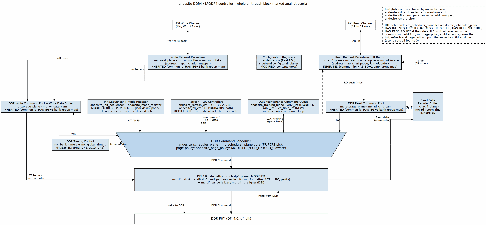

<!-- RTL Design Sherpa Documentation Header -->
<table>
<tr>
<td width="80">
  
</td>
<td>
  <strong>RTL Design Sherpa</strong> · <em>Learning Hardware Design Through Practice</em> 
  
    <a href="https://github.com/sean-galloway/RTLDesignSherpa">GitHub</a> ·
    <a href="https://github.com/sean-galloway/RTLDesignSherpa/blob/main/docs/DOCUMENTATION_INDEX.md">Documentation Index</a> ·
    <a href="https://github.com/sean-galloway/RTLDesignSherpa/blob/main/LICENSE">MIT License</a>
  
</td>
</tr>
</table>

---

<!-- End Header -->

# Block Diagram

## The whole controller, marked against scoria

Read this figure first. The last line of each block's label tells you the size
of this project: INHERITED blocks are scoria's (the common-ip planes), used
as-is; MODIFIED blocks change in named, bounded ways; NEW blocks are new. The dashed box lists the andesite FUBs that are in
`rtl/fub` but not instantiated by `andesite_core` (see the RTL check below).

### Figure 2.1: andesite block diagram, with inheritance marking

**Source:** [01_block_diagram.dot](../assets/graphviz/01_block_diagram.dot)

## Reading the figure

**The front end is entirely INHERITED.** The AXI4 interface — read and write
intakes, the write-data CAM's front side, the burst chopper, the FSM-free
split/aggregate — is untouched by the move to DDR4. Nothing about DDR4 or
LPDDR4 reaches the host side.

**The scheduler is INHERITED in structure, MODIFIED at the edges.** The FR-FCFS
arbiter mechanism, the per-(rank,bank) bank timers and the page policy are
inherited. What turns MODIFIED is bank-group awareness: the address mapper grows
the BG decode, the arbiter and the global timers learn the long/short pairs,
and the scheduler keeps admitting maintenance traffic the way scoria's does —
request/grant, never preempt (family doctrine 2).

**Important:** one inherited detail must be inherited *including its fix*.
scoria's `global_timers` inherited pumice's next-state-function fix (pumice
ISSUE-018: readiness flags published one cycle late, which permitted tCCD and
tRTW violations). andesite inherits the fixed form the same way; a fresh
implementation of the same block from the same description would reintroduce
the bug.

**The MODIFIED maintenance block is refresh, for FGR.** `refresh_ctrl` is
MODIFIED because DDR4's fine-granularity refresh (1x/2x/4x, selected in MR3)
adds a density dimension on top of the mechanism scoria landed with TASK-001
(elastic refresh, TCR, ZQCS placement — the policy base andesite keeps, Ch
3.4). `zq_ctrl` stays INHERITED for DDR4 — DDR4 keeps `ZQCS`/`ZQCL` exactly as
scoria issues them — with a NEW submodule for LPDDR4, whose calibration rides
the MPC command.

**The NEW blocks are three, and all three are bounded.** `odt_ctrl` is new
because dynamic ODT has no scoria counterpart. `rdlvl_ifc` and
`ca_train_ifc` are new because read leveling and LPDDR4 CA/WDQ training have
none. All three are interfaces with telemetry; none contains a search loop.

**`dfi_signal_pack` is carried dormant.** The pack stage
stays a registered pipeline; its DFI 4.0 frequency-ratio variants go
unexercised at this design point. The waking conditions for it and
`powerdown_ctrl` are named in Chapter 3.1.

**RTL check (2026-10-13).** The figure is drawn from `andesite_core`, and two
things in it differ from the text above. First, `andesite_odt_ctrl`,
`andesite_powerdown_ctrl`, `andesite_dfi_signal_pack`, `andesite_addr_mapper`
and `andesite_cmd_arbiter` exist in `rtl/fub` but nothing in `andesite_core`
instantiates them: the pick is the common `mc_cmd_arbiter`, the address map is
the common `mc_addr_mapper` (with `HAS_BG=1`), and the DFI pins come from
`mc_dfi_4p0_plane`. The figure lists them in its dashed box. Second,
`andesite_scheduler_plane` does not override the `HAS_INIT_SEQUENCER`,
`HAS_MODE_REGISTER`, `HAS_REFRESH_CTRL` and `HAS_PAGE_POLICY` parameters of its
`mc_scheduler_plane` core, which default to 1, so the core builds the common
`mc_xddr2_*` and `mc_page_policy` children and ignores the init, refresh and
page-policy inputs the andesite children drive. `scoria_scheduler_plane` sets
all four to 0.

## What the figure deliberately omits

The PHY, because DFI is the boundary. Any training-search state machine,
because the searches live in firmware per the D2 precedent. The DDR5-oriented
signals of DFI v4.x, because andesite does not implement them. Each absence
is named somewhere in this book so it reads as a decision rather than an
oversight.
