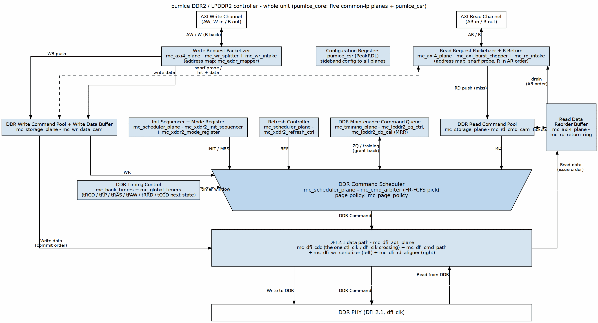

<!-- RTL Design Sherpa Documentation Header -->
<table>
<tr>
<td width="80">
  
</td>
<td>
  <strong>RTL Design Sherpa</strong> · <em>Learning Hardware Design Through Practice</em> 
  
    <a href="https://github.com/sean-galloway/RTLDesignSherpa">GitHub</a> ·
    <a href="https://github.com/sean-galloway/RTLDesignSherpa/blob/main/docs/DOCUMENTATION_INDEX.md">Documentation Index</a> ·
    <a href="https://github.com/sean-galloway/RTLDesignSherpa/blob/main/LICENSE">MIT License</a>
  
</td>
</tr>
</table>

---

<!-- End Header -->

# Block Diagram

## Top-Level Block Diagram

The controller's top-level data and control flow is shown below. AXI4 traffic
enters at top-left into `mc_axi4_plane` (common-ip), which accepts host
transactions, maps addresses, and pushes per-direction descriptors to
`mc_storage_plane` (common-ip). The storage plane holds the write-data and
read-command CAMs and presents the same schedulable-entry view to the
scheduler.

`pumice_core` instantiates the common `mc_scheduler_plane` directly, with its
default children built in: `mc_xddr2_init_sequencer`, `mc_xddr2_mode_register`,
`mc_xddr2_refresh_ctrl` and `mc_page_policy` around the `mc_cmd_arbiter` pick
and the bank / global timers. It instantiates the common `mc_training_plane`
with both LPDDR2 clients enabled: `mc_lpddr2_zq_ctrl` (periodic ZQ
calibration, slot 0) and `mc_lpddr2_dq_cal` (MRR DQ calibration, slot 1)
(`rtl/top/pumice_core.sv:601-611`, `:756-764`). There is no pumice-side
scheduler or training wrapper any more. The `mc_dfi_2p1_plane` (common-ip) crosses the single
controller-to-PHY clock boundary and formats the chosen command into DFI v2.1
wires, while its write serializer and read aligner move write beats out and
return read beats in alignment with the scheduled commands. Returned read data
lands in `mc_rd_return_ring` by ticket in issue order and drains to the AXI R
channel in AR order. `pumice_top`
instantiates `pumice_core` (these five planes) plus the PeakRDL `pumice_csr`
block that drives all configuration by name.

The family architecture — plane contract, descriptor seam, and doctrines — is
documented in
[common_has](../../../../../common-ip/docs/common_has/ch02_architecture/01_plane_stack.md).
Per-block microarchitecture for the common-ip planes is in
[common_mas](../../../../../common-ip/docs/common_mas/common_mas_index.md);
the pumice-specific wrappers and children are covered in the pumice MAS
([scheduler macro](../../pumice_mas/ch02_macros/02_command_scheduler_macro.md),
[training macro](../../pumice_mas/ch02_macros/05_training_plane_macro.md)).

## Data Flow Summary

**Write path:**
1. AXI master issues an AW/W transaction; `mc_axi4_plane` accepts it and
   splits the host burst at DRAM-burst boundaries, producing mapped
   (rank, bank, row, col) descriptors.
2. `mc_storage_plane` fills the write burst into its write-data CAM SRAM and
   records the command; the fill-complete flag gates schedulability and snarf.
3. `mc_scheduler_plane` reads the CAMs' schedulable-entry views each cycle and picks the next
   abstract command (`mc_cmd_arbiter` against the bank and global
   timers, with `mc_page_policy` supplying the open-page decision).
4. In `mc_dfi_2p1_plane`, the command crosses the CDC and the command
   formatter encodes it into DFI cs_n / ras_n / cas_n / we_n / address / bank
   wires (DDR2) or the packed CA bus (LPDDR2); closed-page uses WRA
   (auto-precharge).
5. On the write-fire strobe, the DFI write serializer commit-drains the burst
   from the storage-plane write-data CAM and drives `dfi_wrdata` /
   `dfi_wrdata_en` / `dfi_wrdata_mask` with PHY alignment.
6. On retire, the write CAM slot is freed and `mc_axi4_plane` returns the
   B-response to the AXI master.

**Read path:**
1. AXI master issues an AR transaction; `mc_axi4_plane` accepts and splits
   the burst, producing the mapped descriptor.
2. `mc_storage_plane` records the read command. `mc_axi4_plane` probes the
   write-data CAM: on a snarf hit (unscheduled, same-id, same-BL) the read is
   served directly from the write-data CAM SRAM without going to DRAM
   (read-your-write forwarding).
3. `mc_scheduler_plane` issues ACT, then RD / RDA via `mc_dfi_2p1_plane`.
4. The DFI read aligner drives `dfi_rddata_en` `t_rddata_en` cycles after the
   RD command and captures `dfi_rddata` beats for the burst.
5. The read-command CAM entry was freed at issue; the read's ticket (a
   `mc_rd_return_ring` slot handed out at insert, in AR order) follows it.
   Returned beats land in the ticket's slot in issue order, and the ring
   drains its head in AR order into `mc_rd_intake`, which drives the R
   channel with the original AXI ID.

**Refresh path:**
1. `refresh_ctrl`'s tREFI counter elapses, incrementing the
   `refresh_pending` accumulator (JEDEC max 8 postponed).
2. When `refresh_pending` exceeds the soft threshold, refresh becomes
   highest-priority in the arbiter.
3. For REFab: the scheduler core waits for the addressed banks to be safe,
   then issues REF; the affected timers reload.
4. LPDDR2 per-bank refresh (REFpb) selection is driven by
   `REFRESH_TUNING.refpb_policy_or`.

**Init / power path:**
1. On cold reset, `init_sequencer` holds off AXI traffic.
2. `init_sequencer` executes the memtype-specific JEDEC MR/init sequence,
   driving CKE / RESET_N and issuing MR-write strobes into `mode_register`.
   `mode_register` propagates live CL / CWL / BL / AL to the DFI plane.
3. On completion, `init_done_o` asserts and the scheduler core begins
   servicing AXI traffic.
4. Power-down / self-refresh entry (Active / APD / SR / DPD) is managed by
   `powerdown_ctrl` (present but optional; not in the default top build),
   with SR-entry coordinated with `refresh_ctrl`.

**Post-Phase-2 note (2026-10-09).** Until 2026-10-09 the pumice core used
local `pumice_axi4_plane`, `pumice_dfi_plane`, and a monolithic
`pumice_scheduler_plane`, with the CAMs grouped inside the AXI plane. The
Phase-2 common-IP campaign extracted `mc_axi4_plane`, `mc_storage_plane`,
`mc_scheduler_plane`, `mc_training_plane`, and `mc_dfi_2p1_plane` into
`common-ip`. Pumice first kept thin rock wrappers
(`pumice_scheduler_plane`, `pumice_training_plane`) for its
generation-specific children; those children have since moved into
common-ip too (`mc_xddr2_*`, `mc_lpddr2_*`), and `pumice_core` now
instantiates `mc_scheduler_plane` and `mc_training_plane` directly.

Detailed per-module behavior follows in Chapter 3.
