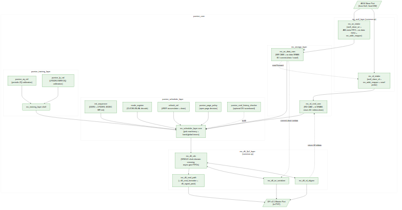

<!-- RTL Design Sherpa Documentation Header -->
<table>
<tr>
<td width="80">
  
</td>
<td>
  <strong>RTL Design Sherpa</strong> · <em>Learning Hardware Design Through Practice</em> 
  
    <a href="https://github.com/sean-galloway/RTLDesignSherpa">GitHub</a> ·
    <a href="https://github.com/sean-galloway/RTLDesignSherpa/blob/main/docs/DOCUMENTATION_INDEX.md">Documentation Index</a> ·
    <a href="https://github.com/sean-galloway/RTLDesignSherpa/blob/main/LICENSE">MIT License</a>
  
</td>
</tr>
</table>

---

<!-- End Header -->

# Block Diagram

## Top-Level Block Diagram

The controller's top-level data and control flow is shown below. AXI4 traffic
enters at top-left into `mc_axi4_layer` (common-ip), which accepts host
transactions, maps addresses, and pushes per-direction descriptors to
`mc_storage_layer` (common-ip). The storage layer holds the write-data and
read-command CAMs and presents the same schedulable-entry view to the
scheduler.

The `pumice_scheduler_layer` is a thin rock-side wrapper around the common
`mc_scheduler_layer` core; its rock children are `init_sequencer`,
`mode_register`, `refresh_ctrl`, `pumice_page_policy`, and the optional
`pumice_cmd_history_checker`. The `pumice_training_layer` is a similar thin
wrapper around the common `mc_training_layer` shell, carrying the rock-side
`pumice_zq_ctrl` (periodic ZQ calibration) and `pumice_lp_cal` (LPDDR2 MRR DQ
calibration) FUBs. The `mc_dfi_2p1_layer` (common-ip) crosses the single
controller-to-PHY clock boundary and formats the chosen command into DFI v2.1
wires, while its write serializer and read aligner move write beats out and
return read beats in alignment with the scheduled commands. `pumice_top`
instantiates `pumice_core` (these five layers) plus the PeakRDL `pumice_csr`
block that drives all configuration by name.

The family architecture — layer contract, descriptor seam, and doctrines — is
documented in
[common_has](../../../../../common-ip/docs/common_has/ch02_architecture/01_layer_stack.md).
Per-block microarchitecture for the common-ip layers is in
[common_mas](../../../../../common-ip/docs/common_mas/common_mas_index.md);
the pumice-specific wrappers and children are covered in the pumice MAS
([scheduler macro](../../pumice_mas/ch02_macros/02_command_scheduler_macro.md),
[training macro](../../pumice_mas/ch02_macros/05_training_layer_macro.md)).

**Source:** [01_block_diagram.mmd](../assets/mermaid/01_block_diagram.mmd)

## Data Flow Summary

**Write path:**
1. AXI master issues an AW/W transaction; `mc_axi4_layer` accepts it and
   splits the host burst at DRAM-burst boundaries, producing mapped
   (rank, bank, row, col) descriptors.
2. `mc_storage_layer` fills the write burst into its write-data CAM SRAM and
   records the command; the fill-complete flag gates schedulability and snarf.
3. `pumice_scheduler_layer` queries the CAMs each cycle and picks the next
   abstract command (`mc_scheduler_layer` core against the bank and global
   timers, with `pumice_page_policy` supplying the open-page decision).
4. In `mc_dfi_2p1_layer`, the command crosses the CDC and the command
   formatter encodes it into DFI cs_n / ras_n / cas_n / we_n / address / bank
   wires (DDR2) or the packed CA bus (LPDDR2); closed-page uses WRA
   (auto-precharge).
5. The DFI signal packer aggregates the per-phase DFI control bus.
6. On the write-fire strobe, the DFI write serializer commit-drains the burst
   from the storage-layer write-data CAM and drives `dfi_wrdata` /
   `dfi_wrdata_en` / `dfi_wrdata_mask` with PHY alignment.
7. On retire, the write CAM slot is freed and `mc_axi4_layer` returns the
   B-response to the AXI master.

**Read path:**
1. AXI master issues an AR transaction; `mc_axi4_layer` accepts and splits
   the burst, producing the mapped descriptor.
2. `mc_storage_layer` records the read command. `mc_axi4_layer` probes the
   write-data CAM: on a snarf hit (unscheduled, same-id, same-BL) the read is
   served directly from the write-data CAM SRAM without going to DRAM
   (read-your-write forwarding).
3. `pumice_scheduler_layer` issues ACT, then RD / RDA via `mc_dfi_2p1_layer`.
4. The DFI read aligner drives `dfi_rddata_en` `t_rddata_en` cycles after the
   RD command and captures `dfi_rddata` beats for the burst.
5. Returned beats fill the storage-layer read-command CAM; its oldest-first
   drain engine (gated on data-ready) streams them back out, tagged with the
   original AXI ID, on the R channel.

**Refresh path:**
1. `refresh_ctrl`'s tREFI counter elapses, incrementing the
   `refresh_pending` accumulator (JEDEC max 8 postponed).
2. When `refresh_pending` exceeds the soft threshold, refresh becomes
   highest-priority in the arbiter.
3. For REFab: the scheduler core waits for the addressed banks to be safe,
   then issues REF; the affected timers reload.
4. LPDDR2 per-bank refresh (REFpb) selection is driven by
   `REFRESH_TUNING.refpb_policy_or`.

**Init / power path:**
1. On cold reset, `init_sequencer` holds off AXI traffic.
2. `init_sequencer` executes the memtype-specific JEDEC MR/init sequence,
   driving CKE / RESET_N and issuing MR-write strobes into `mode_register`.
   `mode_register` propagates live CL / CWL / BL / AL to the DFI layer.
3. On completion, `init_done_o` asserts and the scheduler core begins
   servicing AXI traffic.
4. Power-down / self-refresh entry (Active / APD / SR / DPD) is managed by
   `powerdown_ctrl` (present but optional; not in the default top build),
   with SR-entry coordinated with `refresh_ctrl`.

**Post-Phase-2 note (2026-10-09).** Until 2026-10-09 the pumice core used
local `pumice_axi4_layer`, `pumice_dfi_layer`, and a monolithic
`pumice_scheduler_layer`, with the CAMs grouped inside the AXI layer. The
Phase-2 common-IP campaign extracted `mc_axi4_layer`, `mc_storage_layer`,
`mc_scheduler_layer`, `mc_training_layer`, and `mc_dfi_2p1_layer` into
`common-ip`. Pumice now instantiates the common layers and retains thin
rock wrappers (`pumice_scheduler_layer`, `pumice_training_layer`) for its
generation-specific children.

Detailed per-module behavior follows in Chapter 3.
