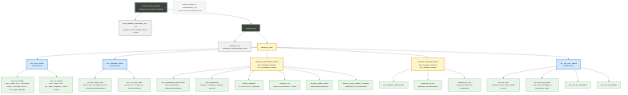

<!-- RTL Design Sherpa Documentation Header -->
<table>
<tr>
<td width="80">
  <a href="https://github.com/sean-galloway/RTLDesignSherpa">
    
  </a>
</td>
<td>
  <strong>RTL Design Sherpa</strong> · <em>Learning Hardware Design Through Practice</em><br>
  <sub>
    <a href="https://github.com/sean-galloway/RTLDesignSherpa">GitHub</a> ·
    <a href="https://github.com/sean-galloway/RTLDesignSherpa/blob/main/docs/DOCUMENTATION_INDEX.md">Documentation Index</a> ·
    <a href="https://github.com/sean-galloway/RTLDesignSherpa/blob/main/LICENSE">MIT License</a>
  </sub>
</td>
</tr>
</table>

---

<!-- End Header -->

# Module Hierarchy

The controller is decomposed into **five planes under `pumice_core`**:
`mc_axi4_plane`, `mc_storage_plane`, `pumice_scheduler_plane`,
`pumice_training_plane`, and `mc_dfi_2p1_plane`. The first, second, and fifth
are shared common-ip planes; `pumice_scheduler_plane` and
`pumice_training_plane` are thin pumice-specific wrappers around the common
`mc_scheduler_plane` core and `mc_training_plane` shell. Each FUB is
independently verified at the unit level; each plane is verified as an
integration ("macro") unit. See [FUB Breakdown](05_fub_breakdown.md) for the
per-FUB role descriptions and [Chapter 3](../ch03_architecture/) for the
behavioral details.

## Hierarchy Tree



**Source:** [02_module_hierarchy.mmd](../assets/mermaid/02_module_hierarchy.mmd)

## Planeed Organization

```
SoC level
└── pumice_top_geared            ← OPTIONAL host-width wrapper
    │                              (axi4_dwidth_converter_wr/_rd when HOST != DW)
    └── pumice_top               ← instantiated by the SoC
        ├── pumice_csr           ← PeakRDL passthrough cpuif register block
        └── pumice_core          ← the controller proper
            ├── mc_axi4_plane            ← common-ip; host AXI + descriptor push
            ├── mc_storage_plane         ← common-ip; wr/rd CAMs + bank image
            ├── pumice_scheduler_plane   ← thin wrapper around common mc_scheduler_plane
            ├── pumice_training_plane    ← thin wrapper around common mc_training_plane
            └── mc_dfi_2p1_plane         ← common-ip; single CDC + DFI v2.1 datapath
```

The single controller-to-PHY clock crossing for the datapaths lives inside
`mc_dfi_2p1_plane` (common-ip async FIFOs only). The training plane owns one
small sideband crossing of its own (`cal_expect` down, captured MRR data up)
for the read aligner's calibration capture — see
[Training](../ch03_architecture/09_training.md). The host AXI interface, CAMs,
and command scheduler all run on `aclk`; the DFI command path, write serializer,
and read aligner run on `dfi_clk`.

## Plane Groupings

| Plane / macro | Ownership | FUBs |
|---|---|---|
| `mc_axi4_plane` | common-ip | AXI4 slave intakes, shallow FIFOs, burst chop/split, final coalescing, read-data return endpoint ([common_mas ch02](../../../../../common-ip/docs/common_mas/ch02_axi4_plane/01_mc_axi4_plane.md)) |
| `mc_storage_plane` | common-ip | wr/rd CAMs, read snooping, per-bank open-row image ([common_mas ch03](../../../../../common-ip/docs/common_mas/ch03_storage_plane/01_mc_storage_plane.md)) |
| `pumice_scheduler_plane` | pumice wrapper | `mc_scheduler_plane` core ([common_mas ch04](../../../../../common-ip/docs/common_mas/ch04_scheduler_plane/01_mc_scheduler_plane.md)); rock children `init_sequencer`, `mode_register`, `refresh_ctrl`, `pumice_page_policy`, `pumice_cmd_history_checker` |
| `pumice_training_plane` | pumice wrapper | `mc_training_plane` shell ([common_mas ch05](../../../../../common-ip/docs/common_mas/ch05_training_plane/01_mc_training_plane.md)); rock children `pumice_zq_ctrl`, `pumice_lp_cal` |
| `mc_dfi_2p1_plane` | common-ip | single CDC, command formatter/pipeline, write serializer, read aligner ([common_mas ch07](../../../../../common-ip/docs/common_mas/ch07_dfi_2p1_plane/01_mc_dfi_2p1_plane.md)) |
| `pumice_core` | pumice | wraps the five planes above |

Also present in the tree but not in the default top build: `page_predictor`
and `powerdown_ctrl` (referenced / optional; verify against the filelists in
`rtl/filelists/`).

Chapter 3 follows the plane ordering (one section per architectural plane,
with module names hyperlinked to their MAS chapters).

## Memtype-Conditional Logic

Memtype (DDR2 vs LPDDR2) is a runtime CSR selection (`PHY_TIMING.memtype`),
not an elaboration parameter. The memtype-dependent logic lives in:

- **`mc_dfi_2p1_plane`** — its command formatter contains a memtype branch:
  DDR2 drives ras/cas/we; LPDDR2 packs the 10-bit JESD209-2F CA-bus command
  (two edges) onto `dfi_address` ([common_mas ch07](../../../../../common-ip/docs/common_mas/ch07_dfi_2p1_plane/01_mc_dfi_2p1_plane.md)).
- **`init_sequencer`** (rock child inside `pumice_scheduler_plane`) — runs the
  DDR2 or LPDDR2 JEDEC MR/init sequence.
- **`mode_register`** (rock child inside `pumice_scheduler_plane`) — CL / CWL /
  BL / AL decode differs by memtype.
- **`pumice_training_plane`** — both FUBs gate on `memtype == MEMTYPE_LPDDR2`;
  DDR2 has no ZQ pin and no MRR, so the plane is inert for DDR2 builds.

Both memtypes pass the full simulation suite.

## Clock-Domain Crossings

The datapath clock-domain crossing is exactly one: the CDC inside
`mc_dfi_2p1_plane`, built from asynchronous gaxi FIFOs. One FIFO word is one
DFI cycle, so the command / write-data / read-data datapaths are bubble-free.
Everything up to the CDC is on `aclk`; everything past it is on `dfi_clk`.

The training plane adds one narrow sideband crossing (`sync_pulse` /
`cdc_synchronizer`, not FIFOs): `cal_expect` down to `dfi_clk` to arm the read
aligner's calibration capture, and the captured MRR beat back up to `aclk`.
It carries no datapath traffic — see Chapter 3.9.

## What Changed vs the Earlier Architecture

The controller was rearchitected from an earlier FSM-based, elaboration-time
decomposition into a three-plane, CSR-driven design. Until 2026-10-09 that
design was implemented with pumice-local planes
(`pumice_axi4_plane`, `pumice_scheduler_plane`, `pumice_dfi_plane`) and did
not separate the CAM pool into a distinct storage plane. The 2026-10-09
Phase-2 common-IP campaign extracted the shared memory-controller logic into
`common-ip` (`mc_axi4_plane`, `mc_storage_plane`, `mc_scheduler_plane`,
`mc_training_plane`, and `mc_dfi_2p1_plane`); pumice retained thin rock
wrappers (`pumice_scheduler_plane`, `pumice_training_plane`) for its
generation-specific children. See the family architecture in
[common_has](../../../../../common-ip/docs/common_has/ch02_architecture/01_plane_stack.md).

Notable changes across both transitions:

- **Retired**: `txn_queue`, `bank_machine`, `xbank_timers`, `cmd_encoder`,
  `odt_ctrl`, `scheme selector`, the `*_macro`-as-architecture names,
  `axi_intake`/`axi_frontend`, and the pumice-local plane names
  `pumice_axi4_plane` and `pumice_dfi_plane`.
- **Replaced by / moved to common-ip**: the two CAMs
  (`mc_wr_data_cam` + `mc_rd_cmd_cam`, now in `mc_storage_plane`),
  FSM-free `bank_timer` (stamped by `mc_scheduler_plane`), `mc_global_timers`,
  `dfi_cmd_formatter` (+ `dfi_signal_pack`, now in `mc_dfi_2p1_plane`), and
  the single `ADDR_MAP.bank_lsb` knob.
- **Introduced**: the distinct `mc_storage_plane`, the common single-CDC
  `mc_dfi_2p1_plane`, the common `mc_training_plane` shell, the PeakRDL
  `pumice_csr` block (configuration by name), and the optional
  `pumice_top_geared` host-width wrapper.
