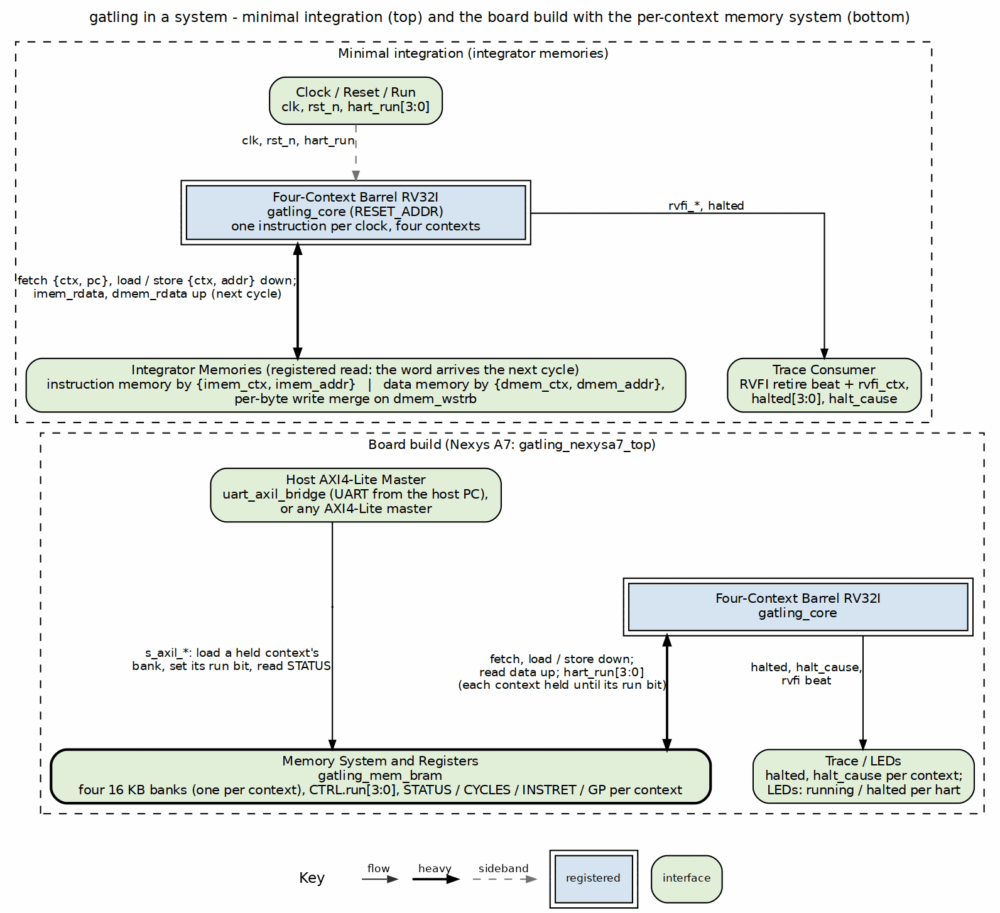

<!-- RTL Design Sherpa Documentation Header -->
<table>
<tr>
<td width="80">
  
</td>
<td>
  <strong>RTL Design Sherpa</strong> · <em>Learning Hardware Design Through Practice</em> 
  
    <a href="https://github.com/sean-galloway/RTLDesignSherpa">GitHub</a> ·
    <a href="https://github.com/sean-galloway/RTLDesignSherpa/blob/main/docs/DOCUMENTATION_INDEX.md">Documentation Index</a> ·
    <a href="https://github.com/sean-galloway/RTLDesignSherpa/blob/main/LICENSE">MIT License</a>
  
</td>
</tr>
</table>

---

# Introduction

gatling is the per-tetrad compute engine of the tile (PRD 1): one RV32I processor with four hardware contexts, one per cell of the tetrad, sharing one datapath. The four contexts run four independent programs. Each context executes one instruction per four clocks; together they execute one per clock.

The organization is the oldest form of hardware multithreading. Thornton's CDC 6600 ran its ten peripheral processors through one shared execution unit in strict rotation (papers, entry 16; H&P6 App. M.5), the Denelcor HEP let a process issue only when its previous instruction had left the pipeline (papers, entry 17), and the textbooks name the scheme fine-grained multithreading: switch threads every cycle, round-robin (H&P6 §3.11; P&H §6.4; H&H §7.7.7). The textbooks present the interleave as a way to hide stalls. gatling fixes the thread count equal to the pipeline depth, and at that point the hazards are not hidden but gone; the barrel model [REF-3] works through the argument with measurements.

This first build is the RV32I barrel (owner, 2026-10-21). The Xcell extension -- the custom-0 instructions that move data between a context and its cell (PRD 3.1) -- is reserved and arrives with the cell seam. On the Nexys A7 the four contexts run the riscv-tests rv32ui battery at once, four different programs side by side.

### Figure 1.1: gatling in a system

The top region is the minimal integration: `gatling_core` with two integrator-provided registered-read memories, addressed by context and address, and a trace consumer on the RVFI port. The bottom region is the board build: `gatling_mem_bram` supplies one 16 KB bank per context, the per-context run bits and the status registers, and a host (the UART-to-AXI4-Lite bridge on the Nexys A7, or any AXI4-Lite master) loads a held context's bank and releases it, while the other contexts keep running.
