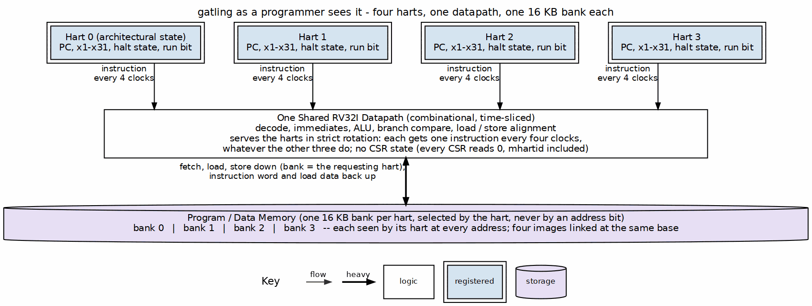

<!-- RTL Design Sherpa Documentation Header -->
<table>
<tr>
<td width="80">
  
</td>
<td>
  <strong>RTL Design Sherpa</strong> · <em>Learning Hardware Design Through Practice</em> 
  
    <a href="https://github.com/sean-galloway/RTLDesignSherpa">GitHub</a> ·
    <a href="https://github.com/sean-galloway/RTLDesignSherpa/blob/main/docs/DOCUMENTATION_INDEX.md">Documentation Index</a> ·
    <a href="https://github.com/sean-galloway/RTLDesignSherpa/blob/main/LICENSE">MIT License</a>
  
</td>
</tr>
</table>

---

# Programmer's Model

## Contexts

Each context is a complete RV32I hart: a PC, registers x0-x31 and its own program/data memory. A program cannot see the other contexts' registers or memory, and cannot tell which context it runs on (context visibility is implicit, PRD 7). All four start at the same RESET_ADDR.

### Figure 2.1: What a program sees

Each hart's state is its own; the datapath exists once and serves the harts in strict rotation, so a hart's timing depends on nothing the other three do. The bank a hart sees is selected by the hart, never by an address bit, which is why four images linked at the same base run side by side.

## ISA

RV32I exactly as kestrel implements it (PRD 3, [REF-7]): every base instruction (unpriv §2.1); FENCE (unpriv §2.1.7) and FENCE.I (Zifencei, unpriv §4.1) retire as no-ops; MRET (priv §3.3.2) falls through to the next instruction. Self-modifying code works without FENCE.I: a store is visible to the context's next fetch, which is the ordering Zifencei exists to provide.

## CSRs

There is no CSR state. Every CSR instruction (Zicsr, unpriv §4.2) reads zero and discards its write, without trapping -- the Zicntr counters (`rdcycle`, `rdtime`, `rdinstret`; unpriv §4.3) and `mhartid` (priv §3.1.5) included, so a program cannot tell which context it is (by design, PRD 7). There is no trap vector (`mtvec`, priv §3.1.7, is accepted and ignored), and `WFI` (priv §3.3.3) is illegal. PRD 3.3 lists these departures from the RISC-V specification and why.

## Halts

There are no traps. The exceptions the ISA defines -- instruction-address-misaligned (unpriv §2.1.5), load- and store-address-misaligned (unpriv §2.1.6), ECALL and EBREAK (unpriv §2.1.8) and illegal instruction (priv §3.1.15) -- stop the context that raises them, and only that context (context-lock, PRD 7):

| Cause | Event |
|---|---|
| 1 | ECALL |
| 2 | EBREAK |
| 3 | Taken branch, JAL or JALR to an address that is not 4-byte aligned |
| 4 | Misaligned load (LH/LHU off a half-word, LW off a word) |
| 5 | Misaligned store |
| 0xF | Illegal instruction (including the custom-0 opcode until Xcell is built) |

: Table 2.1: Halt causes (kestrel's encoding)

The halting instruction does not write a register or memory. The riscv-tests verdict on a context is its last write to gp (x3) at the ECALL halt: 1 is a pass.

## Timing a program can rely on

None, by design: a context's speed depends on nothing it does. Every instruction -- ALU, load, store, taken or not-taken branch -- takes exactly four clocks of its context, whatever the other contexts are doing.
