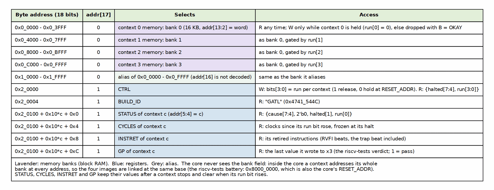

<!-- RTL Design Sherpa Documentation Header -->
<table>
<tr>
<td width="80">
  
</td>
<td>
  <strong>RTL Design Sherpa</strong> · <em>Learning Hardware Design Through Practice</em> 
  
    <a href="https://github.com/sean-galloway/RTLDesignSherpa">GitHub</a> ·
    <a href="https://github.com/sean-galloway/RTLDesignSherpa/blob/main/docs/DOCUMENTATION_INDEX.md">Documentation Index</a> ·
    <a href="https://github.com/sean-galloway/RTLDesignSherpa/blob/main/LICENSE">MIT License</a>
  
</td>
</tr>
</table>

---

# Interfaces

## Core memory ports

`gatling_core` has an instruction port and a data port, each carrying the requesting context. Both expect registered-read memory: the data is used exactly one cycle after the request, and nothing waits (there is no wait input).

| Port | Signals | Contract |
|---|---|---|
| Instruction | `imem_ctx`, `imem_addr` -> `imem_rdata` | The word at {ctx, addr} the next cycle |
| Data | `dmem_req`, `dmem_ctx`, `dmem_addr`, `dmem_wstrb`, `dmem_wdata` -> `dmem_rdata` | Word-aligned address, lane strobes; a load's word the next cycle |
| Run | `hart_run[NUM_HARTS-1:0]` (four by default) | Per context: 1 run, 0 hold at RESET_ADDR |
| Status | `halted[3:0]`, `halt_cause[3:0][3:0]` | Per context |
| Retire | `rvfi_*`, `rvfi_ctx` | riscv-formal RVFI, one beat per cycle at most, tagged with its context |

: Table 3.1: gatling_core interfaces

## Board memory map (gatling_mem_bram, over UART -> AXI4-Lite)

| Address | Name | Access |
|---|---|---|
| 0x0_0000 + 0x4000*c | context c memory (16 KB; addr[16] aliases) | R any time; W only while context c is stopped (dropped otherwise) |
| 0x2_0000 | CTRL | W bits[3:0] run per context; R {halted[7:4], run[3:0]} |
| 0x2_0004 | BUILD_ID | R "GATL" (0x4741_544C) |
| 0x2_0100 + 0x10*c | STATUS, CYCLES, INSTRET, GP of context c | R; kept after a stop, cleared when the context is started |

: Table 3.2: Board memory map

### Figure 3.1: The board address map

A host loads a context by stopping it, writing its bank and setting its run bit; the other contexts can keep running throughout. The host driver is `projects/fpga-systems/NexysA7/riscv-ip/gatling/bin/gatling_board.py`.
