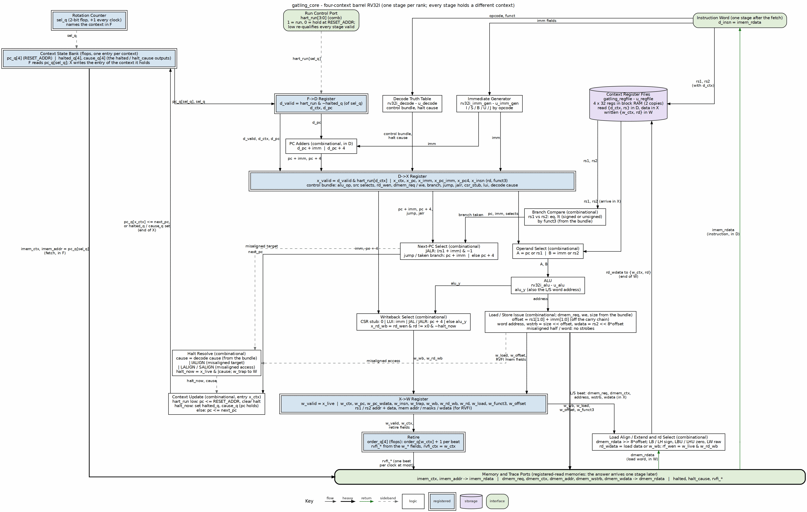

<!-- RTL Design Sherpa Documentation Header -->
<table>
<tr>
<td width="80">
  
</td>
<td>
  <strong>RTL Design Sherpa</strong> · <em>Learning Hardware Design Through Practice</em> 
  
    <a href="https://github.com/sean-galloway/RTLDesignSherpa">GitHub</a> ·
    <a href="https://github.com/sean-galloway/RTLDesignSherpa/blob/main/docs/DOCUMENTATION_INDEX.md">Documentation Index</a> ·
    <a href="https://github.com/sean-galloway/RTLDesignSherpa/blob/main/LICENSE">MIT License</a>
  
</td>
</tr>
</table>

---

# Overview

## Machine organization

gatling is one RV32I datapath shared by four hardware contexts. Each context owns a PC, a 32-entry register file, a halt state (halted, cause) and a run bit; everything else -- decode, immediates, ALU, branch comparator, load/store alignment -- exists once. That is the replicated architectural state of hardware multithreading as the textbooks define it: "it replicates only the PC and register file, not the execution units and memories" (H&H §7.7.7).

The contexts (`NUM_HARTS`, four by default: the tetrad) are interleaved through a four-stage pipeline in strict rotation. A counter, `sel_q`, names the context in F; D, X and W hold the contexts one, two and three before it. Every cycle each stage holds a different context, so a context has exactly one instruction in flight. That single fact removes every hazard a pipeline normally has to manage:

| Hazard | Why it cannot happen |
|---|---|
| Data (RAW) | A context's next instruction is in D at t+5; its previous instruction wrote its register at the end of W, t+3 |
| Control | The branch target is written to the context's PC at the end of X, t+2; the next fetch is at t+4 |
| Structural | Each stage is used by one context per cycle; each memory port by one stage |

: Table 1.1: Hazards the rotation removes by construction

These are the three hazard classes of the pipelining chapters (P&H §4.8-4.9; H&P6 App. C), and the textbook answer to each -- forwarding, stalls, prediction and flushes -- is machinery gatling does not contain. The rotation is fine-grained multithreading (H&P6 §3.11; P&H §6.4) with one departure: a held or halted context's slot stays empty rather than being given to another context (chapter 4), because a context that issued early would have two instructions in flight and the hazards would return. The lineage, from the CDC 6600 peripheral processors through the HEP to Niagara, is in the barrel model [REF-6] and the reading list [REF-11].

Each context retires one instruction per window (CPI 4); with all four running the core retires one instruction per clock.

## The machine in one picture

### Figure 1.1: gatling datapath block diagram

The figure is drawn from `gatling_core.sv`: the ranks are the four stages, the blue double-bordered rows between them are the stage registers, and every block names its RTL. Requests go down to the memory bar (the fetch address from the context bank on the left, the load/store beat from X in the center) and the answers climb back one stage later on their own lanes: the instruction word up the right edge into D, the load word into W. The two feedback climbs are the architectural writes: the context update into the context bank at the end of X, and the register write into the register files at the end of W. There are no hazard or forwarding lanes to draw, because each context has one instruction in flight.

## What is reused

gatling's ISA contract is kestrel's (PRD 3): the same opcode map, the same trap/halt causes, the same CSR stub, FENCE/FENCE.I as NOPs, MRET falling through. The blocks that implement it are the `riscv-ip/common-rv32i` blocks kestrel also instantiates, used unchanged through their own filelists (`$RV32I_COMMON_ROOT`): `rv32i_decode`, `rv32i_imm_gen`, `rv32i_alu` and `rv32i_pkg`. One ISA has one source; a fix to the shared decode is a fix to both cores.

New for the barrel: `gatling_core` (the rotation, the per-context state and the stage registers), `gatling_regfile` (four register files in one block RAM) and `gatling_mem_bram` (one memory bank per context, the AXIL loader, per-context run and status).

## Owner decisions this build implements

| Decision (PRD v0.3) | As built |
|---|---|
| Context visibility: implicit | No context-ID read; software cannot tell contexts apart |
| Program placement: separate | One 16 KB program/data bank per context, seen at every address |
| Illegal instruction: context-lock | Every halt stops only its context; the other three keep running |
| Scope: RV32I barrel first | Xcell (custom-0) decodes as illegal until the cell seam exists |

: Table 1.2: PRD decisions realized in the RTL
