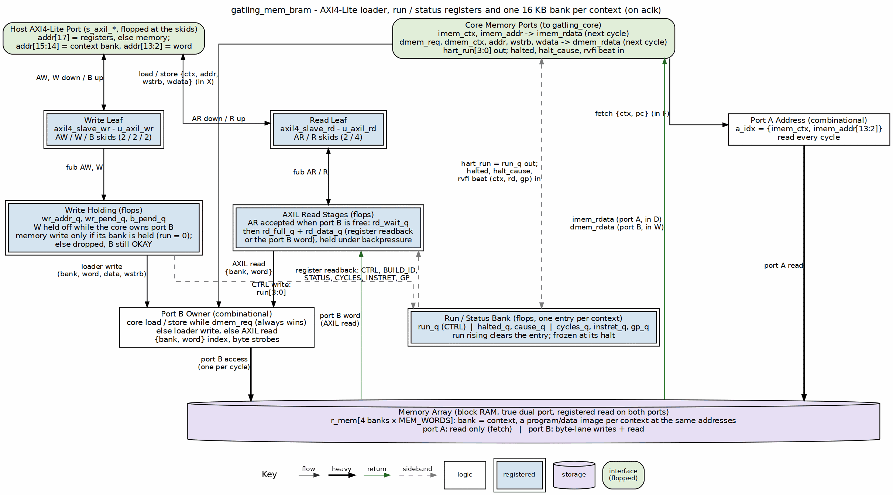

<!-- RTL Design Sherpa Documentation Header -->
<table>
<tr>
<td width="80">
  
</td>
<td>
  <strong>RTL Design Sherpa</strong> · <em>Learning Hardware Design Through Practice</em> 
  
    <a href="https://github.com/sean-galloway/RTLDesignSherpa">GitHub</a> ·
    <a href="https://github.com/sean-galloway/RTLDesignSherpa/blob/main/docs/DOCUMENTATION_INDEX.md">Documentation Index</a> ·
    <a href="https://github.com/sean-galloway/RTLDesignSherpa/blob/main/LICENSE">MIT License</a>
  
</td>
</tr>
</table>

---

# gatling_mem_bram

## Purpose

The board's memory system: one program/data bank per context in one true-dual-port block RAM, the AXIL loader, per-context run control and per-context status registers. Derived from `kestrel_mem_bram`: the same AXIL leaves, the same load/run discipline and the same register semantics, widened to four contexts.

### Figure 2.2: gatling_mem_bram composition

The host's AXI4-Lite port is the left column and the core's memory ports the right one; the four-bank true-dual-port array is the bar. Port A is the core's fetch port and nothing else. Port B is shared: the core's load/store when it has one (it always wins), else a loader write, else an AXIL read. Every read is registered, which is exactly the one stage the barrel allows. The run/status bank is sideband: it owns `hart_run` and collects each context's halt and retire events for the STATUS registers.

## Memory

`MEM_WORDS` words per context (default 4096, 16 KB), indexed `{ctx, word}`. A context's bank is its whole address space -- the bank index is the context, never an address bit -- so four images linked at the same base (the riscv-tests link at 0x8000_0000) load side by side.

- Port A fetches: `{imem_ctx, imem_addr}` in F, the word in D.
- Port B is the core's data port while a context's load or store is in X (word in W), and the loader's otherwise. The core always wins; the loader waits a cycle (W is held off while the core owns port B).
- A store and a fetch never touch the same word on one edge: they belong to different contexts, so different banks.

## Loader rules

A loader write lands only in a bank whose context is held (run = 0); a write to a running context's bank is acknowledged and dropped, as kestrel's loader drops writes while running. Reads are served any time port B is free. So one context can be reloaded and restarted while the other three run.

## Register map

| Address | Name | Description |
|---|---|---|
| 0x2_0000 | CTRL | W: bits[NUM_HARTS-1:0] run per context. R: {halted, run}, NUM_HARTS bits each ({halted[7:4], run[3:0]} for four) |
| 0x2_0004 | BUILD_ID | ASCII "GATL" (0x4741_544C) |
| 0x2_0100 + 0x10*c | STATUS | {cause[7:4], halted[1], run[0]} for context c |
| +0x4 | CYCLES | Clocks since its run was set, frozen at its halt |
| +0x8 | INSTRET | Its retired instructions (RVFI beats, the trap beat included) |
| +0xC | GP | The last value it wrote to x3: the riscv-tests verdict |

: Table 2.4: gatling_mem_bram registers (addr[17] = 1; memory below, bank in addr[15:14])

Status holds its values after the context is stopped and clears when its run bit rises.
