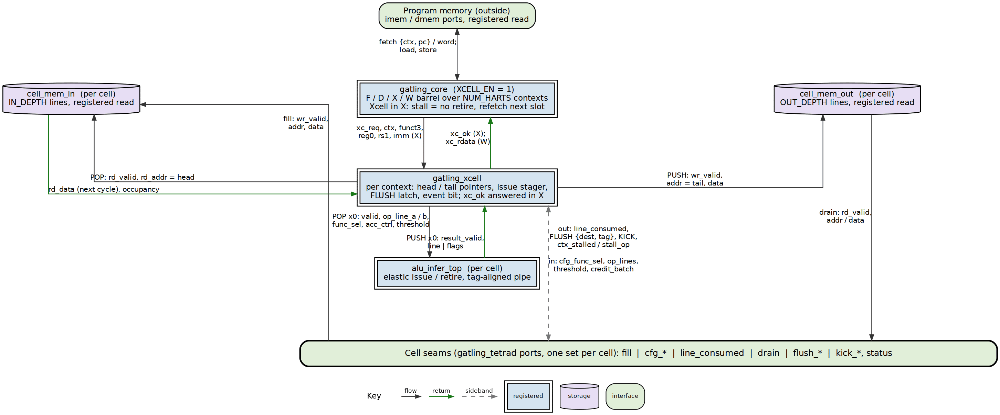

<!-- RTL Design Sherpa Documentation Header -->
<table>
<tr>
<td width="80">
  
</td>
<td>
  <strong>RTL Design Sherpa</strong> · <em>Learning Hardware Design Through Practice</em> 
  
    <a href="https://github.com/sean-galloway/RTLDesignSherpa">GitHub</a> ·
    <a href="https://github.com/sean-galloway/RTLDesignSherpa/blob/main/docs/DOCUMENTATION_INDEX.md">Documentation Index</a> ·
    <a href="https://github.com/sean-galloway/RTLDesignSherpa/blob/main/LICENSE">MIT License</a>
  
</td>
</tr>
</table>

---

# gatling_tetrad

## Purpose

gatling sequencing its tetrad's cells: `gatling_core` with `XCELL_EN = 1`, `gatling_xcell`, and per context the three cell blocks the Xcell instructions reach, from compute-eng-ip -- `cell_mem_in`, `alu_infer_top` and `cell_mem_out` -- each brought in through its own filelist.

### Figure 2.3: gatling_tetrad

## What is outside

The rest of the cell does not exist yet (compute-eng-ip cell TASK-001/002): the delta node and rx demux that fill the input memory, the packetizer that drains the result memory, the credit block and the cfg registers. Their seams are this module's ports (HAS Table 3.2), so the tile's tetrad can wire them without changing gatling. The program memory is outside as well, on the core's imem / dmem ports, as in every gatling build.

## Reset

A `reset_sync` (N = 3) gives the Xcell unit and the cell blocks a synchronized reset; the core synchronizes its own `rst_n` as it always has. The cell side leaves reset first, so the core never sees an unreset cell.

## Parameters

| Parameter | Default | Meaning |
|---|---|---|
| `NUM_HARTS` | 4 | contexts = cells |
| `RESET_ADDR` | 0 | every context's reset PC |
| `IN_DEPTH`, `OUT_DEPTH` | 32 | lines per cell memory (the cell's defaults) |
| `ALU_EN_INT8` .. `ALU_EN_CVT` | 1 | alu-infer's build-out switches, passed through; the bf16 base rows are always built |

: Table 2.6: gatling_tetrad parameters

The DV top builds the ALU without the families the tetrad tests do not use (`ALU_FULL = 0`); alu-infer's own suite verifies them, and leaving them out keeps the Verilator build short enough to run every case at every level.

## Implementation (xc7a100t-1, out of context, 10 ns, 0.2 ns uncertainty)

| Build | Result |
|---|---|
| `gatling_xcell` alone | 383 LUT, 687 FF; WNS +4.002 ns (4 levels) |
| `gatling_tetrad`, bf16-only ALU, endpoints inside the ALU excluded | WNS +0.144 ns; worst path a cell's `result_valid` -> `xc_ok` -> the result memory's write enable (9 levels, 80% route) |
| `gatling_tetrad`, bf16-only ALU, everything timed | WNS -128.8 ns: operand register -> alu-infer's bf16 rows (211 levels) |
| `gatling_tetrad`, full ALU | 95.6k LUT as logic: does not fit the xc7a100t (63.4k) |

: Table 2.7: gatling_tetrad implementation (2026-11-26)

gatling's own logic closes 100 MHz. Two things that are not gatling's set the tetrad's real size and speed: alu-infer's rows are combinational at their default latencies (the 211-level path; pipelining them is alu-infer's), and the cell memories (`cell_mem_in`, `cell_mem_out`) write their arrays inside a reset block, so each 32-line memory is about 1,060 flops instead of a distributed RAM, and PUSH's write enable fans out across them.
