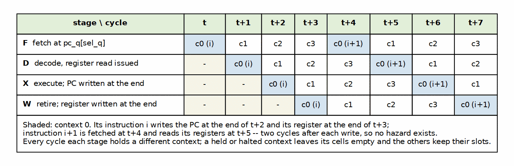
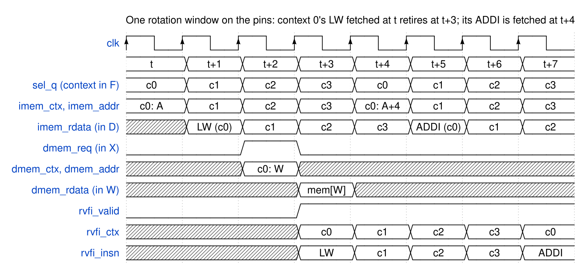

<!-- RTL Design Sherpa Documentation Header -->
<table>
<tr>
<td width="80">
  
</td>
<td>
  <strong>RTL Design Sherpa</strong> · <em>Learning Hardware Design Through Practice</em> 
  
    <a href="https://github.com/sean-galloway/RTLDesignSherpa">GitHub</a> ·
    <a href="https://github.com/sean-galloway/RTLDesignSherpa/blob/main/docs/DOCUMENTATION_INDEX.md">Documentation Index</a> ·
    <a href="https://github.com/sean-galloway/RTLDesignSherpa/blob/main/LICENSE">MIT License</a>
  
</td>
</tr>
</table>

---

# Micro-Architecture Behavior

## The rotation, cycle by cycle

### Figure 4.1: The rotation, cycle by cycle

Context c0's instruction i is fetched at t, decoded at t+1, executed at t+2 (its PC written at the end of t+2) and retired at t+3 (its register written at the end of t+3). Instruction i+1 is fetched at t+4 from the PC written two cycles earlier, and reads its registers at t+5, two cycles after the write. Consecutive retirements of one context are exactly four cycles apart; with all four running, retirements follow the rotation order, one per clock.

A context that is held or halted leaves its slot empty: the other contexts are not shifted into it, so each still retires once per window. This is measured: in DV every context's consecutive beats are checked to be four cycles apart, and on gatling_mem_bram a context's CYCLES/INSTRET is 4.000.

The empty slot is the one place gatling departs from fine-grained multithreading as the textbooks describe it, where round-robin issue "skips any threads that are stalled at that time" (H&P6 §3.11; P&H §6.4) and Niagara does exactly that (papers, entry 20). Skipping would let the next instruction of a running context enter the pipeline fewer than four cycles behind its last, and the hazard logic the barrel exists to remove would come back (PRD 3.3). The HEP had the same rule in a different form: a process could issue only once its previous instruction had left the pipeline (papers, entry 17).

## The rotation on the pins

### Waveform 4.1: One rotation window on the pins

The same window as the grid, on `gatling_core`'s ports. `sel_q` walks c0, c1, c2, c3 and the fetch port follows it; the fetched word is on `imem_rdata` one cycle after its address, which is the D stage of the context that asked for it. Context 0's LW issues its data access at t+2 (`dmem_req`, tagged `dmem_ctx = c0`), the word arrives at t+3 and the beat retires that cycle with `rvfi_ctx = c0`. From t+3 on, one beat retires every clock, in rotation order; context 0's next instruction, the ADDI at A+4, is fetched at t+4 from the PC written at the end of t+2.

## Taken branches cost nothing

The branch decision and target are known in X and written to the context's PC at the end of X, two cycles before that context's next fetch. There is no wrong-path fetch to cancel, so no bubble, no flush and no prediction.

## Stopping and restarting a context

`hart_run[c]` low kills context c's instruction in whichever stage holds it -- the stage valid is re-qualified by `hart_run` everywhere -- and holds its PC at RESET_ADDR. Released, the context fetches RESET_ADDR in its next F slot with its retirement order at 0. DV stops a context at all four rotation phases (one per stage) and checks that nothing retires while it is held; a mutant that drops the qualification in W retires one leaked beat and is caught only by the stop in the W phase.
