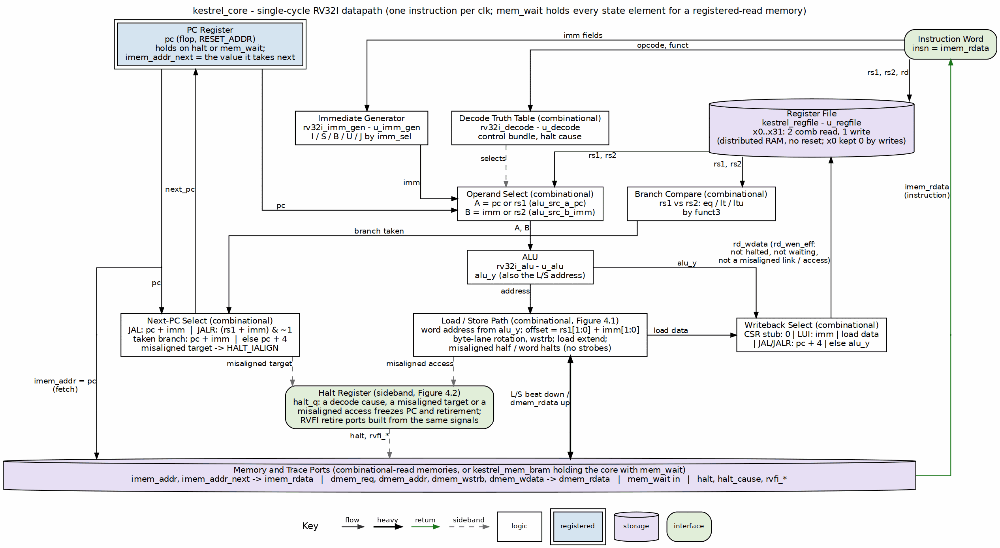

<!-- RTL Design Sherpa Documentation Header -->
<table>
<tr>
<td width="80">
  
</td>
<td>
  <strong>RTL Design Sherpa</strong> · <em>Learning Hardware Design Through Practice</em> 
  
    <a href="https://github.com/sean-galloway/RTLDesignSherpa">GitHub</a> ·
    <a href="https://github.com/sean-galloway/RTLDesignSherpa/blob/main/docs/DOCUMENTATION_INDEX.md">Documentation Index</a> ·
    <a href="https://github.com/sean-galloway/RTLDesignSherpa/blob/main/LICENSE">MIT License</a>
  
</td>
</tr>
</table>

---

<!-- End Header -->

# Design Philosophy and Machine Organization

## Design Philosophy

Three commitments shape the microarchitecture, and every block chapter shows them landing:

1. **The datapath is FSM-free.** Classic processor control walks fetch/decode/execute/memory/writeback as states; in kestrel those phases are spatial, not temporal. Fetch is a wire off the PC register; decode is a truth table; execute is an ALU; memory access is a combinational port; writeback is a mux feeding a clocked register file. There is nothing to sequence, so there is no FSM — and no microcode, no control ROM, no phase counter. The one place a naive design would reach for an FSM — halting — is a single holding flop with a plain set condition, and a misaligned data access is one more halt cause rather than a retry sequence.
2. **Control is an explicit truth table.** Decode is one `unique casez` keyed on `{opcode, funct3, funct7}` producing a thirteen-field control bundle. The same word always produces the same bundle; the table is small enough to read top to bottom and is transcribed in the rv32i_decode chapter.
3. **RVFI is the observation channel.** The retire port is not debug instrumentation bolted on afterward; it is the defined observation channel, present from the first vertical slice, and its aggregation rules are stated next to the assignments in the RTL and again in Chapter 4.

The discipline the suite's style brief imposes — datapath logic is truth tables and muxes; FSMs only where control is unavoidable — is what makes this core reviewable in one sitting and provable at shallow model-checking depth (riscv-formal runs at depth 6 and covers reset plus a two-cycle memory access with headroom).

## The Machine in One Picture

### Figure 1.1: kestrel datapath block diagram

The diagram is drawn to match the RTL: the blocks are the module instances in `kestrel_core.sv`, and every named wire is a real signal in the source. State elements are the PC register, the register file, the retire counter and the one-bit halt register (Chapter 4); everything else is combinational, and a registered-read memory holds all of it with `mem_wait`. The load/store path and the halt logic each get their own figure in Chapter 4.

## Module Inventory

The first four rows -- the ISA package and the decode, immediate-generator and ALU blocks -- live in `riscv-ip/common-rv32i` since 2026-10-22 and are shared unchanged with gatling; kestrel pulls them in through `$RV32I_COMMON_ROOT`. Their chapters stay in this book: kestrel is the reference consumer.

| Module | File | Role | State |
|--------|------|------|-------|
| `rv32i_pkg` | `common-rv32i/rtl/includes/rv32i_pkg.sv` | Shared enums (`alu_op_e`, `imm_sel_e`) and the halt-cause encodings | none |
| `rv32i_decode` | `common-rv32i/rtl/fub/rv32i_decode.sv` | Combinational truth table from `{opcode, funct3, funct7}` to the control bundle | none |
| `rv32i_imm_gen` | `common-rv32i/rtl/fub/rv32i_imm_gen.sv` | Builds the 32-bit immediate for the five formats | none |
| `rv32i_alu` | `common-rv32i/rtl/fub/rv32i_alu.sv` | Ten operations: ADD SUB AND OR XOR SLL SRL SRA SLT SLTU | none |
| `kestrel_regfile` | `rtl/fub/kestrel_regfile.sv` | 32 x 32-bit registers, two combinational read ports, one synchronous write, x0 discarded | 32 words |
| `kestrel_core` | `rtl/top/kestrel_core.sv` | Wires the leaves together: source muxes, branch comparator, next-PC mux, writeback mux, L/S rotation, halt, RVFI | 5 elements below |
| `kestrel_mem_loader` | `rtl/fub/kestrel_mem_loader.sv` | Optional board glue: memories + AXIL slave + run control (see its chapter) | run bit, holding regs |

: Module inventory

## State Inventory

Everything kestrel remembers, outside the register file and (when integrated) the memories:

| Element | Width | Purpose | Next-state equation |
|---------|-------|---------|---------------------|
| `pc` | 32 | Program counter; resets to `RESET_ADDR` | `pc <= (halt \|\| mem_wait) ? pc : next_pc` (also driven out as `imem_addr_next`) |
| `retire_count` | 64 | RVFI retirement order: 0, 1, 2, ... | `+1` when `rvfi_valid` |
| `halt_q` | 1 | Halt holding register; latches any halt cause | `halt_q <= halt_q \| halt_now` |

: The complete core state inventory, register file aside

Three state elements with one-line next-state equations are reviewable in minutes. The halt bit is control state only; no data is captured mid-instruction (until 2026-10-20 a cross-word retry bit and a 32-bit merge register were the exception; misaligned accesses now halt, Ch. 4.2).

## Key Interfaces at a Glance

| Interface | Width | Producer → Consumer |
|-----------|-------|---------------------|
| Control bundle | 13 fields | `rv32i_decode` → muxes, regfile, L/S datapath |
| `imm` | 32 | `rv32i_imm_gen` → source-B mux, writeback (LUI) |
| `alu_y` | 32 | `rv32i_alu` → dmem address, writeback |
| Branch flags | eq/lt/ltu | dedicated comparator → branch-cond mux → next-PC mux |
| `next_pc` | 32 | next-PC mux → PC register and `rvfi_pc_wdata` |
| `rd_wdata` | 32 | writeback mux → register file |
| RVFI bundle | 17 signals | aggregation assigns → top-level ports |

: Internal interface summary (full wiring in Chapter 3)

---

**Last Updated:** 2026-10-07
