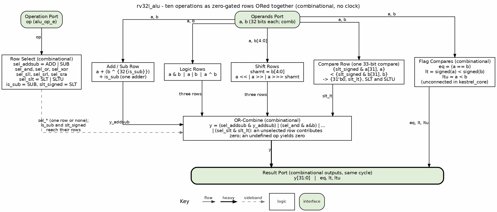

<!-- RTL Design Sherpa Documentation Header -->
<table>
<tr>
<td width="80">
  
</td>
<td>
  <strong>RTL Design Sherpa</strong> · <em>Learning Hardware Design Through Practice</em> 
  
    <a href="https://github.com/sean-galloway/RTLDesignSherpa">GitHub</a> ·
    <a href="https://github.com/sean-galloway/RTLDesignSherpa/blob/main/docs/DOCUMENTATION_INDEX.md">Documentation Index</a> ·
    <a href="https://github.com/sean-galloway/RTLDesignSherpa/blob/main/LICENSE">MIT License</a>
  
</td>
</tr>
</table>

---

<!-- End Header -->

# rv32i_alu

This block lives in `riscv-ip/common-rv32i` (`common-rv32i/rtl/fub/rv32i_alu.sv`, since 2026-10-22) and is instantiated unchanged by both kestrel and gatling. kestrel is its reference consumer; this chapter is its documentation.

## Purpose

`rv32i_alu` performs the datapath arithmetic for the core: ten operations selected by `alu_op`, operating on the source-mux outputs. It also computes `eq/lt/ltu` flags — which the core deliberately does not use for branches (see the ruling below).

### Figure 2.2: rv32i_alu composition

The operands fan out to every row; the row select enables exactly one of them (or none) and the OR-combine merges the zero-gated rows into `y`. The add/sub row is one adder, the compare row one 33-bit comparator shared by SLT and SLTU, and the flag compares sit on their own lane to the result port because the core leaves them unconnected (the ruling below).

## Interface

| Port | Direction | Width | Description |
|------|-----------|-------|-------------|
| `op` | Input | `alu_op_e` | Operation select |
| `a` | Input | 32 | Left operand (PC or rs1, via the core's source mux) |
| `b` | Input | 32 | Right operand (immediate or rs2) |
| `y` | Output | 32 | Result |
| `eq` / `lt` / `ltu` | Output | 1 / 1 / 1 | Flags: equality, signed less-than, unsigned less-than — unconnected at the core instance |

: rv32i_alu interface

`rv32i_alu` has no parameters: it is built in fabric only (see "Why the ALU is not in a DSP" below).

## Operations

| `alu_op` | `y` | Notes |
|----------|-----|-------|
| ADD | `a + b` | Also computes branch/JAL targets when `a = pc` |
| SUB | `a + ~b + 1` | one adder for ADD/SUB: the inverted operand plus a carry-in |
| AND / OR / XOR | bitwise | |
| SLL | `a << shamt` | shamt = `b[4:0]` (unpriv §2.1.4.1: shift amounts use 5 bits) |
| SRL | `a >> shamt` | logical |
| SRA | `$signed(a) >>> shamt` | arithmetic |
| SLT | `{{31{1'b0}}, slt_lt}` | sets rd to 0/1 |
| SLTU | `{{31{1'b0}}, slt_lt}` | unsigned, notably for SLTIU's sign-extended-then-unsigned immediate; SLT and SLTU share one comparator, the operands extended to 33 bits with the sign bit for SLT and a zero for SLTU |

: ALU operations (`shamt = b[4:0]`)

The result is the OR of every row, each forced to zero unless its op is selected, rather than a final multiplexer (2026-10-20; the OR-combined result is an idea from the BRISKI barrel core). An undefined op yields zero.

The shift-by-`b[4:0]` matches the ISA's shamt semantics exactly — and because the decode table keys SLLI/SRLI/SRAI fully on funct7, encodings with shamt[5] set (reserved in RV32I) never reach this module as shifts; they halt as illegal in decode.

## The Flags Ruling

The flags compare `a` against `b`: `eq = (a == b)`, `lt = ($signed(a) < $signed(b))`, `ltu = (a < b)`. For branch instructions the core drives `a = pc` (the ALU is simultaneously computing `pc + imm`), so these flags would compare pc against imm — silently wrong. The core's instance leaves `eq/lt/ltu` unconnected and branches decide on the dedicated rs1/rs2 comparator in the top. The flag ports keep their own compares and stay correct (the unit test checks them); SLT/SLTU use the shared comparator instead. The flags are available to any future consumer whose `a`/`b` are the intended operands. This was a reviewed ruling (Task 4 review, SDD ledger), recorded here so nobody "fixes" the dangling pins.

---

**Last Updated:** 2026-10-07

## Why the ALU is not in a DSP

A DSP48E1 option was built, verified and measured, then removed (2026-10-20).
It is recorded here so it is not tried again without a new reason.

**What was built.** ADD, SUB, AND, OR, XOR, SLT and SLTU in one instantiated
DSP48E1 with every register off: C = `a`, A:B = `b`, each extended to 48 bits
(with the sign bit for SLT); OPMODE and ALUMODE chosen per op (the DSP's logic
unit for AND/OR/XOR, the post-adder for ADD/SUB); SLT/SLTU taken from the sign
of the 48-bit subtract, as in the DSP48E user guide's compare application
(UG193). Shifts stayed in fabric. The idea of one DSP for the ALU came from the
BRISKI barrel core. Vivado would not infer it (on xc7a100t it maps a lone
add/sub but no DSP for a case that also selects the logic rows), so the slice
was instantiated, with a behavioral model for simulation and formal that
matched the Xilinx DSP48E1 model over 140,448 vectors. rv32ui passed 42/42 on
the Nexys A7 and riscv-formal 42/42.

**Why it was removed.** It did not do what it was for: save LUTs and pack the
core denser. Nexys A7, same netlist and `IMPL=explore` flow:

| | Fabric ALU | DSP ALU |
|---|---|---|
| LUTs, synthesized | 1,908 | 1,905 |
| LUTs, routed | 2,026 | 2,029 |
| CARRY4 | 72 | 59 |
| Occupied slices | 656 | 674 |
| Worst slack at 100 MHz | -1.63 ns | -1.71 ns |

: Fabric vs DSP48E1 ALU on the Nexys A7 (xc7a100t)

The ALU is too small for the move to pay. The 32-bit add is eight CARRY4
cells, and each logic row is one LUT per bit, which the OR-combined result
merges with the row select. The DSP has fixed sites, so its 64 operand nets
and 32 result nets travel to and from a DSP column: the few LUTs it absorbs
come back as that routing, which spreads the core over 18 more slices and lengthens the path through
the ALU. A fully combinational DSP48E1 is also the slice's slowest mode. An earlier add/sub-only version (inferred) saved 42 LUTs but cost about
0.3 ns, on the core as it stood before the x0, comparator and OR-result changes.

**What would change the answer.** A pipelined core, where the DSP's input and
output registers sit on a stage boundary, or a design short of LUTs and rich in
spare DSPs. Neither is kestrel, which is single-cycle and meant to stay simple
and cheap.

