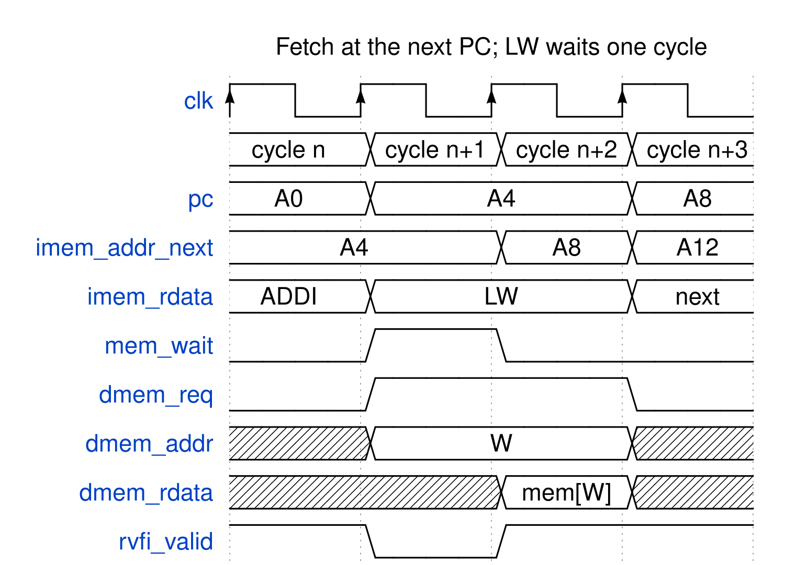

<!-- RTL Design Sherpa Documentation Header -->
<table>
<tr>
<td width="80">
  
</td>
<td>
  <strong>RTL Design Sherpa</strong> · <em>Learning Hardware Design Through Practice</em> 
  
    <a href="https://github.com/sean-galloway/RTLDesignSherpa">GitHub</a> ·
    <a href="https://github.com/sean-galloway/RTLDesignSherpa/blob/main/docs/DOCUMENTATION_INDEX.md">Documentation Index</a> ·
    <a href="https://github.com/sean-galloway/RTLDesignSherpa/blob/main/LICENSE">MIT License</a>
  
</td>
</tr>
</table>

---

<!-- End Header -->

# kestrel_mem_bram

## Purpose

`kestrel_mem_bram` is the block-RAM alternative to `kestrel_mem_loader`
(owner, 2026-10-20): a board-sized memory with **registered reads** behind
the same core ports and the same AXIL address map. Port A fetches at the
core's next PC, so block RAM's own output register acts as the instruction
register and an instruction takes one clock. Port B is the data port; a
load holds the core with `mem_wait` for one cycle while its read lands. The
ISA is untouched (HAS Ch. 4, memory contract property 2).

| | `kestrel_mem_loader` | `kestrel_mem_bram` |
|---|---|---|
| Storage | 2 x 64 KB distributed RAM | 1 x `MEM_WORDS` x 32 block RAM (16 KB default), true dual port |
| Core reads | combinational | registered: fetch at `imem_addr_next`, load held one cycle with `mem_wait` |
| CPI | 1 | 1, 2 for a load |
| Word index | byte-address bits [13:0] (aliases, see Ch. 2.6) | `addr[IDX_W+1:2]`, aliases above the array |
| Run control | sticky `run` | `run` writable both ways: 0 returns to load mode |
| Status | `run` | halted, cause, cycles, instret, last gp write |

: Loader and block-RAM wrapper compared

## The Array

One `logic [31:0] r_mem [MEM_WORDS]` with `ram_style = "block"`, read through
an output register on each port; port B writes per byte lane, port A only
reads (the inference template Vivado maps to RAMB36 in true-dual-port mode;
4 tiles at the 16 KB default, which every rv32ui image fits -- the largest
ends below 12.3 KB). Code, data and `.tohost` share one address space, as in
every other kestrel memory (fetch and L/S coherent, so `rv32ui-p-fence_i`
runs).

## Port A: Fetch at the Next PC

Port A is addressed by the core's `imem_addr_next`, the value the PC
register takes at the coming edge (`RESET_ADDR` while the core is in reset).
After the edge the PC holds that address and port A's output holds the word
at it, so the cycle that executes an instruction starts with the instruction
already at the RAM output. While the core holds (`mem_wait`, halt) the PC
does not move and port A re-reads the same word.

The first version of this wrapper time-multiplexed one port through a
fetch / execute / load sequencer. It took two clocks per instruction and
still ran the whole execute path off the RAM output in one of them, with the
load wait decoded after the ALU; on the Nexys A7 that path was 14-15 logic
levels and about 17.7 ns. Fetching at the next PC removes the sequencer and halves
the CPI.

## Port B: Data and the Load Wait

While `run` is set, the core owns port B whenever it presents `dmem_req`:

| Access | Cycle 1 | Cycle 2 |
|---|---|---|
| Store | `dmem_wstrb` writes at the end of the cycle; the core retires | -- |
| Load | address presented; `mem_wait` = 1, the core holds | the word is on port B's output; `mem_wait` = 0, the core retires |

: The core's port-B accesses

### Waveform 2.7: Fetch at the next PC, and a load's one-cycle wait

The ADDI at A0 executes in one clock while port A is already reading A4. The
LW at A4 raises `mem_wait` in its first cycle: the PC and `imem_addr_next`
hold, port B reads W, and nothing retires. In the second cycle the word is
on port B's output, `mem_wait` drops, the load retires, and the fetch moves
on to A8.

`mem_wait` is decoded from the opcode bits at port A's output
(`imem_rdata[6:0] == LOAD`) and a one-cycle phase bit, never from the core's
request or address, so it arrives one LUT after the RAM instead of after the
address add. A misaligned load waits too; the core then halts without
writing (Ch. 4.2).

A store and a fetch of the same word on the same edge collide on port A. The
fetch may see either value, which RISC-V allows when no `FENCE.I` separates
the store from the fetch.

## AXIL Side (Port B when the core does not want it)

The write side is the loader's: the `axil4_slave_wr` leaf, an AW holding
register and a B holding bit. Memory writes are accepted only in load mode.
The read side takes two stages, because port B's read is registered: AR is
accepted into a wait cycle, the array (or register) data is copied into a
holding register, and R is offered from there and held under backpressure.
AR is refused in a cycle where a loader write or the core's load/store owns
port B.

## Registers (`addr[17] = 1`)

| `addr[4:2]` | Name | Access |
|---|---|---|
| 0 | CTRL/STATUS | W bit 0 `run` (1 releases the core, 0 returns to load mode); R `{cause[7:4], halted[1], run[0]}` |
| 1 | CYCLES | clocks since `run` was set, frozen at halt |
| 2 | INSTRET | retired instructions (RVFI beats) |
| 3 | GP | last value written to x3 -- the riscv-tests verdict, since kestrel halts on the final ecall before the `tohost` store |
| 4 | BUILD_ID | `0x4B42524D` ("KBRM") |

: kestrel_mem_bram registers

Setting `run` from 0 clears halted, cause and the counters.

## Verification

- `dv/tests/test_kestrel_mem_bram.py`: the rv32ui battery through this path
  with the golden-interpreter diff and spike lockstep (42/42 at func;
  `ma_data` is an expected halt, Ch. 4.2), the registers (status, counters,
  CPI 1..2, stop / reload / rerun) and AXIL backpressure on the two-stage
  read. A wrapper mutant (no load wait) fails 11 of the 42 images.
- `formal/kestrel/riscv-formal`: every check with `mem_wait` driven freely
  (bounded to two consecutive waits).
- On the board: `projects/fpga-systems/NexysA7/riscv-ip/kestrel`,
  the same host programs over UART in sim and on the board.
