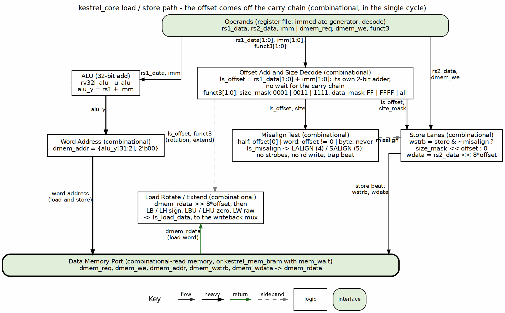

<!-- RTL Design Sherpa Documentation Header -->
<table>
<tr>
<td width="80">
  
</td>
<td>
  <strong>RTL Design Sherpa</strong> · <em>Learning Hardware Design Through Practice</em> 
  
    <a href="https://github.com/sean-galloway/RTLDesignSherpa">GitHub</a> ·
    <a href="https://github.com/sean-galloway/RTLDesignSherpa/blob/main/docs/DOCUMENTATION_INDEX.md">Documentation Index</a> ·
    <a href="https://github.com/sean-galloway/RTLDesignSherpa/blob/main/LICENSE">MIT License</a>
  
</td>
</tr>
</table>

---

<!-- End Header -->

# Misaligned Data Access Halt

## The Rule

A load or store whose address is not naturally aligned for its size -- a
halfword at an odd byte, a word off a 4-byte boundary -- halts the core
(2026-10-20). Bytes are always aligned; halves and words at an aligned
offset are rotated into their byte lanes in the single cycle:

| Size (`funct3[1:0]`) | Aligned offsets (`addr[1:0]`) | Halts |
|---|---|---|
| byte (00) | 0, 1, 2, 3 | never |
| half (01) | 0, 2 | 1, 3 -- cause 4 (load), 5 (store) |
| word (10) | 0 | 1, 2, 3 -- cause 4 (load), 5 (store) |

: Aligned and halting accesses

The halting access performs nothing: the store strobes are forced to zero,
the load does not write rd, and the instruction retires as the usual RVFI
trap beat (Ch. 4.3) with empty memory fields. Causes 4 and 5 are
`HALT_LALIGN` and `HALT_SALIGN` in `rv32i_pkg`; like `HALT_IALIGN` they
are raised in the core, because decode cannot see the address.

## The Offset Comes Off the Carry Chain

### Figure 4.1: The load/store path

The figure is the point of this section: the two-bit offset adder is its own column, and the misalign test, the store strobes and data, and the load rotation all hang off it, while only the word address waits for the ALU's 32-bit add. The store beat goes down to the data port; the load word climbs back up its own lane into the rotate/extend block and from there to the writeback mux.

`ls_offset = rs1_data[1:0] + imm[1:0]` -- the low two bits of the address,
computed by their own two-bit add rather than taken from the ALU's 32-bit
result. The halt test, the store strobes (`size_mask << offset`), the store
data (`rs2_data << 8*offset`) and the load rotation (`dmem_rdata >>
8*offset`) all key off it, so none of them waits for the full add. The word
address `{alu_y[31:2], 2'b00}` does.

## Why a Halt, Not Hardware

Until 2026-10-20 kestrel completed misaligned accesses in hardware: one
cycle inside a word, two across a word boundary, with a retry bit, a
captured low half and a merge path. RISC-V permits either (unpriv §2.1.6:
misaligned accesses may be handled by hardware or trapped). On block RAM the
retry logic sat on the critical path -- it gated the register write and the
PC hold, two logic levels between the address add and the register file.
The halt keeps the access logic to a rotation and one compare, which is
the simpler and smaller design the rung is meant to be.

The cost is `rv32ui-p-ma_data`, which needs hardware support: kestrel halts
on its first misaligned load (cause 4) exactly where spike, which also
traps misaligned accesses, takes `trap_load_address_misaligned`. The DV and
board batteries list it as an expected halt.

## Verification

- `test_kestrel_ls`: `ls_misaligned` rotates bytes through all four lanes and
  halves through both, then halts on a misaligned `lh` (cause 4, rd not
  written); `ls_misalign_store` halts on a misaligned `sw` (cause 5, empty
  write mask).
- The fuzz generator emits only aligned offsets; the golden interpreter
  halts on any misaligned access, so a core that completed one would diverge.
- riscv-formal runs with `RISCV_FORMAL_ALIGNED_MEM`, whose instruction models
  require `rvfi_trap` on every misaligned load and store.

---

**Last Updated:** 2026-10-20
