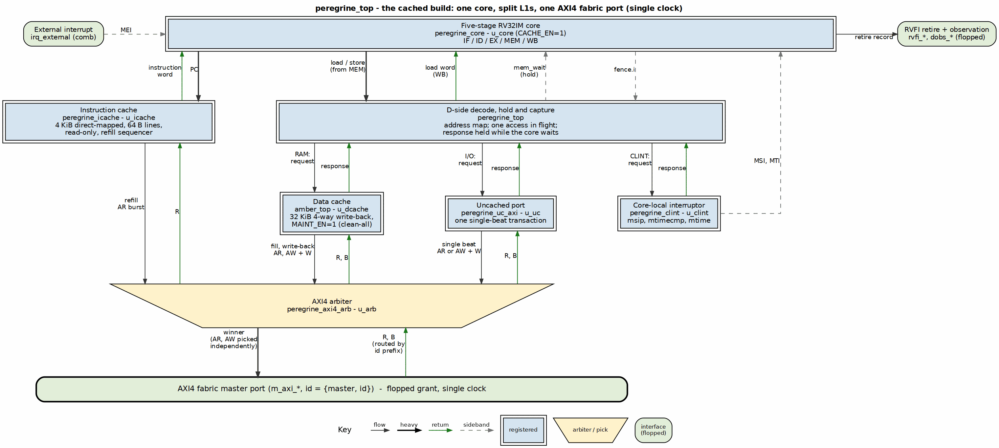

<!-- RTL Design Sherpa Documentation Header -->
<table>
<tr>
<td width="80">
  
</td>
<td>
  <strong>RTL Design Sherpa</strong> · <em>Learning Hardware Design Through Practice</em> 
  
    <a href="https://github.com/sean-galloway/RTLDesignSherpa">GitHub</a> ·
    <a href="https://github.com/sean-galloway/RTLDesignSherpa/blob/main/docs/DOCUMENTATION_INDEX.md">Documentation Index</a> ·
    <a href="https://github.com/sean-galloway/RTLDesignSherpa/blob/main/LICENSE">MIT License</a>
  
</td>
</tr>
</table>

---

<!-- End Header -->

# System Overview

## Deliverables

peregrine is a package, one core module, one cached system wrapper and seven blocks that the wrapper and core instantiate. The decode, immediate generator and ALU are `riscv-ip/common-rv32i`'s, shared with kestrel, merlin and gatling; the register file is kestrel's.

| Deliverable | File (under `peregrine-rv32im/rtl/`) | Role |
|-------------|------|------|
| `peregrine_pkg` | `includes/peregrine_pkg.sv` | Pipeline-register structs, forwarding and writeback encodings, exception codes, mcause codes, CSR addresses |
| `peregrine_core` | `top/peregrine_core.sv` | The five-stage RV32IM core; at `CACHE_EN=0` it is the whole cacheless build |
| `peregrine_top` | `top/peregrine_top.sv` | The cached build: the core with its I\$, amber as the D\$, the CLINT, the uncached port and the AXI4 arbiter |
| `peregrine_bpred` | `fub/peregrine_bpred.sv` | BTB and BHT |
| `peregrine_csr` | `fub/peregrine_csr.sv` | Machine-mode CSR file and the interrupt-pending decision |
| `peregrine_mdu` | `fub/peregrine_mdu.sv` | Iterative multiply/divide unit |
| `peregrine_hazard` | `fub/peregrine_hazard.sv` | Forwarding selects and the load-use interlock |
| `peregrine_if_id`, `_id_ex`, `_ex_mem`, `_mem_wb` | `fub/` | Pipeline registers |
| `peregrine_icache` | `fub/peregrine_icache.sv` | 4 KiB direct-mapped instruction cache, one AXI4 read master |
| `peregrine_clint` | `fub/peregrine_clint.sv` | `msip`, `mtimecmp`, `mtime` |
| `peregrine_uc_axi` | `fub/peregrine_uc_axi.sv` | Uncached single-beat AXI4 load/store port |
| `peregrine_axi4_arb` | `fub/peregrine_axi4_arb.sv` | Three AXI4 masters onto one fabric port |

: peregrine deliverables

The D\$ is `amber_top` from `projects/components/cache-ip/amber-mesi-l1`, instantiated with `MAINT_EN=1` so that its CPU port accepts the clean-all request `fence.i` needs.

## The Cached System

### Figure 2.1: peregrine_top in context

**Source:** [peregrine_system_context.dot](../assets/graphviz/peregrine_system_context.dot)

Every fetch goes through the I\$. Every load and store is issued from the MEM stage and decoded by address into one of three targets: amber for the cacheable RAM window, the CLINT, or the uncached port for the I/O window (see "Address Map"). The I\$ refill master, amber's AXI4 master and the uncached port share one AXI4 fabric port through a round-robin arbiter; responses return to the master that issued them by an id prefix.

The core's global hold, `mem_wait`, is driven by the wrapper. It is high while the I\$ misses, while a data access waits to be accepted or for its response, and while a `fence.i` or a TB-requested D\$ clean is in progress. While it is high no state element in the core updates.

amber's ACE snoop port is tied idle: there is one core and no other cache, so no snoop ever arrives.

## The Cacheless Build

`peregrine_core` at `CACHE_EN=0` (the default) is a complete core with merlin's Harvard registered-read memory ports (see "Memory Contract"). There is no cache to clean: `fence.i` still flushes the pipeline and refetches the next instruction, so self-modifying code behaves identically in both builds. This build runs the instruction batteries fastest, keeps riscv-formal's instruction checks reachable (PRD P12), and separates core bugs from cache bugs.

## What Is Not in the System

- **No MonBus observation.** amber is built with `USE_MONITOR=0`, and the core has no MonBus port. The observation the PRD §4.6 plans (mispredict, trap and M-busy events) is not built; the same information is on the RVFI observation ports (`rvfi_trap_cause`, `rvfi_bp_*`).
- **No bus-error reporting.** An AXI `SLVERR` or `DECERR` on an I\$ refill, a D\$ fill or an uncached access is not reported to the core; peregrine has no access-fault exception.

---

**Last Updated:** 2026-11-25
