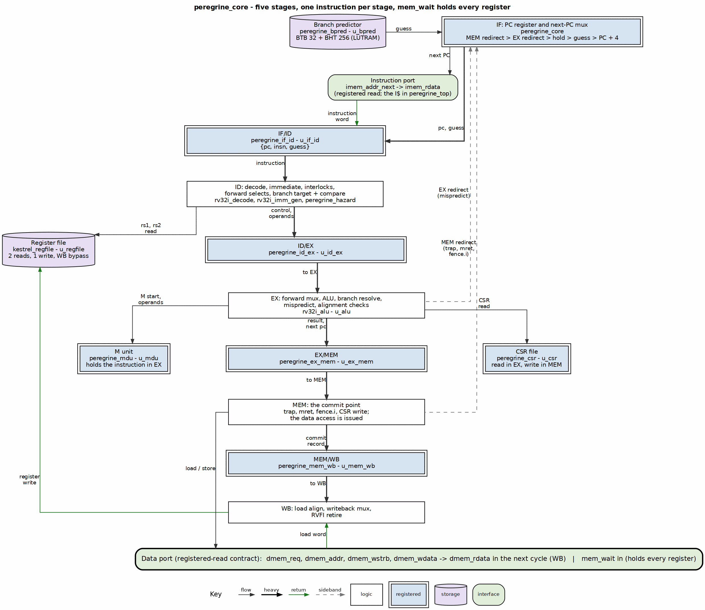

<!-- RTL Design Sherpa Documentation Header -->
<table>
<tr>
<td width="80">
  
</td>
<td>
  <strong>RTL Design Sherpa</strong> · <em>Learning Hardware Design Through Practice</em> 
  
    <a href="https://github.com/sean-galloway/RTLDesignSherpa">GitHub</a> ·
    <a href="https://github.com/sean-galloway/RTLDesignSherpa/blob/main/docs/DOCUMENTATION_INDEX.md">Documentation Index</a> ·
    <a href="https://github.com/sean-galloway/RTLDesignSherpa/blob/main/LICENSE">MIT License</a>
  
</td>
</tr>
</table>

---

<!-- End Header -->

# Design Philosophy and Machine Organization

## merlin, Extended

peregrine is merlin's five-stage pipeline with additions, and is meant to be read as a diff against merlin (PRD §4.1). Carried over unchanged:

- the IF / ID / EX / MEM / WB stage split and the four pipeline registers, with merlin's control-versus-payload split (only control fields reset and flush);
- the forwarding unit: EX/MEM over MEM/WB, with the select computed in ID and registered beside ID/EX;
- the load-use bubble and the second load interlock (merlin's load-to-branch interlock, widened to every consumer of a load by TASK-006);
- the WB-to-ID register-file bypass;
- the registered-read memory contract with the global `mem_wait` hold.

Added:

| Addition | Where | Blocks |
|----------|-------|--------|
| Branch prediction: BTB + 2-bit BHT looked up in IF, resolved in EX | IF, EX | `peregrine_bpred` |
| Precise machine-mode traps committed in MEM; `mret`; interrupts sampled in MEM | ID, EX, MEM | `peregrine_csr` |
| CSR instructions: read in EX, written in MEM, serialized in ID | ID, EX, MEM | `peregrine_csr` |
| M extension on one iterative unit, the instruction held in EX | EX | `peregrine_mdu` |
| Split L1s, CLINT, uncached port, AXI4 arbiter (`CACHE_EN=1`) | IF, MEM, WB | `peregrine_icache`, amber, `peregrine_top`, `peregrine_clint`, `peregrine_uc_axi`, `peregrine_axi4_arb` |
| Timing restructure (stage 7): branch target and its compare moved to ID, `_nw` redirect paths, I\$ read registers enabled by the hold | ID, EX, IF | `peregrine_core`, `peregrine_icache`, `peregrine_top` |

: What peregrine adds to merlin

## The Stages

| Stage | Work |
|-------|------|
| IF | PC register; BTB/BHT lookup by the PC; the next-PC mux (MEM redirect, EX redirect, hold, predicted target, PC + 4); the fetch |
| ID | Decode (`rv32i_decode` with `M_EXT` and `ZICSR`), immediate, register read with the WB bypass; forwarding selects; interlocks (load-use, load-to-branch, CSR); the branch/JAL target `pc + imm` and its compare against the guess |
| EX | Forwarding muxes, ALU, branch compare, JALR target, mispredict detection and the EX redirect; CSR read and write-data; M-unit start and hold; alignment checks; predictor update |
| MEM | The commit point: trap (exception or interrupt), `mret`, `fence.i`, CSR write; the data access is issued here |
| WB | Load alignment and extension; register write; the WB forward; RVFI retire |

: Work per stage

### Figure 1.1: The peregrine pipeline

**Source:** [peregrine_pipeline.dot](../assets/graphviz/peregrine_pipeline.dot)

## Three Rules That Shape Everything

1. **One commit point.** Anything an instruction does that cannot be undone (a store, a CSR write, a trap entry) happens in MEM, and only for an instruction that is not trapping. The register file is written one stage later. So when MEM traps, older work is complete and younger work has touched nothing.
2. **One global hold.** `mem_wait` freezes every state element. Every event that changes state (a redirect, a flush, a predictor write, an M-unit start) is qualified by `~mem_wait`, so an event raised during a hold is replayed when the hold drops, not lost.
3. **Every instruction that leaves EX retires.** A MEM redirect kills the instruction in EX before it leaves; nothing that leaves EX is killed later except by its own trap, which still retires as a trap beat. This is what makes the predictor state a function of the retire stream, and what lets the DV hold every prediction to a model.

---

**Last Updated:** 2026-11-25
