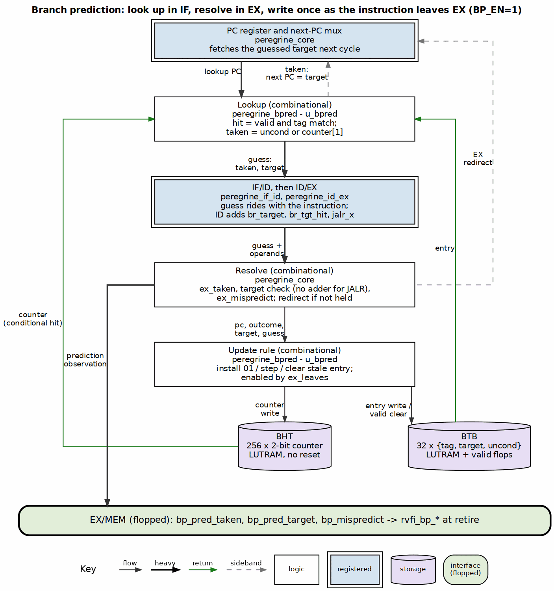

<!-- RTL Design Sherpa Documentation Header -->
<table>
<tr>
<td width="80">
  <a href="https://github.com/sean-galloway/RTLDesignSherpa">
    
  </a>
</td>
<td>
  <strong>RTL Design Sherpa</strong> · <em>Learning Hardware Design Through Practice</em><br>
  <sub>
    <a href="https://github.com/sean-galloway/RTLDesignSherpa">GitHub</a> ·
    <a href="https://github.com/sean-galloway/RTLDesignSherpa/blob/main/docs/DOCUMENTATION_INDEX.md">Documentation Index</a> ·
    <a href="https://github.com/sean-galloway/RTLDesignSherpa/blob/main/LICENSE">MIT License</a>
  </sub>
</td>
</tr>
</table>

---

<!-- End Header -->

# Branch Prediction and Recovery

## Lookup in IF

`peregrine_bpred` is looked up combinationally by `pc`. A hit on an unconditional entry, or on a conditional entry whose counter's high bit is set, predicts taken, and the next-PC mux fetches the entry's target in the next cycle; otherwise PC + 4. The guess (`pred_taken`, `pred_target`) rides with the instruction through IF/ID and ID/EX.

### Figure 4.1: Predict in IF, resolve in EX, write as the instruction leaves EX



**Source:** [peregrine_predictor.dot](../assets/graphviz/peregrine_predictor.dot)

## Work Moved to ID (Stage 7)

A branch or JAL target does not depend on a register, so ID computes it and its compare against the guess: `br_target = pc + imm` and `br_tgt_hit = (pred_target == br_target)`. For JALR, ID computes `jalr_x = pred_target - imm`. This keeps EX's mispredict test from sitting behind the forwarding mux and the ALU; with it, the load data no longer reached the PC at all (stage 7 step 3: WNS -9.97 to -5.04 ns at 10 ns).

## Resolve in EX

- **Direction:** `ex_taken = valid & (jump | jalr | branch_taken)`, with `branch_taken` from a dedicated comparator on the branch operands (one signed/unsigned compare by `funct3`).
- **Target:** `br_target` for a branch or JAL; `(rs1 + imm) & ~1` for JALR.
- **Target check:** for a branch or JAL, `~br_tgt_hit`. For JALR the target adder is not on the check: a taken guess is word-aligned (the BTB stores PC[31:2]), so `(rs1 + imm) & ~1` equals it exactly when `rs1` is `jalr_x` or `jalr_x + 1`. Two 32-bit compares against `rs1` replace an add and a compare.
- **Mispredict:** `ex_mispredict = valid & ((pred_taken != ex_taken) | (ex_taken & target miss))`. A not-taken guess mispredicts on direction alone.

## Recovery

- `ex_flush = ex_mispredict & ~ex_m_stall`: the PC takes `ex_next_pc` (the resolved target, or PC + 4) and IF/ID and ID/EX are flushed. **Cost: 2 cycles.** A correctly predicted taken branch costs 0.
- **An instruction held in EX redirects only as it leaves.** A flush during the M hold would kill the M instruction in ID/EX (flush beats stall). The stale-entry stream that rewrites a jump into a `mul` caught the mutant that redirected during the hold.
- **A non-branch predicted taken** (a stale BTB entry after code was rewritten) mispredicts on direction, redirects to PC + 4, and its update clears the entry, so it mispredicts once, not on every pass.
- **A misaligned target** still redirects in EX; the instruction-address-misaligned trap at MEM one cycle later flushes whatever was fetched.
- A MEM redirect (trap, `mret`, `fence.i`) takes priority over the EX redirect: the older instruction wins.

## The Write Rule

The predictor is written once per instruction, as it leaves EX:

```systemverilog
ex_leaves = id_ex_q.valid & ~mem_wait & ~ex_m_stall & ~mem_redirect_nw;
```

- **not under `mem_wait`**: the instruction has not left;
- **not while an M instruction holds**: it has not left;
- **not when a MEM redirect kills it**: it never leaves.

Every instruction that leaves EX retires, as an ordinary beat or a trap beat (its own exception, or an interrupt taken at MEM). The predictor state is therefore a function of the retire stream including trap beats, and the TB replays the retired stream through a predictor model and checks every prediction (`rvfi_bp_*`). The update is applied at EX resolution, not at retirement, and an update from an instruction that later traps is harmless: predictor state is not architectural.

The update fields are the resolved PC, `branch` (conditional), `jump | jalr` (unconditional), `ex_taken`, `ex_target` and the guess; the table updates are in the `peregrine_bpred` chapter.

**What this rule cost to verify.** Two write-rule mutants survived the general streams and needed their own: a write from an instruction a trap kills in EX (caught only by `trap_shadow` with a T, T, N, N direction pattern; the alternating version stopped catching it once installs wrote `01`), and a write on every `mem_wait` cycle (caught only once loop and interlock streams ran under random `mem_wait`). The formal `core_props` unit now proves the rule (TASK-001 stage 5).

## Timing of the Model Check

The core writes the predictor two stages after it looks it up. So an instruction was predicted from every update of instructions at least three older; from the one two older only if IF was held while that one left EX; and never from the one immediately older unless that one redirected the fetch. The model check accepts any prediction those states allow, with unreset BHT counters held as sets of values.

## The A/B Build

`BP_EN=0` instantiates no predictor storage and always predicts not taken: every taken transfer mispredicts, which is merlin's fetch exactly. The HAS ("Performance Characteristics") gives the measured speedups.

---

**Last Updated:** 2026-11-25
