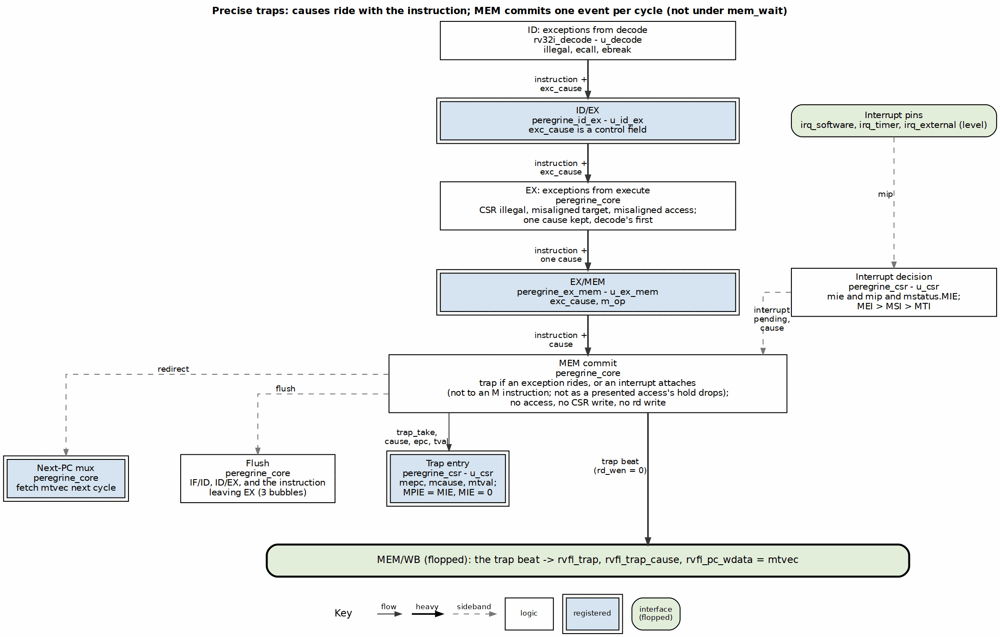

<!-- RTL Design Sherpa Documentation Header -->
<table>
<tr>
<td width="80">
  
</td>
<td>
  <strong>RTL Design Sherpa</strong> · <em>Learning Hardware Design Through Practice</em> 
  
    <a href="https://github.com/sean-galloway/RTLDesignSherpa">GitHub</a> ·
    <a href="https://github.com/sean-galloway/RTLDesignSherpa/blob/main/docs/DOCUMENTATION_INDEX.md">Documentation Index</a> ·
    <a href="https://github.com/sean-galloway/RTLDesignSherpa/blob/main/LICENSE">MIT License</a>
  
</td>
</tr>
</table>

---

<!-- End Header -->

# Traps, Interrupts and the Commit Point

## Why MEM

The trap is taken in MEM (Smith and Pleszkun's in-order case, PRD §4.3). Memory is written in MEM and the register file in WB. An exception found earlier travels with its instruction as `exc_cause`; when the instruction reaches MEM it does not access memory, write a CSR or write `rd`, and traps there. The instruction in WB is older and retires; nothing younger has touched memory, the register file or a CSR.

### Figure 4.2: Exceptions ride to MEM; MEM commits one event per cycle

**Source:** [peregrine_traps.dot](../assets/graphviz/peregrine_traps.dot)

## Detection

| Stage | Exception | Condition |
|-------|-----------|-----------|
| ID | Illegal instruction, `ecall`, `ebreak` | Decode's `halt_cause` (with `ZICSR=1` these are trap causes) |
| EX | Illegal instruction | A CSR instruction naming an unimplemented CSR, or writing a read-only one (address bits 11:10 = 11) |
| EX | Instruction address misaligned | A taken branch or JAL with `pc + imm` not word-aligned, or a JALR with `(rs1 + imm)` bit 1 set |
| EX | Load / store address misaligned | `rs1[1:0] + imm[1:0]` not aligned for a halfword or word |
| ID | Instruction access fault (`CACHE_EN=1`) | The fetch arrived with `imem_fault` (its I\$ refill failed); IF/ID carries `ifault` and a zero word, and ID replaces decode's cause with `EXC_IFAULT` |
| WB | Load / store access fault (`CACHE_EN=1`) | `dmem_fault`: the wrapper's error response for WB's access (see "Bus Errors at WB" below) |

: Where exceptions are detected

EX keeps one cause per instruction, in that order of precedence: the fetch fault (ID already put it in decode's place), decode's, then the CSR illegal, then the misaligned target, then the misaligned access. The low address bits come from their own two-bit add, off the 32-bit adder.

## The Commit

In MEM, for the valid instruction there:

- `mem_exc`: it carries an exception.
- `mem_irq = valid & ~m_op & irq_pending & ~r_mem_irq_lock`: an interrupt attaches to it. `irq_pending` is registered in `peregrine_csr` (one cycle behind the pins and enables, cleared for the cycle after a CSR write, trap or mret).
- `mem_trap = (mem_exc | mem_irq) & ~mem_wait`.
- `mem_mret` and `mem_csr_wen` require no exception and no interrupt.

If both an exception and an interrupt are present, the interrupt wins: the instruction never executed, mcause is the interrupt's, `mepc` is the instruction's PC, and after `mret` it executes again and raises its exception then.

| mcause | mtval |
|--------|-------|
| Interrupt (MEI, MSI, MTI) | 0 |
| `ecall` (11) | 0 |
| `ebreak` (3) | The PC |
| Misaligned target (0) | The resolved next PC (the target) |
| Misaligned load (4), store (6) | The access address (`alu_y`) |
| Illegal (2) | The instruction word |
| Instruction access fault (1) | The PC |
| Load (5) / store (7) access fault, from WB | The access's byte address (WB's `alu_y`) |
| Bus error interrupt (16) | 0 |

: mcause and mtval selection

A trap:

1. updates `peregrine_csr` (`trap_take`: `mepc`, `mcause`, `mtval`, `mstatus`);
2. redirects the PC to `mtvec` and flushes IF/ID, ID/EX and the instruction leaving EX (`ex_mem_flush_eff`);
3. suppresses the data access (`dmem_req` needs no exception and no interrupt) and the CSR write;
4. passes to WB with `trap = 1`, `rd_wen = 0`, `is_mem = 0` and `next_pc = mtvec`, so it retires as a trap beat with no effects;
5. cancels the M unit if an M instruction was starting in EX.

`mret` redirects to `mepc` and updates `mstatus` the same way. A CSR write commits in MEM from `csr_wdata` computed in EX.

## Bus Errors at WB

A load or store learns that its access failed only from the response, and the registered-read contract delivers the response in WB (TASK-005). The commit point for that one trap is therefore WB, with MEM held so that the trap is still precise:

1. **The wrapper holds on an error.** An error response does not count as a completion: `mem_wait` stays up through it (`r_outstanding & ~w_rsp_ok`) and the next access is not accepted in it (`w_dvalid` requires `~r_outstanding | w_rsp_ok`). The response is captured on the held side (`r_have` / `r_have_err` for WB's access, `r_mem_have` / `r_mem_err` for an access MEM had presented under an I\$ hold), so the error reaches the core from a flop.
2. **The core traps WB.** `dmem_fault = r_have & r_have_err`; in the core `wb_fault = dmem_fault & WB valid & is_mem`. With `~mem_wait`, `wb_trap` enters the trap in `peregrine_csr` with WB's PC, cause 5 (load) or 7 (store) and `mtval` = WB's `alu_y`; WB retires as a trap beat (`rvfi_trap`, `rvfi_trap_cause`, `rvfi_pc_wdata = mtvec`, no `rd`, no `rvfi_mem_*`), and the register-file write is suppressed.
3. **MEM is killed.** Every MEM-stage commit is qualified by `~wb_fault` (`mem_valid = ex_mem_q.valid & ~wb_fault`): no CSR write, no MEM trap, `mret` or `fence.i`, and MEM's instruction does not enter WB. The data request is the one exception: `dmem_req_pre` is left ungated in the core, because it is the core -> amber accept cone that limits the 75 MHz build (gating it there cost a LUT level and 0.31 ns of slack at `MUL_DSP=1`); the wrapper, whose own flop raised the fault, neither presents nor waits for MEM's request in that cycle (`~w_dfault` in `w_dvalid` and in the hold). The redirect (`mem_redirect_nw` includes `wb_fault`) flushes IF/ID, ID/EX and the instruction leaving EX, cancels the M unit, and blocks the predictor update.

Everything older than the faulting instruction has retired, and the instruction in MEM was held through the error response, so nothing younger has committed. The one rule this bends is "every instruction that leaves EX retires": the instruction killed in MEM had already trained the predictor, which is not architectural state (and the predictor model check runs without bus errors). OKAY responses take exactly the cycles they did before.

## When an Interrupt Is Taken

Interrupts are sampled at MEM: a pending, enabled interrupt attaches to the valid instruction entering MEM (precise at the oldest uncommitted instruction). These rules move it:

**A running M instruction is interrupted from EX** (TASK-007). `ex_m_irq = ex_m_valid & ~mdu_idle & ~mdu_done & ~ex_mem_q.valid & csr_irq_pending & ~mem_wait`: the M instruction holds in EX with the unit busy (started, so the latched operands RVFI reports are valid; not done, so no finished result is lost), MEM is empty, and the pipeline moves. That cycle EX/MEM takes the M instruction instead of the hold bubble, tagged `irq_take`, and `r_ex_irq_cause` latches the cause. In MEM the tag is an interrupt unconditionally (`mem_irq = mem_irq_lv | (valid & irq_take)`), with the latched cause, so it traps whatever the pins do the next cycle; `mepc` is the M instruction's PC. The redirect cancels the unit and flushes the copy ID/EX still holds. An older WB bus fault still wins. The tagged instruction leaves EX (`ex_leaves`), like every instruction that retires. `mem_ls_ok` reads `mem_irq_lv`, not `mem_irq`: a tagged instruction makes no access, and the tag stays out of the 75 MHz accept cone.

**The first instruction after an `mret` is not interruptible** (the progress rule). `r_mret_shadow` is set by `mem_mret` and cleared when the next instruction commits at MEM (`mem_valid & ~mem_wait`). Its next state, `w_irq_block`, goes to the CSR file, which holds the registered `irq_pending` low meanwhile, so neither the EX path nor the MEM path sees an interrupt, and the commit cone gains no term. Every interrupt return retires one instruction, so a cancelled M instruction completes on its second issue. With the block removed, the mext suite's fast timer livelocks it (no `tohost` in 14,600 cycles), which is the stage-2 failure this rule answers: the first stage-2 build let an interrupt discard the M instruction on every pass.

**A finished M instruction is not interruptible.** It reaches MEM only with its result done; it commits and the interrupt goes to the next instruction (`mepc` = the successor's PC). Finished work is never discarded.

**A presented access is not interruptible as its hold drops** (`CACHE_EN=1`). `r_mem_irq_lock` is set while the core is held with a load, store or `fence.i` in MEM that has presented its request; it is still set in the cycle the hold drops. Without it, an interrupt arriving during the hold would kill the instruction in that cycle and withdraw a request that the target had seen but not yet accepted, which the GAXI and AXI rules forbid. The `irq_lock` program aims the timer at exactly that cycle; removing the lock dropped 161 requests (TASK-001 stage 4).

**The bus-error interrupt (16) is an ordinary interrupt.** amber's write-back error status is `mip.16` (`irq_buserr`), and it is taken by the same rules, the M-instruction, progress and lock gates included. It has the highest priority.

**Nothing commits during a hold.** `mem_trap` is gated by `~mem_wait`; an interrupt pending during a D\$ miss is taken when the access completes (the cache is blocking).

## CSR Read-After-Write

CSR instructions read in EX and write in MEM. The CSR serialization interlock keeps a CSR instruction in ID while an older CSR instruction is in ID/EX or EX/MEM; there is no CSR forwarding. A non-CSR instruction cannot read a CSR, so no other hazard exists. The interrupt-pending decision reads `mie` and `mstatus` combinationally, so a CSR write that enables an interrupt affects the next instruction to reach MEM.

---

**Last Updated:** 2026-11-27
