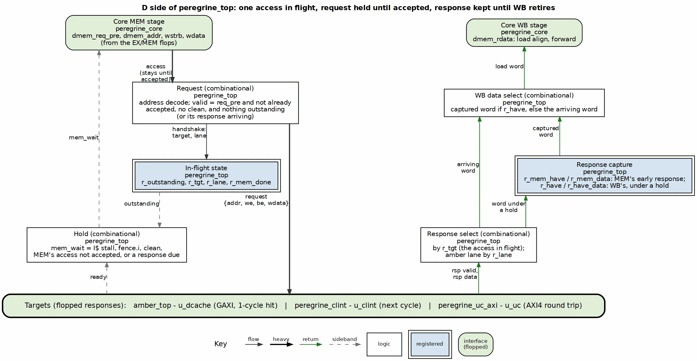

<!-- RTL Design Sherpa Documentation Header -->
<table>
<tr>
<td width="80">
  <a href="https://github.com/sean-galloway/RTLDesignSherpa">
    
  </a>
</td>
<td>
  <strong>RTL Design Sherpa</strong> · <em>Learning Hardware Design Through Practice</em><br>
  <sub>
    <a href="https://github.com/sean-galloway/RTLDesignSherpa">GitHub</a> ·
    <a href="https://github.com/sean-galloway/RTLDesignSherpa/blob/main/docs/DOCUMENTATION_INDEX.md">Documentation Index</a> ·
    <a href="https://github.com/sean-galloway/RTLDesignSherpa/blob/main/LICENSE">MIT License</a>
  </sub>
</td>
</tr>
</table>

---

<!-- End Header -->

# The D Side: Loads in MEM, Holds and Early Responses

This chapter is the cached build's data path: how `peregrine_top` meets the core's registered-read data contract with valid/ready targets (amber, the CLINT, the uncached port).

## Loads Issue in MEM

Every load and store is issued in MEM from the EX/MEM register, so the address is a flop, not the ALU output, and the data arrives in WB: the stage-1 registered-read contract, unchanged. amber's 1-cycle hit (amber TASK-005) fits it exactly: accepted in MEM, response valid in the next cycle, which is WB. A hit adds no stall, and the load-use bubble is the same as in the cacheless build. (The stage-6 plan had loads issuing from EX with data in MEM; that would have put the ALU in front of amber's tag lookup and bought nothing.)

### Figure 4.3: The D-side request, hold and response capture in peregrine_top



**Source:** [peregrine_dside.dot](../assets/graphviz/peregrine_dside.dot)

## The Request

```systemverilog
w_dvalid = dmem_req_pre & ~r_mem_done & ~fence.i busy & ~clean busy
         & ~w_dfault                                     // WB's bus fault this cycle
         & (~r_outstanding | OKAY response arriving);   // w_rsp_ok (TASK-005)
```

- `dmem_req_pre` is the core's MEM access before its `~mem_wait` gate: it stays high, with a stable address, for as long as the instruction sits in MEM.
- **One access in flight.** A new access may be presented in the cycle the previous one's response arrives, but not before.
- **Not gated by the I\$ stall** (stage 7). The I\$ hit is late, and amber's accept-cycle lookup sits behind the request valid, so gating the request by the I\$ put the I\$ hit in front of amber's lookup. An access may therefore be accepted while the core is held for an I\$ miss; `r_mem_done` then marks MEM's access as done until MEM moves on, so it is not presented twice.
- The request is decoded by address (CLINT, I/O, else amber) and routed to that target's valid; `dobs_valid` is the handshake.

## The Hold

```systemverilog
mem_wait = I$ stall | fence.i busy | clean busy
         | (dmem_req_pre & ~r_mem_done & ~w_dfault & ~handshake)  // MEM's access not yet accepted
         | (r_outstanding & ~w_rsp_ok);                   // an accepted access waits;
                                                          // an error response holds one more
```

The first three terms come from flops. The last two make a D\$ miss, an uncached access, a write hit's second cycle or a CLINT access hold the core exactly as long as it takes.

## Responses

The response mux selects by `r_tgt` (the target of the access in flight). Three cases put the response into the core's WB stage:

| Case | When the response arrives | Where WB reads it |
|------|---------------------------|-------------------|
| Hit, no hold | The cycle after the accept: the load is in WB | Straight from the target (`dmem_rdata` = the arriving word) |
| WB's response under a hold | The core is held (an I\$ miss, or the next instruction's access waiting) while the load sits in WB | `r_have` / `r_have_data`, captured that cycle and given to WB until it retires |
| MEM's early response | The access was accepted under a hold (`r_mem_done`) and its response arrives while the load is still in MEM | `r_mem_have` / `r_mem_data`; when the hold drops and MEM moves to WB it becomes `r_have` |

: Where a response waits for WB

Each capture carries the response's error bit (`r_have_err`, `r_mem_err`; TASK-005). An error response always lands on the held side, because it holds; `r_have & r_have_err` is then the core's `dmem_fault` for WB's instruction ("Traps, Interrupts and the Commit Point", "Bus Errors at WB"). The error bit is `cpu_rsp_rd_data[AXI_DW]` from amber (`BUS_ERR_EN=1`, a failed fill) and `rsp_err` from the uncached port; the CLINT never errs.

If MEM's response arrives in the very cycle the hold drops, it goes straight to `r_have`. A response counts (capture, `r_outstanding`, `mem_wait`) only while `r_outstanding` is set, so amber's response to a clean-all is never taken as data.

## The Request Is Never Withdrawn

A valid/ready request may not drop before its handshake. The access stays in MEM (and `dmem_req_pre` stays high) while the core is held, and the core's interrupt lock keeps an interrupt from killing it in the cycle the hold drops ("Traps, Interrupts and the Commit Point"). An access is suppressed only if its instruction traps before presenting it.

## Lessons from the Two Late-Read Bugs

Stage 7's mutation pass found two mutants that survived every simulation: MEM's early response not handed to WB, and MEM's early response captured as WB's. Both read a response a cycle late, and both passed because amber keeps its last response on `cpu_rsp_rd_data`, so a late read still saw the right word in all 10 early loads the CPI suite produced. The TB now scrambles amber's response data whenever its valid is low (`RSP_SCRAMBLE`, "Verification Hooks and Observability"), and the formal `top_props` stub drives a free response on every cycle; both catch the two mutants. The uncached port and the CLINT already drive 0 outside their response cycle.

## Lane Placement and Width

The CPU word is 32 bits and amber's beat 64, with no width converter: the word rides its lane (`be = wstrb << 4 x lane`, data replicated), and the response word is selected by the lane registered at the accept.

## The Upgrade Cost

amber's AXI4 plane sees no IsShared, so by default amber installs every read fill Shared, and the first store to a line a load brought in pays a CleanUnique upgrade (a 1-beat AR the memory answers). peregrine's D\$ is the system's only coherent master and its snoop port is tied idle, so `peregrine_top` sets amber's `READ_FILL_E = 1` (cache-ip/amber-mesi-l1 TASK-006): read fills install Exclusive, and that store is a write hit. On the CPI kernels this removes 0.08% of cycles.

---

**Last Updated:** 2026-11-27
