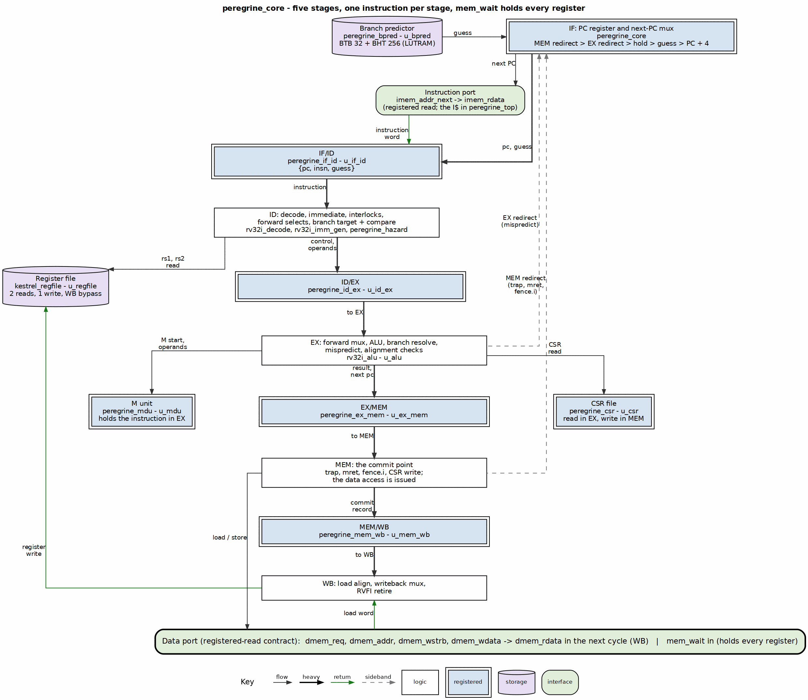

# Introduction

## What this book is

These are condensed study notes on peregrine, the in-order RV32IM core at
rung 3 of the falcon suite. They are not a replacement for the RISC-V
specifications, which are the authority, or for the peregrine MAS
(`peregrine_mas`), which documents every block, port and signal. What this
book adds is the reasoning: why each mechanism has the shape it has, what
it cost, and which alternative was measured and rejected.

Every number in the book comes from the peregrine PRD or from the closed
implementation record, riscv-ip/peregrine-rv32im TASK-001. Where a number
is an estimate or a prediction, the text says so.

## What peregrine adds over merlin

merlin is a five-stage pipeline (IF, ID, EX, MEM, WB) with forwarding, a
load-use bubble, a load-to-branch interlock, and branches resolved in EX
with predict-not-taken: every taken branch costs 2 cycles. merlin halts on
an exception instead of trapping. peregrine keeps the five stages, the
forwarding unit and both interlocks, and adds:

| Addition | What it is | The lesson |
|----------|------------|------------|
| Speculation | 32-entry BTB, 256-entry BHT of 2-bit counters, looked up in IF | A correctly predicted taken branch costs 0; only a mispredict costs 2 |
| Precise traps | Machine-mode CSRs, trap commit at MEM, `mret`, a CLINT | Exceptions and interrupts are taken at one point in program order |
| M extension | Radix-2 multiply/divide, the instruction held in EX | A structural hazard: 33 stall cycles, or 2 with a DSP multiply |
| Memory hierarchy | 4 KiB direct-mapped I\$, amber as a 32 KiB 4-way D\$, AXI4 | Hit time sets the clock; `fence.i` becomes real work |

: The four additions

### Figure 1.1: The peregrine pipeline

The figure is the MAS's pipeline diagram (MAS Figure 1.1). The rest of
this book refers to stages by their merlin names.

## How to read it

Chapters 2 to 5 take the four additions in the order they were built,
because each depends on the one before: the predictor needs a redirect,
traps need a commit point that a redirect can also use, the M unit's
hold interacts with both, and the caches change every timing assumption
the first three made. Chapter 6 is how the core was checked, and Chapter
7 is the bill.

Cycle-level detail is shown with three waveforms (a taken branch, a trap
entry, an M-unit stall). They are drawn from the MAS's cycle rules, which
the RVFI checks in the test suites enforce, not from a single simulation
trace.
