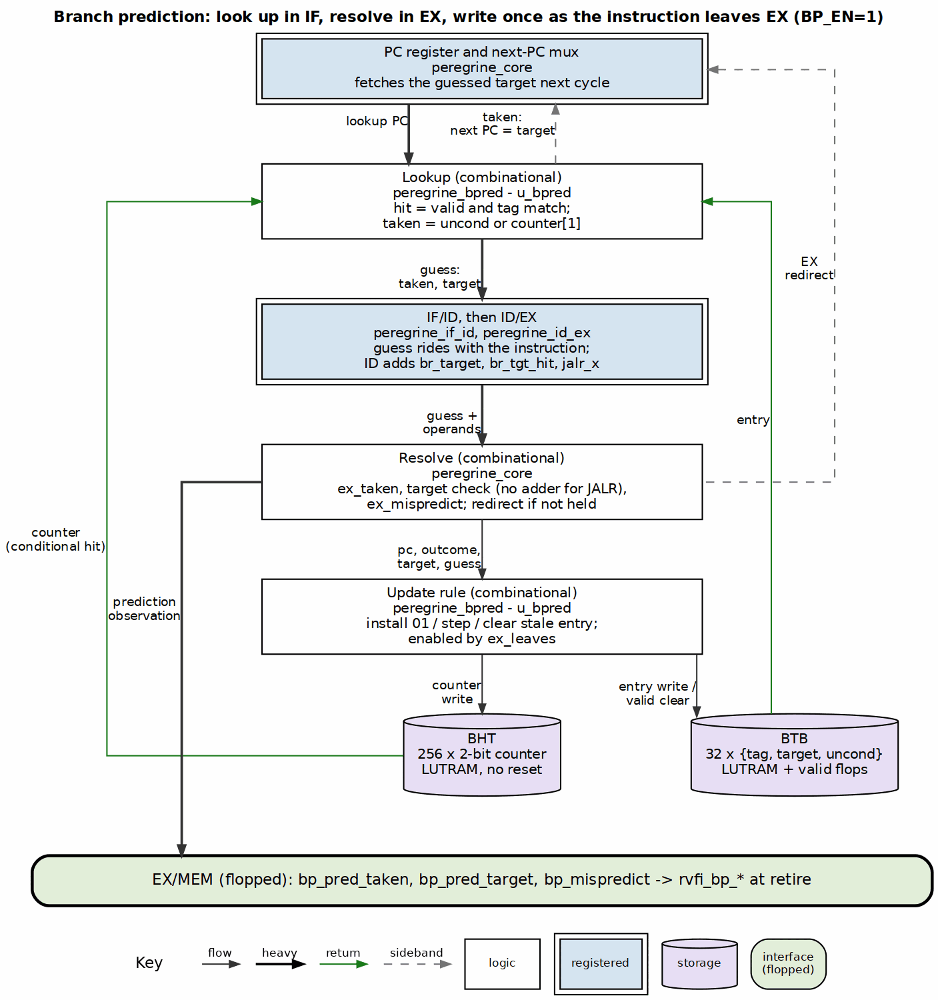
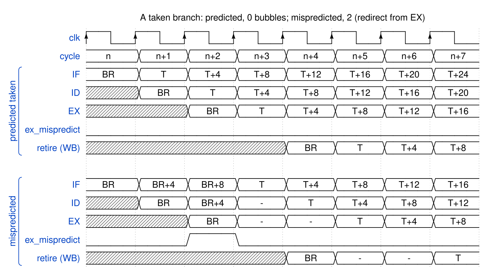

# The BTB and the BHT

## merlin's cost

merlin resolves a branch in EX and fetches PC + 4 until it knows. A taken
branch has two wrong instructions behind it (in IF and ID), so every taken
branch costs 2 cycles, whether it is a loop's back edge taken a thousand
times or not. COD §4.9 makes the penalty a function of where the branch
resolves; merlin's EX resolution sits between COD's base pipeline (MEM,
3 behind) and its move-to-ID optimization (1 behind).

## peregrine's answer: predict in IF

peregrine looks the fetch PC up in two tables in the same cycle it fetches
it (PRD §4.2, P5):

- **BTB**, 32 entries, direct mapped, indexed by PC[6:2], full tag. An
  entry holds the target and an "unconditional" bit (JAL and JALR are in
  the BTB too).
- **BHT**, 256 two-bit saturating counters, indexed by PC[9:2] (COD Fig
  4.65).

If the BTB hits and either the entry is unconditional or the counter is in
a taken state (`1x`), the next fetch is the stored target; otherwise PC +
4. JALR targets are predicted from the BTB with no return-address stack
(P5), so a helper called from two sites mispredicts its return every time
the caller changes.

### Figure 2.1: Lookup in IF, resolve and update in EX

## Resolve in EX

The branch still resolves in EX, exactly as in merlin. EX compares the
guess the instruction carried down the pipe with the real outcome. A
**mispredict** is a wrong direction, or a wrong target on a taken guess.
It redirects the PC to the resolved next PC and flushes IF/ID and ID/EX:
2 bubbles, merlin's taken-branch cost. A correct taken guess costs
**0**.

#### Waveform 2.1: A taken branch, predicted and mispredicted

The top half is the lesson of the rung. The branch `BR` is fetched at
`n`; the BTB hit sends IF to the target `T` at `n+1`, and `BR` and `T`
retire back to back. In the bottom half the guess was not taken: IF
fetches `BR+4` and `BR+8`, `BR` resolves in EX at `n+2`, the redirect
flushes both, and `T` retires two slots late. The penalty is now a
function of the mispredict rate, not of the taken rate (COD gap G2).

## Update as the instruction leaves EX

The counter and the BTB entry are written when the branch resolves, not
when it retires, and exactly once per instruction: as it leaves EX. Not
while `mem_wait` holds the pipe, not while an M instruction holds EX, and
not for an instruction a trap in MEM kills on its way out. Predictor
state is not architectural, so a wrong update cannot break a program,
only slow it. That is exactly why each of those three rules needed its
own test (Section 2.4).

| Instruction leaving EX | BHT | BTB |
|------------------------|-----|-----|
| Conditional branch, taken, no conditional BTB hit | Install: written to `01` | Install entry |
| Conditional branch, taken, BTB hit | Step toward taken | Rewrite entry |
| Conditional branch, not taken | Step toward not taken | Unchanged |
| JAL or JALR | Unchanged | Install entry, unconditional |
| Not a branch, but predicted taken (a stale entry) | Unchanged | Clear entry |

: The update rule (MAS "Branch Prediction")

The last row matters after code is rewritten: a `j` patched into a `mul`
still hits its old BTB entry once, mispredicts, and the entry is cleared,
so it costs one mispredict and not one per pass.
