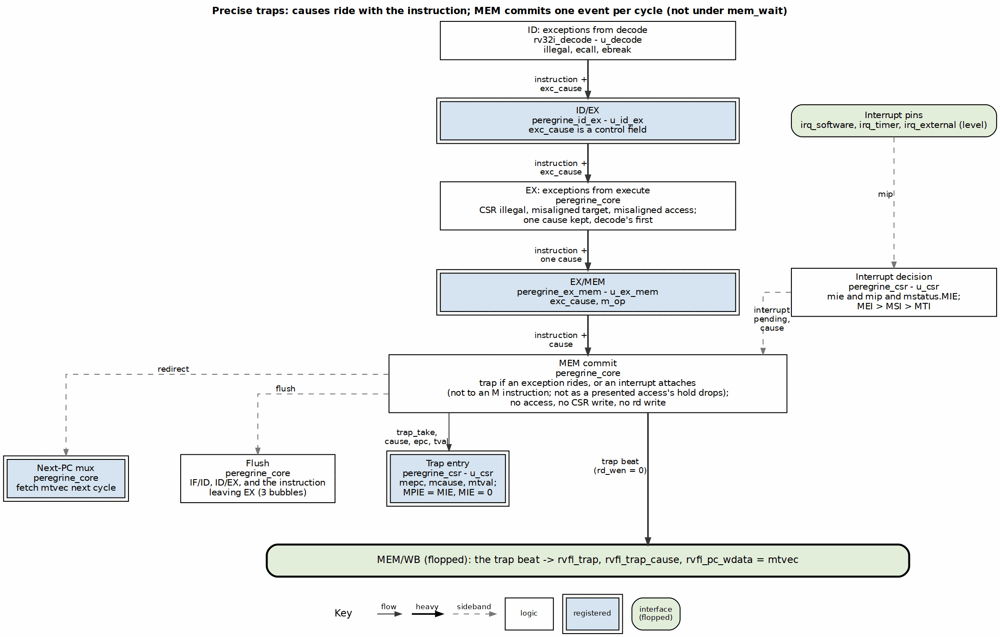
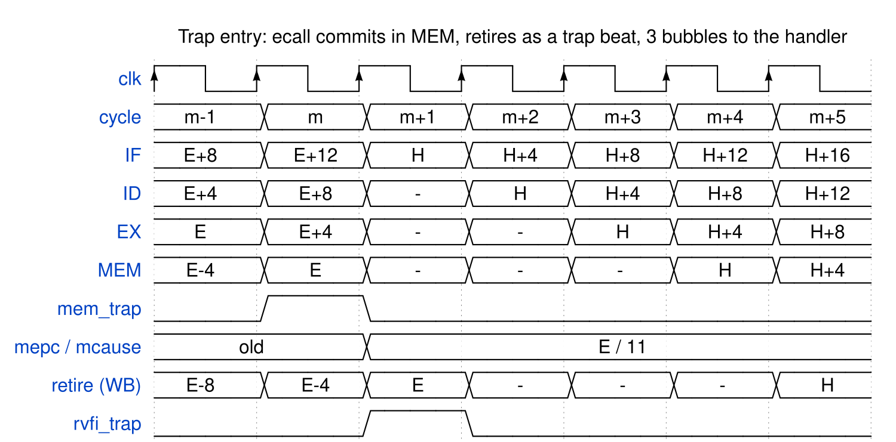

# Commit at MEM

## merlin halted; peregrine traps

kestrel and merlin stop on an exception and report a cause on a pin.
peregrine retires that contract: an exception saves the PC and the cause
in machine-mode CSRs and jumps to the handler at `mtvec`, and `mret`
returns. The handler can fix the problem and resume, which is what makes
`ecall`, timer interrupts and real firmware possible.

The hard part is **precision**: when the handler runs, every instruction
older than the trapping one has completed and no younger one has touched
anything. COD §4.10 states the contract; Smith and Pleszkun's in-order
case is the design (PRD §4.3).

## One commit point

Memory is written in MEM and the register file in WB. So the trap is
taken in MEM:

- An exception found earlier (illegal instruction, `ecall`, `ebreak` in
  ID; a misaligned target or access in EX) does not act when it is found.
  It rides down the pipe with its instruction as a cause code.
- When that instruction reaches MEM it does not access memory, write a
  CSR or write its register. It traps there: `mepc`, `mcause`, `mtval`
  and `mstatus` are written, the PC goes to `mtvec`, and IF/ID, ID/EX and
  the instruction leaving EX are flushed.
- The instruction in WB is older, so it retires. Nothing younger has
  touched memory, the register file or a CSR.

### Figure 3.1: Exceptions ride to MEM; MEM commits one event per cycle

Because the trap commits where a store would write, a store behind a
trapping load never reaches memory, and a load that traps never writes
its register. An exception found in ID for a wrong-path instruction
never matters: the mispredict in EX flushes it before it reaches MEM.

#### Waveform 3.1: Trap entry

The `ecall` `E` is in MEM at `m`. `mem_trap` is high, and at the edge
`mepc` becomes `E` and `mcause` becomes 11. IF fetches the handler `H` at
`m+1`. `E` retires at `m+1` as a **trap beat**: `rvfi_trap` is set, with
no register write and no memory access, which lets a checker see exactly
where the trap was taken. The three instructions behind it are flushed,
so the handler's first instruction retires at `m+5`: 3 bubbles. `mret`
and `fence.i` redirect from MEM the same way and cost the same.

## Where exceptions are detected

| Stage | Exception | mcause |
|-------|-----------|--------|
| ID | Illegal instruction | 2 |
| ID | `ebreak` | 3 |
| ID | `ecall` | 11 |
| EX | Illegal CSR access (unimplemented, or a write to a read-only CSR) | 2 |
| EX | Instruction address misaligned (a taken branch or jump target) | 0 |
| EX | Load address misaligned | 4 |
| EX | Store address misaligned | 6 |

: Exceptions, where they are found, and their cause codes

Bus errors are not on the list. The PRD planned load and store access
faults on an AXI error response; they are not built, bus errors are
ignored, and the work is filed as riscv-ip/peregrine-rv32im TASK-005
(PRD §3, amended 2026-11-25).
