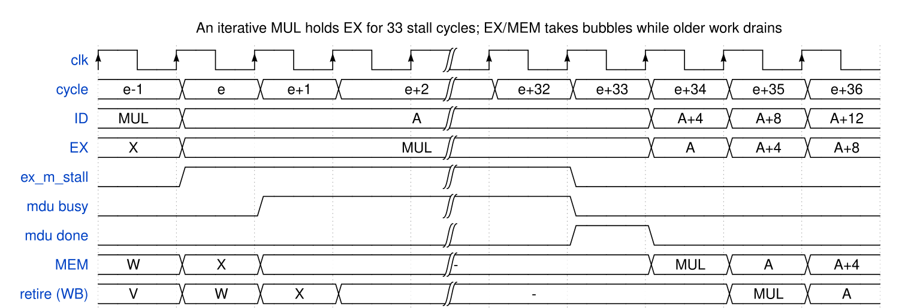

# Hold-in-EX

## A structural hazard

`mul`, `mulh`, `mulhsu`, `mulhu`, `div`, `divu`, `rem` and `remu` share
one iterative unit that takes many cycles. While it works, it is busy,
and the next M instruction cannot use it: a **structural hazard** (COD
§4.6). The question is what everything else does meanwhile.

## The scoreboard the spec asked for

The falcon-suite spec asked for a busy scoreboard: the M instruction
leaves EX at once, the unit works in the background, independent
instructions keep flowing past it, and anything that needs the M result
waits. The result is written back when it is ready, after younger
instructions have already retired.

That last clause is the problem. peregrine reports every retired
instruction on RVFI, in order, with the register it wrote. A write-back
that lands after younger instructions retired belongs to no retire beat,
so RVFI cannot report it, and riscv-formal's instruction checks, which
read RVFI, cannot check it (PRD P12).

## What was built: hold the instruction in EX

The owner revised P3 to hold-in-EX (2026-11-23, "Hold in EX"):

- The M instruction stays in EX until its result is done. The PC, IF/ID
  and ID/EX hold.
- EX/MEM takes a bubble every cycle, so the instructions **ahead** of the
  M instruction drain through MEM and WB and retire.
- When the result is done it moves on with the M instruction and is
  written back in program order, on its own retire beat.

#### Waveform 4.1: An M-unit stall

`MUL` reaches EX at `e`. That cycle starts the unit and latches the
operands; the unit steps 32 times and is done at `e+33`, so EX holds for
33 stall cycles. `W` and `X`, which were ahead, retire normally while MEM
and WB fill with bubbles. `A` waits in ID the whole time. `MUL` retires at
`e+35`, and `A` right after it.

## The details that bit

- **Operands are latched at the start.** During the hold the producers
  drain past WB, so the forwarding selects that were right in the first
  EX cycle go stale. The unit latches its operands, and RVFI reports the
  latched values. A mutant that reported the live ones was caught by the
  RVFI shadow check and by riscv-formal.
- **The ID interlock bubble is suppressed during the hold.** Otherwise it
  would overwrite the held M instruction in ID/EX.
- **A redirect waits.** An M instruction that hit a stale BTB entry (a
  `j` rewritten into a `mul`) mispredicts, but redirects only as it
  leaves EX; a redirect during the hold would flush the held instruction.
- **An older trap cancels the unit**, which can only happen in the M
  instruction's first EX cycle; after that MEM holds bubbles.

## What hold-in-EX gives up

Independent instructions behind the M instruction cannot pass it. That
is the scoreboard's whole benefit, and it moves to gyrfalcon, where a
reorder buffer retires in order even though results complete out of
order (Chapter 7).
