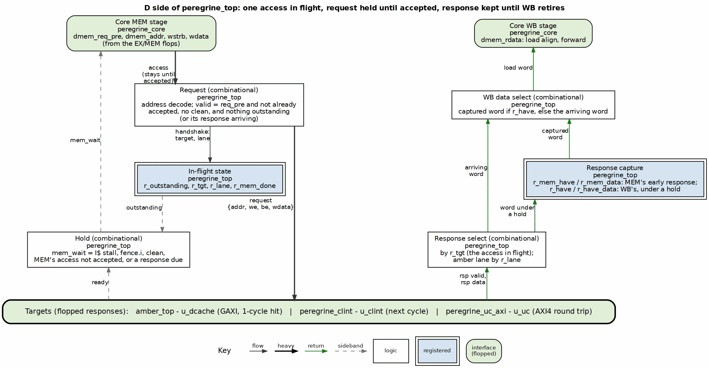

# Split Caches and fence.i

## The hierarchy

kestrel and merlin read instruction and data memory in one cycle, which
only works for a small on-chip memory. peregrine puts caches in front of
an AXI4 fabric (PRD §4.5, P7, P9):

| Block | What it is |
|-------|------------|
| I\$ (`peregrine_icache`) | 4 KiB, direct mapped, 64 B lines, read only, one AXI4 read master; refills a whole line as one burst |
| D\$ (amber, from cache-ip) | 32 KiB, 4-way, 64 B lines (128 sets), write-back, blocking, one AXI4 master |
| Uncached port | One 32-bit load or store at a time, for the I/O window |
| CLINT | `msip`, `mtimecmp`, `mtime` at the SiFive offsets |
| Arbiter | Merges the I\$, D\$ and uncached masters onto one fabric port |

: The memory system (P7, P9)

| Address range | Goes to |
|---------------|---------|
| 0x0200_0000 - 0x0200_FFFF | CLINT |
| 0x1000_0000 - 0x1FFF_FFFF | Uncached I/O (the board UART, the test `tohost` mailbox) |
| Everything else | RAM, cacheable |

: The address map (P7, as amended 2026-11-24)

The I/O window was first written as "0x1000_0000 and up". The
riscv-tests and arch-test images link at 0x8000_0000 and have to be
cacheable, so the window was bounded.

### Figure 5.1: The D side: request, hold and response

Both caches are blocking: a miss holds the whole core with `mem_wait`
until the line is in. An in-order core with one memory access in flight
has nothing to overlap with a second miss, so a non-blocking cache would
be invisible (PRD §2). A load issues in MEM and takes its data in WB; on
a hit that adds no cycle and leaves merlin's single load-use bubble as it
was. (The 75 MHz floor later added a second load-use bubble; see The
Timing Story.)

## fence.i becomes real work

With split caches, a store that rewrites code lands in the D\$ (dirty,
not yet in memory) while the I\$ may hold the old instruction. RISC-V's
`fence.i` is the program's promise that it wants the new code; the core
has to make it true. peregrine's sequence, in MEM:

1. clean the D\$: write every dirty line back to memory (amber's
   clean-all request, added to amber as cache-ip TASK-004);
2. invalidate the whole I\$;
3. commit, and redirect to `pc + 4`, flushing everything younger, which
   was fetched before the clean.

The core holds while the clean and the invalidate run. The redirect is
the step that is easy to forget: the instructions already behind
`fence.i` in the pipe were fetched from the old code.

In the cacheless build there is nothing to clean, but the redirect still
matters. A cacheless build that treated `fence.i` as a no-op failed 2 of
6 signature words of the arch-test `Zifencei` suite; with the redirect it
passes (owner, 2026-11-25).

## The cost of filling shared

amber installs every read fill as Shared, because the plain AXI4 fabric
returns no "is shared" information. In a single-core system the first
store to a line a load brought in therefore pays an upgrade round trip
(18 cycles from the accept on amber's test rig, Section 5.2, against 1 for a write hit). The
fix, installing Exclusive when the response says nobody else holds the
line, is amber's work: cache-ip/amber-mesi-l1 TASK-006.
