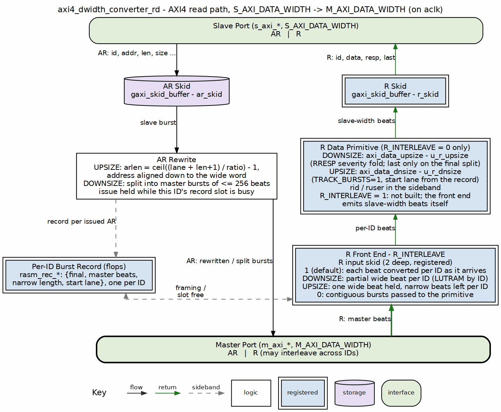

<!-- RTL Design Sherpa Documentation Header -->
<table>
<tr>
<td width="80">
  <a href="https://github.com/sean-galloway/RTLDesignSherpa">
    
  </a>
</td>
<td>
  <strong>RTL Design Sherpa</strong> · <em>Learning Hardware Design Through Practice</em><br>
  <sub>
    <a href="https://github.com/sean-galloway/RTLDesignSherpa">GitHub</a> ·
    <a href="https://github.com/sean-galloway/RTLDesignSherpa/blob/main/docs/DOCUMENTATION_INDEX.md">Documentation Index</a> ·
    <a href="https://github.com/sean-galloway/RTLDesignSherpa/blob/main/LICENSE">MIT License</a>
  </sub>
</td>
</tr>
</table>

---

<!-- End Header -->

# 2.6 axi4_dwidth_converter_rd

The **axi4_dwidth_converter_rd** module is the complete AXI4 read path — AR and R channels with burst length adjustment and burst-aware RLAST generation.

## 2.6.1 Overview

The read converter combines the generic `axi_data_dnsize` with AXI4 protocol handling:

1. **Address Channel (AR)**: Passes through with burst length adjustment
2. **Read Data Channel (R)**: Uses `axi_data_dnsize` for data splitting
3. **Burst Tracking**: Generates correct RLAST based on original ARLEN
4. **Response Broadcasting**: Propagates RRESP to all narrow beats

## 2.6.2 Block Diagram

### Figure 2.7: Read Converter Architecture



## 2.6.3 Interface Specification

### Parameters

| Parameter | Type | Default | Description |
| --- | --- | --- | --- |
| S_AXI_DATA_WIDTH | int | 32 | Slave-side data width |
| M_AXI_DATA_WIDTH | int | 128 | Master-side data width |
| AXI_ID_WIDTH | int | 8 | Transaction ID width |
| AXI_ADDR_WIDTH | int | 32 | Address width |
| AXI_USER_WIDTH | int | 1 | User-signal width |
| SKID_DEPTH_AR | int | 4 | AR skid buffer depth |
| SKID_DEPTH_R | int | 4 | R skid buffer depth |
| RASM_DEPTH | int | 272 | Unused. Sized the retired BUG-009 beat pool; kept so existing instances still elaborate |
| RASM_MAX_OUTSTANDING | int | 16 | Unused, as RASM_DEPTH |
| R_INTERLEAVE | bit | 1 | 1: the `m_axi` R source may interleave beats across IDs; each beat is converted per ID as it arrives (2.6.9). 0: R bursts arrive contiguously (in any order across IDs); beats pass straight to the data primitive (2.6.9a) |

: Table 2.18: Read Converter Parameters

### Ports

```systemverilog
module axi4_dwidth_converter_rd #(
    // Width Configuration
    parameter int S_AXI_DATA_WIDTH  = 32,
    parameter int M_AXI_DATA_WIDTH  = 128,
    parameter int AXI_ID_WIDTH      = 8,
    parameter int AXI_ADDR_WIDTH    = 32,
    parameter int AXI_USER_WIDTH    = 1,

    // Skid Buffer Depths (for timing closure)
    parameter int SKID_DEPTH_AR     = 2,
    parameter int SKID_DEPTH_R      = 4,

    // Calculated Parameters
    localparam int S_STRB_WIDTH = S_AXI_DATA_WIDTH / 8,
    localparam int M_STRB_WIDTH = M_AXI_DATA_WIDTH / 8,
    localparam int WIDTH_RATIO  = (S_AXI_DATA_WIDTH < M_AXI_DATA_WIDTH) ?
                                  (M_AXI_DATA_WIDTH / S_AXI_DATA_WIDTH) :
                                  (S_AXI_DATA_WIDTH / M_AXI_DATA_WIDTH),
    localparam bit UPSIZE       = (S_AXI_DATA_WIDTH < M_AXI_DATA_WIDTH) ? 1'b1 : 1'b0,
    localparam bit DOWNSIZE     = (S_AXI_DATA_WIDTH > M_AXI_DATA_WIDTH) ? 1'b1 : 1'b0,

    // Skid buffer packed widths
    localparam int AR_WIDTH = AXI_ID_WIDTH + AXI_ADDR_WIDTH + 8 + 3 + 2 + 1 + 4 + 3 + 4 + 4 + AXI_USER_WIDTH,
    localparam int R_WIDTH  = S_AXI_DATA_WIDTH + 2 + AXI_USER_WIDTH + 1 + AXI_ID_WIDTH
) (
    // Clock and Reset
    input  logic                        aclk,
    input  logic                        aresetn,

    //==========================================================================
    // Slave AXI Read Interface
    //==========================================================================

    // Read Address Channel
    input  logic [AXI_ID_WIDTH-1:0]     s_axi_arid,
    input  logic [AXI_ADDR_WIDTH-1:0]   s_axi_araddr,
    input  logic [7:0]                  s_axi_arlen,
    input  logic [2:0]                  s_axi_arsize,
    input  logic [1:0]                  s_axi_arburst,
    input  logic                        s_axi_arlock,
    input  logic [3:0]                  s_axi_arcache,
    input  logic [2:0]                  s_axi_arprot,
    input  logic [3:0]                  s_axi_arqos,
    input  logic [3:0]                  s_axi_arregion,
    input  logic [AXI_USER_WIDTH-1:0]   s_axi_aruser,
    input  logic                        s_axi_arvalid,
    output logic                        s_axi_arready,

    // Read Data Channel
    output logic [AXI_ID_WIDTH-1:0]     s_axi_rid,
    output logic [S_AXI_DATA_WIDTH-1:0] s_axi_rdata,
    output logic [1:0]                  s_axi_rresp,
    output logic                        s_axi_rlast,
    output logic [AXI_USER_WIDTH-1:0]   s_axi_ruser,
    output logic                        s_axi_rvalid,
    input  logic                        s_axi_rready,

    //==========================================================================
    // Master AXI Read Interface
    //==========================================================================

    // Read Address Channel
    output logic [AXI_ID_WIDTH-1:0]     m_axi_arid,
    output logic [AXI_ADDR_WIDTH-1:0]   m_axi_araddr,
    output logic [7:0]                  m_axi_arlen,
    output logic [2:0]                  m_axi_arsize,
    output logic [1:0]                  m_axi_arburst,
    output logic                        m_axi_arlock,
    output logic [3:0]                  m_axi_arcache,
    output logic [2:0]                  m_axi_arprot,
    output logic [3:0]                  m_axi_arqos,
    output logic [3:0]                  m_axi_arregion,
    output logic [AXI_USER_WIDTH-1:0]   m_axi_aruser,
    output logic                        m_axi_arvalid,
    input  logic                        m_axi_arready,

    // Read Data Channel
    input  logic [AXI_ID_WIDTH-1:0]     m_axi_rid,
    input  logic [M_AXI_DATA_WIDTH-1:0] m_axi_rdata,
    input  logic [1:0]                  m_axi_rresp,
    input  logic                        m_axi_rlast,
    input  logic [AXI_USER_WIDTH-1:0]   m_axi_ruser,
    input  logic                        m_axi_rvalid,
    output logic                        m_axi_rready
);
```

## 2.6.4 Burst Length Conversion

### Ratio Calculation

Same as write converter:

```systemverilog
// Direction-aware, same as the write converter (2.5.4)
localparam int RATIO = (S_AXI_DATA_WIDTH < M_AXI_DATA_WIDTH)
                       ? (M_AXI_DATA_WIDTH / S_AXI_DATA_WIDTH)
                       : (S_AXI_DATA_WIDTH / M_AXI_DATA_WIDTH);
localparam int RATIO_LOG2 = $clog2(RATIO);

// upsize: New ARLEN = ceil((start_lane + ARLEN + 1) / RATIO) - 1
// (round UP; the start lane counts for mid-word bursts, see 2.6.5)
// downsize: split into master bursts of <= 256 beats (see 2.6.5)
```

### Examples

| S_DATA | M_DATA | Ratio | S_ARLEN | S_beats | M_ARLEN | M_beats |
| --- | --- | --- | --- | --- | --- | --- |
| 64 | 512 | 8 | 7 | 8 | 0 | 1 |
| 64 | 512 | 8 | 15 | 16 | 1 | 2 |
| 64 | 512 | 8 | 31 | 32 | 3 | 4 |

: Table 2.19: Read Burst Length Conversion

## 2.6.5 Address Channel Handling

### AR Passthrough with Adjustment

Every legal AXI4 read burst is carried, in the same three modes as the
write converter (Table 2.16; bridge BUG-018/019):

| Mode | Direction | Bursts | Master side | R path |
| --- | --- | --- | --- | --- |
| CM_PACK | upsize | INCR at the slave's full width | one wide INCR, address aligned down | each wide beat sliced into narrow beats from the start lane |
| CM_PACK | downsize | INCR wider than the master bus | narrow INCR pieces of <= 256 beats | narrow beats packed into wide beats |
| CM_PASS | both | ARSIZE no wider than the narrower bus | the AR unchanged | one slave beat per master beat; downsize replicates the data across chunks, upsize takes the lane the beat's address selects |
| CM_EXPAND | downsize | FIXED or WRAP wider than the master bus | one narrow INCR piece per slave beat | each piece packed into one wide beat |

: Table 2.20: Read Converter Burst Modes

The CM_PACK rewrites (see 2.5.5 for why the upsize divide rounds up):

```systemverilog
// narrow -> wide (upsize): beats combine, round up; the start lane
// counts toward the wide total for mid-word bursts
assign master_arlen = 8'(((10'(w_ar_lane) + 10'(int_arlen) + 10'(WIDTH_RATIO))
                          / 10'(WIDTH_RATIO)) - 10'd1);

// wide -> narrow (downsize): each wide beat becomes 2^(ARSIZE - master
// size) narrow beats, less the start lane in the first one, and the
// total can exceed both ARLEN's 8 bits and the 256-beat legal maximum --
// so one slave burst is SPLIT into master bursts of <= 256 beats (same
// sequencer as the write converter, see 2.5.5)
assign m_axi_arlen  = 8'(w_this_beats - 9'd1);  // min(remaining, 256 - lane)
```

In CM_PACK the size is the master's own full width; in CM_PASS it is the
slave's ARSIZE, unchanged.

For a split read the slave must still see ONE burst: each master burst
returns its own RLAST, and every one except the final master burst's is
masked out. The masking is safe by construction: the first piece is
`256 - lane` narrow beats, so every piece boundary lands on a slave-beat
boundary and never mid-accumulation, and each later piece starts at
`aligned(start) + n * 256 * M_STRB_WIDTH` (the earlier step from the
unaligned start ran every later piece one lane late, bridge BUG-019). The
per-ID record says which piece is final.

**CM_EXPAND** is correct but serial: each slave beat is its own master
burst, and each ID has one master burst outstanding (2.6.9), so a wide
FIXED or WRAP read through a downsizer costs one round trip per beat.

On the UPSIZE path a CM_PACK address is aligned down to the master data
width -- the slave returns whole wide words -- and mid-word INCR starts
are handled by the R slicer: the per-ID record carries the start lane,
`m_axi_arlen` counts it (`ceil((start_lane + narrow_beats) / RATIO)` wide
beats), and the slicer takes the burst's FIRST wide word from that lane,
so the narrow master receives the bytes it actually addressed. Later wide
words slice from lane 0. A CM_PASS burst is issued at its own address; the
slicer walks the beat's low address by the burst rules (FIXED holds, INCR
steps on the size grid, WRAP wraps in its container) to pick each beat's
lane.

### Burst-Length Tracking

Only the wide→narrow R data path needs explicit framing — that is the
converter's **UPSIZE** mode (S narrower than M: wide master read data
sliced down to narrow slave beats through `axi_data_dnsize`). The downsize
block ignores a `burst_start` pulse while a burst is active and keeps no
length queue of its own, so framing only the first burst would collapse
N read bursts into one — bursts 2..N would drain with `narrow_last` never
asserting.

The framing record is the per-ID AR record (2.6.8), pushed at AR accept
and holding the burst's narrow length and start lane;
it replaces the 16-deep burst-length FIFO this section originally
described. The record is per-ID (one outstanding master burst per ID by
reservation), so no shared queue is needed and overlapping bursts are
framed independently. With `R_INTERLEAVE = 1` the same record frames the
per-ID slicer (2.6.9) instead of the primitive.

The narrow→wide R data path (the converter's DOWNSIZE mode) needs no
such framing; its generate branch ties the shared handshake wires off
inert.

## 2.6.6 Read Data Channel

### Downsize Instance

```systemverilog
axi_data_dnsize #(
    .WIDE_WIDTH      (M_AXI_DATA_WIDTH),
    .NARROW_WIDTH    (S_AXI_DATA_WIDTH),
    .WIDE_SB_WIDTH   (2),          // RRESP
    .NARROW_SB_WIDTH (2),
    .SB_BROADCAST    (1),          // Broadcast RRESP
    .TRACK_BURSTS    (1),
    .BURST_LEN_WIDTH (8)
) u_r_dnsize (
    .aclk            (aclk),
    .aresetn         (aresetn),
    // burst framing is MANDATORY with TRACK_BURSTS(1): burst_len is in
    // NARROW beats - 1, and burst_start is LEVEL-HELD while the length
    // FIFO is non-empty (the dnsize samples it only when idle, which is
    // what frames every overlapping burst); leaving them off silently
    // produces framing with no LAST (see 2.3.9)
    .burst_len       (w_blen_rd_data),
    .burst_start     (w_blen_rd_valid),
    .start_lane      (w_blen_rd_lane[$clog2(WIDTH_RATIO)-1:0]),
    .wide_valid      (m_axi_rvalid),
    .wide_ready      (m_axi_rready),
    .wide_data       (m_axi_rdata),
    .wide_sideband   (m_axi_rresp),
    .wide_last       (m_axi_rlast),
    .narrow_valid    (int_r_valid),
    .narrow_ready    (int_r_ready),
    .narrow_data     (int_rdata),
    .narrow_sideband (int_rresp),
    .narrow_last     (int_rlast)
);
```

## 2.6.7 RLAST Generation

With `R_INTERLEAVE = 1`, RLAST is the per-ID slicer's last narrow beat
(upsize) or the final split's RLAST (downsize), 2.6.9. With
`R_INTERLEAVE = 0` there is no local RLAST tracker: the dnsize primitive
generates `narrow_last` itself in TRACK_BURSTS mode, framed by the per-ID
AR record (2.6.8): the record supplies the burst's original narrow
length and start lane, `burst_start` pulses at the first accepted wide beat,
and the dnsize counts narrow beats against it — `int_rlast` comes out of the
dnsize and passes to `s_axi_rlast` through the R skid.

(An earlier revision showed a standalone counter loading
`(arlen + 1) * RATIO - 1`, the same xRATIO framing 2.3.4 calls out as
the classic mis-framing bug; a later one used a 16-deep burst-length FIFO of
narrow arlen/lane per outstanding read. No such multiply exists anywhere in
the converter, and the FIFO was replaced by the per-ID record when the
BUG-009 reassembly layer, since retired, landed.)

## 2.6.8 RID Handling

### ID Tracking

Every converted beat carries its own burst's ID. With `R_INTERLEAVE = 1`
the output beat is built from the arriving beat (downsize) or from the
wide beat being sliced (upsize), so `int_rid` / `int_ruser` are that
beat's RID / RUSER. With `R_INTERLEAVE = 0` they ride the data
primitive's sideband, `{RRESP, RID, RUSER}`, RRESP in the top field so the
upsize primitive's numeric-max fold keeps the worst response.

### Ordering Guarantee (read side; write side fixed by BUG-008)

**Write side: no constraint beyond AXI4 itself.** Since 2026-10-04 the B fold
is a per-burst CAM keyed by AWID (see `05_dwidth_converter_wr.md`): any
cross-ID B completion order is exact (fixed as projects/components/utility-ip/converters BUG-008).

**Read side: full AXI4 R interleaving across IDs is supported.** Beats of
different IDs may arrive in any interleaving and any burst order; beats of
one ID arrive in order, as AXI4 requires. Each ID has at most one master
burst outstanding: master AR issue for an ID waits while that ID's record
slot is occupied, and the slot frees when the burst has arrived (downsize)
or its converted slave burst has gone out (upsize). Same-ID read chains
serialize on that; cross-ID traffic stays concurrent.

An R beat whose ID has no outstanding AR record is flagged by a
`SIMULATION`-guarded `$error`.

## 2.6.9 R Interleave (`R_INTERLEAVE = 1`, 2026-10-18)

AXI4 permits a slave to interleave R beats across ARIDs. The converter
converts each beat against its own ID's state as it arrives; nothing waits
for a whole burst, and the data primitives are not built.

1. **Registered input.** `m_axi` R enters through a 2-deep skid, so every
   per-ID lookup starts from a flop.
2. **Downsize (narrow master beats folded into wide slave beats).** Each
   ID keeps the lanes of its partial wide beat -- `RATIO - 1` narrow
   lanes, one ID-indexed distributed-RAM array per lane -- plus a lane
   count and the worst RRESP so far. The beat that fills the last lane,
   or the final split's RLAST, emits the wide beat with the lanes already
   held. Because the arriving beat supplies the last lane itself, emitting
   costs no extra cycle.
3. **Upsize (wide master beats sliced into narrow slave beats).** One wide
   beat is held and sliced lane by lane. Each ID keeps the narrow beats
   left in its burst and whether the burst has started, so the ID's next
   wide beat resumes at lane 0 with the right count; the burst's first
   wide beat starts at the record's start lane. A next beat of the same ID
   continuing the same burst takes its count from the beat being sliced,
   not from the table (bypass). RLAST is the burst's last narrow beat.
4. **Records and reservation** are the same as 2.6.9a: the per-ID AR
   record supplies the final-split flag (downsize) and the narrow length
   and start lane (upsize).

Cost per instance: `(RATIO - 1) x 2^ID_WIDTH` narrow beats of LUTRAM on the
downsize side, and one wide beat of flops plus a 9-bit count per ID on the
upsize side.

This replaced the BUG-009 reassembly layer (2026-10-04), a shared beat pool
of `RASM_MAX_OUTSTANDING x RASM_DEPTH` entries (16 x 272 by default) that
stored each master burst whole before feeding it to the primitive. In a
generated bridge that was about 128k LUTs per read converter on the
Artix-7; a bridge with ten read converters did not finish synthesis. It was
dropped on 2026-10-16 in favour of the no-interleave mode below, and
interleaving came back without the pool two days later.

Verified by the converter suite at both modes (the R-interleave tests drive
an interleaving slave BFM; the upsize bursts span several wide beats so the
per-ID count is exercised), by formal (`prove` and `prove_rbypass`), and by
the bridge regression, whose slave BFMs interleave R by default.

## 2.6.9a No-Interleave Mode (`R_INTERLEAVE = 0`, 2026-10-16)

When the `m_axi` R source never interleaves beats of different bursts,
beats go straight to the data primitive as they arrive:

1. **Pass-through.** Each R beat goes to the data primitive through one
   2-deep skid that registers it (so the record lookup and the
   primitive's burst framing start from a flop rather than from the
   source's R mux); no burst is buffered.
2. **Records and reservation.** Bursts of different IDs may still return
   in any order, so the per-ID AR record is looked up by the arriving
   beat's RID, and the one-burst-per-ID reservation applies.
3. **Attribution in the sideband.** See 2.6.8.
4. **Downsize accepts other IDs between splits.** Every master burst is a
   whole number of wide beats from lane 0 (splits are 256 narrow beats),
   so no wide beat spans two bursts. Another ID's burst arriving between
   the splits of a slave burst is taken.
5. **Upsize takes one burst at a time.** The dnsize primitive frames
   from `burst_len`, so a new burst enters once the previous one is
   leaving it.

A `SIMULATION` check flags an interleaved beat. The data primitives frame
aligned full-width INCR only, so `R_INTERLEAVE = 0` carries CM_PACK bursts
that start on the wide boundary and nothing else: a narrow, FIXED, WRAP or
unaligned burst is flagged by a second `SIMULATION` check (`$error`), and
there is no hardware fallback. Use `R_INTERLEAVE = 1` for full AXI4.
Covered by the converter suite's `_ri0` rows. The bridge used this mode from 2026-10-16 to
2026-10-18; it now builds every read converter with `R_INTERLEAVE = 1`.

## 2.6.10 Resource Utilization

### Typical Resources (64→512 UPSIZE, ratio 8, ID=4)

The burst-length FIFO exists only in the converter's UPSIZE mode (see
2.6.5), so the configuration here is upsize — an earlier revision
labeled this table 512→64 (DOWNSIZE), a mode in which that FIFO is
tied off and does not exist. Hand estimates, not synthesis results,
except the FIFO, which is counted from its declarations.

```
AR skid buffer:      ~150 flip-flops
R dnsize data path:  ~600 flip-flops, ~50 LUTs  (single-buffer slicer)
Burst-length FIFO:   186 flip-flops
                     (16 x 8b length + 16 x 3b start lane + two 5b pointers)
Control logic:       ~80 LUTs

Total: ~940 flip-flops, ~130 LUTs (sum of the lines above)
```

There is no separate "burst tracker" block — 2.6.7 explains RLAST
comes from the dnsize's own counter, framed by the FIFO. The R data
path is the single-buffer `axi_data_dnsize` — the only implementation;
its ping-pong `DUAL_BUFFER` variant was removed, see 2.3.8.

## 2.6.10 Timing

### Latency

| Path | Latency |
| --- | --- |
| AR passthrough | 1-2 cycles (skid) |
| First R beat | 1 cycle (load buffer) |
| Subsequent R beats | 1 beat/cycle |

: Table 2.21: Read Converter Latency

### Throughput

- AR channel: 1 transaction/cycle
- R channel: the downsize accepts its next wide beat during the last narrow beat — 0.992 beats/cycle measured in simple mode (TRACK_BURSTS=1 pays one bubble per burst boundary and measures ~0.93; see 2.3)

## 2.6.11 Usage Example

```systemverilog
axi4_dwidth_converter_rd #(
    .S_AXI_DATA_WIDTH (128),
    .M_AXI_DATA_WIDTH (32),
    .AXI_ID_WIDTH     (8),
    .AXI_ADDR_WIDTH   (32),
    .SKID_DEPTH_AR    (2),
    .SKID_DEPTH_R     (4)
) u_conv (
    .aclk             (aclk),
    .aresetn          (aresetn),
    // slave side: s_axi_ar*/... (full AXI4 channel set)
    .s_axi_arvalid   (cpu_arvalid),
    .s_axi_arready   (cpu_arready),
    // ...
    // master side: m_axi_* toward the narrow fabric
    .m_axi_arvalid   (mem_arvalid),
    .m_axi_arready   (mem_arready)
    // ...
);
```

All channel ports carry the `s_axi_`/`m_axi_` prefix; the full list is
the module header. Skid depths are per channel — there is no single
`SKID_DEPTH`.

---

**Next:** [Protocol Conversion Overview](../ch03_protocol_blocks/01_overview.md)
