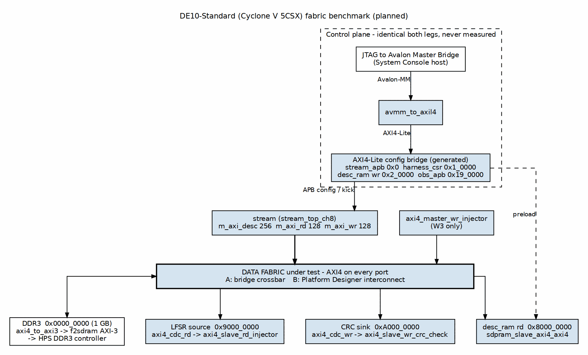

<!-- RTL Design Sherpa Documentation Header -->
<table>
<tr>
<td width="80">
  
</td>
<td>
  <strong>RTL Design Sherpa</strong> · <em>Learning Hardware Design Through Practice</em> 
  
    <a href="https://github.com/sean-galloway/RTLDesignSherpa">GitHub</a> ·
    <a href="https://github.com/sean-galloway/RTLDesignSherpa/blob/main/docs/DOCUMENTATION_INDEX.md">Documentation Index</a> ·
    <a href="https://github.com/sean-galloway/RTLDesignSherpa/blob/main/LICENSE">MIT License</a>
  
</td>
</tr>
</table>

---

<!-- End Header -->

**[← Back to fabric-benchmark](README.md)**

# DE10-Standard Fabric Benchmark — PRD

**Version:** 0.4 (draft) · **Date:** 2026-10-14 · **Status:** collateral-blocked
(Quartus/Platform Designer IP intake pending; bring-up unblocked when available)

## 1. Purpose

Measure, on one piece of silicon and one mirrored pair of traffic patterns,
what two AXI fabrics cost and what they deliver:

- **Leg A — bridge:** the RTL Design Sherpa bridge generator's crossbar.
- **Leg B — Intel fabric:** the Platform Designer (Qsys) AXI interconnect.

The traffic is real: `stream` moves data between real endpoints. The
premise is that `stream` delivers full bandwidth on its own, so any
shortfall measured here is the fabric's or the memory controller's; the run
matrix in §4.1 is built to say which, and W2 (no memory controller in the
path) checks the premise on this board.

**The workload — two mirror-image flavors (both legs, bit-identical):**

- **Flavor 1 — drain:** `stream` moves a DDR3 region across the fabric
  into the CRC sink.
- **Flavor 2 — fill:** `stream` reads the LFSR source across the fabric
  and writes it into a DDR3 region.

**Hypothesis:** the two flavors are mirror images and SHOULD tell the same
story — fabric and memory-controller behavior direction-symmetric. DDR3
reads and writes are not physically symmetric (posted writes, bus
turnaround), so the hypothesis is expected to be tested, not assumed:
measuring where and by how much it fails is a result in its own right. The
scenario library in §4.1 extends the same mirror discipline to contention,
addressing, transients, and integrity.

Two comparison axes: **size of design** and **performance**. Everything
else — device, HPS, memory controller, stream, the source and sink, the
descriptor SRAM, the protocol converters at the fabric edge, obs blocks,
injector, host control path, clocks — is held constant.

## 2. Background

The site teaches fabric design with generated crossbars (see the bridge
HAS/MAS and the interconnect literature in
`projects/components/fabric-gen-ip/bridge/references/`). A fair question a
reader should be able to see answered with data: against the vendor's own
interconnect on the same device, with the same masters and slaves, what does
a generated crossbar cost in logic and fmax, and what bandwidth/latency does
it actually deliver? The DE10-Standard (Cyclone V SoC, hard DDR3 controller
in the HPS) is the vehicle: the Intel memory controller is the constant
anchor both fabrics must reach through.

**The HPS memory port is AXI3, not AXI4.** The FPGA reaches the HPS DDR3
through the FPGA-to-HPS SDRAM interface (f2sdram), whose ports are
configurable as AXI-3 or Avalon-MM, 32 to 256 bits, with at most 256 bits
per direction across all ports (Cyclone V HPS TRM, "FPGA-to-HPS SDRAM
Interface"). This is the only AXI3 boundary in the data path, and it is
held OUTSIDE both fabrics (§5.3).

## 3. Definitions and constants

| Held constant (both legs) | Value / source |
| --- | --- |
| Board / device | Terasic DE10-Standard, Cyclone V 5CSXFC6D6F31C8 |
| Toolchain | Quartus Prime 24.1 Standard (`/home/seang/intelFPGA_lite/24.1std`) |
| HPS + hard memory controller | Intel DDR3 controller via HPS f2sdram, one AXI-3 port; identical HPS config both legs |
| Clock plan | One fabric clock (same frequency both legs); the LFSR source and CRC sink on their own clock behind CDC (§5.2) |
| Mover | `stream` (`stream_top_ch8`, the Genesys 2 harness configuration from `stream_cfg_pkg`) |
| Descriptors | `desc_ram` (`sdpram_slave_axi4_axi4`): host preloads over the control plane, `stream`'s descriptor master fetches across the fabric under test |
| LFSR source | `axi4_slave_rd_injector` behind `axi4_cdc_rd` |
| CRC sink | `axi4_slave_wr_crc_check` behind `axi4_cdc_wr` |
| Write injector (W3 only) | `axi4_master_wr_injector`, same config both legs |
| Fabric-edge converter | `axi4_to_axi3` between the fabric's DDR port and f2sdram, same RTL both legs |
| Host control path | Intel JTAG to Avalon Master Bridge → `avmm_to_axil4` → generated AXI4-Lite config bridge; control only, never data (§5.1) |
| obs blocks | Identical `axi4_intf_master_observer` / `axi4_intf_slave_observer` RTL at the same probe points both legs |
| Traffic | Identical sequence files, transaction counts, burst sequences, LFSR seeds |

| The one variable | Leg A | Leg B |
| --- | --- | --- |
| The data fabric between the masters and slaves of §5.2 | Bridge-generated AXI4 crossbar | Platform Designer AXI4 interconnect |

Matching rule: Leg A's bridge config (TOML) mirrors the PD system's topology
— same master/slave count, same data widths, same ID widths, same address
map (§5.2). No wider or fancier bridge than the PD fabric it replaces. Any PD
feature with no bridge equivalent (e.g. default slave, topology display) is
matched functionally or documented as a difference.

## 4. Benchmark definition

### 4.1 Workloads (performance axis)

Every run is one point in a source × sink matrix. The source is DDR3 or the
LFSR source; the sink is DDR3 or the CRC sink:

| Run | Source | Sink | What it isolates |
| --- | --- | --- | --- |
| **W1-F1 — drain** | DDR3 | CRC sink | read path: fabric + memory controller, read direction |
| **W1-F2 — fill** | LFSR source | DDR3 | write path: fabric + memory controller, write direction |
| **W2 — fabric only** | LFSR source | CRC sink | the fabric with no memory controller in the path |
| **W4 — copy** | DDR3 | DDR3 | both directions through the controller at once |

W2 is the attributor: a shortfall that appears in W1 and not in W2 is the
memory controller's; one that appears in W2 is the fabric's. F2 followed by
F1 over the same region is also the integrity loop: the LFSR data written by
F2 is drained into the CRC sink by F1, so every F2 run ends in a CRC verdict
(C1 below).

**v1 execution scope** — the headline sweep runs on W1-F1, W1-F2 and W2:
burst length {4, 8, 16, 32, 64 beats} × outstanding transactions {1, 2, 4,
8}, fixed measurement window, N = 5 runs. Bursts above 16 beats are split
by the fabric-edge `axi4_to_axi3` on the DDR3 path; that converter is the
same RTL in both legs, so the comparison stays fabric against fabric, and
the split shows up identically in both. W2 does not cross it.

- **W3 — Contention pair (F3 / F3-mirror):** stream drains DDR3 → CRC sink
  while the injector concurrently fills a *different* DDR3 region
  (concurrent R+W through the arbiters and the controller); the mirror run
  swaps the roles. Sweep: mix {50/50, 90/10} × outstanding {2, 4}.
  **Story:** per-master bandwidth shares should be symmetric under
  role-swap; asymmetry isolates arbitration bias in the fabric vs
  read-priority scheduling in the controller.

**Scenario library** — adopted with this PRD; all reuse the fixed cast and
all carry a mirror check. Scheduling follows milestone appetite; data lands
in `data/` under the same conventions as v1.

| Scenario | Mirror partner | The story it should tell |
| --- | --- | --- |
| **B1 — Burst-knee curve** | both flavors | Efficiency vs burst length at fixed total bytes; the saturation knee per leg, and the same knee in both flavors |
| **B2 — Address-stride sweep** | both flavors | Row-interleaved vs blocked vs strided access (stream's existing address generators); the fabric adds no order-sensitivity, and legs track across strides |
| **B3 — Hot-region saturation** | — (single, but percentile tails are the check) | Latency percentiles under full saturation of one bank/region; arbitration jitter exposed by the tail |
| **B4 — Cold vs warm transients** | idle durations {1 µs, 1 ms, 10 ms} | First-transaction latency after idle vs steady-state; pipeline/skid depth visible as the size-vs-latency trade |
| **C1 — F2 readback verify** | F1's drain CRC | After W1-F2 writes DDR3, F1 drains the same region into the CRC sink — closes the integrity loop so **both** flavors end in a CRC verdict |
| **C2 — Seed-swap sanity pair** | F1 ↔ F2 seeds | Same entropy, different data; results are data-independent. `LFSR_SEED` is a build parameter of the source today, so C2 costs a second bitstream per leg (or a seed CSR on the source) |

**v1.x stretch** (reuse the cast; schedule after the library): D1 — hours-long
alternating F1/F2 soak with obs tracking BW/latency drift over time; E1 —
unmapped-address probe (DECERR latency, PD default slave vs bridge
subtractive slave); E2 — unaligned burst starts (both legs carry aligners;
measure the penalty).

**Deferred:** A2 — backpressure pair (slow sink, then slow source). Tells
the sustained-backpressure story, but needs one small RTL knob (a pace
throttle on the LFSR source / CRC sink); revisit after v1.

### 4.2 Metrics — performance

Measured by the **obs blocks** (identical RTL and probe points both legs),
read out over the control plane:

- Sustained bandwidth (MB/s) per sweep point, per run, next to the
  theoretical peak of the path it crossed: fabric width × fabric clock for
  W2; the lesser of that and the DDR3 peak for W1/W4.
- Latency distribution (p50 / p95 / p99) for the measured transaction
  windows, idle and under load.
- Mirror agreement: W1-F1 vs W1-F2 (and F3 vs F3-mirror) bandwidth and
  latency at matched sweep points; divergence attributed with W2.
- Under W3: per-master bandwidth share (arbitration fairness) and latency
  inflation; role-swap symmetry.
- Integrity: CRC verdicts at the end of every flavor run (C1 closes the
  loop for F2).

### 4.3 Metrics — size of design

From Quartus, same seeds/effort/SDC both legs:

- ALMs (and the logic vs register split), FFs, M10K blocks and bits, DSPs
  (expected zero).
- fmax from TimeQuest on the fabric-clocking scheme (same target strategy
  both legs; report achieved and the failing-path story if a leg misses).
- Compile wall-clock; per-hierarchy resource extraction for the fabric
  instance where the flow allows.
- The fabric boundary for size is the fabric instance alone. The
  fabric-edge `axi4_to_axi3`, the CDC crossings and the host control path
  are held constant (§3) and reported once, not per leg.

Delivered as raw Fitter/TimeQuest report parses (CSV in `data/`) and a
normalized delta table (% difference, Leg A vs Leg B).

### 4.4 Methodology rules

- Same Quartus version, device, pin/clock constraints, and SDC.
- Same sequence files and transaction streams both legs (identical counts,
  identical LFSR seeds both flavors and both legs), run first against the
  sim harness and then on the board (§5.4).
- Warm-up excluded: measurements taken over a fixed steady-state window.
- N = 5 runs per point; report median and spread.
- No hand-tuning a leg's constraints to win; constraint files are shared.

## 5. Architecture

### Figure 5.1: The benchmark (planned)

Two planes. The **control plane** carries the host's configuration and
readout and is never measured. The **data plane** is the fabric under
test and everything that moves data through it.

### 5.1 Control plane

Intel parts have no JTAG-to-AXI master; the Quartus debug master is the
**JTAG to Avalon Master Bridge**, an Avalon-MM master driven from System
Console. `avmm_to_axil4`
(`projects/components/utility-ip/converters/rtl/`) converts it to the
AXI4-Lite master the harness expects — the same front-end contract the
Genesys 2 harness gets from `uart_axil_bridge`. Writes are non-posted (the
converter holds waitrequest until BRESP), so configuration lands in the
order the host wrote it. A generated AXI4-Lite bridge fans out to the
harness slaves; this bridge is identical in both legs and is not the fabric
under test.

| Base | Size | Slave |
| --- | ---: | --- |
| `0x0000_0000` | 8 KB | `stream_apb`: STREAM configuration and kicks |
| `0x0001_0000` | 4 KB | `harness_csr`: CTRL / STATUS / CRC expected and computed |
| `0x0002_0000` | 64 KB | `desc_ram` host write port: descriptor preload |
| `0x0019_0000` | 4 KB | `obs_apb`: observer configuration and the bandwidth / latency readout |

: Table 5.1: Control-plane address map (AXI4-Lite, 32-bit). A subset of the Genesys 2 harness map (`bridge_stream_mon_axil`, which both Genesys 2 builds use) at the same offsets, so the generated regmaps and host libraries carry over. The LFSR polynomial and seed and the CRC configuration are parameters of the source and sink, not registers, and are identical in both legs.

Host transport: the shared stack's by-name register layer
(`UartRegisterMap` / `Device` / `DeviceBus`) takes any bridge object with
`write` / `read`. A System Console bridge implementing that interface
serves the board; the sim harness drives the same register calls into
`avmm_to_axil4` through an Avalon-MM master. Same host programs and
sequence files on both sides — the equivalence property of the shared
host stack, at the register-call level rather than the UART byte level.

### 5.2 Data plane — the fabric under test

Masters (AXI4, fabric clock):

| Master | Width | Role |
| --- | ---: | --- |
| `stream` m_axi_desc | 256 | descriptor fetch from `desc_ram` |
| `stream` m_axi_rd | 128 | source reads (DDR3 or LFSR source) |
| `stream` m_axi_wr | 128 | sink writes (DDR3 or CRC sink) |
| `axi4_master_wr_injector` | 128 | W3 contention writes only |

Slaves and the data-plane address map:

| Base | Size | Slave | Path behind the fabric port |
| --- | ---: | --- | --- |
| `0x0000_0000` | 1 GB | DDR3 | `axi4_to_axi3` → f2sdram AXI-3 port (128-bit) → HPS DDR3 controller. Benchmark regions live in `0x2000_0000`–`0x3FFF_FFFF`; the lower 512 MB stays with the HPS preloader/software |
| `0x8000_0000` | 64 KB | `desc_ram` read port | `sdpram_slave_axi4_axi4`, the same RAM the host preloads over the control plane |
| `0x9000_0000` | 256 MB | LFSR source | `axi4_cdc_rd` → `axi4_slave_rd_injector` (read-only; data is address-independent, the window only has to cover a run) |
| `0xA000_0000` | 256 MB | CRC sink | `axi4_cdc_wr` → `axi4_slave_wr_crc_check` (write-only) |

: Table 5.2: Data-plane address map (AXI4, 32-bit address). DDR3 is at base 0 so fabric addresses are SDRAM physical addresses at f2sdram with no translation.

The LFSR source and CRC sink run on their own clock behind the CDC
crossings so they cannot be the bottleneck; the crossings are the same RTL
in both legs. The descriptor fetch crosses the fabric under test on
purpose — descriptor traffic competing with data traffic is part of the
real workload. (On the Genesys 2 the descriptor master is wired straight to
`desc_ram`; that wiring is one `desc_ram` port move if a run wants it
removed from the measurement.)

### 5.3 The protocol boundary

Both fabrics are AXI4 on every port. The one AXI3 boundary, f2sdram, is
crossed by the repo's `axi4_to_axi3` sitting between the fabric's DDR3
slave port and the HPS, in both legs. Leg B's Platform Designer system
therefore sees an AXI4 slave and inserts no burst adapter of its own on the
DDR3 path; Leg A's bridge is configured `protocol = "axi4"` on every port.
Keeping the conversion outside both fabrics is what makes bursts above 16
beats a fair point: they are split by the same RTL in both legs, and neither
fabric's size or latency carries a converter the other does not.

### 5.4 Simulation before silicon

Both legs run in the sim harness before any bitstream, under the house FPGA
method (`vault/handbook/fpga/cmn-infra/`): the same harness RTL, the same
generated regmaps, the same host programs and sequence files that drive the
board, with the simulation configuration replicating the board
configuration exactly. The f2sdram port is modelled in sim by an AXI-3
memory slave behind the same `axi4_to_axi3`. Leg B simulates from Platform
Designer's generated simulation model of its interconnect.

## 6. Deliverables

1. `quartus/` — two compilable Quartus projects (Leg A, Leg B).
2. `rtl/` — the DE10 harness and top, bridge TOMLs (control plane and Leg A
   data plane), obs hookups.
3. `dv/` — the sim harness for both legs.
4. `host/`, `bin/` — the System Console bridge, host programs, sequence
   files, report-to-CSV parsers.
5. `data/` — measurement CSVs per leg per run per run date.
6. `docs/` — analysis document (standard doc flow → PDF): headline size
   table + performance tables (every run in §4.1) + mirror-agreement
   verdicts + honest caveats (topology differences, single-device scope).

## 7. Milestones

| M | Content | Blocked by |
| --- | --- | --- |
| M0 | Collateral intake: PD IP inventory, JTAG to Avalon Master Bridge in 24.1 std, HPS DDR3 config for this board, f2sdram port width and count | external download |
| M1 | Control plane: JTAG → `avmm_to_axil4` → config bridge; System Console bridge reads and writes the harness CSRs by name, in sim and on the board | M0 |
| M2 | Leg B (Intel PD) data plane: sim harness green on W1-F1/W1-F2/W2/W3 with the board sequences; then compiles and runs on the board | M1 |
| M3 | Leg A (bridge) data plane: matched-topology TOML; same sim then board gate as M2 | M2 |
| M4 | Measurements: v1 sweep ×5 runs both legs; scenario-library runs as appetite allows; Fitter/TimeQuest parses | M3 |
| M5 | Analysis doc + site write-up (incl. mirror-agreement verdicts) | M4 |

Note the order: Intel leg first. The PD flow is the unknown; the bridge leg
is deterministic given a matched topology.

## 8. Success criteria

- Both legs pass the sim harness and then fit and run on the DE10-Standard
  with the identical host programs and sequence files.
- Headline tables delivered: size delta and performance delta, Leg A vs Leg
  B, at matched topology, for every run in §4.1.
- **Mirror agreement:** W1-F1 and W1-F2 (and F3 vs F3-mirror) tell the same
  story within measurement spread at matched sweep points, or every
  divergence is attributed (fabric vs controller, via W2) in the analysis.
- Every flavor run ends in a CRC verdict (C1 makes this true for F2).
- A third party can re-run the campaign from `host/` + this PRD alone.

## 9. Non-goals (v1)

Other topologies/NoC; ACP and the f2h bridge (the L3 path) as the DDR3
route; multi-clock fabric comparisons; power; Linux userspace benchmarking;
AXI5; backpressure pacing (A2 deferred).

## 10. Risks

| Risk | Mitigation |
| --- | --- |
| HPS boot complexity (the controller needs HPS configuration) | Vendor reference boot flow from the collateral; bare-metal preloader if Linux is overkill |
| f2sdram port count/width differs from the 128-bit AXI-3 assumed in §5.2 | M0 fixes it; the fabric-edge converter and the TOML follow the measured port |
| PD leg emits features the bridge can't match | Match functionally or document as a difference in the analysis; never let Leg A exceed Leg B's configured capability |
| Leg A fmax below Leg B on Cyclone V (different RAM inference styles) | Report achieved fmax at the shared clock target plus a best-effort column; the comparison is primarily at-equal-clock |
| Mirror flavors disagree (real asymmetry) | That is a finding, not a failure: attribute it with W2 (fabric only) against W1 (with the controller) |
| Scenario-library scope creeps past milestone appetite | Library is explicitly appetite-scheduled; v1 exit criteria only cover W1/W2/W3 |
| Quartus 24.1 std device/IP gaps for 5CSX | M0 verifies before any build work |

## 11. Open questions (resolve at M0)

- Exact HPS DDR3 part/timing config shipped with the board collateral, and
  its theoretical peak for §4.2.
- f2sdram: one 128-bit AXI-3 port, or 256-bit — fixes the DDR3 port width
  and the converter configuration.
- System Console scripting in 24.1 std: any license feature needed.
- PD interconnect default configuration knobs worth matching (pipeline
  stages, arbitration) so Leg A's bridge config is a fair mirror.

## 12. References

- Dally & Towles, *Principles and Practices of Interconnection Networks*
  (Morgan Kaufmann, 2004) — router/interconnect cost model framing; already
  in `projects/components/fabric-gen-ip/bridge/references/README.md`.
- Intel, *Cyclone V Hard Processor System Technical Reference Manual*,
  "FPGA-to-HPS SDRAM Interface" — f2sdram protocols, widths and port
  utilization.
- Terasic DE10-Standard user manual — bibliographic entry to be added at M0
  from the downloaded collateral.
- Bridge HAS/MAS (`projects/components/fabric-gen-ip/bridge/docs/`) — Leg A
  capabilities and configuration surface.
- `projects/fpga-systems/Genesys2/dma-ip/stream/` — the harness, filelists,
  stimulus blocks, obs infrastructure and host libraries this campaign reuses.
- `vault/handbook/fpga/cmn-infra/` — the sim-harness / host-stack method both
  legs follow.
