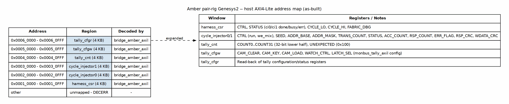

<!-- RTL Design Sherpa Documentation Header -->
<table>
<tr>
<td width="80">
  
</td>
<td>
  <strong>RTL Design Sherpa</strong> · <em>Learning Hardware Design Through Practice</em> 
  
    <a href="https://github.com/sean-galloway/RTLDesignSherpa">GitHub</a> ·
    <a href="https://github.com/sean-galloway/RTLDesignSherpa/blob/main/docs/DOCUMENTATION_INDEX.md">Documentation Index</a> ·
    <a href="https://github.com/sean-galloway/RTLDesignSherpa/blob/main/LICENSE">MIT License</a>
  
</td>
</tr>
</table>

---

<!-- End Header -->

**[← Back to README](../README.md)** | **[← amber_fpga_system_index](amber_fpga_system_index.md)**

# Amber Pair-Rig Genesys2 — Address Map

The host sees a single 32-bit AXI4-Lite address space decoded by the
auto-generated `bridge_amber_axil` crossbar (1 master × 6 slaves). All
apertures are 4 KB and are as-built in the harness RTL.

### Figure 2.1: Host AXI4-Lite Address Map

The address map above is derived from `bridge_amber_axil.toml` and the host
base constants in `host/amber_board.py`.

## Window summary

| Base | Range | Slave | Protocol | Data | Purpose |
| --- | --- | --- | --- | --- | --- |
| `0x0001_0000` | 4 KB | `harness_csr` | AXIL | 32 | Global control/status + free-running cycle counter |
| `0x0002_0000` | 4 KB | `cycle_injector0` | AXIL | 32 | Core 0 stimulus engine config/status |
| `0x0003_0000` | 4 KB | `cycle_injector1` | AXIL | 32 | Core 1 stimulus engine config/status |
| `0x0004_0000` | 4 KB | `tally_cnt` | AXIL | 64 | MonBus tally bin-count readback (host reads low 32 bits) |
| `0x0005_0000` | 4 KB | `tally_cfgw` | AXIL | 64 | MonBus tally CAM legal-set load / config write |
| `0x0006_0000` | 4 KB | `tally_cfgr` | AXIL | 64 | MonBus tally config/status readback |

: Table 2.1: Host-visible AXI4-Lite address windows

Any address outside the six windows above returns a DECERR response from the
bridge.

## `harness_csr` registers (`0x0001_0000`)

| Offset | Name | Access | Description |
| --- | --- | --- | --- |
| `0x000` | CTRL | RW | Global control (scratch / run gate) |
| `0x004` | STATUS | R | `{26'b0, ci1_err, ci0_err, ci1_busy, ci0_busy, ci1_done, ci0_done}` |
| `0x008` | CYCLE_LO | R | Free-running cycle counter [31:0] |
| `0x00C` | CYCLE_HI | R | Free-running cycle counter [63:32] |
| `0x010` | FABRIC_DBG | R | `amber_pair_fabric` debug state [3:0] |

: Table 2.2: harness_csr register map

## `cycle_injector` registers (`0x0002_0000` and `0x0003_0000`)

| Offset | Name | Access | Description |
| --- | --- | --- | --- |
| `0x000` | CTRL | RW | `{we_mix[15:8], 7'b0, run}` |
| `0x004` | SEED | RW | Fibonacci LFSR seed (0 substitutes `0xDEAD_BEEF`) |
| `0x008` | ADDR_BASE | RW | Base address for generated transactions |
| `0x00C` | ADDR_MASK | RW | Wrap mask applied to LFSR index (`addr = base + (lfsr & mask)`) |
| `0x010` | TRANS_COUNT | RW | Number of transactions to issue |
| `0x014` | STATUS | R | `{30'b0, busy, done}` |
| `0x018` | ACC_COUNT | R | Accepted CPU-request count |
| `0x01C` | RSP_COUNT | R | Returned CPU-response count |
| `0x020` | ERR_FLAG | R | `{31'b0, err_flag}` (set on response timeout) |
| `0x030` | RSP_CRC_LO | R | CRC-32 over returned read data [31:0] |
| `0x034` | RSP_CRC_HI | R | CRC-32 over returned read data [63:32] |
| `0x038` | WDATA_CRC_LO | R | CRC-32 over issued write data [31:0] |
| `0x03C` | WDATA_CRC_HI | R | CRC-32 over issued write data [63:32] |

: Table 2.3: cycle_injector register map

## `tally_cnt` registers (`0x0004_0000`)

`monbus_tally_axil` stores 33 entries as 64-bit counters. The bridge exposes
`count` as a 64-bit-data slave, but the 32-bit host read path returns the
lower 32 bits of each entry.

| Offset | Name | Description |
| --- | --- | --- |
| `0x000` - `0x0F8` | COUNT0..COUNT31 | 32 legal-set profile bins (8 bytes each) |
| `0x100` | UNEXPECTED | Catch-all bin for packets not in the legal set |

: Table 2.4: tally_cnt read-back layout

## `tally_cfgw` / `tally_cfgr` registers (`0x0005_0000` / `0x0006_0000`)

These apertures expose the generated `tally_regs` register block from
`monbus_tally_axil`.

| Offset | Name | Description |
| --- | --- | --- |
| `0x100` | CAM_CLEAR | Write `CLEAR=1` to clear the legal-set CAM |
| `0x108` | CAM_KEY | 32-bit key value for CAM load |
| `0x110` | CAM_LOAD | `{VALID[31], INDEX[7:0]}` load a key→index mapping (32-bit write only) |
| `0x118` | WATCH_CTRL | `{ARM, MASK[15:0]}` watch/control |
| `0x120` | LATCH_SEL | `{SEL[7:0]}` latch select |

: Table 2.5: tally_cfgw/cfgr register map

---

**Last Updated:** 2026-10-14
**Maintained By:** RTL Design Sherpa Project
