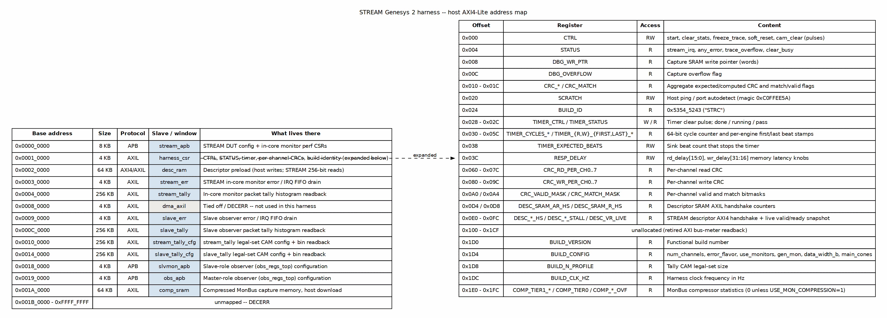

<!-- RTL Design Sherpa Documentation Header -->
<table>
<tr>
<td width="80">
  
</td>
<td>
  <strong>RTL Design Sherpa</strong> · <em>Learning Hardware Design Through Practice</em> 
  
    <a href="https://github.com/sean-galloway/RTLDesignSherpa">GitHub</a> ·
    <a href="https://github.com/sean-galloway/RTLDesignSherpa/blob/main/docs/DOCUMENTATION_INDEX.md">Documentation Index</a> ·
    <a href="https://github.com/sean-galloway/RTLDesignSherpa/blob/main/LICENSE">MIT License</a>
  
</td>
</tr>
</table>

---

<!-- End Header -->

# The Address Map

The host sees one 32-bit AXI4-Lite master. `uart_axil_bridge` turns the
ASCII `W addr data` / `R addr` lines into that master, and the generated
`bridge_stream_mon_axil` fans it out to every slave in the harness. The bridge
is generated from `rtl/bridges/configs/bridge_stream_mon_axil.toml`; the table
below is the as-built map from that file. Anything not listed decodes to a
tied-off `dma_axil` port or returns DECERR.

### Figure 2.2: Host address map

**Source:** [05_address_map.dot](../assets/graphviz/05_address_map.dot)

## Bridge slave map

| Base | Size | Protocol | Slave | Purpose |
|------|-----:|----------|-------|---------|
| `0x0000_0000` | 8 KB | APB | `stream_apb` | STREAM DUT config and in-core monitor perf CSRs |
| `0x0001_0000` | 4 KB | AXIL | `harness_csr` | Harness control/status/timer/CRC/build identity |
| `0x0002_0000` | 64 KB | AXI4/AXIL | `desc_ram` | Descriptor preload: host writes 32-bit, STREAM reads 256-bit |
| `0x0003_0000` | 4 KB | AXIL | `stream_err` | STREAM in-core monitor error / IRQ FIFO drain |
| `0x0004_0000` | 256 KB | AXIL | `stream_tally` | In-core monitor packet tally histogram readback |
| `0x0008_0000` | 4 KB | AXIL | `dma_axil` | Tied off / DECERR -- not used in this harness |
| `0x0009_0000` | 4 KB | AXIL | `slave_err` | Slave observer error / IRQ FIFO drain |
| `0x000C_0000` | 256 KB | AXIL | `slave_tally` | Slave observer packet tally histogram readback |
| `0x0010_0000` | 256 KB | AXIL | `stream_tally_cfg` | `stream_tally` legal-set CAM config + bin readback |
| `0x0014_0000` | 256 KB | AXIL | `slave_tally_cfg` | `slave_tally` legal-set CAM config + bin readback |
| `0x0018_0000` | 4 KB | APB | `slvmon_apb` | Slave-role observer (`obs_regs_top`) configuration |
| `0x0019_0000` | 4 KB | APB | `obs_apb` | Master-role observer (`obs_regs_top`) configuration |
| `0x001A_0000` | 64 KB | AXIL | `comp_sram` | Compressed MonBus capture memory, host download |

: Table 2.3: Bridge address map (from `bridge_stream_mon_axil.toml`)

The two tally windows (`stream_tally` / `slave_tally`) are read-only for the
host in normal use: records arrive directly from the observers or in-core
monitors, and the host reads the resulting histogram. Their companion
`_cfg` windows are where the host loads the legal `{agent, protocol, type,
event}` CAM profile and where direct bin readback also lives.

## Harness CSR detail

`harness_csr` occupies `0x0001_0000` and is the source of truth for run
control, build identity, and the memory-latency knob. The map is generated from
`regs/harness_csr_regs.rdl` and decoded by hand in `rtl/harness_csr.sv`; a test
(`bin/tests/test_harness_regmap.py`) asserts every RDL register has a matching
hardware decode.

| Offset | Register | Access | Content |
|--------|----------|:------:|---------|
| `0x000` | `CTRL` | RW | `start`, `clear_stats`, `freeze_trace`, `soft_reset`, `cam_clear` pulses |
| `0x004` | `STATUS` | R | `stream_irq`, `any_error`, `trace_overflow`, `clear_busy` |
| `0x008` | `DBG_WR_PTR` | R | Capture SRAM write pointer (words) |
| `0x00C` | `DBG_OVERFLOW` | R | Capture overflow flag |
| `0x010` | `CRC_RD_EXPECTED` | R | Aggregate expected read-source CRC |
| `0x014` | `CRC_WR_EXPECTED` | R | Aggregate expected write-sink CRC |
| `0x018` | `CRC_WR_COMPUTED` | R | Actual CRC computed by write sink |
| `0x01C` | `CRC_MATCH` | R | `match[0]`, `valid[1]` |
| `0x020` | `SCRATCH` | RW | Host ping / port autodetect (magic `0xC0FFEE5A`) |
| `0x024` | `BUILD_ID` | R | `0x5354_5243` ("STRC") -- harness family |
| `0x028` | `TIMER_CTRL` | W | Timer clear pulse |
| `0x02C` | `TIMER_STATUS` | R | `done`, `running`, `pass` |
| `0x030` / `0x034` | `TIMER_CYCLES_LO` / `HI` | R | 64-bit free-running cycle counter |
| `0x038` | `TIMER_EXPECTED_BEATS` | RW | Sink beat count that stops the timer |
| `0x03C` | `RESP_DELAY` | RW | `rd_delay[15:0]`, `wr_delay[31:16]` latency knobs |
| `0x040` - `0x05C` | `TIMER_R_FIRST_*` / `TIMER_R_LAST_*` / `TIMER_W_FIRST_*` / `TIMER_W_LAST_*` | R | Per-engine first/last beat cycle stamps |
| `0x060` - `0x07C` | `CRC_RD_PER_CH0..7` | R | Per-channel read CRC |
| `0x080` - `0x09C` | `CRC_WR_PER_CH0..7` | R | Per-channel write CRC |
| `0x0A0` / `0x0A4` | `CRC_VALID_MASK` / `CRC_MATCH_MASK` | R | Per-channel valid/match bitmasks |
| `0x0D4` / `0x0D8` | `DESC_SRAM_AR_HS` / `DESC_SRAM_R_HS` | R | Descriptor SRAM AXIL handshake counters |
| `0x0E0` - `0x0FC` | `DESC_AR_HS`, `DESC_AR_STALL`, `DESC_R_HS`, `DESC_R_STALL`, `DESC_AW_HS`, `DESC_W_HS`, `DESC_B_HS`, `DESC_VR_LIVE` | R | STREAM descriptor AXI4 handshake + live valid/ready snapshot |
| `0x100` - `0x1CF` | -- | -- | Unallocated (retired AXI bus-meter readback) |
| `0x1D0` | `BUILD_VERSION` | R | Functional build number |
| `0x1D4` | `BUILD_CONFIG` | R | `num_channels`, `error_flavor`, `use_monitors`, `gen_mon`, `data_width_b`, `main_cones` |
| `0x1D8` | `BUILD_N_PROFILE` | R | Tally CAM legal-set size |
| `0x1DC` | `BUILD_CLK_HZ` | R | Harness clock frequency in Hz |
| `0x1E0` - `0x1FC` | `COMP_TIER1_A/B/C`, `COMP_TIER0`, `COMP_CAM_MISS`, `COMP_DELTA_TS_OVF`, `COMP_EVENT_DATA_OVF`, `COMP_ED_DELTA_OVF` | R | MonBus compressor statistics (0 unless `USE_MON_COMPRESSION=1`) |

: Table 2.4: `harness_csr` register map (base `0x0001_0000`)

## By-name access

Host tools must resolve addresses by name, not by hardcoded offset:

- `bin/harness_addrs.py` `H("CTRL")` resolves harness CSR registers against
  `rtl/harness_csr_regmap.py` (generated from the RDL).
- `bin/stream_addrs.py` `A("SCHED_CONFIG")` resolves STREAM APB registers
  against the component-level `stream_regmap.py`.
- `bin/obs_addrs.py` `O("MON_CTRL")` resolves observer APB registers against
  `obs_regs_top_regmap.py`; use `base=SLAVE_OBS_APB_BASE` (`0x0018_0000`) for
  the slave-role observer.

This indirection is what keeps host scripts valid when a register moves inside
its window.
