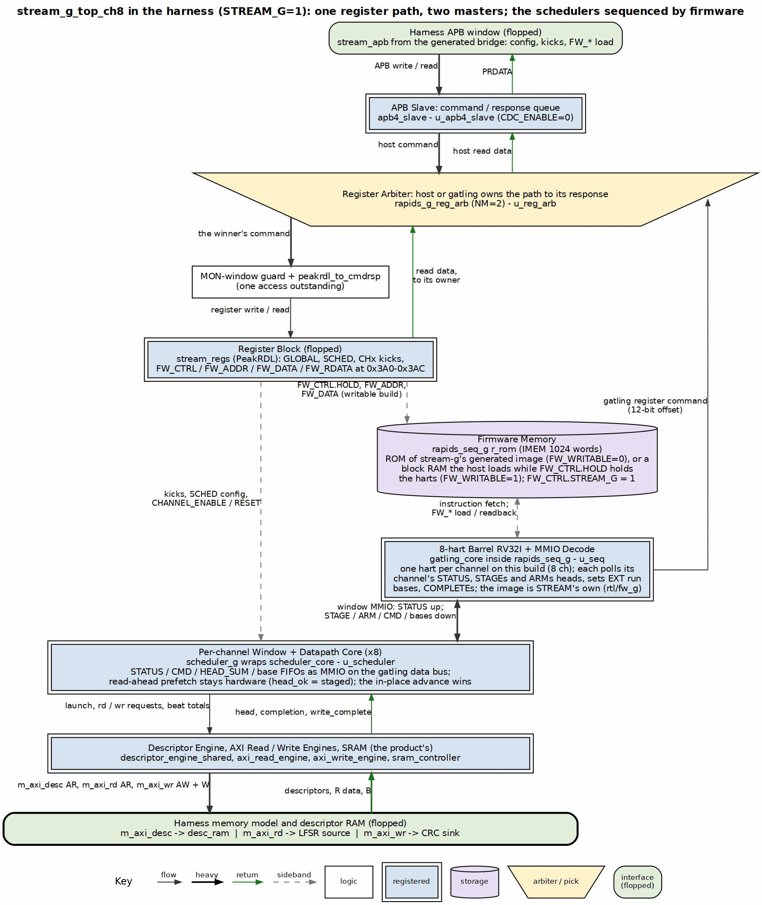
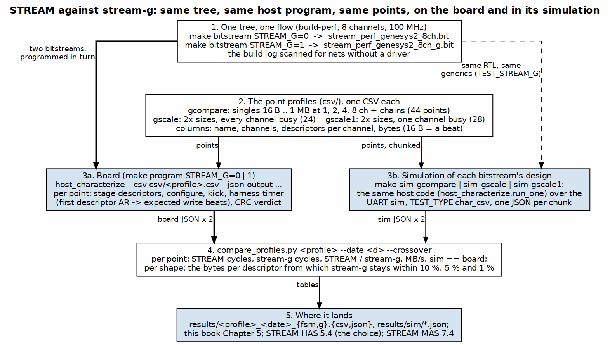

<!-- RTL Design Sherpa Documentation Header -->
<table>
<tr>
<td width="80">
  
</td>
<td>
  <strong>RTL Design Sherpa</strong> · <em>Learning Hardware Design Through Practice</em> 
  
    <a href="https://github.com/sean-galloway/RTLDesignSherpa">GitHub</a> ·
    <a href="https://github.com/sean-galloway/RTLDesignSherpa/blob/main/docs/DOCUMENTATION_INDEX.md">Documentation Index</a> ·
    <a href="https://github.com/sean-galloway/RTLDesignSherpa/blob/main/LICENSE">MIT License</a>
  
</td>
</tr>
</table>

---

<!-- End Header -->

# STREAM against stream-g on This Board

**Last Updated:** 2026-10-24

stream-g (STREAM MAS Chapter 7) keeps STREAM's descriptors, register map, engines and masters and
replaces the per-channel scheduler state machines with firmware on one gatling core. This chapter is
the board side of the comparison: the build that puts stream-g in the harness, what the two bitstreams
cost, how the two designs were measured against each other, and every number measured. Which design to
choose is STREAM HAS Chapter 5.4, which rests on the tables here; rapids HAS Chapter 6.4 is the same
comparison for RAPIDS.

## The stream-g build

`STREAM_G=1` on `build-perf` makes the DUT `stream_g_top_ch8` instead of `stream_top_ch8`; the harness
is otherwise the same bitstream (the `STREAM_G` define reaches Vivado through
`fpga/tcl/create_project.tcl`, lint through `LINT_DEFINES`, and the harness sim through
`TEST_STREAM_G`). The bitstream name takes `_g`, `FW_WRITABLE=1` makes the firmware memory a block RAM
the host loads through the `FW_CTRL` / `FW_ADDR` / `FW_DATA` / `FW_RDATA` registers (bitstream `_g_fw`)
instead of a ROM of the generated image, and the host reads which design it has from
`BUILD_CONFIG.STREAM_G` in the harness CSRs and `FW_CTRL.STREAM_G` in the STREAM map. `seq_restart` is
tied low in the harness: the harts run from reset and the firmware polls. Figure 5.1 is the DUT's
register path and sequencing structure as it sits in the harness; the engines, the SRAM and the three
masters below it are the product's and are drawn in Figure 2.1.

### Figure 5.1: The stream-g DUT in the harness

**Source:** [06_stream_g_dut.dot](../assets/graphviz/06_stream_g_dut.dot)

For a board question that needs a waveform, the harness carries `mark_debug` marks under
`STREAM_CHAR_ILA` on the host AXI4-Lite, the STREAM APB, the three DUT masters, the monitor writer and
the unit reset; `make bitstream-ila [STREAM_G=1]` builds the same design with an ILA on them
(`fpga/tcl/build_ila.tcl`) and `make tcl-capture_ila` programs it, arms on the first DUT-master or host
command and writes the capture as CSV (`fpga/tcl/capture_ila.tcl`). The marks cost the ordinary builds
nothing.

## The two bitstreams

Both from the same tree and the same flow, 8 channels, 100 MHz, built minutes apart on 2026-10-24:

| | STREAM (`stream_perf_genesys2_8ch.bit`) | stream-g (`stream_perf_genesys2_8ch_g.bit`, ROM firmware) |
|---|---:|---:|
| Slice LUTs | 66,221 (32.5 %) | 65,472 (32.1 %) |
| Slice registers | 59,652 | 58,265 |
| LUT as memory | 6,390 | 6,742 |
| Block RAM tiles | 26 | 29 |
| DSP48 | 64 | 0 |
| Setup WNS / hold WHS (ns) | +0.790 / +0.032 | +0.668 / +0.050 |
| sha256 | `ff9a6b95ff7d58f091e77acd23c5ee8c175d4451e72b75bd060664dc8889452a` | `b403115324623aa04d272c1710c5d0d35eec2bf157060d268300d0d9981687d1` |

: Table 5.1: The two Genesys 2 builds

The 64 DSPs are the state machine's EXT run-base generators (a multiplier pair per channel per
direction, `stream_run_addr_gen`); stream-g computes the bases in firmware and the gatling's own
datapath is LUTs. The three extra block RAMs are the firmware ROM and the harts' scratch. The cores on
their own, out of context at 8 and 16 channels in the board geometry (`fpga/tcl/ooc_stream_core.tcl`,
`reports/ooc/`), are Table 5.2.

| `stream_core` / `stream_core_g`, out of context | STREAM 8ch | stream-g 8ch | STREAM 16ch | stream-g 16ch |
|---|---:|---:|---:|---:|
| LUTs | 32,025 | 32,164 (+0.4 %) | 61,106 | 59,386 (-2.8 %) |
| LUT as distributed RAM | 3,216 | 3,568 | 6,232 | 6,936 |
| Registers | 24,532 | 23,027 | 46,231 | 41,942 |
| Block RAM tiles | 16 | 19 | 32 | 35 |
| DSPs | 64 | 0 | 128 | 0 |
| Setup WNS at 100 MHz (ns) | +0.581 | +0.626 | +0.256 | +0.127 |
| Hold WHS (ns) | +0.052 | +0.051 | +0.057 | +0.051 |

: Table 5.2: The cores out of context on the xc7k325t-2 (128-bit data, 32-bit addresses, 8 outstanding each way, SRAM depth 256, shared engines, no AXI monitors, EXT addressing built; placed and routed at 100 MHz, 2026-10-24)

In the board geometry the gatling and its windows cost about what the eight state machines and their
run-base generators cost in LUTs (+0.4 % at 8 channels, -2.8 % at 16), fewer registers, three more block
RAM tiles (the firmware memory and the harts' scratch) and no DSPs; both close 100 MHz at both channel
counts, the 16-channel builds with the thinner margin. The register arbiter (`rapids_g_reg_arb`) sits in
the top, outside `stream_core_g`, and is in Table 5.1 but not here.

## The first stream-g bitstream

The first `STREAM_G=1` bitstream answered nothing on the UART, not even the harness's own CSRs, while
a `STREAM_G=0` control built from the same tree answered on the same port. The Vivado log named it:
`Net host_cmd_valid in module/entity stream_g_top_ch8 does not have driver`. The generated top had
connected the APB slave to the `host_*` nets before the include that declares them; Verilator resolved
the names and every lint and the harness sim were green, Vivado made implicit undriven nets, and the
host register path did not exist in silicon. The generator anchors the include ahead of the APB slave
now, and `make bitstream` prints every such line from the log after every build (the scan also
surfaced the observers' undriven `w_comp_stat_*` nets, utility-ip misc BUG-002). The lesson is in the
handbook's generated-RTL note; the control build is the A/B that settled it, and the bridge the build
had regenerated was cleared the same way (its 1 MB matrix is cycle-identical to the 2026-10-03 one).

## How the two designs were compared

Figure 5.2 is the method. The host program is `host_characterize.py`, the one every perf matrix on this
board has run; a point is a configuration (channels, descriptors per channel, bytes per descriptor)
that it stages, configures, kicks and times with the harness timer (first descriptor AR to the expected
write-beat count, Section 2), with the CRC verdict on every channel that ran. The point profiles are
rapids-g's three (`gcompare`, `gscale`, `gscale1`) in STREAM terms, as CSV inputs under
`build-perf/csv/`: STREAM is memory to memory, so there is no sink, source or interleave split, and a
beat is 16 bytes. Names read `beat_ch<N>_b<B>` (one descriptor per channel) and `chain_ch<N>_b<B>_d<D>`
(a chain of D per channel), N active channels, B beats per descriptor. Every figure is bytes moved over
the timer's cycles, so it includes the descriptor fetch and the launch; the peak is 1,600 MB/s.

The same points run on the harness simulation of each design through the same host code
(`make sim-gcompare | sim-gscale | sim-gscale1`, the `char_csv` test type, one JSON per chunk under
`results/sim/`), so the board can be checked against its simulation point for point.
`bin/compare_profiles.py <profile> --date 2026-10-24 --crossover` tabulates both designs, marks the
sim-against-board agreement, and derives the sizes at which stream-g is within 10 %, 5 % and 1 %.

### Figure 5.2: The A/B, end to end

**Source:** [07_ab_measurement.dot](../assets/graphviz/07_ab_measurement.dot)

### The simulation against the board

The harness simulation of each bitstream's design, in the bitstream's own configuration (the perf
geometry with `USE_AXI_MONITORS=0`; a first pass had taken the package default and built the in-core
monitors in, which is not this bitstream), reproduces the board. On STREAM the first chunk run both
ways is the board to the cycle on all eight points (233, 310, 559, 1,071, 2,095, 4,143, 8,239, 16,431
for the lone channel's chains from 8 to 1,024 beats). On stream-g the traced run of the lone channel's
16-descriptor chains gives 688 / 1,900 / 1,739 / 2,410 cycles at 16 / 32 / 64 / 128 beats against the
board's 684 / 1,890 / 1,737 / 2,409, and the residue is the design's own run-to-run spread: the
firmware's poll loop runs free of the host, so where a hart's pass stands when the kick lands decides
whether a chain opens on an in-place advance or on a COMPLETE / NEXT_DESC walk, one walk being about
170 cycles (the board itself gave 1,737 and 1,911-1,935 for the same 64-beat point on different runs,
with identical first-read to last-read spans). The simulation trace of channel 0's scheduler
(`bin/sched_trace_timeline.py`, `results/task021_trace_2026-10-24_g.jsonl`) is what settled the
mechanism behind Table 5.5's one-channel chain column, recorded under stream TASK-021: from 32 beats
up every second chained head is staged after the running descriptor's last read and walks instead of
advancing in place, a 216-cycle pair whatever the size, until the data itself outlasts the firmware's
26-to-106-cycle reaction above about 96 beats. The full three-profile campaign on both designs
(`make sim-gcompare | sim-gscale | sim-gscale1`) is recorded under `results/sim/` as it completes.

## Single descriptor per channel (`gcompare`)

| Point | ch | per descriptor | STREAM cycles | stream-g cycles | STREAM MB/s | stream-g MB/s | stream-g / STREAM |
|---|--:|--:|--:|--:|--:|--:|--:|
| beat_ch1_b1 | 1 | 16 B | 33 | 167 | 46 | 9 | 19.8 % |
| beat_ch1_b4 | 1 | 64 B | 39 | 172 | 157 | 35 | 22.7 % |
| beat_ch1_b16 | 1 | 256 B | 63 | 204 | 388 | 120 | 30.9 % |
| beat_ch1_b64 | 1 | 1 KB | 111 | 241 | 880 | 405 | 46.1 % |
| beat_ch1_b256 | 1 | 4 KB | 303 | 445 | 1,289 | 878 | 68.1 % |
| beat_ch1_b1024 | 1 | 16 KB | 1,071 | 1,234 | 1,459 | 1,266 | 86.8 % |
| beat_ch1_b4096 | 1 | 64 KB | 4,143 | 4,273 | 1,509 | 1,463 | 97.0 % |
| beat_ch1_b32768 | 1 | 512 KB | 32,815 | 32,955 | 1,524 | 1,517 | 99.6 % |
| beat_ch1_b65536 | 1 | 1 MB | 65,583 | 65,722 | 1,525 | 1,522 | 99.8 % |
| beat_ch2_b1 | 2 | 16 B | 35 | 188 | 87 | 16 | 18.6 % |
| beat_ch2_b4 | 2 | 64 B | 43 | 210 | 284 | 58 | 20.5 % |
| beat_ch2_b16 | 2 | 256 B | 79 | 216 | 618 | 226 | 36.6 % |
| beat_ch2_b64 | 2 | 1 KB | 175 | 318 | 1,116 | 614 | 55.0 % |
| beat_ch2_b256 | 2 | 4 KB | 559 | 703 | 1,398 | 1,111 | 79.5 % |
| beat_ch2_b1024 | 2 | 16 KB | 2,095 | 2,242 | 1,492 | 1,394 | 93.4 % |
| beat_ch2_b4096 | 2 | 64 KB | 8,239 | 8,394 | 1,517 | 1,489 | 98.2 % |
| beat_ch2_b32768 | 2 | 512 KB | 65,583 | 65,720 | 1,525 | 1,522 | 99.8 % |
| beat_ch2_b65536 | 2 | 1 MB | 131,119 | 131,257 | 1,525 | 1,524 | 99.9 % |
| beat_ch4_b1 | 4 | 16 B | 39 | 172 | 157 | 35 | 22.7 % |
| beat_ch4_b4 | 4 | 64 B | 51 | 215 | 479 | 114 | 23.7 % |
| beat_ch4_b16 | 4 | 256 B | 111 | 254 | 880 | 384 | 43.7 % |
| beat_ch4_b64 | 4 | 1 KB | 303 | 439 | 1,289 | 890 | 69.0 % |
| beat_ch4_b256 | 4 | 4 KB | 1,071 | 1,213 | 1,459 | 1,288 | 88.3 % |
| beat_ch4_b1024 | 4 | 16 KB | 4,143 | 4,285 | 1,509 | 1,459 | 96.7 % |
| beat_ch4_b4096 | 4 | 64 KB | 16,431 | 16,570 | 1,522 | 1,509 | 99.2 % |
| beat_ch4_b32768 | 4 | 512 KB | 131,119 | 131,272 | 1,525 | 1,524 | 99.9 % |
| beat_ch4_b65536 | 4 | 1 MB | 262,191 | 262,331 | 1,526 | 1,525 | 99.9 % |
| beat_ch8_b1 | 8 | 16 B | 47 | 205 | 260 | 60 | 22.9 % |
| beat_ch8_b4 | 8 | 64 B | 67 | 209 | 729 | 234 | 32.1 % |
| beat_ch8_b16 | 8 | 256 B | 175 | 309 | 1,116 | 632 | 56.6 % |
| beat_ch8_b64 | 8 | 1 KB | 559 | 701 | 1,398 | 1,114 | 79.7 % |
| beat_ch8_b256 | 8 | 4 KB | 2,095 | 2,232 | 1,492 | 1,400 | 93.9 % |
| beat_ch8_b1024 | 8 | 16 KB | 8,239 | 8,396 | 1,517 | 1,489 | 98.1 % |
| beat_ch8_b4096 | 8 | 64 KB | 32,815 | 32,966 | 1,524 | 1,517 | 99.5 % |
| beat_ch8_b32768 | 8 | 512 KB | 262,191 | 262,325 | 1,526 | 1,525 | 99.9 % |
| beat_ch8_b65536 | 8 | 1 MB | 524,335 | 524,470 | 1,526 | 1,525 | 100.0 % |

: Table 5.3: One descriptor per channel, 2026-10-24 (peak 1,600 MB/s)

## Descriptor chains (`gcompare`)

| Point | ch | chain | STREAM cycles | stream-g cycles | STREAM MB/s | stream-g MB/s | stream-g / STREAM |
|---|--:|--:|--:|--:|--:|--:|--:|
| chain_ch1_b1_d16 | 1 | 16 x 16 B | 212 | 759 | 115 | 32 | 27.9 % |
| chain_ch1_b64_d16 | 1 | 16 x 1 KB | 1,071 | 1,930 | 1,459 | 810 | 55.5 % |
| chain_ch1_b1024_d16 | 1 | 16 x 16 KB | 16,431 | 16,563 | 1,522 | 1,509 | 99.2 % |
| chain_ch1_b8192_d4 | 1 | 4 x 128 KB | 32,815 | 32,946 | 1,524 | 1,518 | 99.6 % |
| chain_ch8_b1_d16 | 8 | 16 x 16 B | 287 | 803 | 681 | 243 | 35.7 % |
| chain_ch8_b64_d16 | 8 | 16 x 1 KB | 8,239 | 8,284 | 1,517 | 1,509 | 99.5 % |
| chain_ch8_b1024_d16 | 8 | 16 x 16 KB | 131,119 | 131,253 | 1,525 | 1,524 | 99.9 % |
| chain_ch8_b8192_d4 | 8 | 4 x 128 KB | 262,191 | 262,226 | 1,526 | 1,525 | 100.0 % |

: Table 5.4: Chains of descriptors per channel, 2026-10-24

## The size sweeps (`gscale`, `gscale1`)

Each cell is STREAM cycles / stream-g cycles (1.00 = parity). `single` is one descriptor per channel,
`chain` a 16-descriptor chain per channel; "8 ch" has every channel busy, "1 ch" channel 0 alone.

| Beats | per descriptor | single, 8 ch | chain, 8 ch | single, 1 ch | chain, 1 ch |
|--:|--:|--:|--:|--:|--:|
| 1 | 16 B | 0.23 | 0.36 | 0.17 | 0.33 |
| 2 | 32 B | 0.26 | 0.36 | 0.18 | 0.33 |
| 4 | 64 B | 0.30 | 0.67 | 0.22 | 0.28 |
| 8 | 128 B | 0.42 | 0.68 | 0.26 | 0.35 |
| 16 | 256 B | 0.55 | 0.91 | 0.32 | 0.38 |
| 32 | 512 B | 0.69 | 0.98 | 0.36 | 0.29 |
| 64 | 1 KB | 0.81 | 1.00 | 0.45 | 0.62 |
| 128 | 2 KB | 0.89 | 1.00 | 0.57 | 0.87 |
| 256 | 4 KB | 0.94 | 1.00 | 0.69 | 0.97 |
| 512 | 8 KB | 0.97 | 1.00 | 0.79 | 0.98 |
| 1024 | 16 KB | 0.98 | 1.00 | 0.88 | 1.00 |
| 2048 | 32 KB | 0.99 | -- | 0.94 | -- |
| 4096 | 64 KB | 1.00 | -- | 0.97 | -- |
| 8192 | 128 KB | -- | -- | 0.98 | -- |
| 16384 | 256 KB | -- | -- | 0.99 | -- |
| 32768 | 512 KB | -- | -- | 1.00 | -- |
| 65536 | 1 MB | -- | -- | 1.00 | -- |

: Table 5.5: STREAM / stream-g cycles over the size sweep (`--` = not in the sweep)

The smallest bytes per descriptor from which every larger point in the sweep stays within the bound:

| Shape | Busy channels | Within 10 % | Within 5 % | Within 1 % |
|---|--:|--:|--:|--:|
| single descriptor | 1 of 8 | 32 KB | 64 KB | 256 KB |
| single descriptor | 8 of 8 | 4 KB | 8 KB | 32 KB |
| 16-descriptor chain | 1 of 8 | 4 KB | 4 KB | 16 KB |
| 16-descriptor chain | 8 of 8 | 256 B | 512 B | 1 KB |

: Table 5.6: Bytes per descriptor for stream-g to be within 10 %, 5 % and 1 % of STREAM

The difference is a fixed latency, not a rate: about 140 to 170 clocks once per channel between the
kick and the first read (the firmware's poll, STAGE and ARM and the state walk, against the state
machine's few cycles), and a clock or two per chained descriptor after it, because STREAM's read-ahead
prefetch, which stream-g keeps in hardware for a head the firmware has staged, overlaps the next head
with the running one. With every channel busy the other channels' data hides the cost; alone, a
descriptor pays it in full, which is why the one-channel bounds sit eight times higher. One point
stands against the trend: the lone channel's chain at 32 beats (1,897 cycles against 824 at 16 and
1,737 at 64), measured the same way on both runs of the day; it is stream TASK-021.

## The matrix at three descriptor sizes

`host_characterize.py`'s 40-config matrix (1, 2, 4, 8, 16 descriptors per channel at 1 to 8 channels)
at 1 MB, 64 KB and 4 KB per descriptor, 240 runs, all passing on both designs; the STREAM bitstream's
1 MB matrix is cycle-identical to the 2026-10-03 measurement.

| per descriptor | 1 desc, 1 ch | 1 desc, 8 ch | 16 desc, 1 ch | 16 desc, 8 ch | mean of 40 |
|--:|--:|--:|--:|--:|--:|
| 1 MB | 65,583 / 65,730 (+0.22 %) | 524,335 / 524,476 (+0.03 %) | 1,048,623 / 1,048,771 (+0.01 %) | 8,388,655 / 8,388,688 (+0.00 %) | +0.02 % |
| 64 KB | 4,143 / 4,299 (+3.77 %) | 32,815 / 32,963 (+0.45 %) | 65,583 / 65,723 (+0.21 %) | 524,335 / 524,371 (+0.01 %) | +0.41 % |
| 4 KB | 303 / 444 (+46.53 %) | 2,095 / 2,231 (+6.49 %) | 4,143 / 4,170 (+0.65 %) | 32,815 / 32,844 (+0.09 %) | +4.96 % |

: Table 5.7: Cycles, STREAM / stream-g (stream-g relative to STREAM)

## Artifacts

| What | Where (under `build-perf/`) |
|---|---|
| The point profiles | `csv/gcompare.csv`, `csv/gscale.csv`, `csv/gscale1.csv` |
| Board runs | `results/{gcompare,gscale,gscale1}_2026-10-24_{fsm,g}.{csv,json}`, `results/perf_sweep_2026-10-24_{fsm,g}_{1MB,64KB,4KB}.{csv,json}` |
| Simulation runs | `results/sim/<profile>_<dut>_<k>of<n>.json` |
| Out-of-context cores | `../reports/ooc/<top>_<ch>ch/10.0ns/` |
| Tabulation | `../bin/compare_profiles.py` |
