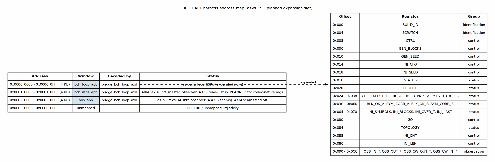

<!-- RTL Design Sherpa Documentation Header -->
<table>
<tr>
<td width="80">
  
</td>
<td>
  <strong>RTL Design Sherpa</strong> · <em>Learning Hardware Design Through Practice</em> 
  
    <a href="https://github.com/sean-galloway/RTLDesignSherpa">GitHub</a> ·
    <a href="https://github.com/sean-galloway/RTLDesignSherpa/blob/main/docs/DOCUMENTATION_INDEX.md">Documentation Index</a> ·
    <a href="https://github.com/sean-galloway/RTLDesignSherpa/blob/main/LICENSE">MIT License</a>
  
</td>
</tr>
</table>

---

# Address Map

The harness exposes one 32-bit AXI4-Lite slave through the UART bridge. The
generated `bridge_bch_loop_axil` fabric decodes three APB windows; the first
window holds the loop's own CSR block. The host code in
`build-loop/host/bch_loop.py` knows only two raw addresses —
`OBS_AXI4_BASE = 0x00010000` and `OBS_AXIS_BASE = 0x00020000` — everything else
is by-name access through the PeakRDL-generated `bch_loop_regs_regmap.py`.

---

## Figure 2.4: UART harness address map

**Source:** [04_address_map.dot](../assets/graphviz/04_address_map.dot)

---

## Window summary

| Base | Range | Size | Window | As-built use |
|---|---|---|---|---|
| 0x0000_0000 | 0x0000_0000 - 0x0000_0FFF | 4 KB | `bch_loop_apb` | Loop CSRs (`bch_loop_regs`) — expanded below. |
| 0x0001_0000 | 0x0001_0000 - 0x0001_0FFF | 4 KB | `bch_regs_apb` | **PLANNED:** codec-native register block. **As-built:** AXI4 flavour hosts `axi4_intf_master_observer`; AXIS flavour returns read-0. |
| 0x0002_0000 | 0x0002_0000 - 0x0002_0FFF | 4 KB | `obs_apb` | `axis4_intf_observer` on the four AXIS seams. On the AXI4 flavour the seams are tied off and reads return 0. |
| 0x0003_0000+ | — | — | unmapped | Sticky `unmapped_irq` in the bridge. |

---

## Loop CSR registers (window 0)

All registers are 32 bits and word-aligned. The address space is defined in
`build-loop/rtl/bch_loop_regs.rdl` and generated into
`build-loop/rtl/generated/bch_loop_regs/rtl/bch_loop_regs.sv` plus
`build-loop/dv/tbclasses/bch_loop_regs_regmap.py`.

### Identification and control

| Offset | Register | Access | Purpose |
|---|---|---|---|
| 0x000 | `BUILD_ID` | R | ASCII identifier: `0x4243_4850` "BCHP" (board) or `0x4243_4853` "BCHS" (small). |
| 0x004 | `SCRATCH` | RW | Host link sanity. |
| 0x008 | `CTRL` | W / RW | `soft_reset`, `clear`, `bypass`, `throttle_a/b`, `inj_seed_on_start`. |
| 0x080 | `GO` | W | Pulse `start` to run `GEN_BLOCKS` blocks. |
| 0x00C | `GEN_BLOCKS` | RW | Blocks per run. |
| 0x010 | `GEN_SEED` | RW | Pattern generator LFSR seed. |
| 0x014 | `INJ_CFG` | RW | Injector mode (`0..7`), error count, rate. |
| 0x018 | `INJ_SEED` | RW | Injector LFSR seed. |
| 0x088 | `INJ_CNT` | RW | Cluster mode min/max cluster count. |
| 0x08C | `INJ_LEN` | RW | Cluster mode min/max cluster length. |

### Status and profile

| Offset | Register | Access | Purpose |
|---|---|---|---|
| 0x084 | `TOPOLOGY` | R | `decoders`, `kes_a`, `iface` (AXIS vs AXI4). |
| 0x020 | `PROFILE` | R | `n`, `t`, `m`, `spb` (bytes per beat). |
| 0x01C | `STATUS` | R | `busy`, `gen_done`, `chk_a_done`, `data_err_a`, `crc_a_ok`, AXI4 stage/overflow. |
| 0x024 - 0x038 | `CRC_EXPECTED`, `CRC_A`, `CRC_B`, `PKTS_A`, `PKTS_B`, `CYCLES` | R | Run-level CRC, packet and cycle counts. |
| 0x03C - 0x060 | `BLK_OK_A`..`SYM_CORR_A`, `BLK_OK_B`..`SYM_CORR_B` | R | Decoder verdict tallies; B-side tied off. |
| 0x064 - 0x070 | `INJ_SYMBOLS`, `INJ_BLOCKS`, `INJ_OVER_T`, `INJ_LAST` | R | Injector statistics. |

### Bandwidth meters

| Offset | Register | Purpose |
|---|---|---|
| 0x090 - 0x09C | `OBS_IN_*` | Codec input end: productive / backpressure / starvation / idle cycles. |
| 0x0A0 - 0x0AC | `OBS_OUT_*` | Codec output end meters. |
| 0x0B0 - 0x0BC | `OBS_CW_OUT_*` | Codeword out of encoder meters. |
| 0x0C0 - 0x0CC | `OBS_CW_IN_*` | Codeword into decoder meters. |

---

## Observer windows (windows 1 and 2)

The observer blocks run their own copy of the shared `obs_regs` register block
(`projects/components/utility-ip/misc/rtl/regs/generated/obs_regs_top_regmap.py`).
The host attaches a second `UartRegisterMap` instance at each window base to
read observer statistics by name. See `BchLoopDriver.axis_observer()` and
`BchLoopDriver.axi4_observer()` in `build-loop/host/bch_loop.py`.
