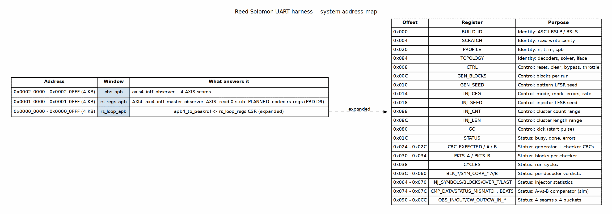

<!-- RTL Design Sherpa Documentation Header -->
<table>
<tr>
<td width="80">
  
</td>
<td>
  <strong>RTL Design Sherpa</strong> · <em>Learning Hardware Design Through Practice</em> 
  
    <a href="https://github.com/sean-galloway/RTLDesignSherpa">GitHub</a> ·
    <a href="https://github.com/sean-galloway/RTLDesignSherpa/blob/main/docs/DOCUMENTATION_INDEX.md">Documentation Index</a> ·
    <a href="https://github.com/sean-galloway/RTLDesignSherpa/blob/main/LICENSE">MIT License</a>
  
</td>
</tr>
</table>

---

<!-- End Header -->

# Harness Address Map

The host sees one flat 32-bit AXI4-Lite address space. The UART bridge
(`uart_axil_bridge`) is the master, and the generated
`bridge_rs_loop_axil` fabric decodes it into three 4 KB APB windows.
Everything the host can reach is in those windows; adding a new window is a
bridge regeneration, not a harness rewrite.

## Figure 2.2: UART harness address map

**Source:** [02_rs_uart_address_map.dot](../assets/graphviz/02_rs_uart_address_map.dot)

## Window summary

| Base | Size | Window | What answers it |
|---|---:|---|---|
| `0x0000_0000` | 4 KB | `rs_loop_apb` | The harness CSR block `rs_loop_regs`, reached through the shared `apb4_to_peakrdl` shim. This is where BUILD_ID, SCRATCH, PROFILE, TOPOLOGY, control, status, verdict tallies and bandwidth meters live. |
| `0x0001_0000` | 4 KB | `rs_regs_apb` | **As built today:** on the AXI4 flavour the pipeline's `axi4_intf_master_observer` answers this window; on the AXIS flavour it is tied to `PRDATA=0, PREADY=1` so a stray access cannot hang the host bus. **PLANNED:** the codec's own `rs_regs` block from PRD D9 (standalone codec ID, PROFILE, CTRL, job fields, statistics, interrupts). |
| `0x0002_0000` | 4 KB | `obs_apb` | Always live. An `axis4_intf_observer` watches the four AXIS seams in codeword order: message-in, codeword-out-of-encoder, codeword-into-decoder, message-out. On the AXI4 flavour the seams are tied off and the observer reads zero, but it still responds. |

The fabric definition is frozen in
`rtl/bridges/generated/bridge_rs_loop_axil/bridge_rs_loop_axil.toml`.
`bin/regen_bridges.sh` regenerates the RTL if the windows move.

## `rs_loop_apb` register offsets

The register block is generated from `build-loop/rtl/rs_loop_regs.rdl`. The
host accesses every register **by name** through `UartRegisterMap` over the
generated `build-loop/dv/tbclasses/rs_loop_regs_regmap.py`; no Python code
hard-codes an offset.

| Offset | Register(s) | Purpose |
|---:|---|---|
| `0x000` | `BUILD_ID` | Identity: ASCII `RSLP` (board profile) or `RSLS` (small Nexys A7 profile). |
| `0x004` | `SCRATCH` | Read-write sanity register. |
| `0x020` | `PROFILE` | `{n[15:0], t[23:16], m[27:24], spb[31:28]}`. |
| `0x084` | `TOPOLOGY` | What the bitstream built: decoders, solver, comparator, datapath, erasure support. |
| `0x008` | `CTRL` | `soft_reset`, `clear`, `bypass`, `throttle_a`, `throttle_b`, `inj_seed_on_start`. |
| `0x00C` | `GEN_BLOCKS` | Blocks per run. |
| `0x010` | `GEN_SEED` | Pattern generator LFSR seed. |
| `0x014` | `INJ_CFG` | Injector mode, erasure `mark`, error count, rate. |
| `0x018` | `INJ_SEED` | Injector LFSR seed. |
| `0x088` | `INJ_CNT` | Cluster count range (mode 4). |
| `0x08C` | `INJ_LEN` | Cluster length range (mode 4). |
| `0x080` | `GO` | Single-pulse kick; every consumer starts off the same cycle. |
| `0x01C` | `STATUS` | `busy`, done flags, error flags, AXI4 stage/overflow. |
| `0x024`–`0x02C` | `CRC_EXPECTED`, `CRC_A`, `CRC_B` | Generator and checker CRC-32s. |
| `0x030`–`0x034` | `PKTS_A`, `PKTS_B` | Blocks received by each checker. |
| `0x038` | `CYCLES` | Cycles from start until both checkers have every block. |
| `0x03C`–`0x060` | `BLK_OK_A/B`, `BLK_CORR_A/B`, `BLK_UNC_A/B`, `BLK_FRAME_A/B`, `SYM_CORR_A/B` | Per-decoder verdict tallies. |
| `0x064`–`0x070` | `INJ_SYMBOLS`, `INJ_BLOCKS`, `INJ_OVER_T`, `INJ_LAST` | Injector statistics. |
| `0x074`–`0x07C` | `CMP_DATA_MISMATCH`, `CMP_STATUS_MISMATCH`, `CMP_BEATS` | A-vs-B comparator (simulation / `ENABLE_COMPARE=1` only). |
| `0x090`–`0x0CC` | `OBS_IN_*`, `OBS_OUT_*`, `OBS_CW_OUT_*`, `OBS_CW_IN_*` | Four seams, four buckets each (productive, backpressure, starvation, idle). |

The complete generated register documentation is at
`build-loop/rtl/generated/rs_loop_regs/docs/rs_loop_regs.md`.

## By-name access

The host driver (`build-loop/host/rs_loop.py`) opens three `UartRegisterMap`
instances:

* `regs` at `HARNESS_BASE = 0x0` using `rs_loop_regs_regmap.py`.
* `obs_axi4` at `OBS_AXI4_BASE = 0x0001_0000` using `obs_regs_top_regmap.py`.
* `obs_axis` at `OBS_AXIS_BASE = 0x0002_0000` using `obs_regs_top_regmap.py`.

Because the bridge is injectable, the same driver runs over pyserial on the
board and over the cocotb UART in simulation.
