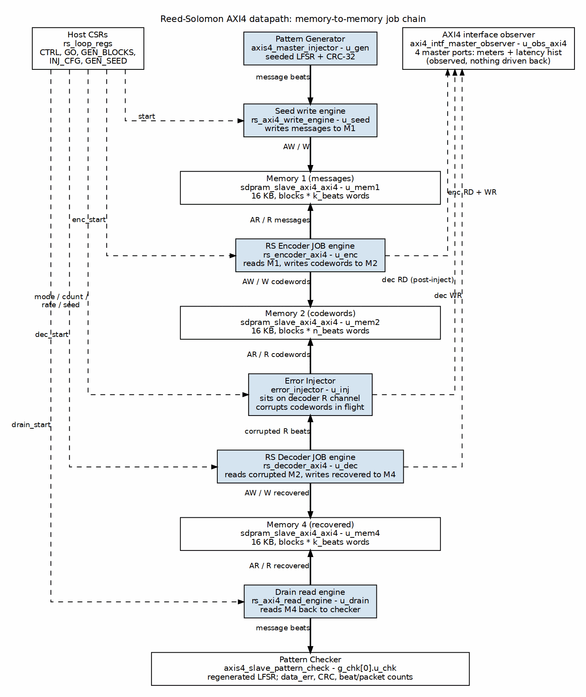

<!-- RTL Design Sherpa Documentation Header -->
<table>
<tr>
<td width="80">
  
</td>
<td>
  <strong>RTL Design Sherpa</strong> · <em>Learning Hardware Design Through Practice</em> 
  
    <a href="https://github.com/sean-galloway/RTLDesignSherpa">GitHub</a> ·
    <a href="https://github.com/sean-galloway/RTLDesignSherpa/blob/main/docs/DOCUMENTATION_INDEX.md">Documentation Index</a> ·
    <a href="https://github.com/sean-galloway/RTLDesignSherpa/blob/main/LICENSE">MIT License</a>
  
</td>
</tr>
</table>

---

<!-- End Header -->

# AXI4 Memory-to-Memory Datapath

The default board-validated flavour is the AXIS stream pipe shown in
[How The Pieces Connect](02_connectivity.md). The same harness also builds an
AXI4 flavour (`IFACE="AXI4"`) that replaces the middle of the pipe with a
memory-to-memory job chain. The generator, checkers, CSRs and verdict logic are
unchanged, so a run reports itself identically whichever middle is built.

## Figure 2.3: AXI4 datapath

**Source:** [03_rs_axi4_pipeline.dot](../assets/graphviz/03_rs_axi4_pipeline.dot)

## Job chain

The chain is four sequential jobs over three dual-port memories:

1. **Seed write** — the generator's message stream is written to **M1**.
2. **Encode** — the encoder reads **M1** and writes codewords to **M2**.
3. **Decode** — the decoder reads **M2** and writes recovered messages to **M4**.
   The injector sits on the decoder's read channel, so the codewords are
   corrupted in flight; no extra memory hop is needed.
4. **Drain read** — the drain engine reads **M4** and feeds the pattern checker.

Stage sequencing is done by rising-edge detectors on each stage's `cfg_done`,
not by a state machine. Each memory has exactly one writer and one reader, so
there is no arbitration on the AXI4 channels.

## Memories

All three memories are `sdpram_slave_axi4_axi4` instances with `MEM_DEPTH =
4096` 32-bit words (16 KB each). A single AXI4 run cannot exceed what one
memory holds; `STATUS.axi4_overflow` refuses the kick rather than clamping or
silently wrapping.

## Observer

The AXI4 flavour's `rs_regs_apb` window (`0x0001_0000`) hosts an
`axi4_intf_master_observer` instantiated inside `rs_axi4_pipeline`. It watches
the codec's four master ports:

| Port | Direction | What it carries |
|---|---|---|
| encoder RD | read | M1 message read |
| encoder WR | write | M2 codeword write |
| decoder RD | read | M2 codeword read, after the injector |
| decoder WR | write | M4 recovered write |

The observer provides the same bus-meter cycle buckets as the AXIS observer,
plus log2 latency histograms. `ENABLE_MON_TAPS = 0` keeps it purely passive so
it cannot throttle the datapath.

## Verdict path

Because the decoder reaches its verdict during the decode stage while the
beats arrive at the checker later, during the drain stage, the per-block tally
cannot follow the AXI4 data path. The pipeline accumulates its own verdict
totals (`blk_ok`, `blk_corr`, `blk_unc`, `blk_frame`, `sym_corr`) and the CSR
block selects those sources when `TOPOLOGY.iface` indicates AXI4.
