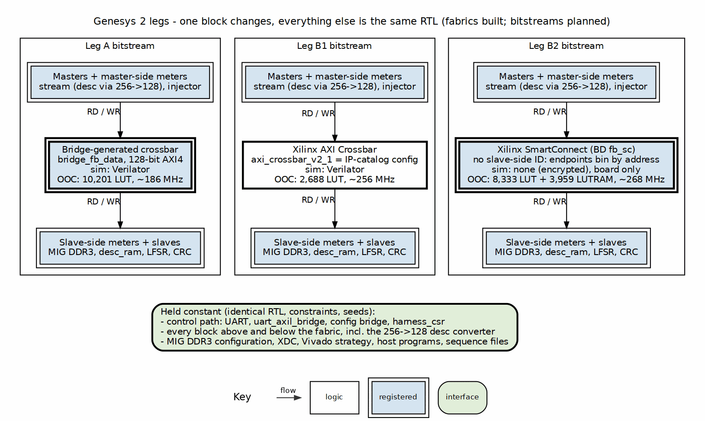

<!-- RTL Design Sherpa Documentation Header -->
<table>
<tr>
<td width="80">
  
</td>
<td>
  <strong>RTL Design Sherpa</strong> · <em>Learning Hardware Design Through Practice</em> 
  
    <a href="https://github.com/sean-galloway/RTLDesignSherpa">GitHub</a> ·
    <a href="https://github.com/sean-galloway/RTLDesignSherpa/blob/main/docs/DOCUMENTATION_INDEX.md">Documentation Index</a> ·
    <a href="https://github.com/sean-galloway/RTLDesignSherpa/blob/main/LICENSE">MIT License</a>
  
</td>
</tr>
</table>

---

<!-- End Header -->

# Genesys 2 (Kintex-7) Fabric Benchmark — PRD

**Version:** 0.2 (draft) · **Date:** 2026-10-15 · **Status:** K0 done in sim (legs A, B1); vendor legs and MIG generated

## 1. Purpose

Run the DE10-Standard fabric benchmark on the Genesys 2 first, for two
reasons:

- **Prove the benchmark on a board we know.** The Genesys 2 already runs
  `stream` at 8 channels with the same host stack, harness CSR, observers,
  LFSR source and CRC sink. Doing the benchmark here first proves the
  harness, the host programs, the sequence files and the sim harness while
  the Quartus tools are being brought up, so the DE10 port is a fabric and
  a board swap, not a first bring-up.
- **Compare against Xilinx's own fabric IP.** The same runs on Kintex-7
  give a second vendor comparison next to the Intel one.

**The benchmark itself is the DE10 PRD's**:
[DE10-Standard fabric benchmark PRD](../../DE10-Standard/fabric-benchmark/PRD.md)
§4 (runs, fabric-only mode, metrics, methodology) and §5 (system address
map, control path, data path, measurement points). This document carries
only what differs on the Genesys 2. Where the two disagree, the DE10 PRD
owns the method and this one owns the board facts.

## 2. Legs

| Leg | Data fabric under test | Source |
| --- | --- | --- |
| **A — bridge** | the bridge generator's AXI4 crossbar | `projects/components/fabric-gen-ip/bridge/bin/bridge_generator.py`, TOML in this area |
| **B1 — Xilinx AXI Crossbar** | `axi_crossbar_v2_1` (the crossbar inside AXI Interconnect), full crossbar, shared-address multiple-data | Vivado 2025.1 IP catalog; HDL ships unencrypted, so it runs in the Verilator sim harness. The wrapper's parameters equal the IP-catalog customization's (`bin/check_xbar_params.py`) |
| **B2 — Xilinx SmartConnect** | `smartconnect_v1_0` | Vivado 2025.1 IP integrator block design `fb_sc`, built by `fpga/tcl/vendor_ip.tcl` from the same TOML. Encrypted: board-only, no Verilator sim (§5) |

The matching rule is the DE10 PRD's §3 rule applied per pair: Leg A's TOML
mirrors the vendor fabric's configuration (port count, data width, ID
width, address map, outstanding depth), and Leg A is never configured
wider or deeper than the vendor fabric it is compared with. Where the two
Xilinx IPs expose different knobs, Leg A carries one TOML per comparison
rather than one compromise.

### Figure 2.1: Legs on the Genesys 2 (planned)

**Source:** [k7_legs.dot](docs/assets/graphviz/k7_legs.dot)

## 3. What differs from the DE10

| Item | DE10-Standard | Genesys 2 | Why it is still the same benchmark |
| --- | --- | --- | --- |
| Device / tools | Cyclone V 5CSX, Quartus 24.1 std | xc7k325tffg900-2, Vivado 2025.1 | per-board facts; legs are compared within one board, never across |
| Host control path | JTAG to Avalon Master Bridge → `avmm_to_axil4` | UART → `uart_axil_bridge` (the Genesys 2 STREAM front end) | both present the same AXI4-Lite master to the same generated configuration bridge; the host reaches registers by name either way |
| Memory controller | HPS hard DDR3 controller through f2sdram (AXI-3) | MIG 7-series DDR3, AXI4 slave interface | held constant across legs on each board; MIG's port is AXI4, so the Genesys 2 has **no** AXI3 edge and no `axi4_to_axi3` |
| DDR3 | 1 GB, 32-bit | 1 GB, 2 × MT41J256M16, 32-bit; DDR3-800 proven by the LiteDRAM memtest (`Genesys2/mem-ctrl-ip/scoria/build-litedram/results/`) | same address window (Table 5.1, `0x0000_0000`, 1 GB) |
| Fabric data width | mixed (descriptor master 256-bit) | **128-bit on every port** | the Xilinx AXI Crossbar has one data width for all ports, so the descriptor master's 256→128 conversion sits **outside** every fabric (`axi4_dwidth_converter_rd`), same RTL all legs — the same rule that keeps `axi4_to_axi3` outside the fabric on the DE10 |
| Board clocks | 50 MHz | 200 MHz differential; fabric clock from the MMCM as in the STREAM build | one fabric clock, same frequency all legs |

Everything else is the DE10 PRD's held-constant list unchanged: `stream`
(`stream_top_ch8`, the Genesys 2 configuration from `stream_cfg_pkg`),
`desc_ram`, the LFSR source and CRC sink behind their CDC crossings, the
W3 injector (`char_engine_block`), the observers at the same probe points,
the same sequence files and the same seeds in every leg.

## 4. The fabric port set (all legs)

Every leg presents exactly this port set to the harness; the harness does
not know which fabric it holds.

| Port | Role | Direction | Width | Behind it |
| --- | --- | --- | ---: | --- |
| M0 | `stream` descriptor fetch | rd | 128 | `stream` m_axi_desc (256) → `axi4_dwidth_converter_rd` (outside the fabric) |
| M1 | `stream` data read | rd | 128 | `stream` m_axi_rd |
| M2 | `stream` data write | wr | 128 | `stream` m_axi_wr |
| M3 | W3 injector | wr | 128 | `char_engine_block` (contention run only) |
| S0 | DDR3 `0x0000_0000`, 1 GB | rd/wr | 128 | MIG AXI4 slave (its own width conversion, if any, is the controller's and identical all legs) |
| S1 | `desc_ram` read port `0x8000_0000` | rd | 128 | `sdpram_slave_axi4_axi4` |
| S2 | LFSR source `0x9000_0000` | rd | 128 | `axi4_cdc_rd` → LFSR source |
| S3 | CRC sink `0xA000_0000` | wr | 128 | `axi4_cdc_wr` → CRC sink |

AXI4, ID width 8 at every master. The port set carries no USER and no
REGION. The LFSR source and CRC sink bin channels on the **address**:
channel N owns the 32 MB window at its endpoint's base + N x 32 MB
(`fb_harness` sets `fb_endpoints` `CH_SEL_ADDR`=1, `CH_ADDR_LSB`=25; 32 MB
holds the largest chain the host builds, 16 descriptors x 1 MB), and the
host places each channel's buffers in its own window
(`DescriptorBuilder(channel_stride=32 MB)`). Nothing downstream of the fabric
depends on the slave-side ID, because SmartConnect delivers none (§5.1).
Legs A and B1 still present `{master slot, master ID}` (10 bits) at their
slaves, and the fabric test checks that at every slave handshake; B2
presents 0.

Descriptors at 128 bits: the scheduler's descriptor is 256 bits and
`m_axi_desc` stays 256-bit, so the converter splits each one-beat fetch into
two 128-bit beats and reassembles the 256-bit beat for `stream`. The
converter splits on ARSIZE, which the descriptor engine drove as 64 bytes
on a 32-byte bus until `e236d102e` (2026-09-26); with that fixed, the K0
sim checks descriptor contents end to end through the converter and the
fabric. The configuration region (`0xF000_0000`) is the DE10 PRD's
Table 5.1 unchanged; it is decoded by the generated configuration bridge,
which is not the fabric under test.

## 5. Simulation before silicon

The house rule holds per leg: the sim harness runs the same harness RTL,
the same generated regmaps and the same host programs (over
`UARTAxiBridge(channel=...)`) as the board, at the board's configuration.

- Leg A: generated RTL, Verilator.
- Leg B1: `axi_crossbar_v2_1` plus its `axi_infrastructure`,
  `axi_register_slice` and `axi_data_fifo` dependencies from the Vivado
  install, Verilator. Configured from the same parameter set the Vivado IP
  customization produces (one source: the IP's `.xci` parameters are
  generated from the leg's config file, and the sim reads the same file).
- Leg B2: **board-only.** SmartConnect's HDL is encrypted (`pragma protect`
  in every `sc_*` sub-IP), and so is the post-synthesis functional netlist
  `write_verilog -mode funcsim` produces, so there is nothing Verilator can
  read. B2 runs the same host programs on the board; the fabric test's
  checks (data, DECERR, IDs at the slaves) are made there through the
  harness. Vivado's own simulator could run it, but not the cocotb harness.
- DDR3: MIG does not simulate in Verilator. The sim harness models S0 with
  an AXI4 memory slave of the same width and ID width; DDR3 timing is
  measured on the board, and fabric-only mode (W2) needs no DDR3 at all.

### 5.1 SmartConnect at the slave ports

SmartConnect presents **no ID** to its slaves: the ID width of every MI port
is 0 and read-only. It expects in-order slaves and returns each response to
the master's own ID itself. So the per-channel CRC cannot key on the ID in
this leg, and the endpoints take the channel from the address in **every**
leg (§4) -- the endpoints stay identical across the legs, and SmartConnect
is configured with no AxUSER, so it carries nothing the other legs do not.

(A first version carried `{slot, id}` on AxUSER and rebuilt the slave-side
ID from it. It worked, but it added 10 bits per request that only B2
carried; dropping it took B2 from 8,438 to 8,333 LUTs, 4,064 to 3,959
LUTRAM and 11,938 to 11,616 flops.)

The in-order requirement holds: with ID 0 on every request, MIG at S0 must
answer in order by the AXI rules for a single ID, and S1-S3 are in order.

## 6. Milestones

**Status (2026-10-15):** K0 done in sim on legs A and B1; the Vivado side of K1-K3 is generated.

- K0: `rtl/fb_harness.sv` (`dv/tests/test_fb_harness.py`) is the harness of
  §4. The Genesys 2 STREAM characterization runner drives it unchanged over
  the sim UART -- the configuration bridge keeps the STREAM harness's
  offsets -- given only a `DescriptorBuilder` for the fabric's map
  (descriptors preloaded at 0x0002_0000, fetched at 0x8000_0000; per-channel
  32 MB windows). func on both legs: 1ch x 1 x 4 KB, 4ch x 2 x 8 KB,
  8ch x 2 x 8 KB all pass with the on-chip PASS and every active channel
  in the CRC valid and match masks; datapath utilization from the
  master-side observer 79.5 / 98.4 / 99.2 % (A) and 80.0 / 98.5 / 99.2 % (B1).
  The slave-side observer window is stubbed (reads 0) until it is built in;
  the W3 injector on M3 is idle until K3.

- All three data fabrics exist, every one from
  `rtl/bridges/configs/bridge_fb_data.toml` and its connectivity CSV
  (`bin/regen.sh`): Leg A (bridge generator), Leg B1 (AXI Crossbar HDL
  wrapper), Leg B2 (SmartConnect block design, `make vendor-ip`). A and B1
  pass the same fabric test (`dv/tests/test_fb_fabric.py`); B2 is board-only
  (§5).
- `make check-xbar` proves B1's wrapper passes exactly the 29 parameters the
  IP-catalog customization of the same TOML produces.
- First size and timing comparison, every leg alone out of context on the
  board's part: [reports/ooc/README.md](reports/ooc/README.md) (`make ooc-all`).
  At the 100 MHz board clock all three close; at a 4 ns target B1 and B2
  close (est. Fmax ~256 and ~268 MHz) and Leg A does not (~161 MHz, a
  15-level path from a master adapter's AW skid into the DDR slave's write
  CAM count; ~186 MHz and 12 levels before the bridge lifted its
  one-target-per-master limitation, GitHub #119 L1, which added the B/R
  response arbiters). Leg A is ~3.8x B1's LUTs; B2 is ~3.1x B1's LUTs plus
  3,959 LUTRAM and ~5.3x its flops.
- S0's MIG DDR3 controller is generated (`fb_mig`, §3): DDR3-800, 4:1, so
  its `ui_clk` is the 100 MHz fabric clock and S0 needs no clock crossing.
  MIG's own example design (controller + AXI traffic generator) places and
  routes on this pinout with WNS +0.906 ns / WHS +0.050 ns
  ([reports/mig_example/](reports/mig_example/), `make mig-example`); its only
  DRC criticals are the example's one status port with no board pin.

Next: the board top and bitstreams (K1).

| K | Content | Gate |
| --- | --- | --- |
| K0 | Fabric-only mode (W2) in sim, Leg A: the harness with the port set of §4, S0 tied to a memory model, `CharacterizationRunner` driving it over the UART channel | sim green, CRC verdicts on every run |
| K1 | Leg B1 (AXI Crossbar) in the same sim; then both legs on the board, W2 headline sweep | same host program both legs, sim then board |
| K2 | Leg B2 (SmartConnect): IP integrator generation, sim decision, board W2 | as K1 |
| K3 | MIG DDR3 at S0; W1-F1, W1-F2, W4, W3 on all legs | sim with the memory model, then board |
| K4 | Size and timing parses (Vivado utilization / timing reports), v1 sweep × 5, analysis section for the Kintex-7 legs | — |

The DE10 milestones resume after K1: the harness, host programs and
sequence files are then proven, and the DE10 work is the Quartus flow, the
JTAG front end and the Platform Designer leg.

## 7. Open questions

- **Memory controller:** MIG 7-series, generated (`fb_mig`). LiteDRAM is
  proven on this board and stays the fallback if MIG calibration stalls
  K3; either way it is one controller held constant across the legs.
- **Board-clock plan:** with `ui_clk` at 100 MHz the harness and fabric run
  on MIG's `ui_clk`, and the endpoint clock (`ep_clk` >= fabric clock) comes
  from MIG's spare MMCM output or a separate MMCM on the 200 MHz input --
  decided with the K1 top.
- *Closed 2026-10-15:* SmartConnect simulation -- board-only (§5).
- *Closed 2026-10-15:* per-channel CRC through a fabric -- A and B1 forward
  `{slot, id}` (checked at every slave handshake by the fabric test); B2
  delivers no ID, so the endpoints select channels by address in every leg
  (`CH_SEL_ADDR`, §4, §5.1).
