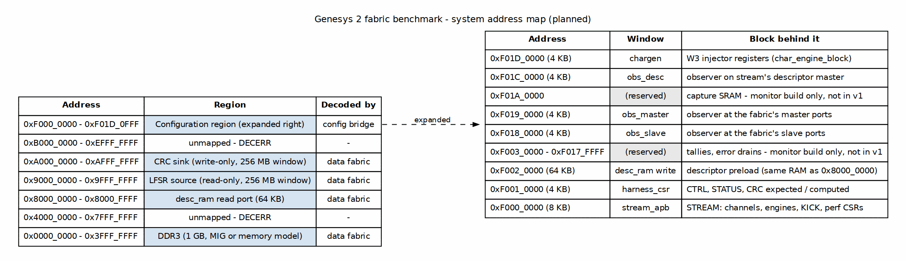

<!-- RTL Design Sherpa Documentation Header -->
<table>
<tr>
<td width="80">
  <a href="https://github.com/sean-galloway/RTLDesignSherpa">
    
  </a>
</td>
<td>
  <strong>RTL Design Sherpa</strong> · <em>Learning Hardware Design Through Practice</em><br>
  <sub>
    <a href="https://github.com/sean-galloway/RTLDesignSherpa">GitHub</a> ·
    <a href="https://github.com/sean-galloway/RTLDesignSherpa/blob/main/docs/DOCUMENTATION_INDEX.md">Documentation Index</a> ·
    <a href="https://github.com/sean-galloway/RTLDesignSherpa/blob/main/LICENSE">MIT License</a>
  </sub>
</td>
</tr>
</table>

---

<!-- End Header -->

**[← Back to Genesys2](../README.md)** | **[← FPGA Systems Index](../../index.md)**

# Genesys 2 (Kintex-7) Fabric Benchmark

Apples-to-apples comparison of three AXI fabrics on the same Kintex-7 device,
endpoints, and traffic: the **bridge-generated crossbar** vs **Xilinx AXI
Crossbar** vs **Xilinx SmartConnect**. The benchmark reuses the `stream`
harness, host stack, observers, LFSR source and CRC sink from the Genesys 2
STREAM build so the only variable is the fabric under test.

- **PRD:** [PRD.md](PRD.md) — legs, workloads, metrics, milestones and open questions.
- **Address map:** [docs/ADDRESS_MAP.md](docs/ADDRESS_MAP.md) — system address space (dot + markdown).
- **Harness / DUT diagrams:** [docs/HARNESS.md](docs/HARNESS.md) — UART harness, data path, DUT internals.
- **Status:** K0 in progress. All three data fabrics are generated from one TOML;
A and B1 pass the fabric test in sim; the Vivado IP (B1 crossbar, B2
SmartConnect, MIG DDR3) is generated and every leg has been placed and routed
out of context ([reports/ooc/README.md](reports/ooc/README.md)). The harness
top, board build and host scripts are next (see [Gaps](#gaps-and-planned-content)).

## What this build demonstrates

The Genesys 2 run is the bring-up vehicle for the DE10-Standard fabric
benchmark. It proves the harness, host programs, sequence files and sim harness
on a board where the STREAM stack is already sign-off clean, then compares the
bridge-generated crossbar against Xilinx's own fabric IP on identical silicon.

| Leg | Fabric under test | Source |
| --- | --- | --- |
| **A — bridge** | Bridge-generated AXI4 crossbar | `rtl/bridges/generated/bridge_fb_data/*` from [`bridge_fb_data.toml`](rtl/bridges/configs/bridge_fb_data.toml) |
| **B1 — Xilinx AXI Crossbar** | `axi_crossbar_v2_1` (inside AXI Interconnect) | `rtl/generated/fb_data_fabric_xbar/` from the same TOML; equal to the IP-catalog customization (`make check-xbar`) |
| **B2 — SmartConnect** | `smartconnect_v1_0` | block design `fb_sc` from `fpga/tcl/vendor_ip.tcl`, same TOML; encrypted, so board-only |

The matching rule is the DE10 PRD's §3 rule applied per pair: Leg A's TOML
mirrors the vendor fabric's configuration (port count, data width, ID width,
address map, outstanding depth). Leg A is never configured wider or deeper than
the vendor fabric it replaces.

### Figure 1: Benchmark legs


**Source:** [docs/assets/graphviz/k7_legs.dot](docs/assets/graphviz/k7_legs.dot)

## Board and device

- **Board:** Digilent Genesys 2
- **FPGA:** Xilinx Kintex-7 XC7K325T-2 FFG900
- **Toolchain:** Vivado 2025.1
- **Host link:** UART (FT232R, 115200-8N1, ASCII `W addr data` / `R addr`)
- **System clock:** 200 MHz differential → MMCM → fabric clock (target 100 MHz
for v1)
- **Memory:** MIG 7-series DDR3, 1 GB, 32-bit AXI4 slave interface

## Pieces in the build

| Piece | Role | Status |
| --- | --- | --- |
| `bridge_fb_data` (generated) | Leg A data fabric: 4 masters × 4 slaves, 128-bit AXI4 | As-built from TOML |
| `fb_data_fabric` (generated, per leg) | The one module the harness instantiates; the leg's filelist picks the file | As-built, all three legs |
| `fb_xbar`, `fb_sc`, `fb_mig` (Vivado IP) | B1 IP-catalog crossbar (parameter proof), B2 SmartConnect BD, S0 MIG DDR3 | Generated by `make vendor-ip` |
| `fb_endpoints` | LFSR source / CRC sink behind their CDCs on `ep_clk` | As-built, tested |
| `stream_top_ch8` | STREAM scatter-gather DMA engine (descriptor, read, write masters) | Reused from STREAM harness; planned instantiation here |
| `char_engine_block` | W3 write injector (`axi4_master_wr_injector`) | Reused; planned |
| `uart_axil_bridge` | UART → AXI4-Lite master | Reused from STREAM harness; planned |
| `bridge_stream_mon_axil` | Generated 1→N config bridge at `0xF000_0000` | Reused from STREAM harness; planned |
| `harness_csr` | Host control/status: start, clear_stats, soft_reset, CRC readout | Reused; planned |
| `desc_ram` | Descriptor store; read port on fabric, write port on config bridge | Reused; planned |
| `axi4_intf_master/slave_observer` | Bus meters / latency histograms at fabric ports | Reused; planned |
| `axi4_cdc_rd` / `axi4_cdc_wr` | Clock-domain crossings to LFSR source / CRC sink | Reused; planned |
| `axi4_slave_rd_injector` / `axi4_slave_wr_crc_check` | LFSR source / CRC sink | Reused; planned |
| `axi4_dwidth_converter_rd` | Descriptor master 256 → 128 width converter (outside fabric) | Reused; planned |
| MIG 7-series / memory model | DDR3 slave at `0x0000_0000` | MIG generated (DDR3-800, 4:1, 128-bit AXI); memory model in sim |
| `build-*` / `fpga/` / `host/` / `dv/` | Build directories, Tcl, host programs, cosim | Not present yet |

## System address map

One 32-bit space. The data fabric decodes the lower regions; the configuration
bridge decodes `0xF000_0000` and up. The configuration offsets match the Genesys
2 STREAM harness map, only the base moved to `0xF000_0000`.

### Figure 2: System address map



**Source:** [docs/assets/graphviz/k7_address_map.dot](docs/assets/graphviz/k7_address_map.dot)

| Base | Size | Block | Reached by | Behind the port |
| --- | ---: | --- | --- | --- |
| `0x0000_0000` | 1 GB | DDR3 | data fabric (`stream` rd/wr, injector) | MIG 7-series AXI4 slave (memory model in sim) |
| `0x8000_0000` | 64 KB | `desc_ram` read port | data fabric (`stream` m_axi_desc) | `sdpram_slave_axi4_axi4`, host preloads at `0xF002_0000` |
| `0x9000_0000` | 256 MB | LFSR source | data fabric (`stream` m_axi_rd) | `axi4_cdc_rd` → `axi4_slave_rd_injector` |
| `0xA000_0000` | 256 MB | CRC sink | data fabric (`stream` m_axi_wr) | `axi4_cdc_wr` → `axi4_slave_wr_crc_check` |
| `0xF000_0000` | 8 KB | `stream_apb` | config bridge (host) | STREAM registers: channels, engines, KICK, perf CSRs |
| `0xF001_0000` | 4 KB | `harness_csr` | config bridge (host) | CTRL, STATUS, CRC expected / computed |
| `0xF002_0000` | 64 KB | `desc_ram` write port | config bridge (host) | descriptor preload |
| `0xF018_0000` | 4 KB | `obs_slave` | config bridge (host) | observer at the fabric's slave ports |
| `0xF019_0000` | 4 KB | `obs_master` | config bridge (host) | observer at the fabric's master ports |
| `0xF01C_0000` | 4 KB | `obs_desc` | config bridge (host) | observer on `stream` m_axi_desc |
| `0xF01D_0000` | 4 KB | `chargen` | config bridge (host) | W3 injector registers (`char_engine_block`) |

: Table 1: System address map (planned, mirrors DE10 PRD Table 5.1)

## How to build and run

> **No bitstream yet.** The fabrics, the Vivado IP and the out-of-context
> comparison build today (below). The harness top, board build, host programs
> and cosim harness have not landed; when they do, the board flow follows the
> house FPGA-system pattern used by `projects/fpga-systems/Genesys2/dma-ip/stream/`:
>
> ```bash
> cd projects/fpga-systems/Genesys2/fabric-benchmark
> make prebuild        # regenerate bridges / regmaps
> make lint            # Verilator lint of the full closure
> make sim BUILD=leg_a # cocotb cosim of Leg A fabric-only mode (W2)
> make bitstream BUILD=leg_a
> make program BUILD=leg_a
> make run BUILD=leg_a SEQUENCES=...
> ```

Current concrete steps that work (`make help`):

```bash
cd projects/fpga-systems/Genesys2/fabric-benchmark
make regen          # every generated file from the TOML: bridge, 3 leg wrappers, IP config, MIG .prj
make vendor-ip      # Vivado: fb_xbar, fb_sc (SmartConnect BD), fb_mig -> fpga/ip/build
make check-xbar     # B1 wrapper parameters == IP-catalog crossbar
make ooc-all        # every leg placed and routed alone at 10 ns and 4 ns -> reports/ooc/
make mig-example    # MIG's example design placed and routed -> reports/mig_example/
make sim            # cocotb: fabric test (A, B1) and endpoint test

# Render documentation diagrams
cd docs/assets/graphviz
./regenerate_all_graphviz.sh
```

## Diagrams

| Figure | File | What it covers |
| --- | --- | --- |
| Figure 1 | [`k7_legs.dot`](docs/assets/graphviz/k7_legs.dot) | The three legs; everything outside the fabric instance is identical RTL |
| Figure 2 | [`k7_address_map.dot`](docs/assets/graphviz/k7_address_map.dot) | 32-bit system address map (data fabric + config bridge) |
| Figure 3 | [`k7_harness.dot`](docs/assets/graphviz/k7_harness.dot) | UART harness: host → `uart_axil_bridge` → config bridge → CSR windows → DUT |
| Figure 4 | [`k7_data_path.dot`](docs/assets/graphviz/k7_data_path.dot) | DUT data path: `stream`, injector, observers, fabric, endpoints |

See [docs/HARNESS.md](docs/HARNESS.md) for the block-diagram discussion.

## Gaps and planned content

| Gap | Why it is planned, not as-built |
| --- | --- |
| Board build | No harness top, XDC or bitstream flow yet; the IP, OOC and MIG-example flows exist (`Makefile`) |
| `host/` scripts | No fabric-benchmark-specific runners or sequence files yet; will reuse the STREAM host stack |
| `dv/` cosim harness | No `fabric_benchmark_tb_top` or cocotb tests yet |
| Board constraints | MIG generates its own pin XDC from `fb_mig.prj`; UART, LEDs and clocks for the top are not written yet |
| `bin/` | Generators and the OOC parser exist; measurement runners do not |
| Leg B2 sim | SmartConnect is encrypted (HDL and funcsim netlist): board-only by design |

These are tracked in the PRD milestones (K0–K4). Everything drawn in the
diagrams and written in the address map is grounded in the PRD and in the
generated `bridge_fb_data` RTL; items marked **planned** above are not yet
present in this working tree.
