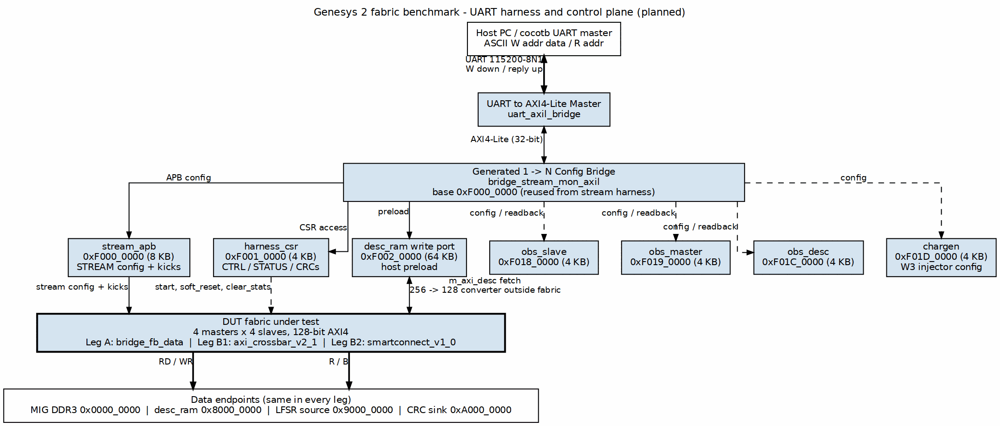
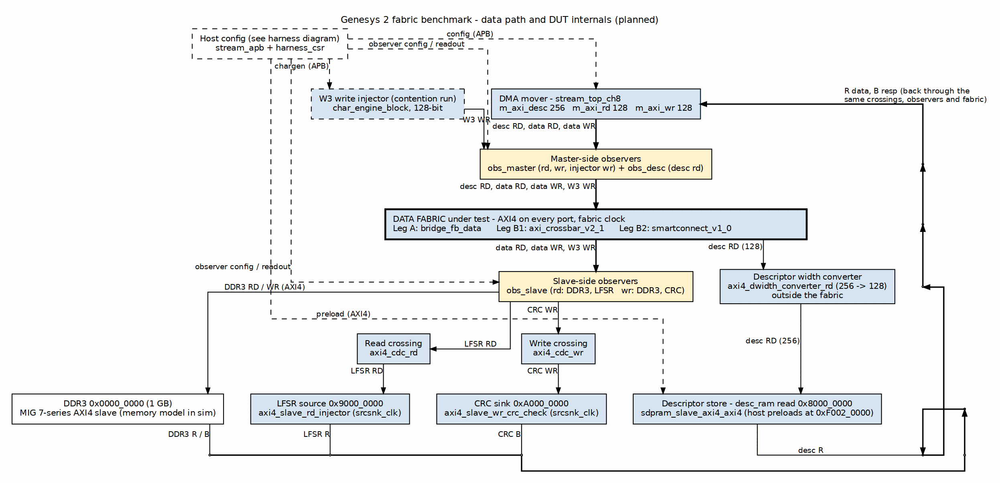

<!-- RTL Design Sherpa Documentation Header -->
<table>
<tr>
<td width="80">
  
</td>
<td>
  <strong>RTL Design Sherpa</strong> · <em>Learning Hardware Design Through Practice</em> 
  
    <a href="https://github.com/sean-galloway/RTLDesignSherpa">GitHub</a> ·
    <a href="https://github.com/sean-galloway/RTLDesignSherpa/blob/main/docs/DOCUMENTATION_INDEX.md">Documentation Index</a> ·
    <a href="https://github.com/sean-galloway/RTLDesignSherpa/blob/main/LICENSE">MIT License</a>
  
</td>
</tr>
</table>

---

<!-- End Header -->

**[← Back to README](../README.md)**

# Genesys 2 Fabric Benchmark — Harness and DUT Block Diagrams

All diagrams are drawn in graphviz `dot` following the house style in
`vault/handbook/authoring/block-diagrams.md`. They are **planned for K0**:
the Leg A fabric RTL is generated, but the harness top, build flow and host
scripts that instantiate these blocks have not yet landed.

## UART harness

The host talks to the board over a 115200-8N1 UART. `uart_axil_bridge` turns
the ASCII `W addr data` / `R addr` bytestream into a 32-bit AXI4-Lite master.
A generated 1→N bridge fans it out to every configuration slave in the design.

### Figure 1: UART harness and control plane

**Source:** [assets/graphviz/k7_harness.dot](assets/graphviz/k7_harness.dot)

| Block | Role |
| --- | --- |
| `uart_axil_bridge` | UART → AXI4-Lite master |
| `bridge_stream_mon_axil` | Generated config bridge at `0xF000_0000`; reused from the STREAM harness |
| `stream_apb` | STREAM configuration window at `0xF000_0000` |
| `harness_csr` | Control/status at `0xF001_0000`: `start`, `clear_stats`, `soft_reset`, CRC readout |
| `desc_ram` write port | Descriptor preload at `0xF002_0000` |
| `obs_slave` / `obs_master` / `obs_desc` | Observer configuration/readback windows |
| `chargen` | W3 injector configuration at `0xF01D_0000` |
| DUT fabric | The fabric under test: `bridge_fb_data` (Leg A), `axi_crossbar_v2_1` (Leg B1), or `smartconnect_v1_0` (Leg B2) |

Control traffic is dashed; the data path to the endpoints is solid and ends at
the boundary bar.

## Data path and DUT internals

The DUT is the fabric under test plus the blocks that drive and observe it.
`stream_top_ch8` moves data between the endpoints; `char_engine_block` adds W3
contention traffic; observers sit on both sides of the fabric to measure
bandwidth and latency.

### Figure 2: Data path and DUT internals

**Source:** [assets/graphviz/k7_data_path.dot](assets/graphviz/k7_data_path.dot)

| Block | Role |
| --- | --- |
| `stream_top_ch8` | STREAM DMA: descriptor fetch, read data, write data masters |
| `char_engine_block` | W3 write injector (`axi4_master_wr_injector`), active only in the contention run |
| `obs_master` / `obs_desc` | Master-side observers: bus meters and latency histograms |
| `obs_slave` | Slave-side observers |
| `bridge_fb_data` / `axi_crossbar_v2_1` / `smartconnect_v1_0` | The fabric under test (Leg A / B1 / B2) |
| `axi4_dwidth_converter_rd` | Descriptor master 256 → 128 width converter, deliberately outside the fabric |
| `desc_ram` | Descriptor store; read port on the fabric at `0x8000_0000` |
| `axi4_cdc_rd` / `axi4_cdc_wr` | Clock-domain crossings to the faster `srcsnk_clk` domain |
| `axi4_slave_rd_injector` | LFSR read source at `0x9000_0000` |
| `axi4_slave_wr_crc_check` | CRC write sink at `0xA000_0000` |
| MIG DDR3 / memory model | DDR3 slave at `0x0000_0000`; real MIG on board, AXI4 memory model in sim |

Requests run top-down through the center; write data drops down the left lane;
read data and write responses climb back up the right lane, forming the spatial
loop of the house style. Configuration is a dashed sideband from the harness.
