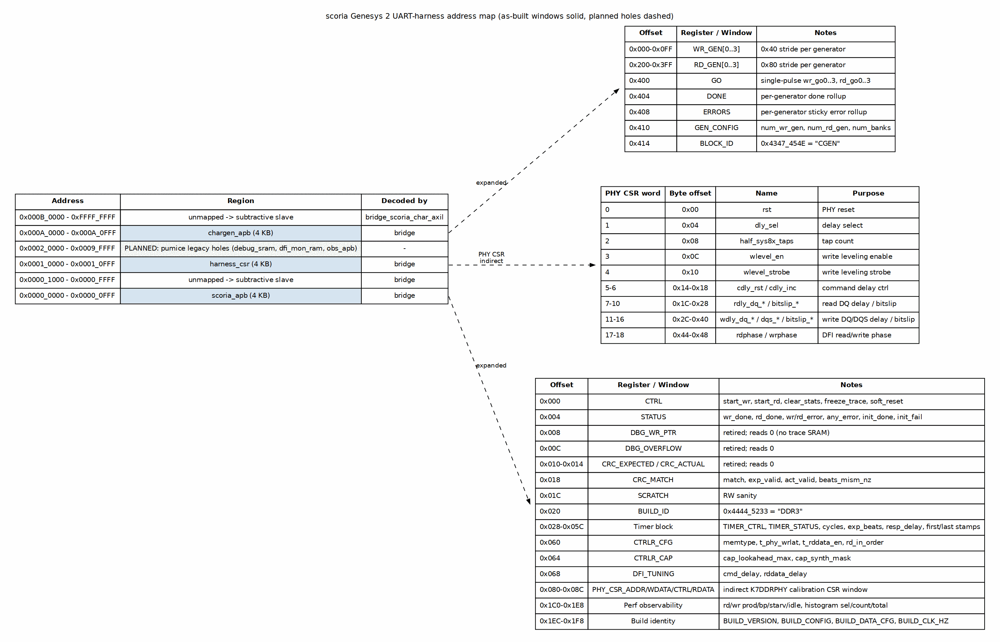

<!-- RTL Design Sherpa Documentation Header -->
<table>
<tr>
<td width="80">
  
</td>
<td>
  <strong>RTL Design Sherpa</strong> · <em>Learning Hardware Design Through Practice</em> 
  
    <a href="https://github.com/sean-galloway/RTLDesignSherpa">GitHub</a> ·
    <a href="https://github.com/sean-galloway/RTLDesignSherpa/blob/main/docs/DOCUMENTATION_INDEX.md">Documentation Index</a> ·
    <a href="https://github.com/sean-galloway/RTLDesignSherpa/blob/main/LICENSE">MIT License</a>
  
</td>
</tr>
</table>

---

<!-- End Header -->

**[← Back to area README](../README.md)**

# scoria Genesys 2 UART-Harness Address Map

The host sees one 32-bit AXI4-Lite address space. The generated bridge
`bridge_scoria_char_axil` decodes three 4 KB windows. Everything else reaches
the subtractive slave and asserts `unmapped_irq` (wired to an LED).

### Figure A.1: Address map

**Source:** [scoria_address_map.dot](assets/graphviz/scoria_address_map.dot)

## Top-level windows

| Base | Size | Slave | RTL source | Status |
|---|---:|---|---|---|
| `0x0000_0000` | 4 KB | `scoria_apb` | `bridge_scoria_char_axil.toml` | as-built |
| `0x0001_0000` | 4 KB | `harness_csr` | `bridge_scoria_char_axil.toml` | as-built |
| `0x000A_0000` | 4 KB | `chargen_apb` | `bridge_scoria_char_axil.toml` | as-built |
| `0x0002_0000 - 0x0009_FFFF` | — | (reserved holes) | `bridge_scoria_char_axil.toml` | **PLANNED** |
| `0x000B_0000 - 0xFFFF_FFFF` | — | subtractive slave error | `bridge_scoria_char_axil` | as-built |

: Table A.1: Bridge address windows

The reserved holes mirror pumice's legacy layout (`debug_sram` at 0x40000,
`dfi_mon_ram` at 0x80000, `obs_apb` at 0x90000). They are intentionally left
empty in this first bring-up harness so the existing windows keep pumice's
addresses and nothing has to migrate when the observability blocks are added.

## `scoria_apb` — controller CSR

This window reaches the scoria controller's PeakRDL-generated CSR block
(`scoria_csr`) through an `apb4_to_peakrdl` shim inside `scoria_char_macro`.
The register names and fields are defined in
`projects/components/mem-ctrl-ip/research-ip/scoria-ddr3-lpddr3/regs/scoria_csr.rdl`.

Host access is through `host/scoria_device.py`, which uses the generated
`scoria_csr_regmap.py` and shadows every register write to avoid read-modify-write
corruption.

Key register groups:

| Group | Purpose |
|---|---|
| `CTRL` / `STATUS` | init force-restart, init_done, init_error |
| `MR0..MR3` | mode-register shadows |
| `PHY_TIMING`, `TIMINGS_*` | DRAM timings, t_phy_wrlat, t_rddata_en |
| `ADDR_MAP` | bank_lsb, hash_en, hash_seed |
| `DFI_PHASE` | rd_phase, wr_phase, gear_ratio, bl |
| `REFRESH_TUNING`, `REF_CTRL`, `REF_TIMING_PB` | refresh policy, postpone/pull-in, per-bank refresh |
| `ZQ_CFG`, `ZQ_INTERVAL`, `ZQ_STATUS`, `ZQ_OBS_INTERVAL` | periodic ZQCS |
| `WRLVL_CFG`, `WRLVL_TIMING*`, `WRLVL_STATUS*` | DDR3 write leveling |
| `STALL_*` | stall attribution: BP, REFRESH, TURNAROUND, TCCD, ACTLIMIT, BANKTIMER, NOREQ, ZQ |
| `PAGE_STATS_*`, `SCHED_STATS_*`, `REF_STATS_*`, `OBS_ROW_HIT[*]` | telemetry |

: Table A.2: scoria controller CSR groups

## `harness_csr` — harness control/status

Offsets are relative to `0x0001_0000`. The register definitions come from
`projects/fpga-systems/rtl/mem_char_framework/rtl/harness_csr.rdl`; the RTL is
hand-written in `harness_csr.sv`.

| Offset | Register | Fields / Purpose |
|---|---|---|
| `0x00` | `CTRL` | start_wr, start_rd, clear_stats, freeze_trace, soft_reset (all self-clearing pulses except freeze_trace) |
| `0x04` | `STATUS` | wr_done, rd_done, wr_error, rd_error, any_error, dbg_clear_busy, init_done, init_fail |
| `0x08` | `DBG_WR_PTR` | retired; reads 0 (no trace SRAM) |
| `0x0C` | `DBG_OVERFLOW` | retired; reads 0 |
| `0x10` | `CRC_EXPECTED` | retired; reads 0 |
| `0x14` | `CRC_ACTUAL` | retired; reads 0 |
| `0x18` | `CRC_MATCH` | match, exp_valid, act_valid, beats_mism_nz |
| `0x1C` | `SCRATCH` | RW sanity |
| `0x20` | `BUILD_ID` | `0x4444_5233` = ASCII "DDR3" |
| `0x24` | `BEATS_MISM` | retired; reads 0 |
| `0x28` | `TIMER_CTRL` | clear pulse |
| `0x2C` | `TIMER_STATUS` | done, running, pass |
| `0x30-0x3C` | `TIMER_CYCLES_*`, `TIMER_EXP_BEATS`, `RESP_DELAY` | cycle-counted measurement window + AXI response-delay knobs |
| `0x40-0x5C` | `TIMER_*_FIRST/last_LO/HI` | first/last beat timestamps |
| `0x60` | `CTRLR_CFG` | memtype, t_phy_wrlat, t_rddata_en, rd_in_order |
| `0x64` | `CTRLR_CAP` | cap_lookahead_max, cap_synth_mask |
| `0x68` | `DFI_TUNING` | cmd_delay, rddata_delay |
| `0x80` | `PHY_CSR_ADDR` | K7DDRPHY calibration CSR word index |
| `0x84` | `PHY_CSR_WDATA` | PHY CSR write data |
| `0x88` | `PHY_CSR_CTRL` | pulse → drive one PHY CSR write |
| `0x8C` | `PHY_CSR_RDATA` | PHY CSR read data |
| `0x1C0-0x1CC` | `OBS_RD_PROD/BP/STARV/IDLE` | read-path bus-meter counts |
| `0x1D0-0x1DC` | `OBS_WR_PROD/BP/STARV/IDLE` | write-path bus-meter counts |
| `0x1E0` | `OBS_HIST_SEL` | bus, metric, bin select |
| `0x1E4` | `OBS_HIST_COUNT` | histogram bin count |
| `0x1E8` | `OBS_HIST_TOTAL` | histogram total |
| `0x1EC` | `BUILD_VERSION` | functional build number |
| `0x1F0` | `BUILD_CONFIG` | dfi_rate, gear_ratio, dram_bl, row_width, bank_width |
| `0x1F4` | `BUILD_DATA_CFG` | axi_data_width, dram_beat_width, dram_device_width |
| `0x1F8` | `BUILD_CLK_HZ` | sys/AXI clock this build was compiled for |

: Table A.3: harness_csr register map

The `0x100-0x1AF` region is intentionally left empty: it held single-engine
config in an earlier harness version and is now retired.

## `chargen_apb` — traffic-generator config

Offsets are relative to `0x000A_0000`. The block is generated from
`projects/fpga-systems/rtl/mem_char_framework/rtl/chargen_regs.rdl`.

| Offset | Register / Window | Purpose |
|---|---|---|
| `0x000-0x0FF` | `WR_GEN[0..3]` | per-generator config, 0x40 stride |
| `0x200-0x3FF` | `RD_GEN[0..3]` | per-generator config, 0x80 stride |
| `0x400` | `GO` | single-pulse launch: wr_go0..3, rd_go0..3 |
| `0x404` | `DONE` | per-generator done rollup |
| `0x408` | `ERRORS` | per-generator sticky error rollup |
| `0x410` | `GEN_CONFIG` | num_wr_gen, num_rd_gen, num_banks |
| `0x414` | `BLOCK_ID` | `0x4347_454E` = ASCII "CGEN" |

: Table A.4: chargen_apb register map

Per-generator registers (within each `WR_GEN`/`RD_GEN` slot):

| Offset | Register | Purpose |
|---|---|---|
| `0x00` | `START_ADDR` | base address |
| `0x04` | `STRIDE_0` | primary address stride |
| `0x08` | `STRIDE_1` | secondary stride (inert in current pattern) |
| `0x0C` | `WRAP_MASK_0` | primary wrap mask |
| `0x10` | `WRAP_MASK_1` | secondary wrap mask |
| `0x14` | `BLEN_TXN` | burst_len, txn_count, gap |
| `0x18` | `AXI_ATTR` | axi_id, id_mode, axi_size, axi_burst, data_mode, hammer_en, max_outstanding |
| `0x1C` | `LFSR_SEED` | data-pattern seed |
| `0x20-0x28` | `HASH_SEED0..2` | address-hash seeds |
| `0x2C` | `FILL_PATTERN` | fixed-fill pattern (data_mode=2) |
| `0x30` | `STATUS` | done, crc_valid, bresp_error (WR) / data_error, rresp_error, stray_beat_error (RD) |
| `0x34` | `EXPECTED_CRC` (WR) / `ACTUAL_CRC` (RD) | CRC computed by engine |
| `0x38` | `BEATS_MISM` | mismatch beat count (RD only) |
| `0x3C` | `STRAY_BEATS` | stray beat count (RD only) |
| `0x40` | `ERR_BITS` | accumulated mismatch popcount (RD only) |

: Table A.5: One generator's registers

## PHY calibration CSR indirection

The K7DDRPHY exposes its own 32-bit calibration CSR bus (10-bit word address,
read-combinational, write-pulse). Because the PHY lives in `scoria_char_top`,
`harness_csr` owns an indirect window at `0x80-0x8C`:

1. Write `PHY_CSR_ADDR` with the PHY CSR word index.
2. Write `PHY_CSR_WDATA` with the value.
3. Pulse `PHY_CSR_CTRL` to perform the write.
4. Read `PHY_CSR_RDATA` for the current value.

The generated PHY CSR map (at `build-scoria/rtl/generated/k7ddrphy_csr_map.txt`)
lists the word addresses; the dot figure above reproduces the as-built 80 MHz
map. Key CSRs include `rst`, `dly_sel`, `wlevel_en`, `wlevel_strobe`, read/write
DQ/DQS delay controls, and `rdphase`/`wrphase`.

## Planned vs as-built

- **As-built:** the three bridge windows (`scoria_apb`, `harness_csr`,
  `chargen_apb`) and their register maps.
- **As-built:** the PHY CSR indirection window and the generated K7DDRPHY CSR
  map.
- **PLANNED:** `debug_sram` (256 KB), `dfi_mon_ram` (4 KB), and `obs_apb`
  (4 KB) windows in the 0x20000-0x9FFFF holes. The bridge `.toml` leaves them
  empty and the harness ties off the unmapped response.
