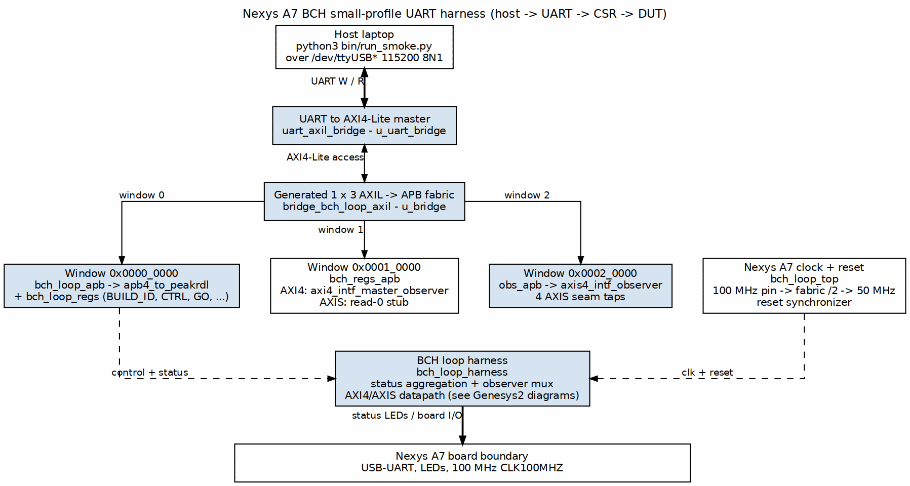

<!-- RTL Design Sherpa Documentation Header -->
<table>
<tr>
<td width="80">
  
</td>
<td>
  <strong>RTL Design Sherpa</strong> · <em>Learning Hardware Through Practice</em> 
  
    <a href="https://github.com/sean-galloway/RTLDesignSherpa">GitHub</a> ·
    <a href="https://github.com/sean-galloway/RTLDesignSherpa/blob/main/docs/DOCUMENTATION_INDEX.md">Documentation Index</a> ·
    <a href="https://github.com/sean-galloway/RTLDesignSherpa/blob/main/LICENSE">MIT License</a>
  
</td>
</tr>
</table>

---

<!-- End Header -->

# Nexys A7 BCH UART Harness Block Diagram

This page shows the Nexys A7-specific view of the BCH UART harness. The
board-level wrapper, clock divide, and the host-to-register path are drawn
here. The detailed codec datapath (generator, encoder, error injector, decoder,
and pattern checker) is intentionally **not duplicated** — it is identical to
the Genesys2 harness and is documented there.

### Figure 1: Nexys A7 BCH UART Harness (Small Profile)

## Host-to-register path

1. The host runs `bin/run_smoke.py` (or any other sequence script) and talks to
   the board over a 115200-baud 8N1 UART on `/dev/ttyUSB*`.
2. `uart_axil_bridge` turns the byte stream into an AXI4-Lite master.
3. The generated `bridge_bch_loop_axil` fabric fans the single AXI4-Lite master
   out to three APB windows:
   - `0x0000_0000` — loop CSRs (`bch_loop_regs`).
   - `0x0001_0000` — `bch_regs_apb`: AXI4 observer or AXIS read-0 stub.
   - `0x0002_0000` — `obs_apb`: AXIS seam observer.
4. The loop harness (`bch_loop_harness`) receives control from the CSRs and
   returns status and verdict tallies.

## Board-specific clocking

The Nexys A7-100T provides a single-ended 100 MHz clock (`CLK100MHZ`). The
small profile divides this in fabric to 50 MHz before it reaches
`bch_loop_harness`, because the Artix-7 -1 speed grade cannot close the loop at
100 MHz. `CFG_SYS_CLK_HZ` matches the divided clock, so the UART baud rate stays
at 115200 regardless of profile. The active-low reset button is synchronized
into the harness clock domain in `bch_loop_top`.

## Where the datapath is documented

The Genesys2 harness has the same loop internals and already provides house-
style block diagrams for both integration flavours:

- AXIS flavour:
  [`../../../Genesys2/ecc-ip/bch/docs/bch_uart_harness/assets/graphviz/01_bch_axis_loop.png`](../../../../Genesys2/ecc-ip/bch/docs/bch_uart_harness/assets/graphviz/01_bch_axis_loop.png)
- AXI4 memory-to-memory flavour:
  [`../../../Genesys2/ecc-ip/bch/docs/bch_uart_harness/assets/graphviz/02_bch_axi4_loop.png`](../../../../Genesys2/ecc-ip/bch/docs/bch_uart_harness/assets/graphviz/02_bch_axi4_loop.png)
- Harness guide:
  [`../../../Genesys2/ecc-ip/bch/docs/UART_HARNESS.md`](../../../../Genesys2/ecc-ip/bch/docs/UART_HARNESS.md)
