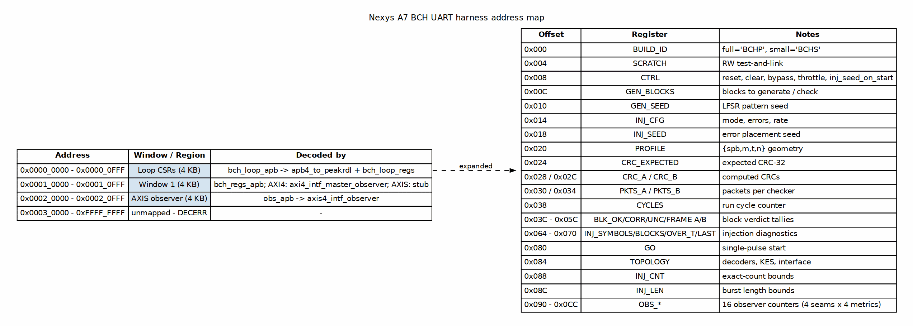

<!-- RTL Design Sherpa Documentation Header -->
<table>
<tr>
<td width="80">
  
</td>
<td>
  <strong>RTL Design Sherpa</strong> · <em>Learning Hardware Through Practice</em> 
  
    <a href="https://github.com/sean-galloway/RTLDesignSherpa">GitHub</a> ·
    <a href="https://github.com/sean-galloway/RTLDesignSherpa/blob/main/docs/DOCUMENTATION_INDEX.md">Documentation Index</a> ·
    <a href="https://github.com/sean-galloway/RTLDesignSherpa/blob/main/LICENSE">MIT License</a>
  
</td>
</tr>
</table>

---

<!-- End Header -->

# BCH Nexys A7 UART Harness Address Map

This is the host-visible address space for the BCH small-profile build on the
Nexys A7. The harness itself is built from the shared Genesys2 tree; the bridge
and register map are therefore identical to the Genesys2 full-profile harness
except for the `BUILD_ID` value (`BCHS` here vs `BCHP` there) and the geometry
reported by the `PROFILE` CSR.

The address map is extracted from:

- `projects/fpga-systems/Genesys2/ecc-ip/bch/rtl/bridges/generated/bridge_bch_loop_axil/bridge_bch_loop_axil.toml`
- `projects/fpga-systems/Genesys2/ecc-ip/bch/build-loop/dv/tbclasses/bch_loop_regs_regmap.py`

## Top-level windows

| Address | Size | Window | What lives there |
|---------|------|--------|------------------|
| 0x0000_0000 | 4 KB | `bch_loop_apb` | Loop CSRs: `bch_loop_regs` behind `apb4_to_peakrdl` |
| 0x0001_0000 | 4 KB | `bch_regs_apb` | AXI4 flavour: `axi4_intf_master_observer`; AXIS flavour: read-0 stub |
| 0x0002_0000 | 4 KB | `obs_apb` | `axis4_intf_observer` on the four AXIS seams |
| 0x0003_0000 - 0xFFFF_FFFF | - | - | Unmapped, returns DECERR |

: BCH Nexys A7 harness address windows

### Figure 1: BCH Nexys A7 UART Harness Address Map

## Loop CSR details (window 0)

| Offset | Register | Purpose |
|--------|----------|---------|
| 0x000 | `BUILD_ID` | `'BCHP'` full profile / `'BCHS'` Nexys A7 small profile |
| 0x004 | `SCRATCH` | RW test-and-link register |
| 0x008 | `CTRL` | `soft_reset`, `clear`, `bypass`, `throttle_a/b`, `inj_seed_on_start` |
| 0x00C | `GEN_BLOCKS` | Number of blocks to generate and check |
| 0x010 | `GEN_SEED` | LFSR data-pattern seed |
| 0x014 | `INJ_CFG` | Injector mode (0..7), error count, rate |
| 0x018 | `INJ_SEED` | Error-placement seed |
| 0x020 | `PROFILE` | `{spb,m,t,n}` geometry read back from hardware |
| 0x024 | `CRC_EXPECTED` | Expected per-packet CRC-32 |
| 0x028 / 0x02C | `CRC_A` / `CRC_B` | Computed CRCs from the two checkers |
| 0x030 / 0x034 | `PKTS_A` / `PKTS_B` | Packets processed per checker |
| 0x038 | `CYCLES` | Cycle counter for the run |
| 0x03C - 0x05C | `BLK_OK/CORR/UNC/FRAME` A/B | Per-checker block verdict tallies |
| 0x064 - 0x070 | `INJ_SYMBOLS/BLOCKS/OVER_T/LAST` | Injection diagnostics |
| 0x080 | `GO` | Single-pulse start |
| 0x084 | `TOPOLOGY` | Decoders, KES flavour, interface flavour |
| 0x088 | `INJ_CNT` | Exact-count mode min/max bounds |
| 0x08C | `INJ_LEN` | Burst / localized length bounds |
| 0x090 - 0x0CC | `OBS_*` | 16 observer performance counters (4 seams x 4 metrics) |

: BCH loop CSR register offsets

## As-built vs planned

- Window 0 and window 2 are fully as-built and used by every campaign.
- Window 1 is as-built but its contents depend on the flavour:
  - `IFACE="AXI4"` hosts the `axi4_intf_master_observer` watching the codec's
    AXI4 master ports.
  - `IFACE="AXIS"` ties the slot off (`PREADY=1`, `PRDATA=0`) so the host bus
    never hangs.
- The TOML comments call window 1 an "expansion slot" for a future codec-owned
  register block. That standalone codec register block is **PLANNED**; the
  current harness does not implement it.

## Related documents

- Harness architecture and datapath diagrams:
  [`../../../Genesys2/ecc-ip/bch/docs/bch_uart_harness/assets/graphviz/01_bch_axis_loop.png`](../../../../Genesys2/ecc-ip/bch/docs/bch_uart_harness/assets/graphviz/01_bch_axis_loop.png)
  and
  [`02_bch_axi4_loop.png`](../../../../Genesys2/ecc-ip/bch/docs/bch_uart_harness/assets/graphviz/02_bch_axi4_loop.png).
- Harness user guide:
  [`../../../Genesys2/ecc-ip/bch/docs/UART_HARNESS.md`](../../../../Genesys2/ecc-ip/bch/docs/UART_HARNESS.md).
- Component math / algorithm docs:
  [`projects/components/ecc-ip/bch/docs/`](../../../../../components/ecc-ip/bch/docs/).
