# granite vs LiteDRAM, the full sweep (owner's request, 2026-10-29)

## Working summary (as of 2026-11-01)

One board (Nexys A7-100T, MT47H64M16HR x16), one harness, one host program
for all three controllers. Everything below the summary is the running log
it was distilled from, newest update first, with the setup and every table.

**Where things stand.** At 100 MHz (DDR2-400, peak 800 MB/s each
direction) granite at power-on beats or ties LiteDRAM on all 60 shared
cells: **42 win, 18 tie, 0 lose** (write and read averaged, a tie is within
2 percent). The 18 ties are row_major, col_major and half_pair with an
idle gap: one bank or one stream at a time, where the DRAM's own timing or
the gap sets the ceiling for both. Incremental is a narrow win (2-3
percent). The large wins are the patterns that need more than one bank
busy at a time. LiteDRAM is about 3.7x smaller and has the
lower unloaded read latency (18 cycles against 23).

| cell (write / read MB/s) | granite 100 | LiteDRAM 100 | granite 75 | LiteDRAM 75 | pumice 50 |
|---|---|---|---|---|---|
| peak | 800 | 800 | 600 | 600 | 400 |
| incremental, 16-beat | 772 / 773 | 746 / 756 | 576 / 578 | 554 / 564 | 381 / 382 |
| row_major, 8-beat | 775 / 778 | 766 / 776 | 578 / 581 | 569 / 580 | 384 / 384 |
| col_major, 8-beat | 416 / 520 | 409 / 518 | 292 / 333 | 304 / 386 | 181 / 181 |
| col_major_interleaved, 16-beat | 721 / 729 | 500 / 507 | 541 / 545 | 377 / 380 | 325 / 342 |
| half_pair, 1 thread | 393 / 389 | 324 / 383 | 294 / 243 | 243 / 286 | 195 / 147 |
| half_pair, 8 threads | 385 / 389 | 94 / 95 | 268 / 290 | 70 / 71 | 157 / 194 |
| random window, 4 threads | 628 / 658 | 383 / 397 | 468 / 481 | 286 / 298 | 267 / 287 |
| mixed window, 4 threads | 251 / 283 | 159 / 159 | 147 / 147 | 119 / 119 | 131 / 108 |
| concurrent 1 writer + 1 reader, incremental | 368 / 368 | 167 / 167 | 285 / 285 | 124 / 124 | 185 / 185 |

Sources: granite 100 = `own3_100` 2026-11-01, power-on (`defaults`;
every cell but the mixed window reads the same on the `hx100`, `byp100` and
`ard2_100` builds of 2026-10-31, where the mixed window was 205 / 202). The
mixed window settles in one of two states per run, 251 / 283 or 260 / 319
(three runs each in six); see "Direction ownership" below. LiteDRAM
100 = `hx100` 2026-10-31; granite 75 = `sweep75` 2026-10-29 `open_page`
(the design as of that day: before the hybrid, fast read release and the
drain-arm fix); LiteDRAM 75 = `sweep75` 2026-10-29; pumice 50 = `sweep`
2026-10-30 `open_page` (build-perf bitstream 2026-10-27; its 75 MHz build
does not close). At 75 MHz the 2026-10-29 granite scored 35 win / 19 tie / 6
lose, the six losses all `col_major`. That design has not been re-swept at 75.

**Read latency**, exact (AR to the first R beat, 100 MHz, so 1 cycle = 10 ns):

| cell | granite mean / min / max | LiteDRAM mean / min / max |
|---|---|---|
| half_pair, 1 thread (unloaded) | 29.5 / 23 / 44 | 18.7 / 18 / 48 |
| half_pair, 8 threads | 40.7 / 25 / 69 | 26.8 / 21 / 62 |
| incremental, 8-beat | 45.6 / 23 / 73 | 33.9 / 32 / 62 |
| col_major_interleaved, 8-beat | 50.2 / 23 / 77 | 64.5 / 22 / 87 |
| random window, 4 threads | 51.4 / 23 / 84 | 61.4 / 22 / 91 |

granite = `own3_100` (695b42e0d; every row reads the same on `ard2_100`,
41bb5e07e: on top of the store head bypass and the return fall-through, the
store's AR direct placement and the DFI command fall-through): the floor came down 27 -> 25 -> 23 over the two rebuilds.
Only a read that finds the controller idle sees the floor, so the loaded
means move about a cycle (median -1.0 over 180 cells against `byp100`;
half_pair 8 threads 44.9 -> 41.9 -> 40.7).

granite's floor is 5 cycles above LiteDRAM's (9 before the four cuts). Its mean is higher on the
sequential patterns too (46.6 against 33.9 on incremental, at the same
bandwidth). At 8 threads it is higher while it moves 4x the data. It is lower
where the pattern needs bank parallelism. The mixed window has no latency figure, because that measurement never
reads the histogram.

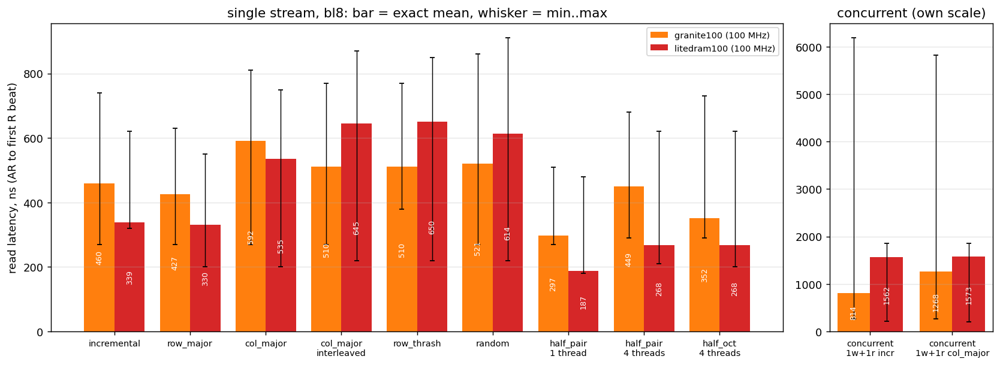

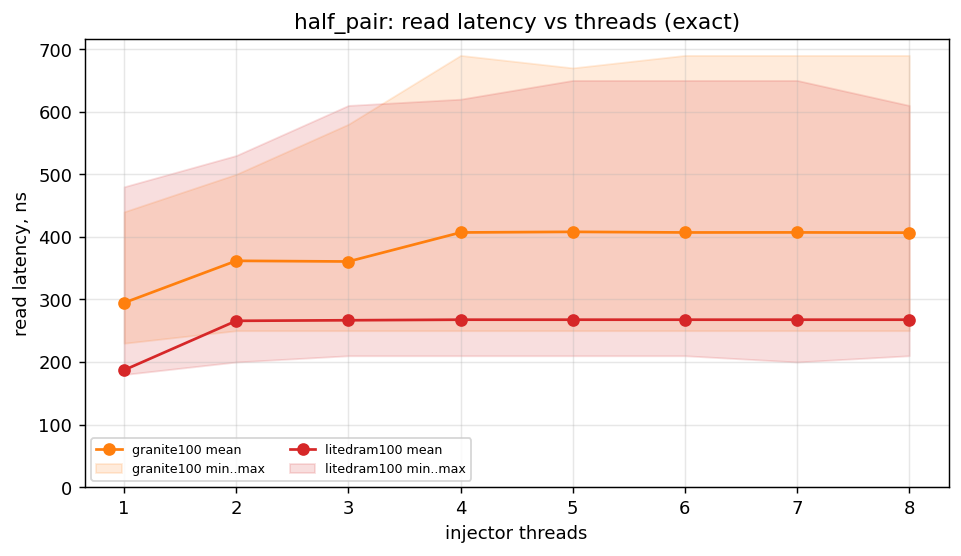

**Area** (Vivado `report_utilization -hierarchical` on each routed
checkpoint, xc7a100t; the controller only, without the shared DDR2 PHY, the
characterization engines, the UART bridge or the debug RAMs):

| | granite | pumice | LiteDRAM |
|---|---|---|---|
| instance | `granite_top_geared` | `pumice_top_geared` | `litedram_core` minus `VexRiscv` and `a7ddrphy` cells |
| LUT (of which LUTRAM) | 8,284 (416) | 11,897 (432) | about 2,260 (235) |
| FF | 5,019 | 6,509 | about 1,580 |
| RAMB36 | 2 | 2 | 0-3 (see note) |
| DSP | 0 | 0 | 0 |
| checkpoint | 100 MHz `own3` build, 2026-11-01 | build-perf, 2026-10-27 | 100 MHz build, 2026-10-31 |
| read MB/s per 1,000 LUT, random window | 79 | 24 (at 50 MHz) | 176 |
| read MB/s per 1,000 LUT, incremental 16-beat | 93 | 32 (at 50 MHz) | 335 |

- **What each count includes:**
  - granite's count includes its CSR block (379 LUT, 501 FF). The rest is `granite_core`: the per-bank queue store 3,163 LUT, the AXI plane 2,213, the scheduler 2,102 (of it the bank pick 878), the DFI plane 326 and the init plane 113.
  - How it grew: `hx` (2026-10-31) 7,890 LUT / 4,987 FF; `ard2_100` 8,190 / 4,997 (the store head bypass, AR direct placement and the DFI command fall-through, +300 LUT); `own3_100` 8,284 / 5,019 (bank ownership, the idle hold and the parallel stale one-hot: the bank pick 774 -> 878 LUT, 203 -> 216 FF; +94 LUT, 1.1 percent).
  - LiteDRAM's core is one flat module, so its controller figure is the core total minus the CPU subtree (Vivado hierarchy) and minus the cells named `a7ddrphy` (208 LUT, 496 FF). What remains still holds the SoC glue (Wishbone, CSR bus, UART), so it is an upper bound.
  - Of the core's block RAMs, 9 are the CPU's, 8 the BIOS ROM and 2 its SRAM. That leaves 3 RAMB36 at most for the controller and the glue.
- **pumice:** the checkpoint predates fast read release (the RTL default since 2026-10-31).

**Open items** (TASK-003 log): granite's 5-cycle unloaded latency gap
(where it goes: the section "Where the read floor goes" below); a pumice rebuild and sweep to
confirm fast read release and give pumice exact latency; latency for the
mixed window.

---

# Appendix: the running log

## Direction ownership, and a direction lock it exposed (2026-11-01)

The mixed window's low states were not the refresh phase alone (below). A
probe at every direction flip in the proxy's bad state (tREFI 772) showed
the current direction still holding 8 queued heads, none requesting: one
bank held open by the other direction's row (the PRE courtesy withholds the
close while the other direction's head hits it), the other a few cycles
short of its ACT lookahead after its own auto-precharge. The bus turned
round (about 26 cycles) instead of closing and opening a row (about 4), one
bank per run, runs of 8, 2,043 switches. The write watermark never entered
into it: under the bank-pick core `SCHED_WR_WM` is tied off (now documented
as inert in the RDL).

Three changes to `mc_bank_pick`, granite on (695b42e0d):

- `DIR_OWNS_ROWS`: the direction holding the bus may close the other direction's row, until its batch cap.
- `DIR_HOLD_IDLE` 8: the direction also holds while it has a queued head, for at most 8 idle cycles.
- Any direction flip, not only the batch cap's, makes the next cycle's column of the old direction a leftover that does not turn the bus back. The first board build with the first two (`own100`, CSVs kept as the record) held one bank's read for the whole write stream: multigen `col_major_interleaved` max read latency 367,621 cycles under `fixed_open_tr2` (9,386 open page, 7,087 power-on). A new proxy family, `mg_<family>`, runs the board's multigen and concurrent host path and reproduced it (23,069). The cycle trace: the writer's short-hop column, picked the cycle before a drain flip to reads, fired in the flip cycle and turned the bus back with a fresh batch, and the picked read then lost to tWTR. The batch never passed 8, so the 255 cap never fired. With the leftover rule the same proxy cell reads 175. In the proxy the rule also helps with both knobs off: the proxy mixed window at tREFI 772 leaves its low state (281.5 -> 395.2).

Timing: the first two missed 100 MHz on seven placements (best -0.062 ns
after a post-route pass), always on the stale-pick loop. Instead of a
pipeline stage, the stale mask's one-hot is now computed per request set in
parallel with the class select and muxed by its source. It is cycle-exact (an
instrumented compare over 95,000 picks found none differ) and costs no pick
cycle. `ddr2_char_granite_100mhz_own3_2026-11-01.bit`, Explore, WNS +0.007 /
WHS +0.016.

Board, every profile, `char_granite_own3_100_<profile>_2026-11-01.csv`: 180
cells, 0 failed, 0 mismatched. Against `ard2_100`:

| cell (write / read MB/s, max read latency) | `ard2_100` | `own3_100` |
|---|---|---|
| mixed window, power-on (six runs) | 205 / 202 | 251 / 283 or 260 / 319 |
| mixed window, open page (six runs) | 205 / 202 | 262 / 330 |
| mixed window, `fixed_open_tr2` (six runs) | 191 / 197 | 250 / 236 |
| concurrent 1+1 `col_major_interleaved`, power-on | 274 / 274, 197 | 317 / 317, 161 |
| concurrent 1+1 `col_major_interleaved`, open page | 275 / 275, 196 | 318 / 318, 161 |
| multigen 1+2 `col_major_interleaved`, power-on | 123 / 246, 138 | 123 / 246, 152 |
| multigen 1+2 `col_major_interleaved`, `fixed_open_tr2` | 115 / 229, 231 | 126 / 253, 187 |
| multigen 1+2 `col_major_interleaved`, open page | 130 / 259, 225 | 126 / 253, 163 |
| worst read latency, all 180 cells | 1,744 | 1,742 |

- Bandwidth across all 180 cells: mean +0.8 percent, median 0. The worst cell is -2.5 percent: multigen open page `col_major_interleaved`, the last row above.
- Mean latency: median 0, mean -1.0. The `half_burst` sweep cells move by whole steps of about 9 cycles (94.5 / 103.5 / 112.5 / 121.5), as they did between earlier builds; that is a phase state, not this change.
- LiteDRAM tally: unchanged from `ard2_100`.
- The large multigen gain on the first build (246 -> 386 MB/s) was the lock itself: the writer ran alone and then the readers ran alone, with no turnarounds. Without the lock that cell reads -2.5 to +10 percent against `ard2_100`, depending on the config.

## Two more cycles: AR direct placement and the DFI command fall-through (2026-10-31, night)

Two more granite-only parameters, both on by default (41bb5e07e):

- the store's `AR_DIRECT`: an AR that finds the hold register empty is placed straight into its bank queue instead of waiting a cycle in the hold. That is the "push -> visible" row, 3 -> 2.
- the DFI plane's `CMD_FALLTHRU` (same-clock form of `mc_dfi_cdc` only): a command that finds the command FIFO empty skips it. That is the "command -> RD at the pins" row, 4 -> 3.

Sim: AR -> first R 16 -> 14 cycles on the char proxy, lone-read bandwidth
166.7 -> 179.5 MB/s; proxy families 0 mismatches, 0 timing violations.

Timing at 100 MHz was the hard part. Five placement directives missed by
-0.144 to -0.393 ns, every time on paths that were already marginal and that
the change does not touch (the scheduler's stale-pick logic in
`mc_bank_pick`, and the pick -> store pop). AltSpreadLogic_medium plus a
post-route `phys_opt_design` (AggressiveFanoutOpt, then
AlternateFlowWithRetiming) closed it: `ddr2_char_granite_100mhz_ard2_2026-10-31.bit`,
WNS +0.006 / WHS +0.008. The next added gate on those paths will likely need a
pipeline stage in the stale pick rather than a luckier placement.

Board, every profile, `char_granite_ard2_100_<profile>_2026-10-31.csv`:
180 cells, 0 failed, 0 mismatched. Against `byp100`:

- **Floor 25 -> 23.** 160 of 180 cells drop exactly 2 cycles in their minimum. The other 20 are cells whose minimum is a rare event (the one read that found the controller idle), and they move either way.
- **Mean latency** -1.0 cycle median.
- **Bandwidth.** Write +0.03 percent mean and read +0.17 percent mean. No cell is worse than -1.3 percent.
- **Open-page half_pair reads.** These rise 6 percent (367 -> 390 MB/s), now level with power-on. A lone reader is latency-bound, and two cycles off each read shows directly.
- **`half_pair_gap2`, open page:** the bandwidth is the same, and the mean latency rose 68 -> 80. At gap 2 the reads queue behind the writes, so that mean measures the queue and not the controller's floor.
- **LiteDRAM tally.** 42 win / 18 tie / 0 lose, the same as before.

| stage | first build | `byp100` | `ard2_100` |
|---|---|---|---|
| AXI plane: AR -> pushed into the bank queue store | 2 | 2 | 2 |
| store: push -> visible to the scheduler's pick | 4 | 3 | 2 |
| pick + fire, command -> RD at the DFI pins | 4 | 4 | 3 |
| harness `cmd_delay` + `t_rddata_en` (board only) | 2 | 2 | 2 |
| PHY: read enable -> data valid (shared with LiteDRAM) | 8 | 8 | 8 |
| return -> R | 2 | 1 | 1 |
| measured board floor (rd_lat_min) | 27 | 25 | 23 |

## What selects the two mixed-window and multigen states (2026-10-31, night)

The two cells that land in one of two values from run to run (the mixed
window, 202.4 or 196.7, and multigen power-on col_major_interleaved, 261.9 or
245.8) are one mechanism: the **refresh phase** sets how finely the
scheduler alternates write and read runs once both queues are busy.

- **Sim.** On the char proxy, sweeping tREFI 760-780 in steps of 2 moves the mixed window between states. The DRAM command trace at tREFI 772 (bad) against 774 (normal):
  - bad: runs of 8 commands, 2,043 direction switches, 3,128 ACTs, 140.8 MB/s;
  - normal: runs of 16, 1,037 switches, 2,111 ACTs, 197 MB/s.

  The refresh phase alone picks the run length, and the state then persists for the whole window: twice the direction switches and half again the ACTs. Nothing else differs between the two runs.
- **A write watermark of 4/2 is not the fix.** In sim it removed the bad state at every refresh phase tried (8/4 and 4/0 the same), and on the `byp100` board four alternating power-on runs looked the same way: 2/1 fell to the low state 4 times in 8 cells, 4/2 never. The full sweep at 4/2 on `ard2_100` (`char_granite_ard2wm42_100_*`, 180 cells clean, every other cell within 2 percent, LiteDRAM 42 / 18 / 0) found a third state instead: open page's mixed window at 147.5 MB/s. Four more alternating runs of the windows profile, all three configs:

| mixed window, read MB/s, runs 1-4 | watermark 2/1 | watermark 4/2 |
|---|---|---|
| power-on | 202.5, 202.5, 202.5, 196.7 | 202.5, 202.5, 196.7, 196.7 |
| `fixed_open_tr2` | 196.7 x4 | 196.7 x4 |
| open page | 202.5, 202.5, 202.5, **147.6** | 202.5, **147.6**, 202.5, **147.5** |

  Both watermarks reach all three states (202.5, 196.7 and 147.5), so the eight clean 4/2 runs were luck and the watermark stays 2/1. What the window settles into depends on something set at the start of each run, and the refresh phase is the one the sim trace pins down. A fix has to make the run length independent of where the refresh lands, which is a scheduler change (open).

  **Correction (2026-11-01).** The refresh phase is what tips the window into
  a state; it is not what holds it there, and the watermark could not have
  moved it. Under the bank-pick core the watermark ports are tied off, so the
  4/2 runs differed from 2/1 only in run-to-run state. The bank-ownership
  lock in "Direction ownership" above is what holds the state.

## Where the read floor goes, and two cycles off it (2026-10-31, evening)

One unloaded read, AR handshake = cycle 0 (board ILA on a 100 MHz debug
build, and the char proxy's latency probe, which agree stage for stage):

| stage | cycles before | after |
|---|---|---|
| AXI plane: AR -> pushed into the bank queue store | 2 | 2 |
| store: push -> visible to the scheduler's pick | 4 | 3 |
| pick + fire, command -> RD at the DFI pins | 4 | 4 |
| harness `cmd_delay` + `t_rddata_en` (board only) | 2 | 2 |
| PHY: read enable -> data valid (shared with LiteDRAM) | 8 | 8 |
| return -> R | 2 | 1 |

LiteDRAM's floor through the same PHY is 18, so it spends about 6 cycles
outside the PHY; granite spent about 15, now 13. The two cuts, both
granite-only parameters (4f0603044): the store's `HEAD_BYPASS` (a read
entering an empty bank queue is the head record a cycle sooner) and the
return ring's `RET_FALLTHRU` (a returning beat that finds the output skid
empty goes out in its own cycle).

Board, `ddr2_char_granite_100mhz_byp_2026-10-31.bit` (AltSpreadLogic_high,
WNS +0.003 / WHS +0.023), every profile, `char_granite_byp100_<profile>_2026-10-31.csv`:
183 cells, 0 failed, 0 mismatched; floor 27 -> 25 on every pattern;
against LiteDRAM 42 win / 18 tie / 0 lose, as before. Bandwidth within
1.6 percent of `hx100` everywhere but three cells, each run three times on
both bitstreams:

| cell (read MB/s) | hx100: sweep, rerun, rerun | byp100: sweep, rerun, rerun |
|---|---|---|
| multigen power-on, col_major_interleaved | 261.9, 245.8, 245.8 | 245.8, 245.8, 261.9 |
| multigen open page, row_major | 441.5, 441.7, 441.1 | 464.3, 464.2, 464.2 |
| mixed window, `fixed_open_tr2` | 188.3 x3 | 196.7 x3 |
| mixed window, power-on | 202.4 x3 | 202.4, 202.4, 196.7 |

The first cell takes one of two values on either bitstream (open: what
selects them). Row_major multigen +5.2 and the fixed-open mixed window
+4.5 are the change. Power-on's mixed window lands in a 196.7 state one
run in three on byp100; the 1-cycle runtime knobs (read capture 0/0, or
write latency 0 with cmd_delay 0) landed there every time (open).

Runtime knobs on top, board: read capture `t_rddata_en 0 / rddata_delay 0`
or `t_phy_wrlat 0 / cmd_delay 0` take one more cycle (26 on hx100) and are
clean on every cell tried, but not both at once (no read eye); either puts
power-on's mixed window in the 196.7 state, so neither is the default.

Same board (Nexys A7-100T, MT47H64M16HR x16), same harness, same host
program, same transaction scale (`--txn-scale 4000`, clamped to the engine's
65,535 per scenario), the same day. granite is the STORE_MERGE_EN default
(commit b8b08375c), LiteDRAM is the 2026-10-27 75 MHz build. Both at
75 MHz sys / DDR2-300: **peak 600 MB/s** each direction. The window
families (mixed / row_thrash / random) ran on the board too, through the
`windows` profile added the same evening; their proxy numbers are kept
in the last section for the cross-check. CSVs: `char_granite_sweep75_<profile>_2026-10-29.csv`
and `char_litedram_sweep75_<profile>_2026-10-29.csv` beside this file.

Columns are MB/s write / read; "granite best" is the best of its configs,
max of the two directions, against the same for LiteDRAM. `MISM` would mark
a cell with mismatched beats; there are none. granite's `bank_interleave`
preset maps consecutive bursts to consecutive banks, so every family becomes
the same bank-cycle-bound walk (193/193 everywhere, 137-cycle read latency):
a property of that map, not a measurement failure. `half_burst8` runs on the
build's four injectors (threads clamped 8 -> 4, as the records say).

## Update 2026-10-31: granite at 100 MHz, current design, power-on settings

Supersedes the 100 MHz granite numbers further down (2026-10-29, merge off)
and the page-policy section at the end. What changed since: the merge
default closes at 100 MHz; an auto-precharging bank requests its ACT on the
timer's lookahead; page mode 4 is the hybrid and is the power-on mode;
read/write direction fairness (batch cap 255); and the host derives tRTP
from the RD's DFI phase, 1 MC cycle instead of 2 (granite TASK-003 log,
2026-10-30 / 31). Bitstream `ddr2_char_granite_100mhz_fair_2026-10-31.bit`
(5cba2827b, WNS +0.006 ns), the tRTP change host-side only. CSVs:
`char_granite_rtp100_<profile>_2026-10-31.csv`, configs `defaults` (power-on:
the hybrid, tr_init 2), `fixed_open_tr2` and `open_page`. 180 cells, 0
failed, 0 mismatched.

Against LiteDRAM 100 MHz on the 60 shared cells (average of write and read,
within 2 percent = tie): **42 win, 18 tie, 0 lose** at power-on (was 42 / 15
/ 3). The power-on hybrid is within 1 percent of the best granite mode on
59 of 60; the exception is col_major_interleaved at 16-beat bursts, 704
against open page's 731.

MB/s write / read, peak 800:

| pattern | granite 2026-10-29 (open page) | granite power-on (hybrid) | granite fixed_open | granite open page | LiteDRAM |
|---|---|---|---|---|---|
| col_major, 4-beat | 259/311 | 283/**389** | 283/389 | 283/389 | 279/388 |
| col_major, 8-beat | 390/445 | 416/**520** | 416/520 | 416/520 | 409/518 |
| col_major, 16-beat | 518/565 | 541/**623** | 541/623 | 541/623 | 534/621 |
| col_major_interleaved | 688/688 | 684/688 | 618/615 | 688/688 | 368/372 |
| incremental | 772/774 | 771/772 | 769/769 | 772/775 | 746/756 |
| row_major | 775/777 | 775/778 | 775/778 | 775/778 | 766/776 |
| row_thrash, 4 threads | 688/688 | 684/688 | 620/619 | 688/688 | 364/368 |
| random, 4 threads | 627/644 | 628/658 | 599/622 | 635/662 | 383/397 |
| mixed, 4 threads | 198/199 | 205/202 | 189/188 | 148/148 | 159/159 |
| half_pair, 1 thread | 387/320 | 393/344 | 393/344 | 393/315 | 324/383 |
| half_oct, 4 threads | 286/334 | 380/381 | 381/381 | 287/335 | 94/95 |
| concurrent 1w+1r col_major | 144/144 | **226/226** | 226/226 | 226/226 | 167/167 |
| concurrent 1w+1r incremental | 380/380 | 368/368 | 368/368 | 369/369 | 167/167 |
| 1 writer + 2 readers, col_major | 107/213 | 158/316 | 158/316 | 158/316 | 126/252 |

The 1-writer / 2-reader row is 1:2 by construction. The col_major read
column is the tRTP change: an auto-precharge read paid 4 MC cycles to the
next ACT where JEDEC needs 5 CK (3 MC), so every read row was one cycle
long. The table is the tRTP sweep (`rtp100`); the read latency round
below moves only the single-thread reads.

### Read latency (same day): fast read release and the return-ring bypass

A single thread's reads were the last cells behind LiteDRAM (half_pair 1
thread: 344 against 383): 32 reads in flight over a ~37-cycle loaded
latency caps one thread at 0.86 reads per cycle. Split on the char proxy
by stage, an unloaded page-hit read was 26 cycles from AR to R, and 7 of
them were the scheduler's uniform write-data lead (every command waits
CMD_DELAY so a WR's data reaches the DFI first). Two changes, both
granite-only parameters:

* **Fast read release** (`mc_scheduler_plane` FAST_RD_RELEASE): commands
  skip the delay while no write is in the line. Entered only after the
  line has idled CMD_DELAY plus the largest programmed spacing, left by a
  WR, which takes the full delay, so mixed traffic is exactly the uniform
  stream. 26 -> 20 cycles.
* **Return-ring head bypass** (`mc_rd_return_ring` RET_BYPASS): the next beat
  in AR order goes from the DFI return straight into the ring's output skid
  instead of BRAM write -> ready -> read. 20 -> 18 cycles.

Board 100 MHz (bitstream `ddr2_char_granite_100mhz_lat_2026-10-31.bit`, WNS
+0.011 / WHS +0.008), every profile, `char_granite_lat100_<profile>_2026-10-31.csv`:
180 cells, 0 failed, 0 mismatched; LiteDRAM 42 win / 18 tie / 0 lose.

| cell, power-on | read MB/s before -> after | LiteDRAM | read latency bin before -> after | LiteDRAM |
|---|---|---|---|---|
| half_pair, 1 thread | 344 -> **389** | 383 | 48 -> 25 | 24.6 |
| half_oct, 1 thread | 345 -> **387** | 383 | 48 -> 25 | 24.6 |
| half_pair, gap 0 | 338 -> **374** | 370 | | |
| col_major 8-beat | 520 -> 520 | 518 | 96 -> 51 | 51.4 |
| incremental 8-beat | 772 -> 772 | 756 | 50 -> 50 | 48 |

(The latency columns are the harness's log2-histogram bin means, so they
move by octaves.) Nothing else moved by more than 1 percent; three write
cells moved about 1 percent in both directions, one refresh more or less in
the measurement window.

## Pattern legend (what each name means)

**Families** are what one injector walks. The DRAM is x16, a burst is BL8 =
16 bytes, a page (row) is 2 KB, eight banks.

| name | what the injector does | what it measures |
|---|---|---|
| `incremental` | linear march, one burst after the next, across columns, then banks, then rows | the best-case stream |
| `row_major` | the same march wrapped inside ONE page | every burst a page hit: pure column throughput |
| `col_major` | stride = one row, same bank | every burst a page miss: PRE + ACT each time, the tRC / tRP floor |
| `col_major_interleaved` | stride = one bank | every burst a new bank, activates pipeline: bank parallelism |
| `random` | an LFSR walk inside a region (two rows x all banks per thread) | mixed hits and misses, no order |
| `row_thrash` | one bank, two rows, a burst to each in turn | the row-buffer conflict a scheduling window can reorder |
| `mixed` | bank-paired threads one row apart, reads and writes at once | read/write turnaround under row conflicts |
| `half_pair` | **aggregation**: every DRAM burst issued as TWO half-width host transactions, low half then high half, back to back: l0 h0 l1 h1 ... | whether the controller merges a pair into one burst (a combiner does; without one each half costs a full burst) |
| `half_oct` | the same halves, but all eight low halves then the eight high halves: l0..l7 h0..h7 | the merge window has to hold eight transactions |
| `half_pair_sweep`, `half_oct_sweep` | as above, with the idle gap after each transaction looping 0,1,..7 clocks inside the run | the merge window against arrival spacing, averaged |

**Scenario suffixes**: `_bl4` / `_bl8` / `_bl16` = host transaction length in
beats (AxLEN+1), i.e. DRAM bursts per transaction; `_multiid` = AXI IDs from
an LFSR (out-of-order allowed) instead of a counter; `_gap` = 8 idle clocks
between transactions; `_thrN` = N injectors at once, each in its own
region (the board builds have four, so 5..8 run as four and say so);
`_gapN` = a FIXED N idle clocks between transactions (the `half_gap`
profile: 512 pairs per cell).

**Presets** (the controller's config for a run): `open_page` = row-major
address map (column, bank, row from the low bits up), pages left open;
`close_page` = the same map, every access auto-closes its page;
`bank_interleave` = bank bits below the column, so consecutive bursts hop
banks (close-page policy); `defaults` = the controller's reset state.
LiteDRAM has one config (row/bank/col, open page with auto-precharge).

**Profiles** (which cells a run covers): `every` = the four stream families
x bl 4/8/16 + the multiid and gap variants x three presets; `windows` =
mixed, row_thrash and random on four injectors at bl8 under open and close
page; `half_threads`
= pair and oct at 1..8 threads; `half_burst` = pair, oct and their sweeps
on one thread; `half_burst8` = the same on eight; `half_gap` = the pair walk
at fixed gaps 0..7; `concurrent` = one writer and one reader at once per
family; `multigen` = one writer and two readers.

**Numbers**: write / read MB/s = bytes moved over the pass's cycles at the
harness clock; peak is 600 MB/s at 75 MHz (DDR2-300 x16) and 800 at 100
(DDR2-400). "merges 512/1024 (ratio 0.5)" means every pair merged.

### Exact latency, and the hybrid at 16-beat bursts (same day)

The latency columns above are log2-bin means and move by octaves. The
harness histogram now also keeps the exact latency sum, min and max per
metric (`axi_perf_latency_hist` EXACT_STATS; CSV columns `rd_lat_mean`,
`rd_lat_min`, `rd_lat_max`, AR to first R in controller cycles). Both
controllers rebuilt at 100 MHz (granite `ddr2_char_granite_100mhz_hx_2026-10-31.bit`,
WNS +0.001 / WHS +0.020; LiteDRAM `litedram_char_100mhz_2026-10-31.bit`,
WNS +0.182), every profile, `char_<ctrl>_hx100_<profile>_2026-10-31.csv`:
granite 180 cells and LiteDRAM 60, 0 failed, 0 mismatched. Granite power-on
against LiteDRAM: 42 win, 18 tie, 0 lose on the rule above (91 / 29 / 0 when
write and read are counted separately with a 1 percent tie; corrected 2026-10-31).

| read cell | granite MB/s | LiteDRAM | granite latency mean / min / max | LiteDRAM | bin means (g / L) |
|---|---|---|---|---|---|
| half_pair, 1 thread | 389 | 383 | 29.7 / 27 / 51 | 18.7 / 18 / 48 | 25.0 / 24.6 |
| half_pair, 4 threads | 389 | 95 | 44.9 / 29 / 68 | 26.8 / 21 / 62 | 49.3 / 24.8 |
| incremental 8-beat | 773 | 756 | 46.0 / 27 / 74 | 33.9 / 32 / 62 | 49.8 / 48.0 |
| row_major 8-beat | 778 | 776 | 42.7 / 27 / 63 | 33.0 / 20 / 55 | 48.0 / 48.0 |
| col_major 8-beat | 520 | 518 | 59.2 / 27 / 81 | 53.5 / 20 / 75 | 51.0 / 51.2 |
| col_major_interleaved 8-beat | 688 | 372 | 51.0 / 27 / 77 | 64.5 / 22 / 87 | 50.0 / 88.6 |
| random window, 4 threads | 658 | 397 | 52.1 / 27 / 86 | 61.4 / 22 / 91 | 50.2 / 65.7 |

What the bins hid: at one thread granite's reads are 11 cycles slower on
average and 9 at the floor (27 against 18), not at parity as the 25 / 24.6
bin means said. The single-thread bandwidth cell no longer measures it:
32 reads in flight over a 29.7-cycle mean is 1.08 reads per cycle, past
what the pattern can use, so both controllers sit on the pattern's own
ceiling there. Where the pattern needs bank parallelism (the interleaved column
walk, the random window) granite's reads are the faster ones as well.

**The hybrid at 16-beat bursts.** The power-on hybrid was 701 / 707 on
col_major_interleaved at AxLEN 16 against open page's 729 / 732, the one
cell more than 1 percent behind. The close-on-drain predictor armed on a
short row or after a demand precharge; a 16-column row is not short, and
an auto-precharge close was counted like a timeout close, so every AP
disarmed the bank and the explicit PRE after it re-armed it -- AP and PRE
alternated per bank. A bank's own AP followed by a different row now keeps
it armed. Board: **721 / 729** (open page 729 / 732). The same fix lifts
open page's mixed window 147.5 -> 204.9 (open page writes policy_mode 0,
which uses the same arm); nothing else moved by more than 2 percent
(half_pair gap 0 reads +1.6, refresh phase).

## The graphs (2026-10-30)

Rendered by `build-perf/bin/plot_sweep.py` from the CSVs beside this file,
in the STREAM characterization style: a line family where the knee has to
be legible, grouped bars for the side by side, an annotated heatmap for the
envelope. Each series' peak is the dotted line in its colour.
Since 2026-10-31 `granite100` is the update at the top (power-on hybrid, tRTP 1, fast read release, the ring bypass and the drain-arm fix; since the evening also the store head bypass and return fall-through, and at night AR direct placement and the DFI command fall-through: `ard2_100`) and `litedram100` the same-day LiteDRAM rerun with the exact latency statistics (`hx100`); the other series are unchanged.

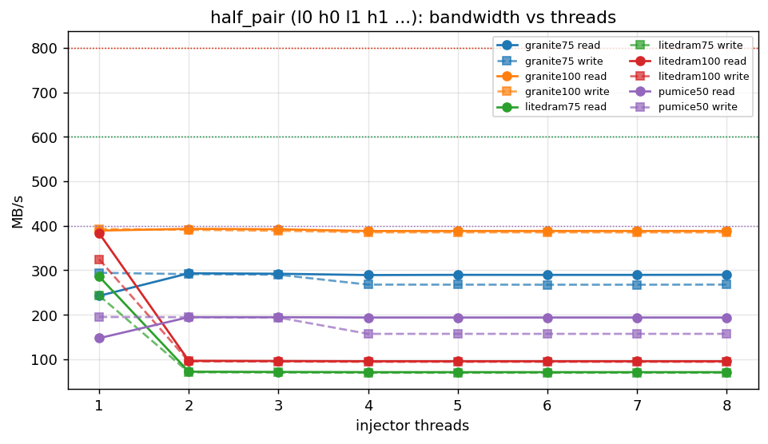

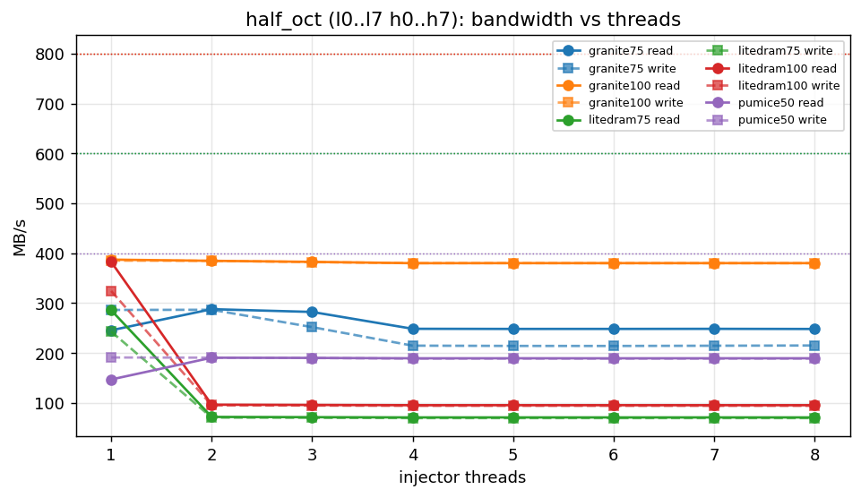

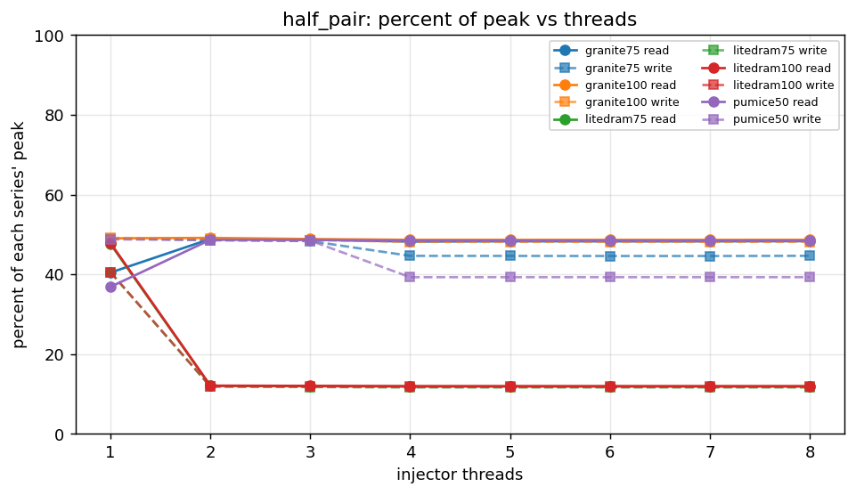

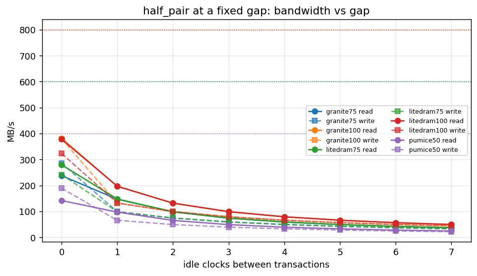

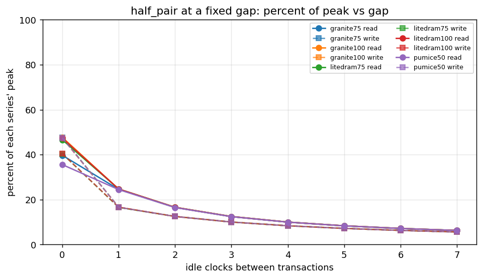

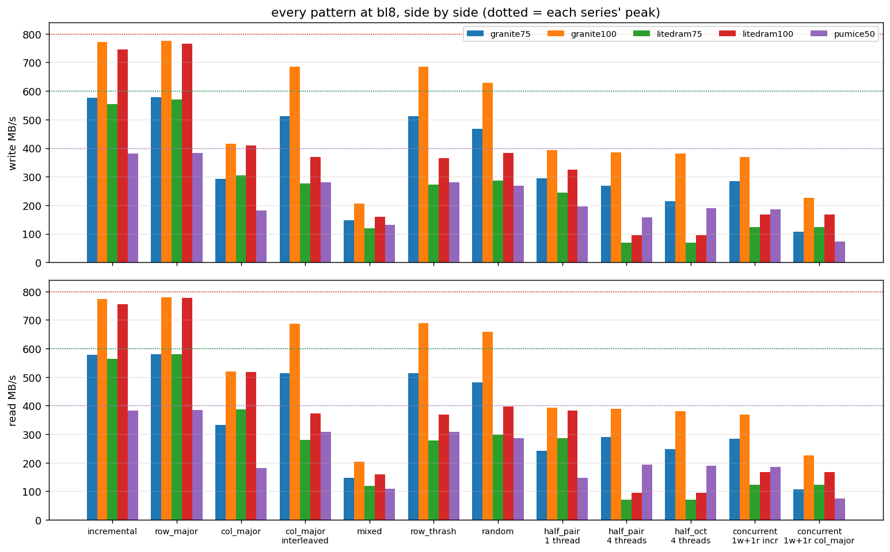

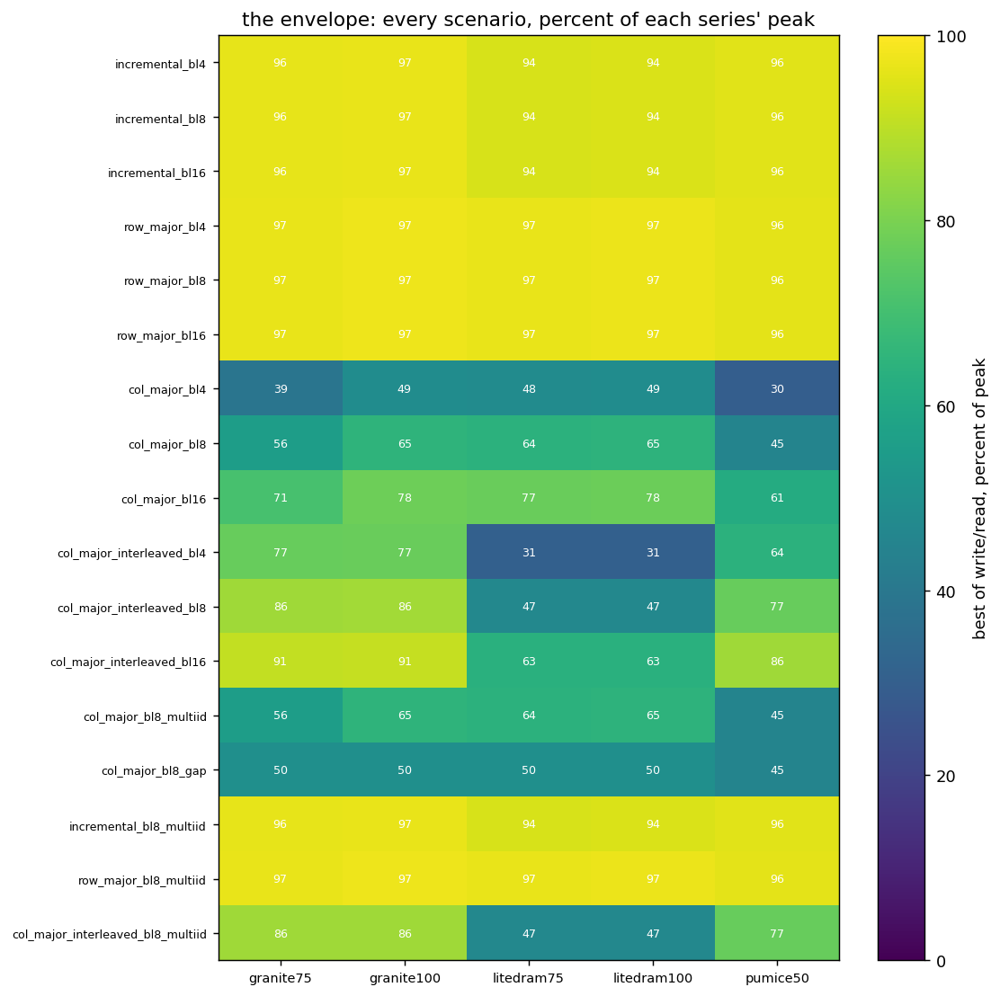

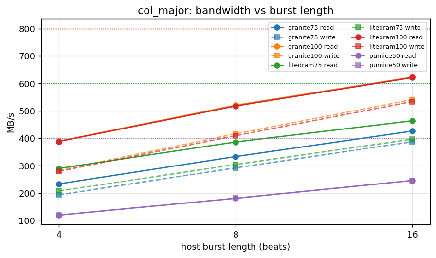

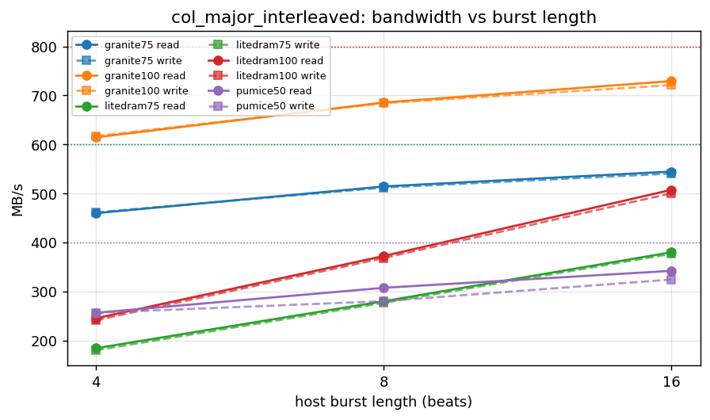

## every  (54 granite cells, 18 LiteDRAM cells)

| scenario | granite open_page | granite close_page | granite bank_interleave | LiteDRAM | granite best / LiteDRAM best |
|---|---|---|---|---|---|
| incremental_bl4 | 576/578 | 60/75 | 193/193 | 554/564 | 578 / 564 = 1.02x |
| incremental_bl8 | 576/578 | 60/75 | 193/193 | 554/564 | 578 / 564 = 1.02x |
| incremental_bl16 | 576/578 | 60/75 | 193/193 | 554/564 | 578 / 564 = 1.02x |
| row_major_bl4 | 578/580 | 58/73 | 193/193 | 569/579 | 580 / 579 = 1.00x |
| row_major_bl8 | 578/581 | 58/73 | 193/193 | 569/580 | 581 / 580 = 1.00x |
| row_major_bl16 | 578/581 | 58/73 | 193/193 | 569/580 | 581 / 580 = 1.00x |
| col_major_bl4 | 194/233 | 60/76 | 193/193 | 208/290 | 233 / 290 = 0.81x |
| col_major_bl8 | 292/333 | 59/74 | 193/193 | 304/386 | 333 / 386 = 0.86x |
| col_major_bl16 | 387/426 | 59/74 | 193/193 | 396/464 | 426 / 464 = 0.92x |
| col_major_interleaved_bl4 | 461/460 | 175/189 | 193/193 | 180/184 | 461 / 184 = 2.50x |
| col_major_interleaved_bl8 | 512/514 | 131/158 | 193/193 | 277/280 | 514 / 280 = 1.84x |
| col_major_interleaved_bl16 | 541/545 | 91/110 | 193/193 | 377/380 | 545 / 380 = 1.43x |
| col_major_bl8_multiid | 292/333 | 59/74 | 193/193 | 304/386 | 333 / 386 = 0.86x |
| col_major_bl8_gap | 282/300 | 59/74 | 193/193 | 282/300 | 300 / 300 = 1.00x |
| incremental_bl8_multiid | 576/578 | 60/75 | 193/193 | 554/564 | 578 / 564 = 1.02x |
| row_major_bl8_multiid | 578/580 | 58/73 | 193/193 | 569/579 | 580 / 579 = 1.00x |
| col_major_interleaved_bl8_multiid | 512/514 | 131/158 | 193/193 | 277/280 | 514 / 280 = 1.84x |

granite ahead on 13 of 17 scenarios (best-config vs LiteDRAM, max of wr/rd)

## half_threads  (32 granite cells, 16 LiteDRAM cells)

| scenario | granite close_page | granite open_page | LiteDRAM | granite best / LiteDRAM best |
|---|---|---|---|---|
| half_pair_thr1 | 60/75 | 294/243 | 243/286 | 294 / 286 = 1.03x |
| half_pair_thr2 | 101/123 | 291/293 | 71/72 | 293 / 72 = 4.07x |
| half_pair_thr3 | 144/175 | 290/292 | 70/71 | 292 / 71 = 4.09x |
| half_pair_thr4 | 188/193 | 268/289 | 70/71 | 289 / 71 = 4.07x |
| half_pair_thr5 | 190/193 | 268/290 | 70/71 | 290 / 71 = 4.08x |
| half_pair_thr6 | 188/193 | 267/290 | 70/71 | 290 / 71 = 4.08x |
| half_pair_thr7 | 189/193 | 267/290 | 70/71 | 290 / 71 = 4.08x |
| half_pair_thr8 | 190/193 | 268/290 | 70/71 | 290 / 71 = 4.08x |
| half_oct_thr1 | 58/73 | 286/246 | 243/286 | 286 / 286 = 1.00x |
| half_oct_thr2 | 49/59 | 287/288 | 71/72 | 288 / 72 = 4.00x |
| half_oct_thr3 | 73/87 | 252/282 | 70/71 | 282 / 71 = 3.95x |
| half_oct_thr4 | 96/96 | 215/249 | 70/71 | 249 / 71 = 3.50x |
| half_oct_thr5 | 96/96 | 214/248 | 70/71 | 248 / 71 = 3.50x |
| half_oct_thr6 | 96/96 | 214/248 | 70/71 | 248 / 71 = 3.50x |
| half_oct_thr7 | 96/96 | 215/248 | 70/71 | 248 / 71 = 3.50x |
| half_oct_thr8 | 96/96 | 215/248 | 70/71 | 248 / 71 = 3.50x |

granite ahead on 16 of 16 scenarios (best-config vs LiteDRAM, max of wr/rd)

merge ratios (granite): close_page/half_pair_thr1 write merges 16000/32000 (ratio 0.5), column ops per write N, close_page/half_pair_thr2 write merges 32000/64000 (ratio 0.5), column ops per write N, close_page/half_pair_thr3 write merges 47971/96000 (ratio 0.4997), column ops per writ, close_page/half_pair_thr4 write merges 63981/128000 (ratio 0.4999), column ops per wri ...

## half_burst  (8 granite cells, 4 LiteDRAM cells)

| scenario | granite close_page | granite open_page | LiteDRAM | granite best / LiteDRAM best |
|---|---|---|---|---|
| half_pair | 60/75 | 294/243 | 243/286 | 294 / 286 = 1.03x |
| half_oct | 58/73 | 287/245 | 243/286 | 287 / 286 = 1.00x |
| half_pair_sweep | 55/67 | 55/67 | 55/67 | 67 / 67 = 1.00x |
| half_oct_sweep | 55/67 | 55/67 | 55/67 | 67 / 67 = 1.00x |

granite ahead on 2 of 4 scenarios (best-config vs LiteDRAM, max of wr/rd)

merge ratios (granite): close_page/half_pair write merges 16000/32000 (ratio 0.5), column ops per write N, close_page/half_oct write merges 15565/32000 (ratio 0.4864), column ops per writ, close_page/half_pair_sweep write merges 16000/32000 (ratio 0.5), column ops per write N, close_page/half_oct_sweep write merges 14647/32000 (ratio 0.4577), column ops per writ ...

## half_burst8  (8 granite cells, 4 LiteDRAM cells)

| scenario | granite close_page | granite open_page | LiteDRAM | granite best / LiteDRAM best |
|---|---|---|---|---|
| half_pair | 190/193 | 268/290 | 70/71 | 290 / 71 = 4.08x |
| half_oct | 96/96 | 214/248 | 70/71 | 248 / 71 = 3.50x |
| half_pair_sweep | 189/193 | 217/261 | 70/71 | 261 / 71 = 3.68x |
| half_oct_sweep | 96/96 | 204/231 | 70/71 | 231 / 71 = 3.25x |

granite ahead on 4 of 4 scenarios (best-config vs LiteDRAM, max of wr/rd)

merge ratios (granite): close_page/half_pair threads clamped 8 -> 4 (build has 4 injectors per direction), close_page/half_oct threads clamped 8 -> 4 (build has 4 injectors per direction), close_page/half_pair_sweep threads clamped 8 -> 4 (build has 4 injectors per direction), close_page/half_oct_sweep threads clamped 8 -> 4 (build has 4 injectors per direction) ...

## half_gap  (16 granite cells, 8 LiteDRAM cells)

| scenario | granite close_page | granite open_page | LiteDRAM | granite best / LiteDRAM best |
|---|---|---|---|---|
| half_pair_gap0 | 59/73 | 286/238 | 242/280 | 286 / 280 = 1.02x |
| half_pair_gap1 | 59/73 | 99/147 | 99/148 | 147 / 148 = 0.99x |
| half_pair_gap2 | 59/73 | 75/99 | 75/99 | 99 / 99 = 1.00x |
| half_pair_gap3 | 59/73 | 60/74 | 60/75 | 74 / 75 = 1.00x |
| half_pair_gap4 | 50/60 | 50/60 | 50/60 | 60 / 60 = 1.00x |
| half_pair_gap5 | 43/50 | 43/50 | 43/50 | 50 / 50 = 1.00x |
| half_pair_gap6 | 37/43 | 37/43 | 37/43 | 43 / 43 = 1.00x |
| half_pair_gap7 | 33/37 | 33/37 | 33/37 | 37 / 37 = 1.00x |

granite ahead on 1 of 8 scenarios (best-config vs LiteDRAM, max of wr/rd)

merge ratios (granite): close_page/half_pair_gap0 write merges 512/1024 (ratio 0.5), column ops per write None, close_page/half_pair_gap1 write merges 512/1024 (ratio 0.5), column ops per write None, close_page/half_pair_gap2 write merges 512/1024 (ratio 0.5), column ops per write None, close_page/half_pair_gap3 write merges 512/1024 (ratio 0.5), column ops per write None ...

## concurrent  (4 granite cells, 4 LiteDRAM cells)

| scenario | granite open_page | LiteDRAM | granite best / LiteDRAM best |
|---|---|---|---|
| incremental_bl8 | 285/285 | 124/124 | 285 / 124 = 2.30x |
| row_major_bl8 | 288/288 | 143/143 | 288 / 143 = 2.02x |
| col_major_bl8 | 106/106 | 124/124 | 106 / 124 = 0.86x |
| col_major_interleaved_bl8 | 201/201 | 123/123 | 201 / 123 = 1.64x |

granite ahead on 3 of 4 scenarios (best-config vs LiteDRAM, max of wr/rd)

## multigen  (4 granite cells, 4 LiteDRAM cells)

| scenario | granite open_page | LiteDRAM | granite best / LiteDRAM best |
|---|---|---|---|
| incremental_bl8 | 128/257 | 93/186 | 257 / 186 = 1.38x |
| row_major_bl8 | 170/340 | 106/211 | 340 / 211 = 1.61x |
| col_major_bl8 | 82/164 | 94/187 | 164 / 187 = 0.87x |
| col_major_interleaved_bl8 | 90/180 | 82/164 | 180 / 164 = 1.10x |

granite ahead on 3 of 4 scenarios (best-config vs LiteDRAM, max of wr/rd)

## windows (the window families on the BOARD), four injectors, bl8, 75 MHz, peak 600 MB/s

`char_{granite,litedram}_sweep75_windows_2026-10-29.csv`. mixed is four
writers and four readers from one GO (bank-paired, one row group apart);
the per-direction figure is each direction over its own window, the union
figure both over the whole run.

| family | granite open_page | granite close_page | LiteDRAM | granite best / LiteDRAM |
|---|---|---|---|---|
| mixed (per direction; union) | 147/147; union 295 | 35/42; union 70 | 119/119; union 238 | 1.24x |
| row_thrash | 512/514 | 131/158 | 271/279 | 1.85x |
| random | 468/481 | 112/135 | 286/298 | 1.61x |

mismatched 0 on all nine cells. The proxies below land within 1 percent of
the board on LiteDRAM and within 10 percent on granite (its proxy has the
sim DRAM model's timing, not the PHY's).

## window families, proxies (sim), four injectors, 75 MHz, 1:2, peak 600 MB/s

`mixed` (bank-paired threads one row apart, reads and writes concurrent),
`row_thrash` (one thread alternating two rows of one bank per burst) and
`random` (an LFSR walk inside a region) through the perf proxies
(`test_granite_char_perf.py`, `test_litedram_char_perf.py`,
`TEST_NUM_GEN=4 TEST_FAMILIES=mixed,row_thrash,random`), the same program
builder the board profile uses. Same families, same injector count, same
DRAM model, write / read MB/s:

| family | granite (proxy) | LiteDRAM (proxy) | granite / LiteDRAM |
|---|---|---|---|
| mixed | 142 / 147 | 119 / 119 | 1.24x |
| row_thrash | 461 / 459 | 271 / 278 | 1.66x |
| random | 444 / 458 | 286 / 298 | 1.54x |

mismatched 0 on all six. The two proxies share the DRAM model but not a
PHY model, so these are controller-vs-controller numbers under the same
JEDEC windows, not board numbers.

## 100 MHz: granite (DDR2-400, STORE_MERGE_EN=0) vs LiteDRAM (DDR2-400), peak 800 MB/s

*Superseded for granite by the 2026-10-31 update at the top; kept as the record of the merge-off point.*

The merge default misses timing at 100 MHz by 2.5 ns (TASK-003 log), so
the 100 MHz granite point is the merge-off build (+0.011 ns). LiteDRAM is
regenerated at `sys_clk_freq` 100e6 with today's harness (`regen.sh` with
`LITEDRAM_SYS_CLK=100e6`, top built with `LITEDRAM_SYS_100=1`, bitstream
`litedram_char_100mhz_2026-10-29.bit`, WNS +0.241 ns, 32,698 LUT), its BIOS calibrating as at 75; the
host scales by `LITEDRAM_CLK_MHZ=100`. CSVs:
`char_{granite,litedram}_sweep100_<profile>_2026-10-29.csv`. Every cell on
both controllers: 0 mismatched.

### every  (54 granite cells, 18 LiteDRAM cells)

| scenario | granite open_page | granite close_page | granite bank_interleave | LiteDRAM | granite best / LiteDRAM best |
|---|---|---|---|---|---|
| incremental_bl4 | 772/774 | 80/89 | 258/258 | 746/756 | 774 / 756 = 1.02x |
| incremental_bl8 | 772/774 | 80/89 | 258/258 | 746/756 | 774 / 756 = 1.02x |
| incremental_bl16 | 772/774 | 80/89 | 258/258 | 746/756 | 774 / 756 = 1.02x |
| row_major_bl4 | 775/777 | 78/87 | 258/258 | 766/776 | 777 / 776 = 1.00x |
| row_major_bl8 | 775/777 | 78/87 | 258/258 | 766/776 | 777 / 776 = 1.00x |
| row_major_bl16 | 775/777 | 78/87 | 258/258 | 766/776 | 777 / 776 = 1.00x |
| col_major_bl4 | 259/311 | 80/89 | 258/258 | 279/388 | 311 / 388 = 0.80x |
| col_major_bl8 | 390/445 | 79/88 | 258/258 | 409/518 | 445 / 518 = 0.86x |
| col_major_bl16 | 518/565 | 79/87 | 258/258 | 534/621 | 565 / 621 = 0.91x |
| col_major_interleaved_bl4 | 615/619 | 236/254 | 258/258 | 241/246 | 619 / 246 = 2.52x |
| col_major_interleaved_bl8 | 688/688 | 175/211 | 258/258 | 368/372 | 688 / 372 = 1.85x |
| col_major_interleaved_bl16 | 729/730 | 121/158 | 258/258 | 500/507 | 730 / 507 = 1.44x |
| col_major_bl8_multiid | 390/445 | 79/88 | 258/258 | 409/518 | 445 / 518 = 0.86x |
| col_major_bl8_gap | 376/400 | 79/88 | 258/258 | 376/400 | 400 / 400 = 1.00x |
| incremental_bl8_multiid | 772/774 | 80/89 | 258/258 | 746/756 | 774 / 756 = 1.02x |
| row_major_bl8_multiid | 775/777 | 78/87 | 258/258 | 766/776 | 777 / 776 = 1.00x |
| col_major_interleaved_bl8_multiid | 688/688 | 175/211 | 258/258 | 368/372 | 688 / 372 = 1.85x |

granite ahead on 13 of 17 scenarios (best-config vs LiteDRAM, max of wr/rd)

### windows  (6 granite cells, 3 LiteDRAM cells)

| scenario | granite open_page | granite close_page | LiteDRAM | granite best / LiteDRAM best |
|---|---|---|---|---|
| mixed_bl8 | 198/199 | 46/54 | 159/159 | 199 / 159 = 1.25x |
| row_thrash_bl8 | 688/688 | 175/211 | 364/368 | 688 / 368 = 1.87x |
| random_bl8 | 627/644 | 149/183 | 383/397 | 644 / 397 = 1.62x |

granite ahead on 3 of 3 scenarios (best-config vs LiteDRAM, max of wr/rd)

### half_threads  (32 granite cells, 16 LiteDRAM cells)

| scenario | granite close_page | granite open_page | LiteDRAM | granite best / LiteDRAM best |
|---|---|---|---|---|
| half_pair_thr1 | 40/44 | 387/320 | 324/383 | 387 / 383 = 1.01x |
| half_pair_thr2 | 66/87 | 385/386 | 95/96 | 386 / 96 = 4.00x |
| half_pair_thr3 | 97/129 | 340/375 | 95/96 | 375 / 96 = 3.91x |
| half_pair_thr4 | 129/129 | 286/334 | 94/95 | 334 / 95 = 3.50x |
| half_pair_thr5 | 129/129 | 289/334 | 94/95 | 334 / 95 = 3.50x |
| half_pair_thr6 | 129/129 | 287/334 | 94/95 | 334 / 95 = 3.50x |
| half_pair_thr7 | 129/129 | 287/334 | 94/95 | 334 / 95 = 3.49x |
| half_pair_thr8 | 129/129 | 285/334 | 94/95 | 334 / 95 = 3.50x |
| half_oct_thr1 | 40/44 | 387/320 | 324/383 | 387 / 383 = 1.01x |
| half_oct_thr2 | 66/87 | 385/386 | 95/96 | 386 / 96 = 4.00x |
| half_oct_thr3 | 97/129 | 342/377 | 95/96 | 377 / 96 = 3.93x |
| half_oct_thr4 | 129/129 | 286/334 | 94/95 | 334 / 95 = 3.50x |
| half_oct_thr5 | 129/129 | 288/334 | 94/95 | 334 / 95 = 3.50x |
| half_oct_thr6 | 129/129 | 286/334 | 94/95 | 334 / 95 = 3.50x |
| half_oct_thr7 | 129/129 | 286/334 | 94/95 | 334 / 95 = 3.50x |
| half_oct_thr8 | 129/129 | 286/334 | 94/95 | 334 / 95 = 3.50x |

granite ahead on 16 of 16 scenarios (best-config vs LiteDRAM, max of wr/rd)

merge ratios (granite): close_page/half_pair_thr1 no merge / column-op telemetry on this build, close_page/half_pair_thr2 no merge / column-op telemetry on this build, close_page/half_pair_thr3 no merge / column-op telemetry on this build, close_page/half_pair_thr4 no merge / column-op telemetry on this build ...

### half_burst  (8 granite cells, 4 LiteDRAM cells)

| scenario | granite close_page | granite open_page | LiteDRAM | granite best / LiteDRAM best |
|---|---|---|---|---|
| half_pair | 40/44 | 387/320 | 324/383 | 387 / 383 = 1.01x |
| half_oct | 40/44 | 387/320 | 324/383 | 387 / 383 = 1.01x |
| half_pair_sweep | 40/44 | 73/89 | 73/89 | 89 / 89 = 1.00x |
| half_oct_sweep | 40/44 | 73/89 | 73/89 | 89 / 89 = 1.00x |

granite ahead on 2 of 4 scenarios (best-config vs LiteDRAM, max of wr/rd)

merge ratios (granite): close_page/half_pair no merge / column-op telemetry on this build, close_page/half_oct no merge / column-op telemetry on this build, close_page/half_pair_sweep no merge / column-op telemetry on this build, close_page/half_oct_sweep no merge / column-op telemetry on this build ...

### half_burst8  (8 granite cells, 4 LiteDRAM cells)

| scenario | granite close_page | granite open_page | LiteDRAM | granite best / LiteDRAM best |
|---|---|---|---|---|
| half_pair | 129/129 | 286/334 | 94/95 | 334 / 95 = 3.50x |
| half_oct | 129/129 | 286/334 | 94/95 | 334 / 95 = 3.50x |
| half_pair_sweep | 129/129 | 273/312 | 94/95 | 312 / 95 = 3.26x |
| half_oct_sweep | 129/129 | 273/311 | 94/95 | 311 / 95 = 3.26x |

granite ahead on 4 of 4 scenarios (best-config vs LiteDRAM, max of wr/rd)

merge ratios (granite): close_page/half_pair threads clamped 8 -> 4 (build has 4 injectors per direction), close_page/half_oct threads clamped 8 -> 4 (build has 4 injectors per direction), close_page/half_pair_sweep threads clamped 8 -> 4 (build has 4 injectors per direction), close_page/half_oct_sweep threads clamped 8 -> 4 (build has 4 injectors per direction) ...

### half_gap  (16 granite cells, 8 LiteDRAM cells)

| scenario | granite close_page | granite open_page | LiteDRAM | granite best / LiteDRAM best |
|---|---|---|---|---|
| half_pair_gap0 | 39/44 | 382/314 | 320/370 | 382 / 370 = 1.03x |
| half_pair_gap1 | 39/44 | 133/196 | 133/197 | 196 / 197 = 0.99x |
| half_pair_gap2 | 39/44 | 100/132 | 100/132 | 132 / 132 = 1.00x |
| half_pair_gap3 | 39/44 | 80/99 | 80/99 | 99 / 99 = 1.00x |
| half_pair_gap4 | 39/44 | 66/79 | 67/80 | 79 / 80 = 1.00x |
| half_pair_gap5 | 39/44 | 57/66 | 57/66 | 66 / 66 = 1.00x |
| half_pair_gap6 | 39/44 | 50/57 | 50/57 | 57 / 57 = 1.00x |
| half_pair_gap7 | 39/44 | 44/50 | 44/50 | 50 / 50 = 1.00x |

granite ahead on 1 of 8 scenarios (best-config vs LiteDRAM, max of wr/rd)

merge ratios (granite): close_page/half_pair_gap0 no merge / column-op telemetry on this build, close_page/half_pair_gap1 no merge / column-op telemetry on this build, close_page/half_pair_gap2 no merge / column-op telemetry on this build, close_page/half_pair_gap3 no merge / column-op telemetry on this build ...

### concurrent  (4 granite cells, 4 LiteDRAM cells)

| scenario | granite open_page | LiteDRAM | granite best / LiteDRAM best |
|---|---|---|---|
| incremental_bl8 | 380/380 | 167/167 | 380 / 167 = 2.28x |
| row_major_bl8 | 386/386 | 192/192 | 386 / 192 = 2.01x |
| col_major_bl8 | 144/144 | 167/167 | 144 / 167 = 0.86x |
| col_major_interleaved_bl8 | 270/270 | 164/164 | 270 / 164 = 1.65x |

granite ahead on 3 of 4 scenarios (best-config vs LiteDRAM, max of wr/rd)

### multigen  (4 granite cells, 4 LiteDRAM cells)

| scenario | granite open_page | LiteDRAM | granite best / LiteDRAM best |
|---|---|---|---|
| incremental_bl8 | 172/344 | 126/252 | 344 / 252 = 1.37x |
| row_major_bl8 | 231/461 | 142/284 | 461 / 284 = 1.62x |
| col_major_bl8 | 107/213 | 126/252 | 213 / 252 = 0.84x |
| col_major_interleaved_bl8 | 128/256 | 110/220 | 256 / 220 = 1.16x |

granite ahead on 3 of 4 scenarios (best-config vs LiteDRAM, max of wr/rd)

## pumice, the third controller (build-perf bitstream 2026-10-27, read and write combiners, 50 MHz sys / DDR2-200, peak 400 MB/s)

pumice's board build runs at 50 MHz (its 75 MHz build does not close), so
the MB/s are not comparable across the row; the percent-of-peak column is.
`char_pumice_sweep_<profile>_2026-10-30.csv`, same host, same profiles, 0
mismatched on all 132 cells. Open-page preset on pumice and granite.

| scenario | pumice 50 MB/s (% of 400) | granite 75 MB/s (% of 600) | LiteDRAM 75 MB/s (% of 600) |
|---|---|---|---|
| every/incremental_bl8 | 381/382 (96%) | 576/578 (96%) | 554/564 (94%) |
| every/row_major_bl8 | 384/384 (96%) | 578/581 (97%) | 569/580 (97%) |
| every/col_major_bl8 | 181/181 (45%) | 292/333 (56%) | 304/386 (64%) |
| every/col_major_interleaved_bl8 | 280/308 (77%) | 512/514 (86%) | 277/280 (47%) |
| windows/mixed_bl8 | 131/108 (33%) | 147/147 (25%) | 119/119 (20%) |
| windows/row_thrash_bl8 | 280/308 (77%) | 512/514 (86%) | 271/278 (46%) |
| windows/random_bl8 | 267/287 (72%) | 468/481 (80%) | 286/298 (50%) |
| half_threads/half_pair_thr1 | 195/147 (49%) | 294/243 (49%) | 243/286 (48%) |
| half_threads/half_pair_thr2 | 194/195 (49%) | 291/293 (49%) | 71/72 (12%) |
| half_threads/half_pair_thr4 | 157/194 (48%) | 268/289 (48%) | 70/71 (12%) |
| half_threads/half_oct_thr4 | 189/189 (47%) | 215/249 (41%) | 70/71 (12%) |
| half_gap/half_pair_gap0 | 190/142 (47%) | 286/238 (48%) | 242/280 (47%) |
| half_gap/half_pair_gap1 | 66/98 (24%) | 99/147 (25%) | 99/148 (25%) |
| concurrent/incremental_bl8 | 185/185 (46%) | 285/285 (47%) | 124/124 (21%) |
| concurrent/col_major_bl8 | 74/74 (18%) | 106/106 (18%) | 124/124 (21%) |
| multigen/incremental_bl8 | 73/146 (36%) | 128/257 (43%) | 93/186 (31%) |

## page policy on granite: the lookahead close is already on, and the untried variant (2026-10-30)

*Superseded: mode 4 was rebuilt as the hybrid on 2026-10-30 and is the power-on mode since 2026-10-31; see the update at the top and the granite TASK-003 log. The bank-timer AP accounting this section points at was one cycle in the pick's decode (fixed) plus one in the host's tRTP (fixed).*

LiteDRAM's policy (open page, auto-precharge when the bank's lookahead
holds another row) is granite's `CLOSE_ON_DRAIN`, active in every board
preset (policy mode 0); `defaults` and `open_page` measured bit-identical.
Mode 4 `drain_timeout` (that plus the idle-timeout PRE) measured
bit-identical to open page on 96 cells. `fixed_open` (timeout PRE only)
trades 7 to 57 percent on the row-miss cells against 10 percent on the
bank-hop cells; the reason is the auto-precharge timing in the bank
timers, see TASK-003. `char_granite_pagemode4_75_<profile>_2026-10-30.csv`,
`char_granite_pagepol75_*_2026-10-29.csv`.

| cell, MB/s wr/rd | open_page = drain_timeout | fixed_open tr2 | LiteDRAM 75 |
|---|---|---|---|
| col_major_bl8 | 292/333 | 311/360 | 304/386 |
| col_major_interleaved_bl8 | 512/514 | 459/459 | 277/280 |
| half_oct, 4 threads | 215/249 | 283/283 | 70/71 |
| concurrent 1w+1r col_major | 106/106 | 166/166 | 124/124 |
