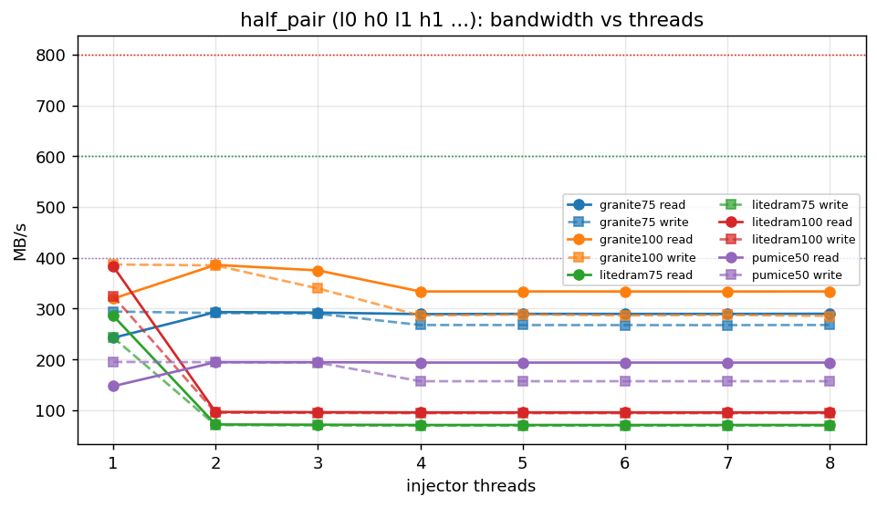
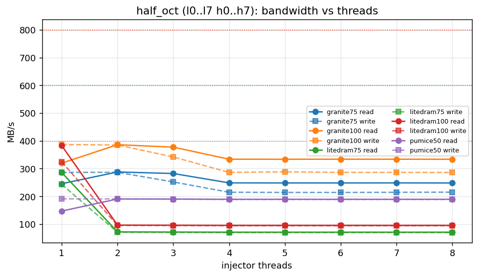
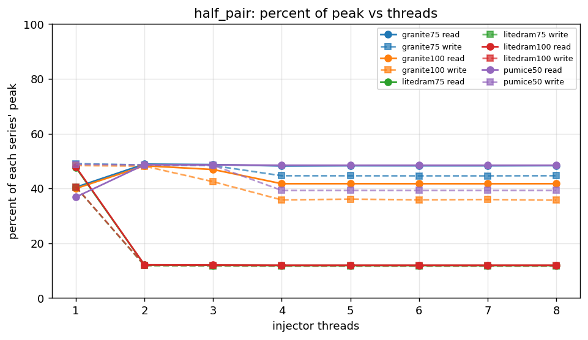
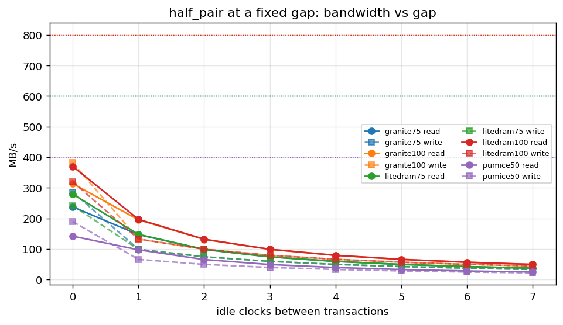
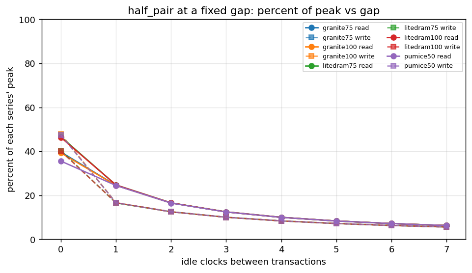
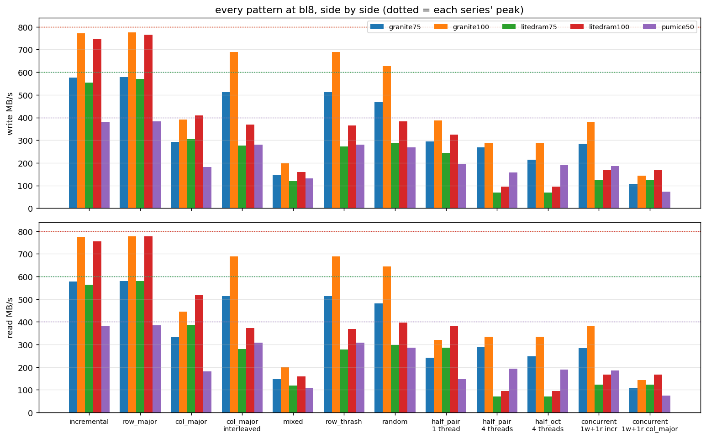
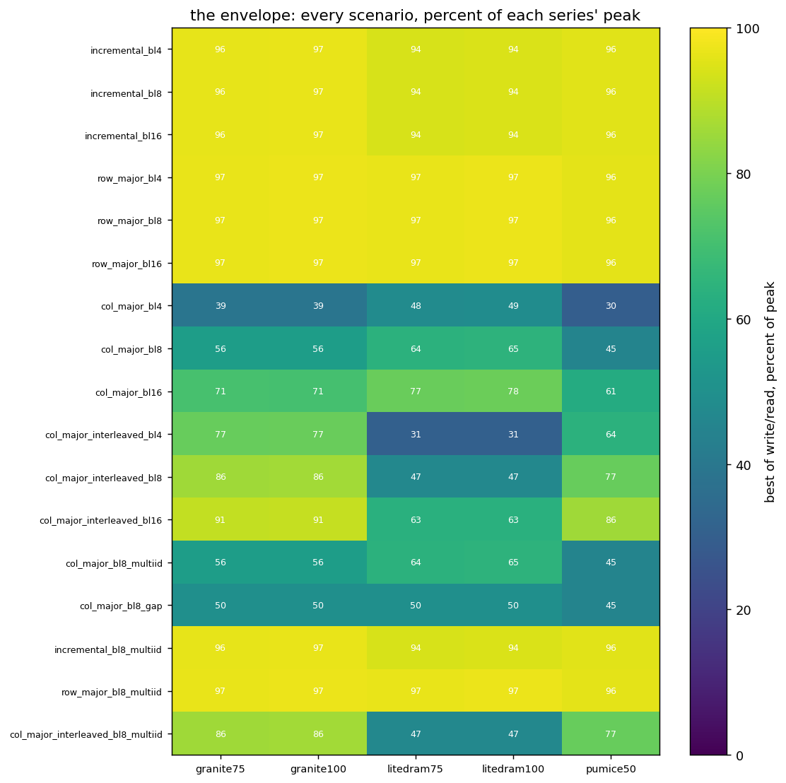
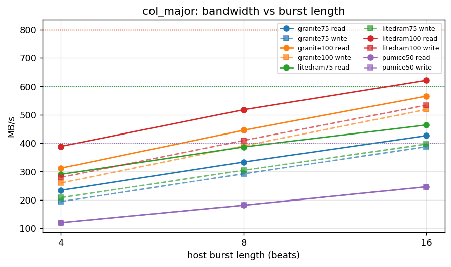
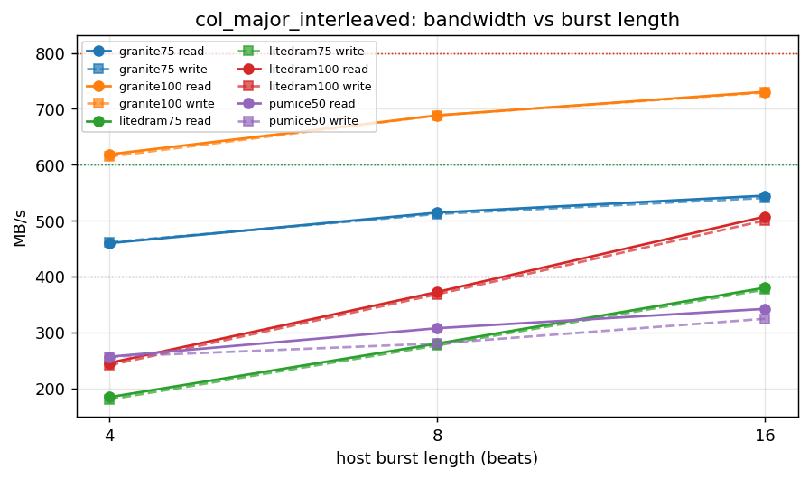

# granite vs LiteDRAM, the full sweep (owner's request, 2026-10-29)

Same board (Nexys A7-100T, MT47H64M16HR x16), same harness, same host
program, same transaction scale (`--txn-scale 4000`, clamped to the engine's
65,535 per scenario), the same day. granite is the STORE_MERGE_EN default
(commit b8b08375c), LiteDRAM is the 2026-10-27 75 MHz build. Both at
75 MHz sys / DDR2-300: **peak 600 MB/s** each direction. The window
families (mixed / row_thrash / random) ran on the board too, through the
`windows` profile added the same evening; their proxy numbers are kept
in the last section for the cross-check. CSVs: `char_granite_sweep75_<profile>_2026-10-29.csv`
and `char_litedram_sweep75_<profile>_2026-10-29.csv` beside this file.

Columns are MB/s write / read; "granite best" is the best of its configs,
max of the two directions, against the same for LiteDRAM. `MISM` would mark
a cell with mismatched beats; there are none. granite's `bank_interleave`
preset maps consecutive bursts to consecutive banks, so every family becomes
the same bank-cycle-bound walk (193/193 everywhere, 137-cycle read latency):
a property of that map, not a measurement failure. `half_burst8` runs on the
build's four injectors (threads clamped 8 -> 4, as the records say).

## Pattern legend (what each name means)

**Families** are what one injector walks. The DRAM is x16, a burst is BL8 =
16 bytes, a page (row) is 2 KB, eight banks.

| name | what the injector does | what it measures |
|---|---|---|
| `incremental` | linear march, one burst after the next, across columns, then banks, then rows | the best-case stream |
| `row_major` | the same march wrapped inside ONE page | every burst a page hit: pure column throughput |
| `col_major` | stride = one row, same bank | every burst a page miss: PRE + ACT each time, the tRC / tRP floor |
| `col_major_interleaved` | stride = one bank | every burst a new bank, activates pipeline: bank parallelism |
| `random` | an LFSR walk inside a region (two rows x all banks per thread) | mixed hits and misses, no order |
| `row_thrash` | one bank, two rows, a burst to each in turn | the row-buffer conflict a scheduling window can reorder |
| `mixed` | bank-paired threads one row apart, reads and writes at once | read/write turnaround under row conflicts |
| `half_pair` | **aggregation**: every DRAM burst issued as TWO half-width host transactions, low half then high half, back to back: l0 h0 l1 h1 ... | whether the controller merges a pair into one burst (a combiner does; without one each half costs a full burst) |
| `half_oct` | the same halves, but all eight low halves then the eight high halves: l0..l7 h0..h7 | the merge window has to hold eight transactions |
| `half_pair_sweep`, `half_oct_sweep` | as above, with the idle gap after each transaction looping 0,1,..7 clocks inside the run | the merge window against arrival spacing, averaged |

**Scenario suffixes**: `_bl4` / `_bl8` / `_bl16` = host transaction length in
beats (AxLEN+1), i.e. DRAM bursts per transaction; `_multiid` = AXI IDs from
an LFSR (out-of-order allowed) instead of a counter; `_gap` = 8 idle clocks
between transactions; `_thrN` = N injectors at once, each in its own
region (the board builds have four, so 5..8 run as four and say so);
`_gapN` = a FIXED N idle clocks between transactions (the `half_gap`
profile: 512 pairs per cell).

**Presets** (the controller's config for a run): `open_page` = row-major
address map (column, bank, row from the low bits up), pages left open;
`close_page` = the same map, every access auto-closes its page;
`bank_interleave` = bank bits below the column, so consecutive bursts hop
banks (close-page policy); `defaults` = the controller's reset state.
LiteDRAM has one config (row/bank/col, open page with auto-precharge).

**Profiles** (which cells a run covers): `every` = the four stream families
x bl 4/8/16 + the multiid and gap variants x three presets; `windows` =
mixed, row_thrash and random on four injectors at bl8 under open and close
page; `half_threads`
= pair and oct at 1..8 threads; `half_burst` = pair, oct and their sweeps
on one thread; `half_burst8` = the same on eight; `half_gap` = the pair walk
at fixed gaps 0..7; `concurrent` = one writer and one reader at once per
family; `multigen` = one writer and two readers.

**Numbers**: write / read MB/s = bytes moved over the pass's cycles at the
harness clock; peak is 600 MB/s at 75 MHz (DDR2-300 x16) and 800 at 100
(DDR2-400). "merges 512/1024 (ratio 0.5)" means every pair merged.

## The graphs (2026-10-30)

Rendered by `build-perf/bin/plot_sweep.py` from the CSVs beside this file,
in the STREAM characterization style: a line family where the knee has to
be legible, grouped bars for the side by side, an annotated heatmap for the
envelope. Each series' peak is the dotted line in its colour.

## every  (54 granite cells, 18 LiteDRAM cells)

| scenario | granite open_page | granite close_page | granite bank_interleave | LiteDRAM | granite best / LiteDRAM best |
|---|---|---|---|---|---|
| incremental_bl4 | 576/578 | 60/75 | 193/193 | 554/564 | 578 / 564 = 1.02x |
| incremental_bl8 | 576/578 | 60/75 | 193/193 | 554/564 | 578 / 564 = 1.02x |
| incremental_bl16 | 576/578 | 60/75 | 193/193 | 554/564 | 578 / 564 = 1.02x |
| row_major_bl4 | 578/580 | 58/73 | 193/193 | 569/579 | 580 / 579 = 1.00x |
| row_major_bl8 | 578/581 | 58/73 | 193/193 | 569/580 | 581 / 580 = 1.00x |
| row_major_bl16 | 578/581 | 58/73 | 193/193 | 569/580 | 581 / 580 = 1.00x |
| col_major_bl4 | 194/233 | 60/76 | 193/193 | 208/290 | 233 / 290 = 0.81x |
| col_major_bl8 | 292/333 | 59/74 | 193/193 | 304/386 | 333 / 386 = 0.86x |
| col_major_bl16 | 387/426 | 59/74 | 193/193 | 396/464 | 426 / 464 = 0.92x |
| col_major_interleaved_bl4 | 461/460 | 175/189 | 193/193 | 180/184 | 461 / 184 = 2.50x |
| col_major_interleaved_bl8 | 512/514 | 131/158 | 193/193 | 277/280 | 514 / 280 = 1.84x |
| col_major_interleaved_bl16 | 541/545 | 91/110 | 193/193 | 377/380 | 545 / 380 = 1.43x |
| col_major_bl8_multiid | 292/333 | 59/74 | 193/193 | 304/386 | 333 / 386 = 0.86x |
| col_major_bl8_gap | 282/300 | 59/74 | 193/193 | 282/300 | 300 / 300 = 1.00x |
| incremental_bl8_multiid | 576/578 | 60/75 | 193/193 | 554/564 | 578 / 564 = 1.02x |
| row_major_bl8_multiid | 578/580 | 58/73 | 193/193 | 569/579 | 580 / 579 = 1.00x |
| col_major_interleaved_bl8_multiid | 512/514 | 131/158 | 193/193 | 277/280 | 514 / 280 = 1.84x |

granite ahead on 13 of 17 scenarios (best-config vs LiteDRAM, max of wr/rd)

## half_threads  (32 granite cells, 16 LiteDRAM cells)

| scenario | granite close_page | granite open_page | LiteDRAM | granite best / LiteDRAM best |
|---|---|---|---|---|
| half_pair_thr1 | 60/75 | 294/243 | 243/286 | 294 / 286 = 1.03x |
| half_pair_thr2 | 101/123 | 291/293 | 71/72 | 293 / 72 = 4.07x |
| half_pair_thr3 | 144/175 | 290/292 | 70/71 | 292 / 71 = 4.09x |
| half_pair_thr4 | 188/193 | 268/289 | 70/71 | 289 / 71 = 4.07x |
| half_pair_thr5 | 190/193 | 268/290 | 70/71 | 290 / 71 = 4.08x |
| half_pair_thr6 | 188/193 | 267/290 | 70/71 | 290 / 71 = 4.08x |
| half_pair_thr7 | 189/193 | 267/290 | 70/71 | 290 / 71 = 4.08x |
| half_pair_thr8 | 190/193 | 268/290 | 70/71 | 290 / 71 = 4.08x |
| half_oct_thr1 | 58/73 | 286/246 | 243/286 | 286 / 286 = 1.00x |
| half_oct_thr2 | 49/59 | 287/288 | 71/72 | 288 / 72 = 4.00x |
| half_oct_thr3 | 73/87 | 252/282 | 70/71 | 282 / 71 = 3.95x |
| half_oct_thr4 | 96/96 | 215/249 | 70/71 | 249 / 71 = 3.50x |
| half_oct_thr5 | 96/96 | 214/248 | 70/71 | 248 / 71 = 3.50x |
| half_oct_thr6 | 96/96 | 214/248 | 70/71 | 248 / 71 = 3.50x |
| half_oct_thr7 | 96/96 | 215/248 | 70/71 | 248 / 71 = 3.50x |
| half_oct_thr8 | 96/96 | 215/248 | 70/71 | 248 / 71 = 3.50x |

granite ahead on 16 of 16 scenarios (best-config vs LiteDRAM, max of wr/rd)

merge ratios (granite): close_page/half_pair_thr1 write merges 16000/32000 (ratio 0.5), column ops per write N, close_page/half_pair_thr2 write merges 32000/64000 (ratio 0.5), column ops per write N, close_page/half_pair_thr3 write merges 47971/96000 (ratio 0.4997), column ops per writ, close_page/half_pair_thr4 write merges 63981/128000 (ratio 0.4999), column ops per wri ...

## half_burst  (8 granite cells, 4 LiteDRAM cells)

| scenario | granite close_page | granite open_page | LiteDRAM | granite best / LiteDRAM best |
|---|---|---|---|---|
| half_pair | 60/75 | 294/243 | 243/286 | 294 / 286 = 1.03x |
| half_oct | 58/73 | 287/245 | 243/286 | 287 / 286 = 1.00x |
| half_pair_sweep | 55/67 | 55/67 | 55/67 | 67 / 67 = 1.00x |
| half_oct_sweep | 55/67 | 55/67 | 55/67 | 67 / 67 = 1.00x |

granite ahead on 2 of 4 scenarios (best-config vs LiteDRAM, max of wr/rd)

merge ratios (granite): close_page/half_pair write merges 16000/32000 (ratio 0.5), column ops per write N, close_page/half_oct write merges 15565/32000 (ratio 0.4864), column ops per writ, close_page/half_pair_sweep write merges 16000/32000 (ratio 0.5), column ops per write N, close_page/half_oct_sweep write merges 14647/32000 (ratio 0.4577), column ops per writ ...

## half_burst8  (8 granite cells, 4 LiteDRAM cells)

| scenario | granite close_page | granite open_page | LiteDRAM | granite best / LiteDRAM best |
|---|---|---|---|---|
| half_pair | 190/193 | 268/290 | 70/71 | 290 / 71 = 4.08x |
| half_oct | 96/96 | 214/248 | 70/71 | 248 / 71 = 3.50x |
| half_pair_sweep | 189/193 | 217/261 | 70/71 | 261 / 71 = 3.68x |
| half_oct_sweep | 96/96 | 204/231 | 70/71 | 231 / 71 = 3.25x |

granite ahead on 4 of 4 scenarios (best-config vs LiteDRAM, max of wr/rd)

merge ratios (granite): close_page/half_pair threads clamped 8 -> 4 (build has 4 injectors per direction), close_page/half_oct threads clamped 8 -> 4 (build has 4 injectors per direction), close_page/half_pair_sweep threads clamped 8 -> 4 (build has 4 injectors per direction), close_page/half_oct_sweep threads clamped 8 -> 4 (build has 4 injectors per direction) ...

## half_gap  (16 granite cells, 8 LiteDRAM cells)

| scenario | granite close_page | granite open_page | LiteDRAM | granite best / LiteDRAM best |
|---|---|---|---|---|
| half_pair_gap0 | 59/73 | 286/238 | 242/280 | 286 / 280 = 1.02x |
| half_pair_gap1 | 59/73 | 99/147 | 99/148 | 147 / 148 = 0.99x |
| half_pair_gap2 | 59/73 | 75/99 | 75/99 | 99 / 99 = 1.00x |
| half_pair_gap3 | 59/73 | 60/74 | 60/75 | 74 / 75 = 1.00x |
| half_pair_gap4 | 50/60 | 50/60 | 50/60 | 60 / 60 = 1.00x |
| half_pair_gap5 | 43/50 | 43/50 | 43/50 | 50 / 50 = 1.00x |
| half_pair_gap6 | 37/43 | 37/43 | 37/43 | 43 / 43 = 1.00x |
| half_pair_gap7 | 33/37 | 33/37 | 33/37 | 37 / 37 = 1.00x |

granite ahead on 1 of 8 scenarios (best-config vs LiteDRAM, max of wr/rd)

merge ratios (granite): close_page/half_pair_gap0 write merges 512/1024 (ratio 0.5), column ops per write None, close_page/half_pair_gap1 write merges 512/1024 (ratio 0.5), column ops per write None, close_page/half_pair_gap2 write merges 512/1024 (ratio 0.5), column ops per write None, close_page/half_pair_gap3 write merges 512/1024 (ratio 0.5), column ops per write None ...

## concurrent  (4 granite cells, 4 LiteDRAM cells)

| scenario | granite open_page | LiteDRAM | granite best / LiteDRAM best |
|---|---|---|---|
| incremental_bl8 | 285/285 | 124/124 | 285 / 124 = 2.30x |
| row_major_bl8 | 288/288 | 143/143 | 288 / 143 = 2.02x |
| col_major_bl8 | 106/106 | 124/124 | 106 / 124 = 0.86x |
| col_major_interleaved_bl8 | 201/201 | 123/123 | 201 / 123 = 1.64x |

granite ahead on 3 of 4 scenarios (best-config vs LiteDRAM, max of wr/rd)

## multigen  (4 granite cells, 4 LiteDRAM cells)

| scenario | granite open_page | LiteDRAM | granite best / LiteDRAM best |
|---|---|---|---|
| incremental_bl8 | 128/257 | 93/186 | 257 / 186 = 1.38x |
| row_major_bl8 | 170/340 | 106/211 | 340 / 211 = 1.61x |
| col_major_bl8 | 82/164 | 94/187 | 164 / 187 = 0.87x |
| col_major_interleaved_bl8 | 90/180 | 82/164 | 180 / 164 = 1.10x |

granite ahead on 3 of 4 scenarios (best-config vs LiteDRAM, max of wr/rd)

## windows (the window families on the BOARD), four injectors, bl8, 75 MHz, peak 600 MB/s

`char_{granite,litedram}_sweep75_windows_2026-10-29.csv`. mixed is four
writers and four readers from one GO (bank-paired, one row group apart);
the per-direction figure is each direction over its own window, the union
figure both over the whole run.

| family | granite open_page | granite close_page | LiteDRAM | granite best / LiteDRAM |
|---|---|---|---|---|
| mixed (per direction; union) | 147/147; union 295 | 35/42; union 70 | 119/119; union 238 | 1.24x |
| row_thrash | 512/514 | 131/158 | 271/279 | 1.85x |
| random | 468/481 | 112/135 | 286/298 | 1.61x |

mismatched 0 on all nine cells. The proxies below land within 1 percent of
the board on LiteDRAM and within 10 percent on granite (its proxy has the
sim DRAM model's timing, not the PHY's).

## window families, proxies (sim), four injectors, 75 MHz, 1:2, peak 600 MB/s

`mixed` (bank-paired threads one row apart, reads and writes concurrent),
`row_thrash` (one thread alternating two rows of one bank per burst) and
`random` (an LFSR walk inside a region) through the perf proxies
(`test_granite_char_perf.py`, `test_litedram_char_perf.py`,
`TEST_NUM_GEN=4 TEST_FAMILIES=mixed,row_thrash,random`), the same program
builder the board profile uses. Same families, same injector count, same
DRAM model, write / read MB/s:

| family | granite (proxy) | LiteDRAM (proxy) | granite / LiteDRAM |
|---|---|---|---|
| mixed | 142 / 147 | 119 / 119 | 1.24x |
| row_thrash | 461 / 459 | 271 / 278 | 1.66x |
| random | 444 / 458 | 286 / 298 | 1.54x |

mismatched 0 on all six. The two proxies share the DRAM model but not a
PHY model, so these are controller-vs-controller numbers under the same
JEDEC windows, not board numbers.

## 100 MHz: granite (DDR2-400, STORE_MERGE_EN=0) vs LiteDRAM (DDR2-400), peak 800 MB/s

The merge default misses timing at 100 MHz by 2.5 ns (TASK-003 log), so
the 100 MHz granite point is the merge-off build (+0.011 ns). LiteDRAM is
regenerated at `sys_clk_freq` 100e6 with today's harness (`regen.sh` with
`LITEDRAM_SYS_CLK=100e6`, top built with `LITEDRAM_SYS_100=1`, bitstream
`litedram_char_100mhz_2026-10-29.bit`, WNS +0.241 ns, 32,698 LUT), its BIOS calibrating as at 75; the
host scales by `LITEDRAM_CLK_MHZ=100`. CSVs:
`char_{granite,litedram}_sweep100_<profile>_2026-10-29.csv`. Every cell on
both controllers: 0 mismatched.

### every  (54 granite cells, 18 LiteDRAM cells)

| scenario | granite open_page | granite close_page | granite bank_interleave | LiteDRAM | granite best / LiteDRAM best |
|---|---|---|---|---|---|
| incremental_bl4 | 772/774 | 80/89 | 258/258 | 746/756 | 774 / 756 = 1.02x |
| incremental_bl8 | 772/774 | 80/89 | 258/258 | 746/756 | 774 / 756 = 1.02x |
| incremental_bl16 | 772/774 | 80/89 | 258/258 | 746/756 | 774 / 756 = 1.02x |
| row_major_bl4 | 775/777 | 78/87 | 258/258 | 766/776 | 777 / 776 = 1.00x |
| row_major_bl8 | 775/777 | 78/87 | 258/258 | 766/776 | 777 / 776 = 1.00x |
| row_major_bl16 | 775/777 | 78/87 | 258/258 | 766/776 | 777 / 776 = 1.00x |
| col_major_bl4 | 259/311 | 80/89 | 258/258 | 279/388 | 311 / 388 = 0.80x |
| col_major_bl8 | 390/445 | 79/88 | 258/258 | 409/518 | 445 / 518 = 0.86x |
| col_major_bl16 | 518/565 | 79/87 | 258/258 | 534/621 | 565 / 621 = 0.91x |
| col_major_interleaved_bl4 | 615/619 | 236/254 | 258/258 | 241/246 | 619 / 246 = 2.52x |
| col_major_interleaved_bl8 | 688/688 | 175/211 | 258/258 | 368/372 | 688 / 372 = 1.85x |
| col_major_interleaved_bl16 | 729/730 | 121/158 | 258/258 | 500/507 | 730 / 507 = 1.44x |
| col_major_bl8_multiid | 390/445 | 79/88 | 258/258 | 409/518 | 445 / 518 = 0.86x |
| col_major_bl8_gap | 376/400 | 79/88 | 258/258 | 376/400 | 400 / 400 = 1.00x |
| incremental_bl8_multiid | 772/774 | 80/89 | 258/258 | 746/756 | 774 / 756 = 1.02x |
| row_major_bl8_multiid | 775/777 | 78/87 | 258/258 | 766/776 | 777 / 776 = 1.00x |
| col_major_interleaved_bl8_multiid | 688/688 | 175/211 | 258/258 | 368/372 | 688 / 372 = 1.85x |

granite ahead on 13 of 17 scenarios (best-config vs LiteDRAM, max of wr/rd)

### windows  (6 granite cells, 3 LiteDRAM cells)

| scenario | granite open_page | granite close_page | LiteDRAM | granite best / LiteDRAM best |
|---|---|---|---|---|
| mixed_bl8 | 198/199 | 46/54 | 159/159 | 199 / 159 = 1.25x |
| row_thrash_bl8 | 688/688 | 175/211 | 364/368 | 688 / 368 = 1.87x |
| random_bl8 | 627/644 | 149/183 | 383/397 | 644 / 397 = 1.62x |

granite ahead on 3 of 3 scenarios (best-config vs LiteDRAM, max of wr/rd)

### half_threads  (32 granite cells, 16 LiteDRAM cells)

| scenario | granite close_page | granite open_page | LiteDRAM | granite best / LiteDRAM best |
|---|---|---|---|---|
| half_pair_thr1 | 40/44 | 387/320 | 324/383 | 387 / 383 = 1.01x |
| half_pair_thr2 | 66/87 | 385/386 | 95/96 | 386 / 96 = 4.00x |
| half_pair_thr3 | 97/129 | 340/375 | 95/96 | 375 / 96 = 3.91x |
| half_pair_thr4 | 129/129 | 286/334 | 94/95 | 334 / 95 = 3.50x |
| half_pair_thr5 | 129/129 | 289/334 | 94/95 | 334 / 95 = 3.50x |
| half_pair_thr6 | 129/129 | 287/334 | 94/95 | 334 / 95 = 3.50x |
| half_pair_thr7 | 129/129 | 287/334 | 94/95 | 334 / 95 = 3.49x |
| half_pair_thr8 | 129/129 | 285/334 | 94/95 | 334 / 95 = 3.50x |
| half_oct_thr1 | 40/44 | 387/320 | 324/383 | 387 / 383 = 1.01x |
| half_oct_thr2 | 66/87 | 385/386 | 95/96 | 386 / 96 = 4.00x |
| half_oct_thr3 | 97/129 | 342/377 | 95/96 | 377 / 96 = 3.93x |
| half_oct_thr4 | 129/129 | 286/334 | 94/95 | 334 / 95 = 3.50x |
| half_oct_thr5 | 129/129 | 288/334 | 94/95 | 334 / 95 = 3.50x |
| half_oct_thr6 | 129/129 | 286/334 | 94/95 | 334 / 95 = 3.50x |
| half_oct_thr7 | 129/129 | 286/334 | 94/95 | 334 / 95 = 3.50x |
| half_oct_thr8 | 129/129 | 286/334 | 94/95 | 334 / 95 = 3.50x |

granite ahead on 16 of 16 scenarios (best-config vs LiteDRAM, max of wr/rd)

merge ratios (granite): close_page/half_pair_thr1 no merge / column-op telemetry on this build, close_page/half_pair_thr2 no merge / column-op telemetry on this build, close_page/half_pair_thr3 no merge / column-op telemetry on this build, close_page/half_pair_thr4 no merge / column-op telemetry on this build ...

### half_burst  (8 granite cells, 4 LiteDRAM cells)

| scenario | granite close_page | granite open_page | LiteDRAM | granite best / LiteDRAM best |
|---|---|---|---|---|
| half_pair | 40/44 | 387/320 | 324/383 | 387 / 383 = 1.01x |
| half_oct | 40/44 | 387/320 | 324/383 | 387 / 383 = 1.01x |
| half_pair_sweep | 40/44 | 73/89 | 73/89 | 89 / 89 = 1.00x |
| half_oct_sweep | 40/44 | 73/89 | 73/89 | 89 / 89 = 1.00x |

granite ahead on 2 of 4 scenarios (best-config vs LiteDRAM, max of wr/rd)

merge ratios (granite): close_page/half_pair no merge / column-op telemetry on this build, close_page/half_oct no merge / column-op telemetry on this build, close_page/half_pair_sweep no merge / column-op telemetry on this build, close_page/half_oct_sweep no merge / column-op telemetry on this build ...

### half_burst8  (8 granite cells, 4 LiteDRAM cells)

| scenario | granite close_page | granite open_page | LiteDRAM | granite best / LiteDRAM best |
|---|---|---|---|---|
| half_pair | 129/129 | 286/334 | 94/95 | 334 / 95 = 3.50x |
| half_oct | 129/129 | 286/334 | 94/95 | 334 / 95 = 3.50x |
| half_pair_sweep | 129/129 | 273/312 | 94/95 | 312 / 95 = 3.26x |
| half_oct_sweep | 129/129 | 273/311 | 94/95 | 311 / 95 = 3.26x |

granite ahead on 4 of 4 scenarios (best-config vs LiteDRAM, max of wr/rd)

merge ratios (granite): close_page/half_pair threads clamped 8 -> 4 (build has 4 injectors per direction), close_page/half_oct threads clamped 8 -> 4 (build has 4 injectors per direction), close_page/half_pair_sweep threads clamped 8 -> 4 (build has 4 injectors per direction), close_page/half_oct_sweep threads clamped 8 -> 4 (build has 4 injectors per direction) ...

### half_gap  (16 granite cells, 8 LiteDRAM cells)

| scenario | granite close_page | granite open_page | LiteDRAM | granite best / LiteDRAM best |
|---|---|---|---|---|
| half_pair_gap0 | 39/44 | 382/314 | 320/370 | 382 / 370 = 1.03x |
| half_pair_gap1 | 39/44 | 133/196 | 133/197 | 196 / 197 = 0.99x |
| half_pair_gap2 | 39/44 | 100/132 | 100/132 | 132 / 132 = 1.00x |
| half_pair_gap3 | 39/44 | 80/99 | 80/99 | 99 / 99 = 1.00x |
| half_pair_gap4 | 39/44 | 66/79 | 67/80 | 79 / 80 = 1.00x |
| half_pair_gap5 | 39/44 | 57/66 | 57/66 | 66 / 66 = 1.00x |
| half_pair_gap6 | 39/44 | 50/57 | 50/57 | 57 / 57 = 1.00x |
| half_pair_gap7 | 39/44 | 44/50 | 44/50 | 50 / 50 = 1.00x |

granite ahead on 1 of 8 scenarios (best-config vs LiteDRAM, max of wr/rd)

merge ratios (granite): close_page/half_pair_gap0 no merge / column-op telemetry on this build, close_page/half_pair_gap1 no merge / column-op telemetry on this build, close_page/half_pair_gap2 no merge / column-op telemetry on this build, close_page/half_pair_gap3 no merge / column-op telemetry on this build ...

### concurrent  (4 granite cells, 4 LiteDRAM cells)

| scenario | granite open_page | LiteDRAM | granite best / LiteDRAM best |
|---|---|---|---|
| incremental_bl8 | 380/380 | 167/167 | 380 / 167 = 2.28x |
| row_major_bl8 | 386/386 | 192/192 | 386 / 192 = 2.01x |
| col_major_bl8 | 144/144 | 167/167 | 144 / 167 = 0.86x |
| col_major_interleaved_bl8 | 270/270 | 164/164 | 270 / 164 = 1.65x |

granite ahead on 3 of 4 scenarios (best-config vs LiteDRAM, max of wr/rd)

### multigen  (4 granite cells, 4 LiteDRAM cells)

| scenario | granite open_page | LiteDRAM | granite best / LiteDRAM best |
|---|---|---|---|
| incremental_bl8 | 172/344 | 126/252 | 344 / 252 = 1.37x |
| row_major_bl8 | 231/461 | 142/284 | 461 / 284 = 1.62x |
| col_major_bl8 | 107/213 | 126/252 | 213 / 252 = 0.84x |
| col_major_interleaved_bl8 | 128/256 | 110/220 | 256 / 220 = 1.16x |

granite ahead on 3 of 4 scenarios (best-config vs LiteDRAM, max of wr/rd)

## pumice, the third controller (build-perf bitstream 2026-10-27, read and write combiners, 50 MHz sys / DDR2-200, peak 400 MB/s)

pumice's board build runs at 50 MHz (its 75 MHz build does not close), so
the MB/s are not comparable across the row; the percent-of-peak column is.
`char_pumice_sweep_<profile>_2026-10-30.csv`, same host, same profiles, 0
mismatched on all 132 cells. Open-page preset on pumice and granite.

| scenario | pumice 50 MB/s (% of 400) | granite 75 MB/s (% of 600) | LiteDRAM 75 MB/s (% of 600) |
|---|---|---|---|
| every/incremental_bl8 | 381/382 (96%) | 576/578 (96%) | 554/564 (94%) |
| every/row_major_bl8 | 384/384 (96%) | 578/581 (97%) | 569/580 (97%) |
| every/col_major_bl8 | 181/181 (45%) | 292/333 (56%) | 304/386 (64%) |
| every/col_major_interleaved_bl8 | 280/308 (77%) | 512/514 (86%) | 277/280 (47%) |
| windows/mixed_bl8 | 131/108 (33%) | 147/147 (25%) | 119/119 (20%) |
| windows/row_thrash_bl8 | 280/308 (77%) | 512/514 (86%) | 271/278 (46%) |
| windows/random_bl8 | 267/287 (72%) | 468/481 (80%) | 286/298 (50%) |
| half_threads/half_pair_thr1 | 195/147 (49%) | 294/243 (49%) | 243/286 (48%) |
| half_threads/half_pair_thr2 | 194/195 (49%) | 291/293 (49%) | 71/72 (12%) |
| half_threads/half_pair_thr4 | 157/194 (48%) | 268/289 (48%) | 70/71 (12%) |
| half_threads/half_oct_thr4 | 189/189 (47%) | 215/249 (41%) | 70/71 (12%) |
| half_gap/half_pair_gap0 | 190/142 (47%) | 286/238 (48%) | 242/280 (47%) |
| half_gap/half_pair_gap1 | 66/98 (24%) | 99/147 (25%) | 99/148 (25%) |
| concurrent/incremental_bl8 | 185/185 (46%) | 285/285 (47%) | 124/124 (21%) |
| concurrent/col_major_bl8 | 74/74 (18%) | 106/106 (18%) | 124/124 (21%) |
| multigen/incremental_bl8 | 73/146 (36%) | 128/257 (43%) | 93/186 (31%) |

## page policy on granite: the lookahead close is already on, and the untried variant (2026-10-30)

LiteDRAM's policy (open page, auto-precharge when the bank's lookahead
holds another row) is granite's `CLOSE_ON_DRAIN`, active in every board
preset (policy mode 0); `defaults` and `open_page` measured bit-identical.
Mode 4 `drain_timeout` (that plus the idle-timeout PRE) measured
bit-identical to open page on 96 cells. `fixed_open` (timeout PRE only)
trades 7 to 57 percent on the row-miss cells against 10 percent on the
bank-hop cells; the reason is the auto-precharge timing in the bank
timers, see TASK-003. `char_granite_pagemode4_75_<profile>_2026-10-30.csv`,
`char_granite_pagepol75_*_2026-10-29.csv`.

| cell, MB/s wr/rd | open_page = drain_timeout | fixed_open tr2 | LiteDRAM 75 |
|---|---|---|---|
| col_major_bl8 | 292/333 | 311/360 | 304/386 |
| col_major_interleaved_bl8 | 512/514 | 459/459 | 277/280 |
| half_oct, 4 threads | 215/249 | 283/283 | 70/71 |
| concurrent 1w+1r col_major | 106/106 | 166/166 | 124/124 |
