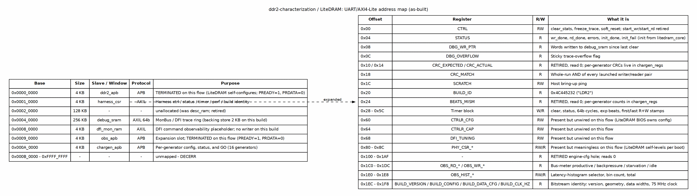

<!-- RTL Design Sherpa Documentation Header -->
<table>
<tr>
<td width="80">
  
</td>
<td>
  <strong>RTL Design Sherpa</strong> · <em>Learning Hardware Design Through Practice</em> 
  
    <a href="https://github.com/sean-galloway/RTLDesignSherpa">GitHub</a> ·
    <a href="https://github.com/sean-galloway/RTLDesignSherpa/blob/main/docs/DOCUMENTATION_INDEX.md">Documentation Index</a> ·
    <a href="https://github.com/sean-galloway/RTLDesignSherpa/blob/main/LICENSE">MIT License</a>
  
</td>
</tr>
</table>

---

<!-- End Header -->

# Address Map

The LiteDRAM flow (`ddr2-characterization/flows-litedram-uart/`) uses the *same*
generated `bridge_ddr2_char_axil` and the same `char_engine_harness` as the pumice
build, so the host address space is identical at the top level. What changes is
what sits behind three of the windows: the pumice controller CSR window is
terminated, the controller-tuning registers in `harness_csr` are present but
unwired, and the `BUILD_ID` reads `LDR2` instead of `DDR2`.

### Figure 5.1: LiteDRAM UART/AXI4-Lite address map

**Source:** [02_address_map.dot](../assets/graphviz/02_address_map.dot)

## Bridge slave windows

| Slave | Base | Size | Protocol | Purpose |
|---|---:|---:|---|---|
| `ddr2_apb` | `0x0000_0000` | 4 KB | APB | **Terminated** on this flow (LiteDRAM self-configures; PREADY=1, PRDATA=0) |
| `harness_csr` | `0x0001_0000` | 4 KB | AXIL | Harness control / status / timer / perf / build identity |
| *unallocated* | `0x0002_0000` | 128 KB | - | Former `desc_ram` slot; retired |
| `debug_sram` | `0x0004_0000` | 256 KB | AXIL 64b | MonBus / DFI trace ring (backing store 2 KB on this build) |
| `dfi_mon_ram` | `0x0008_0000` | 4 KB | AXIL | DFI command observability placeholder; no writer on this build |
| `obs_apb` | `0x0009_0000` | 4 KB | APB | Expansion slot; **terminated** on this flow |
| `chargen_apb` | `0x000A_0000` | 4 KB | APB | `chargen_regs`: per-generator config, status, and `GO` |

: Table 5.3: Bridge address decode for the LiteDRAM flow

## harness_csr register map

All offsets are relative to `0x0001_0000`. The same `harness_csr.sv` module is
used; fields that are physically present but do not affect LiteDRAM are marked
below.

| Offset | Register | R/W | What it does |
|---:|---|:---:|---|
| `0x00` | `CTRL` | RW | `clear_stats`, `freeze_trace` (latch), `soft_reset`; start bits retired |
| `0x04` | `STATUS` | R | `wr_done`, `rd_done`, errors, `init_done`/`init_fail` from `litedram_core` |
| `0x08` | `DBG_WR_PTR` | R | Words written to `debug_sram` since last clear |
| `0x0C` | `DBG_OVERFLOW` | R | Sticky trace-overflow flag |
| `0x10` / `0x14` | `CRC_EXPECTED` / `CRC_ACTUAL` | R | **Retired** — read 0; per-generator CRCs in `chargen_regs` |
| `0x18` | `CRC_MATCH` | R | Whole-run AND of every launched writer/reader pair |
| `0x1C` | `SCRATCH` | RW | Host bring-up ping |
| `0x20` | `BUILD_ID` | R | `0x4C445232` (ASCII `LDR2`) |
| `0x24` | `BEATS_MISM` | R | **Retired** — read 0; per-generator counts in `chargen_regs` |
| `0x28`–`0x5C` | Timer block | W/R | clear, status, 64b cycles, exp beats, first/last R+W stamps |
| `0x60` | `CTRLR_CFG` | RW | Present but **unwired** on this flow (LiteDRAM BIOS owns configuration) |
| `0x64` | `CTRLR_CAP` | RW | Present but **unwired** on this flow |
| `0x68` | `DFI_TUNING` | RW | Present but **unwired** on this flow |
| `0x80`–`0x8C` | `PHY_CSR_*` | RW/R | Present but **meaningless**; LiteDRAM self-levels per boot |
| `0x100`–`0x1AF` | — | R | **Retired** engine-config hole; reads 0 |
| `0x1C0`–`0x1DC` | `OBS_RD_*` / `OBS_WR_*` | R | Bus-meter buckets: productive, backpressure, starvation, idle |
| `0x1E0`–`0x1E8` | `OBS_HIST_*` | RW/R | Latency-histogram selector, bin count, total |
| `0x1EC`–`0x1F8` | Build identity | R | `BUILD_VERSION`, `BUILD_CONFIG`, `BUILD_DATA_CFG`, `BUILD_CLK_HZ` |

: Table 5.4: harness_csr register offsets for the LiteDRAM flow

## As-built vs. not used

- `harness_csr`, `chargen_apb`, and the engine/timer/perf path are fully live.
- `ddr2_apb` is **terminated** inside `char_engine_harness` so a host script that
  still tries to write pumice controller registers completes harmlessly.
- `CTRLR_CFG`, `CTRLR_CAP`, `DFI_TUNING`, and `PHY_CSR_*` are physical registers
  that read back what was written, but nothing consumes them on this flow.
- `debug_sram` is a live AXIL SRAM with the same 2 KB backing-store limitation as
  the pumice build.
- `dfi_mon_ram` has no writer on this build.
- `BUILD_CLK_HZ` reports `75_000_000` because `char_engine_harness` runs on the
  LiteDRAM `user_clk`.

## Differences from the pumice build

The pumice address map is documented in the `pumice_fpga_system` book
(`docs/pumice_fpga_system/ch02_harness/02_address_map.md`). The only meaningful
differences here are behind `ddr2_apb` and in the controller-tuning fields of
`harness_csr`; the generator, timer, and performance register surfaces are the
same, which is what makes the A/B comparison valid.
