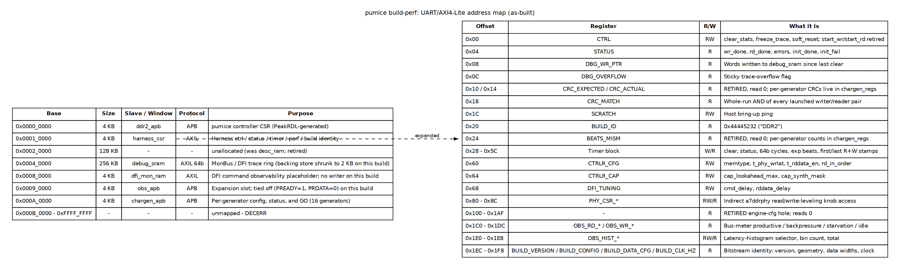

<!-- RTL Design Sherpa Documentation Header -->
<table>
<tr>
<td width="80">
  
</td>
<td>
  <strong>RTL Design Sherpa</strong> · <em>Learning Hardware Design Through Practice</em> 
  
    <a href="https://github.com/sean-galloway/RTLDesignSherpa">GitHub</a> ·
    <a href="https://github.com/sean-galloway/RTLDesignSherpa/blob/main/docs/DOCUMENTATION_INDEX.md">Documentation Index</a> ·
    <a href="https://github.com/sean-galloway/RTLDesignSherpa/blob/main/LICENSE">MIT License</a>
  
</td>
</tr>
</table>

---

<!-- End Header -->

# Address Map

The host sees one 32-bit address space. The UART bridge (`uart_axil_bridge`)
turns the ASCII command stream into AXI4-Lite transactions, and the generated
`bridge_ddr2_char_axil` decodes that master into the six slave windows below.
Every base and size comes from the bridge TOML; every harness_csr offset comes
from `harness_csr.sv`.

### Figure 2.2: pumice build-perf UART/AXI4-Lite address map

**Source:** [05_address_map.dot](../assets/graphviz/05_address_map.dot)

## Bridge slave windows

| Slave | Base | Size | Protocol | Purpose |
|---|---:|---:|---|---|
| `ddr2_apb` | `0x0000_0000` | 4 KB | APB | pumice controller CSR (PeakRDL-generated) |
| `harness_csr` | `0x0001_0000` | 4 KB | AXIL | Harness control / status / timer / perf / build identity |
| *unallocated* | `0x0002_0000` | 128 KB | - | Former `desc_ram` slot; retired |
| `debug_sram` | `0x0004_0000` | 256 KB | AXIL 64b | MonBus / DFI trace ring (backing store shrunk to 2 KB on this build) |
| `dfi_mon_ram` | `0x0008_0000` | 4 KB | AXIL | DFI command observability placeholder; no writer on this build |
| `obs_apb` | `0x0009_0000` | 4 KB | APB | Expansion slot for `axi4_intf_master_observer`; tied off on this build |
| `chargen_apb` | `0x000A_0000` | 4 KB | APB | `chargen_regs`: per-generator config, status, and `GO` |

: Table 2.4: Bridge address decode for the pumice build

The 256 KB `debug_sram` window intentionally occupies `0x4_0000..0x7_FFFF`, so
`dfi_mon_ram` sits at `0x8_0000` rather than `0x5_0000` to avoid overlap.

## harness_csr register map

All offsets are relative to `HARNESS_CSR_BASE` (`0x0001_0000`). The host accesses
these by name through the PeakRDL-generated regmap; offsets are shown here only
for debug.

| Offset | Register | R/W | What it does |
|---:|---|:---:|---|
| `0x00` | `CTRL` | RW | `clear_stats`, `freeze_trace` (latch), `soft_reset`; bits 0/1 (`start_wr`/`start_rd`) are retired |
| `0x04` | `STATUS` | R | `wr_done`, `rd_done`, `wr_error`, `rd_error`, `any_error`, `dbg_clear_busy`, `init_done`, `init_fail` |
| `0x08` | `DBG_WR_PTR` | R | Words written to `debug_sram` since last clear |
| `0x0C` | `DBG_OVERFLOW` | R | Sticky trace-overflow flag |
| `0x10` / `0x14` | `CRC_EXPECTED` / `CRC_ACTUAL` | R | **Retired** — read 0; per-generator CRCs live in `chargen_regs` |
| `0x18` | `CRC_MATCH` | R | Whole-run AND of every launched writer/reader pair |
| `0x1C` | `SCRATCH` | RW | Host bring-up ping |
| `0x20` | `BUILD_ID` | R | `0x44445232` (ASCII `DDR2`) |
| `0x24` | `BEATS_MISM` | R | **Retired** — read 0; per-generator counts live in `chargen_regs` |
| `0x28` | `TIMER_CTRL` | W | Clear-pulse for timer |
| `0x2C` | `TIMER_STATUS` | R | `done`, `running`, `pass` |
| `0x30` / `0x34` | `TIMER_CYCLES_LO` / `HI` | R | 64-bit cycle counter |
| `0x38` | `TIMER_EXP_BEATS` | RW | Beat-count stop trigger (0 = disable) |
| `0x3C` | `RESP_DELAY` | RW | Present but **unwired** on this build |
| `0x40`–`0x5C` | `TIMER_R/W_FIRST/LAST_LO/HI` | R | First/last R and W beat timestamps |
| `0x60` | `CTRLR_CFG` | RW | `memtype`, `t_phy_wrlat`, `t_rddata_en`, `rd_in_order` |
| `0x64` | `CTRLR_CAP` | RW | `cap_lookahead_max`, `cap_synth_mask` |
| `0x68` | `DFI_TUNING` | RW | `cmd_delay`, `rddata_delay` |
| `0x80`–`0x8C` | `PHY_CSR_*` | RW/R | Indirect access to the a7ddrphy leveling knobs |
| `0x100`–`0x1AF` | — | R | **Retired** engine-config hole; reads 0 |
| `0x1C0`–`0x1DC` | `OBS_RD_*` / `OBS_WR_*` | R | Bus-meter buckets: productive, backpressure, starvation, idle |
| `0x1E0`–`0x1E8` | `OBS_HIST_*` | RW/R | Latency-histogram selector, bin count, total |
| `0x1EC` | `BUILD_VERSION` | R | Functional build number |
| `0x1F0` | `BUILD_CONFIG` | R | `dfi_rate`, `gear_ratio`, `dram_bl`, `row_width`, `bank_width` |
| `0x1F4` | `BUILD_DATA_CFG` | R | `axi_data_width`, `dram_beat_width`, `dram_device_width` |
| `0x1F8` | `BUILD_CLK_HZ` | R | Sys/AXI clock this bitstream was compiled for |

: Table 2.5: harness_csr register offsets for the pumice build

## What is as-built vs. not used

- The bridge and `harness_csr` are fully live.
- `ddr2_apb` is live and reaches the pumice controller CSR.
- `obs_apb` is **as-built but tied off** (PREADY=1, PRDATA=0, PSLVERR=0). A stray
  access will complete instead of hanging the bus, but it does nothing.
- `debug_sram` is a live AXIL SRAM, but the trace-ring writer is disabled and
  the backing store is `DEBUG_SRAM_WORDS=512` (2 KB). Accesses above 2 KB alias
  into the ring.
- `dfi_mon_ram` is a live AXIL SRAM with **no writer** on this build.
- The `0x100`–`0x1AF` region in `harness_csr` is intentionally retired; reads
  return 0 so an old host that expects the single-engine config fails visibly.

## See also

- `build-perf/host/ADDRESS_MAP.md` — the same map in text form.
- Chapter 2 harness block diagram ([Figure 2.1](01_harness.md)) — the UART path
  and the blocks behind each window.
