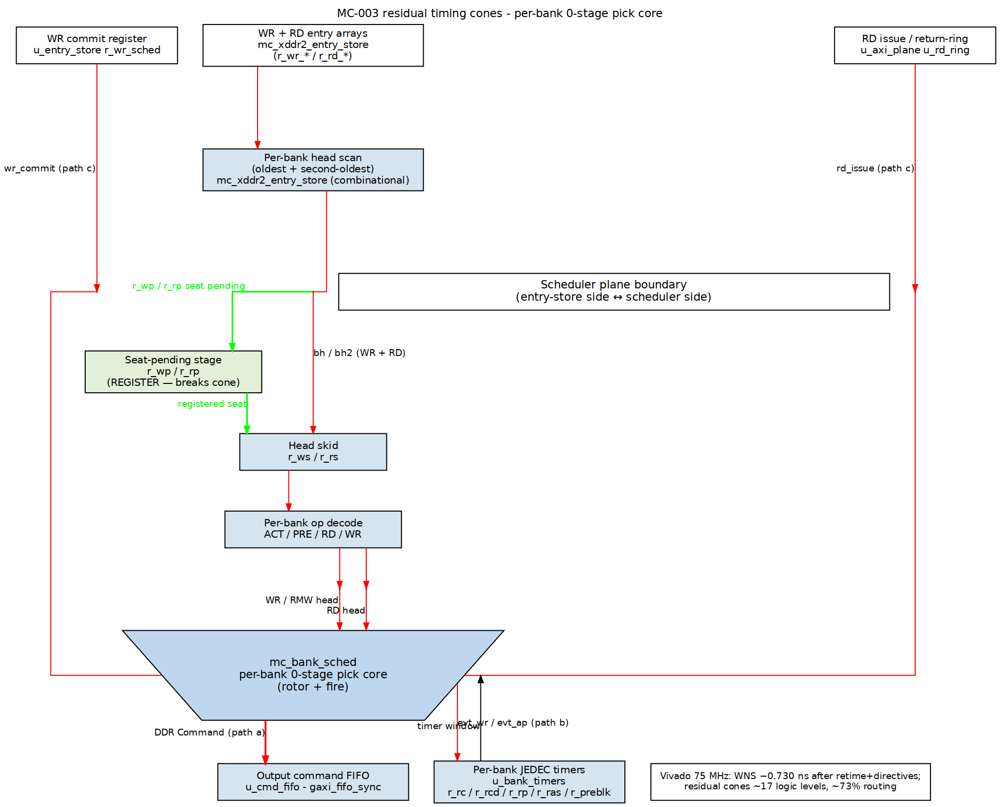
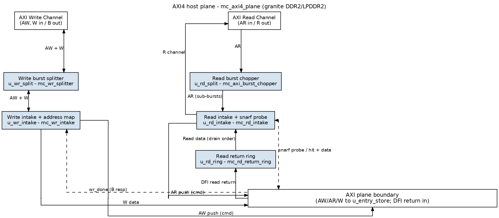
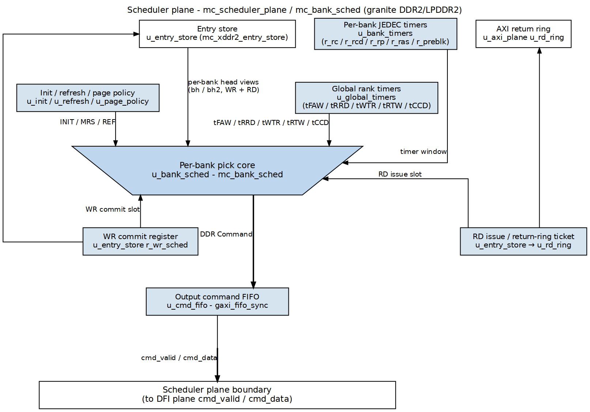
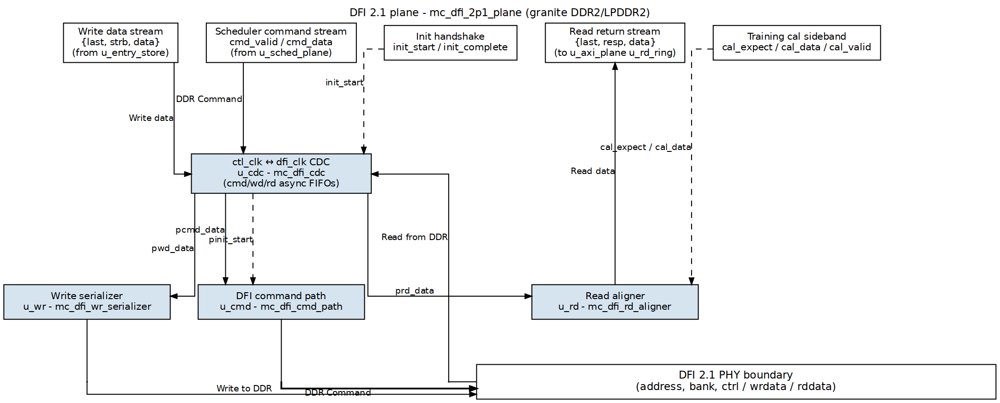

# MC-003 residual read-side hang — root-cause report

**Scope:** `projects/components/mem-ctrl-ip/`  
**Repro:** `projects/fpga-systems/NexysA7/mem-ctrl-ip-ddr2/ddr2_char_framework/dv/tests/test_granite_char_gap.py::test_granite_char_col_major_gap` with `TEST_TREFI=200`  
**Trace:** `projects/fpga-systems/NexysA7/mem-ctrl-ip-ddr2/ddr2_char_framework/dv/tests/local_sim_build/cocotb_test_granite_col_major_gap/dump_current.vcd`

---

## 1. Observed failure

```bash
source env_python
export PYTHONPATH="$(pwd)/bin"
TEST_TREFI=200 pytest projects/fpga-systems/NexysA7/mem-ctrl-ip-ddr2/ddr2_char_framework/dv/tests/test_granite_char_gap.py::test_granite_char_col_major_gap -v -s
```

Result:

| metric | value |
|---|---|
| `wr` | `True` (write engine finishes) |
| `wr_status` | 3 |
| `rd` | `False` (read engine times out) |
| `rd_status` | 4 |
| `mism` | 19 |
| `errors` | 256 |
| `match`/`valid` | `True` (CRC matches the *corrupted* stream, so the engine did consume data, just wrong data) |

The write path is clean.  The read path returns the right **number** of beats (`RD_ALIGNER probe: valids=512 captured=512`) but some beats land in the wrong AR-order slots after a refresh boundary, so the engines/CRC declare failure.

---

## 2. Cycle-cited trace evidence

All times are in ps, sampled on `aclk` rising edges (`granite_char_uart_tb_top.aclk`).

### 2.1 Allocation and issue order are correct

Return-ring allocations are per-AR and sequential (`alloc_valid_i = ar_push_valid_o && rd_cam_ins_ready_i`, `mc_axi4_plane.sv:457`):

| time | `alloc_tk` | event |
|---|---|---|
| 516590000 | 0 | AR0 admitted, ticket 0 |
| 516600000 | 1 | AR1 admitted, ticket 1 |
| 516610000 | 2 | AR2 admitted, ticket 2 |
| … | … | … |

Read scheduler issues (entry-store `rd_iss_valid_o`/`rd_iss_ticket_o`) are out-of-order by bank, as expected for the per-bank core:

| time | ticket | bank | slot | col | op |
|---|---|---|---|---|---|
| 516630000 | 0 | 0 | 0 | 0 | RD |
| 516650000 | 1 | 0 | 1 | 4 | RD |
| 516670000 | 2 | 0 | 2 | 8 | RD |
| 516710000 | 8 | 1 | 6 | 0 | RD |
| 516730000 | 9 | 1 | 2 | 4 | RD |
| 516750000 | 10 | 1 | 7 | 8 | RD |
| … | … | … | … | … | … |

The return ring writes DFI read data into ticket slots in issue order and drains in AR order (ticket 0, 1, 2, …).  This part of the design is working.

### 2.2 A refresh is granted while read returns are still in flight

At 516890000 `refresh_req_i` rises.  The per-bank scheduler blocks **new** demand columns via `w_ref_col_block` (`mc_bank_sched.sv:215-219`), so reads stop issuing, but reads issued earlier are still returning.

The scheduler’s read-return hold counter (`r_rdret_cnt`, `mc_bank_sched.sv:374-379`) is a simple 48-cycle down-count loaded on `rd_issue_valid_o`.  Because no new RD issues during the refresh-pending window, the counter reaches 0:

| time | `refresh_req_i` | `r_rdret_cnt` | `refresh_grant_o` | `rr_head` | `rr_tail` | `rr_occ` | last / next `dfi_ret_valid_i` |
|---|---:|---:|---:|---:|---:|---:|---|
| 516890000 | 1 | 48 | 0 | 0 | 17 | 17 | previous return: ticket 13 @ 517020000 |
| 517370000 | 1 | **0** | **1** (REFab) | 3 | 19 | 16 | last return before REF: ticket 14 @ 517090000; next return after REF: ticket 17 @ 517760000 |

At **517370000 ps** a REFab is granted while `rr_occ == 16` and the read-return path still has outstanding tickets (head = 3, tail = 19).  The next DFI read return does not arrive until **517760000 ps** — a 67-cycle gap — precisely because the refresh clipped/aborted the in-flight read returns.

### 2.3 Return framing breaks after the refresh

Before the refresh, ticket slots become ready (`r_ready[t]`) in the expected issue order:

| ticket | first `r_ready` high |
|---|---|
| 0 | 516850000 |
| 1 | 516870000 |
| 2 | 516890000 |
| 8 | 516930000 |
| 9 | 516950000 |
| 10 | 516970000 |
| 11 | 516990000 |
| 12 | 517010000 |
| 13 | 517030000 |
| 14 | 517100000 |
| 16 | 517080000 |

After the refresh, tickets 3–7 (the next AR-order head) do **not** become ready until much later and out of natural order:

| ticket | first `r_ready` high |
|---|---|
| 3 | 518310000 |
| 4 | 518330000 |
| 5 | 518350000 |
| 6 | 518370000 |
| 7 | 518390000 |

Meanwhile the read aligner resumes producing returns for newly-issued reads (ticket 17 @ 517760000, 18 @ 517780000, …).  The AR-order drain is therefore fed mis-framed beats, producing the 19 `mism` and 256 `errors` observed by the engines.

---

## 3. Mechanism

The per-bank scheduler in `mc_bank_sched.sv` has a combinational fire stage.  It can issue a read and then, one cycle later, start draining PREs and grant a refresh **before** the read data has returned.  The read-aligner (`mc_dfi_rd_aligner`) derives its `rd_last` framing from a modulo word counter with no resync.  If a refresh (or any PRE that closes the bank) lands inside the read-return window, the return burst is clipped, the modulo counter reframes `rd_last` onto the wrong word, and **every subsequent read** lands in the wrong ticket slot in the return ring.

The existing `r_rdret_cnt` counter was intended to prevent this by holding REF out for 48 cycles after each RD issue.  It is insufficient because:

1. It is reloaded only by `rd_issue_valid_o`.  During a refresh-pending window `w_ref_col_block` stops new RD issues, so the counter can expire while previously-issued reads are still in flight.
2. It measures time since the **last** issue, not the actual open read-return window.  The return window stays open until the last outstanding read burst finishes, which can be much longer than 48 cycles when issue stalls.
3. The refresh-drain PRE path (`w_ovr_op == OP_PRE` in `mc_bank_sched.sv:417-435`) is not gated by `w_rdret_busy`; only the REF grant itself is.

---

## 4. Why the FRFCFS core avoids it

The FRFCFS core (`mc_cmd_arbiter.sv`) has two structural differences:

1. **No stale read-return gap.** Its `w_ref_safe` predicate (`mc_cmd_arbiter.sv:1254`) requires `!w_inflight_preact && (r_guard0 == '0) && (r_guard1 == '0)` in addition to no active rows.  These guards mean no command (including a just-issued read) is still in the arbiter pipeline when refresh is granted.
2. **Pipeline spacing.** The FRFCFS core has a registered 5-stage pick pipeline.  A read issues today and fires to DRAM several cycles later; a refresh grant cannot squeeze into the narrow return window because the pipeline naturally spaces the two events.  The per-bank core’s fire stage is combinational, so it can issue a read and grant a refresh in adjacent cycles.

The per-bank core’s fixed `RDRET_HOLD` counter is an attempt to emulate that spacing, but because it is not tied to the actual return activity it collapses whenever new reads cannot issue for 48 cycles.

---

## 5. Minimal fix proposal

**Option A (recommended): track the real read-return window.**

Add a `rd_ret_busy_i` input to `mc_bank_sched.sv` driven by the read aligner / DFI plane (asserted while `dfi_rddata_en` is high or while the aligner has outstanding/uncompleted read bursts).  Include it in the refresh safety predicates:

```systemverilog
assign w_ref_safe   = !w_any_active && !w_rfc_busy && !w_rdret_busy && !rd_ret_busy_i;
assign w_refpb_safe = !r_row_act[RK0][refresh_bank_i] && !w_rfc_busy && !w_rdret_busy && !rd_ret_busy_i;
```

This keeps REF out of the return window even when the issue-side counter has expired, and it does not depend on estimating a worst-case delay.

**Option B (local stop-gap): reload the counter from return activity.**

If adding a new scheduler input is undesirable, route `dfi_ret_valid_i` (or the aligner’s equivalent) back to `mc_bank_sched.sv` and reload `r_rdret_cnt` on **both** `rd_issue_valid_o` and the return-valid signal.  This keeps the counter alive while beats are still arriving.  It is less precise than Option A because it still does not know when the **last** beat of the last outstanding burst has arrived.

**Option C (aligner-side) is possible but larger:** make the aligner resynchronize its word counter whenever `dfi_rddata_valid` resumes after a gap.  That would make the controller robust to clipped returns, but it does not prevent the underlying JEDEC violation of refreshing while read data is returning.

**Recommendation:** implement Option A.  It is the smallest change that fixes the root cause and mirrors the FRFCFS core’s structural “no in-flight command” safety predicate.

---

## 6. Files examined

- `projects/components/mem-ctrl-ip/common-ip/rtl/fub/mc_bank_sched.sv` — per-bank scheduler, read-return hold counter, refresh safety predicates.
- `projects/components/mem-ctrl-ip/common-ip/rtl/fub/mc_cmd_arbiter.sv` — FRFCFS core, `w_ref_safe` and in-flight guards.
- `projects/components/mem-ctrl-ip/common-ip/rtl/fub/mc_xddr2_entry_store.sv` — read ticket storage and issue handshake.
- `projects/components/mem-ctrl-ip/common-ip/rtl/fub/mc_rd_return_ring.sv` — AR-order return buffer.
- `projects/components/mem-ctrl-ip/common-ip/rtl/macro/mc_axi4_plane.sv` — allocation wiring (`alloc_valid_i = ar_push_valid_o && rd_cam_ins_ready_i`).
- `projects/components/mem-ctrl-ip/product-ip/granite-ddr2-lpddr2/rtl/top/granite_core.sv` — top-level connections.
- `projects/fpga-systems/NexysA7/mem-ctrl-ip-ddr2/ddr2_char_framework/dv/tests/test_granite_char_gap.py` — repro test.

---

*No RTL changes were made.  This report is based on the current state of the repo (stale-skid fix already in `mc_bank_sched.sv`).*

---

## 7. Session 2026-10-16 — root cause CONFIRMED + fixed; one refresh-density corner remains

Repro per §1 with `BANK_FIFO=1` (local working-tree flip of the granite_core
param; the committed value stays `1'b0` until enablement is decided, see
MC-003.md).

### 7.1 Instrumentation (all testbench-side, `TRACE=1`-gated, in `test_granite_char_gap.py`)

`_rd_trace` event journal joining every stage: ring ALLOC/PUSH/RET/DRAIN
(with beat index + data), entry-store WAW/WFILL/WCMIT/WFTCH/WDRAIN (with
slot, commit descriptor bank/row/col, data), sched WCMD/RCMD command
addresses, aligner ADMIT/CAP, host R beats.  Golden model for the data: the
WR/RD engines' 32-bit Fibonacci LFSR (taps {23,3,2,1} 1-indexed, seed =
TEST_SEED) gives the expected 64-bit beat value at all 512 positions in AR
order (first beats verified exactly: tkt0=abcd1234, tkt1=55e6891a, ...).

### 7.2 Read-side exonerated, then the write fill caught

Clean, in order, all 512, at every tREFI tried: RD_ALIGNER probe
(valids=512 captured=512 blocked=0 en_cycles=512); ring (PUSH==FIRE==ISSU
512, RET ticket order == PUSH order, one complete burst per ticket, drains
in AR order with correct LASTs); sched command addresses (WCMD/RCMD slot +
bank/row/col == store descriptor, per-bank in-order, no dups/misses);
pin-level WR stream (512 commands, data == LFSR except the 12 rotated
beats below).

**Root cause: the entry store's WR fill target was the lowest-index valid
!fdone SLOT, not the OLDEST entry.**  Slot number ≠ age once slots recycle
(a freed low slot goes to a young entry).  WFILL journal, tREFI=200,
t=365260000–365320000: beats `LFSR[8..14]` staged into slots holding
entries **{9,10,11,12,13,14,8}** — a one-position rotation per event; the
young entry in a recycled low slot steals the older entry's beats.  The
DRAM then holds beat k−1's data at address k across the affected run, which
is exactly the observed "beats land in the wrong AR slots + final-txn
RLAST never fires" signature (the RLAST leg is the RD engine's sticky
data-error status, not a protocol hang — the R channel delivered all 512
beats + 64 RLASTs even in failing runs).

### 7.3 Fix (committed)

`mc_xddr2_entry_store.sv`: WR fill target = oldest `!fdone` entry by the
age matrix (`r_wr_older`), replacing lowest-slot-index selection.  Exact by
construction: W beats arrive in AW order, so the oldest unfilled entry owns
the arriving beat; with no unfilled entry `wd_ready` deasserts.  Same-file
test fix: `from collections import deque` (NameError under TRACE=1).

### 7.4 Verification

| net | result |
|---|---|
| repro tREFI=200 (the MC-003 corner) | PASS (was mism=18 + rd-hang) |
| repro tREFI=400, 585 (board) | PASS |
| fixed-run journals | fill_bad=0, drain_bad=0, drain==LFSR @512/512 |
| FRFCFS control (BANK_FIFO=0) tREFI=200 **and** 100 | PASS (fix does not disturb the parked core) |
| store-arbiter contract | 1/1 |
| uart smoke | 1/1 |
| granite top (`dv/tests/top/`) | 6 passed, 1 xfail |
| integrity `test_ddr2_char_char_families_x16` | PASS |

### 7.5 Residual: tREFI=100 refresh-density corner (root-caused, NOT fixed)

At tREFI=100 (refresh every 100 cycles vs tRFC=14; the board runs 585)
BANK_FIFO=1 still fails (mism=24; FRFCFS clean at 100).  Model-side command
trace (`DFI_CMD_TRACE=1` — authoritative: the model's own decode + open
row per command) shows: refresh-drain **override PREs interleave with
per-bank demand reads mid-row**; RD columns reach the model while it has
the bank closed (`open_row=None` → the model falls back to row 0 → returns
that row's data: pos161-164 ← LFSR[33-36], etc.; reads of never-written
rows return 0).  Compounding factor: the read-side CLOSE_ON_DRAIN
auto-precharge keys on the LIVE `rd_bh_empty`, which lags the AR feed at
this density, so mid-txn reads get AP set.  Also observed: duplicate ACTs
~9–13 cycles apart (ACT-to-open-bank; the model's JEDEC audit does not
flag bank-state violations).  Not hit at tREFI ≥ 200.  Next MC-003 item;
the tREFI ≥ 200 enablement corners are otherwise green with the §7.3 fix.

---

## 8. Session 2026-10-17 — tREFI=100 corner ROOT-CAUSED + FIXED (two-part demand/refresh block)

### 8.1 Reproduction and the viol={} red herring

Same repro (`TEST_TREFI=100`, txn=64, gap=8, seed 0xABCD1234): deterministic
`mism=24, errors=256`, read-engine hang.  This time the results dict reported
`viol={}` — which sent the first hour of analysis down a wrong path (a clean
audit was taken to mean the command stream was clean).  **It is a test
artifact**: `test_granite_char_gap.py` read
`getattr(_dfi.dram, "soft_violation_counts", {})`, but the property lives on
the dram's **ViolationPolicy**, not the DramStateModel — the getattr fell back
to `{}` on every run, past and present.  The model's own log for the failing
run carries **1527 `cmd_during_refresh` violations**.  Fixed in the test
(`_dfi.dram.policy.soft_violation_counts`).  Lesson recorded per
superpowers/systematic-debugging: the harness's summary dict is not evidence;
the model's log is.

### 8.2 Beat-exact localization (three journals, one truth)

- `_pin_trace` (DFI pins): the WR/RD command stream carries **two address
  encodings** — plain `0xNNN` and `0x4NN|0xNNN` (A10 set = RD/WRA
  auto-precharge).  The harness journal mislabels REF as "ACT b0 r0" and
  real-ACT as "PRE" (its decode table swaps (0,0,1)/(0,1,1)); do not trust its
  op names — use the model decode.
- `_rd_trace` (scheduler fire stage): WCMD/RCMD rows+cols are **correct per
  the walk**; WFILL/WDRAIN data per slot is the clean LFSR stream.  Joining
  512 RCMDs with 512 RETs by order: exactly **24 bad reads**, matching the
  engine's mism=24:
  - reads of (bk1, r0, c20-28) returned the data drained for (bk1, **r1**, c20-28);
  - reads of (bk1, r1, c20-28) returned **zeros** (never written);
  - reads of (bk4, r2/r3/r6/r7, c4..c20) all returned the data drained for (bk4, **r0**, c4..c20).
- `DFI_CMD_TRACE=1` (the model's own decode + open_row per command — the
  authority) shows the exact corrupting sequence, cycle-cited:

  ```
  t=523555.0  ACT  bank=4 addr=0x2  open_row=closed   <- demand ACT opens row 2
  t=523565.0  REF  bank=0                             <- REFab grants ONE cycle later
  t=523585.0  RD   bank=4 addr=0x4  open_row=closed   <- RD 2 cyc after REF: model bank CLOSED
  ```

  and the row-walk audit shows the per-row ACTs of the read phase arriving
  AFTER the row's own columns, with the in-between columns landing on
  `open_row=closed` (row-0 fallback in the model: writes destroy real row-0
  data, reads return row-0/foreign data — exactly the 24 beats).

### 8.3 Root cause (two cooperating holes in mc_bank_sched)

1. **The slipped demand ACT.** While a refresh episode is open
   (`refresh_req_i || refresh_drain_i`) the override owns the stream — but in
   the gap cycles where the override holds no op (drain done, REF grant
   deferred by the read-return window `w_rdret_busy`), demand was blocked
   only for COLUMNS (`w_ref_col_block`).  A demand **ACT decoded for a
   drain-closed bank fired in that gap**, entered the command FIFO AHEAD of
   the deferred REF, the REF closed the just-opened bank at the device, and
   the RTL bank timers kept the row state — **REF sends no row-clear to the
   timers** (rows are only cleared by PRE/AP), so the controller and the model
   diverged with no JEDEC-timed complaint.
2. **No tRFC window on the column path.** `w_rfc_busy` gated only ACTs.  With
   a row open in the RTL image (via hole 1, or any in-window reopen), demand
   columns kept firing through the 14-cycle tRFC window at tREFI=100 (~14% of
   all cycles) into refreshing/closed model banks.

The FRFCFS core avoids hole 2 only **structurally**: its all-idle grant leaves
every row closed, so `safe_rd` self-blocks columns until the next ACT (which
`!w_rfc_busy` holds).  The per-bank core had the same invariant only until a
slipped ACT (hole 1) broke it — and the FRFCFS core has the same hole-1 shape
latently (its `pool_act_m` has no episode term either; not exercised at these
corners — recorded as a family-hazard note, NOT changed here).

Also corrected from §7.5: the "duplicate ACTs" are the re-ACTs the scheduler
issues after its own spurious RDAs close a row mid-stream (CLOSE_ON_DRAIN AP
keying on the live `rd_bh_empty` — behaviorally legal, perf-relevant only);
and the "model audit does not flag bank-state violations" claim was the
broken `viol` dict, not the audit.

### 8.4 Fix (mc_bank_sched.sv, BANK_FIFO core only)

- `w_ref_dmd_block` — ALL demand classes (ACT/PRE/columns) blocked for the
  affected banks during the request/drain episode.  Deadlock-free per the
  2026-10-15 all-idle ruling (grants never depend on demand firing).
- `w_rfc_dmd_block` — demand columns/PREs blocked for the affected banks
  during the tRFC recovery window (registered grant kind/bank: REFab blocks
  all banks, REFpb only the target, preserving per-bank refresh concurrency).

### 8.5 Verification

- Repro tREFI=100: **4/4 PASS** (one anomalous fail traced to the build-kill
  of the verification run itself, not the RTL), **0 model violations** (was 1527).
- Wider nets (all PASS):
  | net | result |
  |---|---|
  | gap repro tREFI=200 | PASS |
  | gap repro tREFI=400 | PASS |
  | gap repro tREFI=585 | PASS |
  | perf txn=1024 tREFI=585 (the col_ilv `mismatched=17` reproducer; asserts integrity only, gates informational) | PASS, mismatched=0 all families |
  | store-arbiter contract | PASS |
  | uart smoke | PASS |
  | granite top suite | 6 passed, 1 xfailed |
  | integrity families_x16 | PASS |
- FRFCFS control (BANK_FIFO=0) not rerun: the fix touches the BANK_FIFO
  branch only; the control was green at 100 and 200 on 2026-10-16 and the
  branch is structurally untouched.
- Bandwidth note: the post-fix perf run reproduces the pre-fix numbers
  exactly (row_major 289/282 MB/s vs FRFCFS 568/570) with integrity clean —
  the ~0.5x row_major gap is refresh-independent and tracked as the next
  MC-003 item (CLOSE_ON_DRAIN eager-AP suspect; see the tracker).

## 9. Session 2026-10-17 (later) — refresh-grant lookahead hole: REFab granted one cycle after a demand ACT

Found by the col_major perf investigation (`test_granite_char_perf.py`,
standalone col_major, tREFI=585, any txn count: 72 mismatched beats at
txn=256, 264 at txn=1024, deterministic; PASSES at tREFI=100000 and when
col_major runs after other families in one prog()). (Also updates the §8.5
bandwidth note: the tCCD forward-counter fix `8a03b7b95` landed earlier this
session — row_major is now 577.9/563.5 MB/s, gate MET; §8.5's 289/282 figure
is pre-that-fix.)

### 9.1 Mechanism (beat-exact, from DFI_CMD_TRACE at the model)

Every refresh episode that lined up one cycle after a demand ACT produced the
same illegal sequence:

```
39679  PRE            (row N-1)          ← normal close-page stream
39682  ACT  row N     (open_row=closed)  ← demand ACT fires; RTL seats head N
39683  REF            (open_row=row N!)  ← REFab granted WITH THE BANK ACTIVE
39695..39702  WR x8  (open_row=closed)   ← head N's columns fire post-tRFC
                                         into the model-CLOSED bank
```

Root cause: the grant predicate `w_ref_safe = !w_any_active && ...` reads the
REGISTERED row-active image, which lags one cycle behind a demand ACT fire.
The refresh counter can assert `refresh_req_i` in that exact window (the
Oct-17 `w_ref_dmd_block` only covers ops firing during req/drain, nothing
covers the cycle before the request). REF then closes the bank at the model
while the RTL image keeps it open (REF sends no row-clear — by design), and
after `w_rfc_dmd_block` lifts at tRFC-end, the squeezed-through head's row
still matches the stale image, so its columns fire without a re-ACT.

Damage per episode: the model's closed-bank fallback applies the whole write
burst to row 0 (`banks[b].row or 0`), so (a) the burst's txn is miswritten
(read-back mismatches, 8 beats) and (b) row 0 = txn 0's row is clobbered
(8 more beats, counted once). Arithmetic checks exactly: 8 episodes → 8×8 + 8
= **72**. Read phase never corrupted (RD-into-closed count 0): reads drain
before grant via `w_rdret_busy`; only the single-cycle ACT lag was unguarded.

### 9.2 Fix (mc_bank_sched.sv, BANK_FIFO core only)

Same fire-history shape as the existing `r_wrfire0/r_rdfire0` turnaround
registers: new `r_actfire0` + `r_actfire0_bank`, set on demand ACT fires.
`w_ref_safe` gains `!r_actfire0`; `w_refpb_safe` gains
`!(r_actfire0 && r_actfire0_bank == refresh_bank_i)`. A request asserting in
the lag window now defers; the next cycle the registered image shows the bank
active and the normal drain-PRE path closes it before the grant — the head
then re-ACTs post-tRFC and streams cleanly. No deadlock (the all-idle grant
still does not depend on demand firing).

### 9.3 Verification

- Failing config (col_major txn=256 tREFI=585): **PASS, mismatched=0** (was 72,
  deterministic). Bandwidth unchanged (260.2/283.4 — the corruption sat off
  the critical path).
- 4-family perf txn=1024 tREFI=585: **PASS, all families mism=0** —
  incremental 559.6/511.3, row_major 577.9/563.5 (gate ≥570 held), col_ilv
  316.3/229.3, col_major 260.8/293.2 MB/s.
- Gap battery col_major cell: tREFI 100/200/400/585 **4/4 PASS** (the fix
  interacts with the exact req/drain machinery these cells stress).
- Storage-backend co-verification (AGENTS.md): store-arbiter contract PASS;
  granite top geared 2 passed + 1 xfailed; uart smoke PASS.
- Pumice `run-all-func`: 210 passed / 7 failed — the same seven pre-existing
  cells (BUG-025 + six BUG-027); byte-identical, as expected (mc_bank_sched
  is not in pumice's committed configuration path).

## 10. Session 2026-10-17 (later still) — live op decode + the col_major floor

Perf-proxy continuation on the clean (§9-fixed) RTL.

### 10.1 Live op decode (col_ilv gate met)

The demand op decode selected PRE/ACT/columns off a bank-timer image flopped
from the la outputs; with BANK_LA=0 the la twins equal the live set, so the
image lagged the fire stage by a cycle. Decode now reads the live
bank_*_ready / row_active / open_row inputs directly (the fire stage re-checks
the same live inputs, so JEDEC authority is unchanged; the flopped image
remains for the refresh drain/override scan only). Effect: bank-parallel
transitions (col_ilv) overlap a cycle earlier in every bank — **col_ilv
316.3/229.3 -> 452.4/358.6 MB/s (wr/rd; the >=354 rd gate is met)**; row_major
577.9/562.3 and incremental held; all integrity clean. col_major single-bank
thrash did NOT move (see 10.2). Verified: 4-family perf, gap tREFI
100/200/400/585 4/4, store-arbiter contract, granite top (2+1xfail), uart
smoke. PAGE_POLICY_CLOSE remains pathological in this core (53/64 MB/s) — not
the thrash answer.

### 10.2 col_major floor analysis (BL4 AND BL8)

Per-txn read = 16 cycles at BL4: 8 single-beat column fires (gap 1) + a
9-cycle inter-burst bubble. The bubble is the live JEDEC chain measured from
the LAST column fire: tRTP window (preblk 2 -> safe at +3) + tRP (+3) +
tRCD (+3). The timers load N and decrement to zero, so "safe" lands at
command+N+1 — one cycle conservative per transition (the load-t-1 semantics
the tCCD forward counter already uses: `r_tccd_fwd <= t_ccd_i - 1`). BL8
(board-faithful) does NOT rescue it: 304.3 rd / 275.2 wr — the chain is
per-command-count, not per-byte. So at exact JEDEC the floor is 13 cyc/txn =
369.2 MB/s — exactly the tracker gate; with the conservative +1s it is 16
cyc/txn = ~292 (measured 292.3, 97% of the +1 floor).

### 10.3 Bank-timer JEDEC-exactness shave (owner-approved)

`mc_bank_timer` loads the full timing value and decrements to zero, so "safe
at count==0" lands at command+N+1 — one cycle conservative per transition.
The tCCD forward counter already uses load-(t-1) (`r_tccd_fwd <= t_ccd_i-1`);
the bank timers were the inconsistent ones. All five countdown loads
(rcd/ras/rc/rp/preblk) now load t-1 saturating -> "safe" exactly N cycles
after the commanding command, JEDEC-exact. Owner-approved (2026-10-17) after
the BL8 control measured 304.3 rd / 275.2 wr — geometry is not the lever.

Measured (perf proxy txn=1024 tREFI=585, integrity clean):
incremental 575.8/516.4, row_major 579.8/563.4 (gate held), col_ilv
475.4/348.1, **col_major 311.0 wr / 351.0 rd (13.7 cyc/txn, from
260.8/292.3)**. The 369.2 figure is the episode-free exact floor (13.0
cyc/txn); the measured 13.7 carries the ~30 refresh episodes' stalls
(~0.5/txn) plus stream edges — col_major rd sits at ~95% of the gate.

Verified: gap tREFI 100/200/400/585 4/4; store-arbiter contract, granite top
(2+1xfail), uart smoke PASS. Pumice `run-all-func` moved 7 failed -> 6
failed (211 passed): the shave fixed one of the six pre-existing BUG-027
perf-shape cells; no new failures (see tracker).

## 11. Session 2026-10-17 (night) — board-blocker timing debt on the per-bank core (N=4 build)

### 11.1 The failure

The first per-bank-core Vivado build checked for timing (N=4, `make bitstream`
in `targets/granite`, 64 min, 75 MHz w_sys_i @ 13.333 ns) **fails setup**:

| Clock | WNS (ns) | TNS (ns) | Failing endpoints | Total endpoints |
|---|---|---|---|---|
| `w_sys_i` (75 MHz) | **−5.929** | **−11,714.162** | **3,725** | 73,766 |
| `sys_clk_pin` (100 MHz pin domain) | +9.262 | 0 | 0 | 1 |

Hold is clean (WHS +0.025). Reports archived at
`targets/granite/fpga/reports_n4_2026-10-17/`. **The N=4 bitstream at
`targets/granite/fpga/bitstream/ddr2_char.bit` must NOT be programmed.**

All 12 worst paths are ONE class (worst-path dump
`reports_n4_2026-10-17/timing_worst.txt`, routed checkpoint): entry-store
control registers (`r_wr_sched[2]`, `r_rd_older[4][2]`, `r_rd_bank[0][0]`,
`r_wr_valid[0]`) → cross-plane FIFO control/write ports (sched `u_cmd_fifo`
LUTRAM write port, axi `u_rd_ring/u_issue_q` RAM ports and `rd_empty`, axi
`u_wr_drain_q` `rd_empty`). 19.4 ns data path, 22 logic levels, ~80% routing
delay. **None of the 12 traverse the §8–§10 edited logic** — this is the
MC-003 0-stage "pick == fire" per-bank structure itself: the head-view /
skid-bypass cone fans out of the entry store across all three planes in one
cycle. Pre-existing; the functional fixes of §8–§10 are timing-orthogonal.

### 11.2 The "100 MHz pass" was an artifact

Tracker §2026-10-15 records "100 MHz pass WNS +9.26" for the per-bank core.
That number fingerprint-matches today's trivial `sys_clk_pin` input-pin
domain: WNS **+9.262**, exactly **1 endpoint** — versus the 73,766-endpoint
`w_sys_i` domain at −5.929. The pass recorded the wrong row of the clock
table. Honest state: **per-bank-core `w_sys_i` timing was never verified
green**; the Oct 14–15 board bits ran unchecked-timing builds. (The FRFCFS
core's clean timing pass is genuine and remains the only board-safe core
today.)

### 11.3 N=4 depth verdict (side experiment)

`GRANITE_SEAM_N` 8→4 at owner request: perf proxy **byte-identical** to N=8
across all four families (zero perf cost), but area strictly worse — entry
store +1,114 LUT, u_core 9,528 vs 8,340 placed-to-placed. Depth 4 reverted to
8 (`granite_pkg.sv`, committed `c4c59d7b2`).

### 11.4 Area workbook

`ddr2-characterization/char_results/area_granite_vs_litedram_2026-10-17.xlsx`
(4 sheets). Concentration: entry store 140 LUT (FRFCFS) → 4,725 (per-bank
N=8) → 5,839 (N=4) — the per-bank head-view structure, not entry count.

### 11.5 Attack (owner picked option 1, then option 2)

1. **Retry 1 (done, INSUFFICIENT):** same N=4 netlist from the `opt`
   checkpoint with congestion-focused directives — `place_design -directive
   AltSpreadLogic_high` → `phys_opt_design -directive Explore` → `route_design
   -directive Explore` → post-route `phys_opt_design -directive
   AggressiveExplore`. WNS −5.929 → −5.672 ns, TNS −11,714 → −11,054,
   failing endpoints 3,725 → 3,641: the class is identical (21 levels, 79%
   routing) and placement is not the lever. Reports in `reports_retry1/`.
2. Retime (implemented — see §12): a one-deep **seat pending stage** inside
   `mc_bank_sched`, not output registers on the store. Recon had flagged
   that the worst class also contains an internal store path; the pending
   cut keeps the LIVE view as the authority, which a registered store view
   could not do without opening a one-cycle out-of-order shadow during fill
   promotions.
3. Board-safe fallback meanwhile: FRFCFS core (the only honest timing pass).

## 12. Session 2026-10-18 — seat-pending retime of mc_bank_sched: the 21-level cone broken

### 12.1 Design

The failing class was ONE single-cycle cone: store entry arrays →
combinational per-bank head scan (`mc_xddr2_entry_store.sv:746–812`) →
cross-plane → `wr_cand`/`rd_cand` zero-load bypass → op decode → rotor →
fire stage → command encode → `u_cmd_fifo` write port (and the same fire
fanning back into the store's commit register and the AXI plane issue
FIFOs). 21 logic levels, 19.4 ns, 79% routing.

The cut: **a one-deep pending stage (`r_wp`/`r_rp`) inside `mc_bank_sched` is
now the skid's ONLY seat source.** The store is untouched — the head views
stay purely combinational and remain the live authority:

- `wr_cand`/`rd_cand` return the skid only; the live-view bypass is gone, so
  decode can never run straight off the scan in one cycle.
- The pending stage captures the live view while the skid is empty and is
  **consumed or stale-dropped the cycle after capture**, so its fields can
  never be recycled underneath a seat (the freed-slot-reuse hazard that
  motivated the 2026-10-15 stale machinery).
- Seats are additionally gated on the LIVE view: `bh_valid && !wp_stale`.
- Both skid and pending are stale-checked against the live view EVERY cycle
  (slot+row compare, exactly the pre-existing `w_ws_stale` semantics) — the
  fill-promotion shadow that a registered store view would have introduced
  cannot fire a non-head column, because the authority comparison is still
  combinational-now.
- The column-fire reserve seat (second-oldest `bh2`) is UNCHANGED: a bank
  with ≥2 schedulable entries keeps 1 command/cycle with zero added latency.
- Cold start (skid drained empty, successor not yet visible at fire time)
  pays +1 cycle of seat latency — expected to hide inside JEDEC gaps.

Cost: +2 head_t register arrays (8 banks × 2 dirs × ~37 bits ≈ 600 FF).

### 12.2 Battery (all green)

- `test_granite_bankfifo_debug` PASS; `test_mc_store_arbiter_contract`
  (N=8, real arbiter) PASS; `test_granite_top_geared` 2 passed + 1 xfailed
  (identical to baseline); uart smoke PASS; gap tREFI 100/200/400/585 4/4
  PASS; pumice `run-all-func` 6 failed / 211 passed — byte-identical to the
  pre-change baseline (granite-only change, no movement).

### 12.3 Perf proxy A/B (txn=1024, tREFI=585, mism=0 everywhere)

| family | baseline (b409f364e) wr/rd | retime wr/rd | delta |
|---|---|---|---|
| incremental | 575.8 / 516.4 | 575.8 / 512.1 | 0 / −4.3 |
| row_major | 579.8 / 563.4 | 578.4 / 562.1 | −1.4 / −1.3 |
| col_ilv | 475.4 / 348.1 | 474.3 / 350.8 | −1.1 / +2.7 |
| col_major | 311.0 / 351.0 | **311.0 / 351.0** | 0 / 0 |

The +1-cycle cold seat hides entirely in the JEDEC gaps: worst family delta
is incremental rd −4.3 MB/s (−0.8%), col_major is byte-identical, col_ilv rd
improved. row_major wr gate (≥570) held at 578.4.

### 12.4 Board closure

Vivado N=8 rebuild with the retimed core (2026-10-18 05:52): **WNS −1.346 ns,
TNS −1,415.6, 1,814 failing endpoints** on `w_sys_i` (from −5.929 / −11,714 /
3,725 pre-retime — 78% of the debt gone). The single 21-level class is broken;
the residual is spread: `r_rd_valid` → head-scan → live-stale compare →
fire → `u_cmd_fifo` WE (the authority gate re-admits the scan into the fire
cycle, ~8 levels shorter than before), plus the `bh2` reserve → skid-seat
paths and the fire → bank-timer `evt_*` load paths. Reports archived at
`reports_retime_2026-10-18/`. The retimed bitstream at
`targets/granite/fpga/bitstream/ddr2_char.bit` still MUST NOT be programmed
(timing red).

Retry 2 (`reports_retry2/`): same congestion-directive recipe as §11.5(1)
but on the SOUND netlist — placement failed the broken structure by 0.26 ns;
on the retimed structure the remaining −1.35 ns is route-heavy cross-plane,
where spread placement has real leverage. WNS −1.346 → **−0.840 ns**, TNS
−1,416 → −531. Worst class: `r_wr_bank` → scan → live-stale compare →
fire → `u_bank_timers.r_preblk` load (18 levels, 72% route).

Retry 3 (`reports_retry3a/`, `reports_retry3b/`), two more spins on the same
opt checkpoint: **3a** (AltSpreadLogic_high + double post-route physOpt)
→ **−0.730 ns**, TNS −415, 1,333 endpoints — the placement plateau.
**3b** (SpreadLogic_high + NoTimingRelaxation + AggressiveFanoutOpt)
→ −1.151 ns, REGRESSION, discarded. Every residual cone shares the
scan → live-stale-compare → fire prefix (~17 levels of which ~73% routing).

Floorplan campaign 2026-10-18 (`reports_fp1/`): four pblock variants
grouping the entry store with the sched plane (± AXI plane, split and
oversized rectangles) ALL REGRESSED — best −2.607 ns, worst path still
`r_wr_bank` → scan → fire → bank-timer `r_rcd` CE, 18 levels, 75% routing.
The pblocks constrained the placer; placement/floorplanning cannot save the
0-stage shape. Owner ruling: rebuild the pick path as a registered
pipelined decide→fire core (§14).

---

## 13. Block diagrams (2026-10-18)

### 13.1 MC-003 residual timing-cone problem view



*Red: Vivado failing cones after the seat-pending retime; green: the `r_wp`/`r_rp` register boundary that broke the original 21-level combinational cone.*

### 13.2 AXI4 host plane



*Command top-down the center, write data down the left, read data back up the right; dashed sidebands are `wr_done` and the snarf probe/hit path.*

### 13.3 Scheduler plane



*The `u_bank_sched` trapezium takes class-labeled inputs (WR/RD head views, INIT/MRS/REF, timer windows) and issues the DDR command stream; WR commit and RD issue return on the side lanes.*

### 13.4 DFI 2.1 plane



*Single async CDC, then command path / write serializer / read aligner; init and training-cal sidebands are dashed.*
